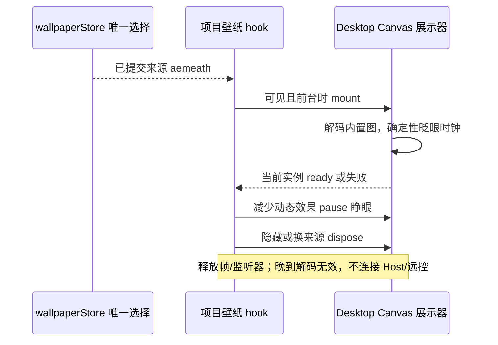
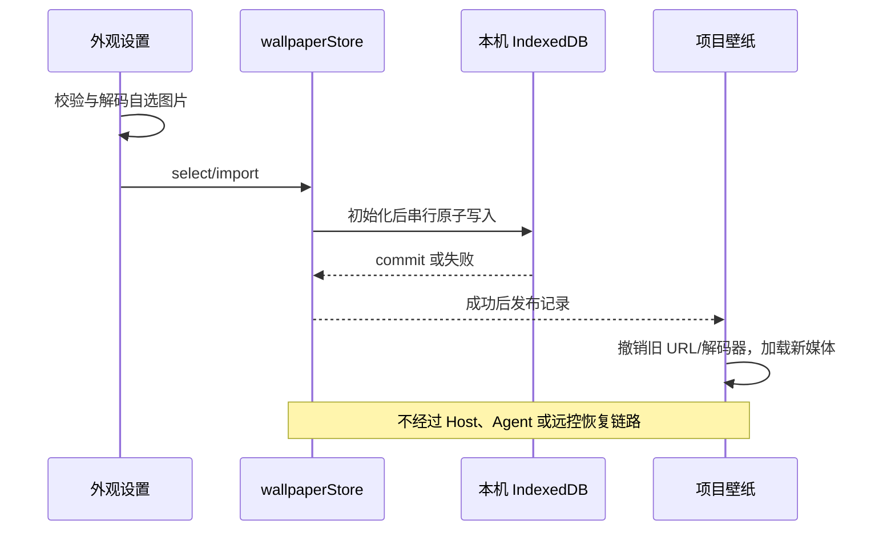

# 外观壁纸

## 产品规则

- 壁纸选择增加「爱弥斯（动态）」：内置角色原图配合双眼眨眼，不叠加启动阶段、标题或副标题，也不读取制作动画的自选背景或位置配置。仍由 wallpaperStore 唯一持久化选择，保存/重启恢复使用现有串行路径。
- 眼部以外继续绘制原图。原始像素回归允许 GPU 读回重采样在极少数像素产生 1/255 舍入，禁止更大色差或可见变化；不以跨 GPU 的逐字节一致替代实际视觉验收。
- Desktop 经 `IPlatformService.mountAemeathWallpaper` 提供局部 Canvas 展示控制器；UI hook 只负责挂载及 play/pause/dispose。与启动使用同一眨眼绘制器。项目隐藏/后台/设置页/启动期间卸载；减少动态效果暂停并绘制睁眼静帧；加载失败回主题背景，过期加载不能重新激活。Web 不实现此能力，不创建媒体或读取本机配置。

- 验收补充：四个壁纸选项均可用；爱弥斯实际像素经历睁眼、闭眼、睁眼，脸部以外像素保持一致；减少动态效果时静态、设置页无 Canvas，重载恢复选择；旧主标题归一但字号/位置保留，旧默认副标题迁移而自定义保留。

- 设置页移除「项目背景预览」及其媒体实例；只保留壁纸选择和更换图片。验证从设置切回项目后的真实背景，不再用设置页小样替代项目渲染验收。

- 开发和安装包默认提供内置壁纸，资源随仓库和安装包分发，不要求环境变量或手动导入。选项按构建生成的同一份资源清单决定可选性，自选图片与启动动画不互相限制。
- 壁纸叠加一次主题遮罩；项目结构背景透出同一壁纸，不再逐层叠加 82% 等不透明背景，避免实际工作台中几乎看不见壁纸。只影响壁纸启用的项目壳，卡片、输入和 Portal 保持既有主题。

- Windows、macOS、Linux 的「设置 → 外观 → 壁纸」提供关闭（默认）、白璃动态、爱弥斯动态、自选图片；与开机动画独立，改变后立即生效，重启保留。
- 删除龙娘壁纸的选项、静帧捕获及素材。白璃使用无文字的 wallpaper.mp4，静音循环，不使用 startup/handoff 作为工作循环。读取到已删除或未知来源时，wallpaperStore 投影为关闭并保留有效自选图片；下一次正常选择沿原串行写入路径持久化，不增加迁移写入路径。
- 自选 PNG/JPEG/WebP/AVIF，最大 10 MiB、4000 万像素；先校验格式和实际解码，再原子保存。无效/超限/存储失败保持原壁纸并显示错误。关闭保留已导入图片，方便再次选择；更换图片覆盖旧 Blob。
- 仅桌面启用；Web/手机远控不读壁纸存储、不请求视频、不增加恢复等待。桌面远端项目使用本机壁纸，图片不进入 AppSettings/RPC/relay/服务端文件。
- 壁纸在项目壳背后，object-fit:cover、pointer-events:none、不可聚焦；结构背景适度透出，输入/卡片/菜单/对话框保持主题不透明，深浅主题文字仍清晰。不修改原生窗口透明度。
- 白璃仅项目壳可见、页面前台且启动动画退场后播放；后台、设置页、隐藏项目、减少动态效果时暂停。减少动态效果保留静态画面。加载失败恢复主题背景，不影响项目交互；更换/卸载释放视频、Blob URL 和监听器。
- 普通生产构建默认携带完整内置素材与来源声明；缺资源或校验失败时拒绝构建或打包。运行时媒体解码失败仍回到主题背景。

## 所有者与接口

| 状态                    | 唯一所有者                              | 接口                                                                 |
| ----------------------- | --------------------------------------- | -------------------------------------------------------------------- |
| 本机壁纸选择及图片 Blob | UI wallpaperStore + 单条 IndexedDB 记录 | useWallpaper hook 读取/选择/导入                                     |
| 保存顺序                | wallpaperStore 串行命令路径             | 初始化先于写入，解码进入串行 admission，成功才发布；失败不替换当前值 |
| 内置素材 URL            | Desktop 平台适配器                      | IPlatformService.getBuiltinWallpaperUrl(id)，Web 不实现              |
| 对象 URL、播放/暂停     | 当前壁纸展示 hook                       | 按 record/可见性创建，过期结果丢弃，卸载释放                         |
| 动画模式/预设           | 既有 SettingService                     | 与壁纸无双写、无自动联动                                             |

## 验收

1. 启动动画提供原始、白璃、爱弥斯、自定义、关闭；壁纸提供关闭、白璃动态、爱弥斯动态、自选图片，保存刷新后还原。自定义启动模板仍与壁纸分别设置；旧龙娘选择回到原始/关闭，保留其它偏好与有效图片。
2. 自选图片实际解码与重启恢复；损坏、错误类型、超限和存储失败保留旧图；并发初始化/选择无旧结果覆盖。
3. 白璃真实视频解码、静音/循环、后台暂停；关闭清理媒体；减少动态效果暂停；选择器无已删除选项，无静帧捕获解码器。
4. 深浅主题、窄窗口不溢出；壁纸不遮挡输入、菜单或焦点，设置页可直接更换。
5. 普通构建与实际 ASAR 内包含白璃启动/壁纸、爱弥斯模板素材、声明及清单；ASAR 相对 file URL 可播放；缺资源、空资源、损坏、过期或含额外媒体的输出不能出包。
6. Web/手机恢复零壁纸请求、零额外门禁；Windows 实测与 macOS/Linux CI 待执行结果分别报告。

## 本地验证（2026-10-17）

- 62 项核心回归与 Windows 无边框原生 Electron 25 项交互回归通过；壁纸包含关闭、白璃动态、爱弥斯动态、自选图片，旧来源回到关闭并保留有效图片。爱弥斯选择重载恢复、双眼闭合/睁开真实像素、眼部区域外原图保持（GPU 单级颜色舍入容差）、减少动态效果静帧及卸载清理通过。白璃、自选图片、无设置预览、真实项目背景与 Web 零壁纸 IO 通过；自定义启动模板和动态资源仅用于启动制作区，不改变壁纸存储或选择。
- 完整 Renderer 生产构建与实际 ASAR 校验通过，资源包含白璃两份视频、爱弥斯背景/轮廓/闭眼补帧、来源声明与清单。类型检查、Lint、架构检查通过，架构新违规为 0。
- macOS/Linux 运行时验收由现有 CI matrix 执行，本机未执行；正式安装包需重新构建安装。具体检查边界见 desktop-startup-animation.md。
