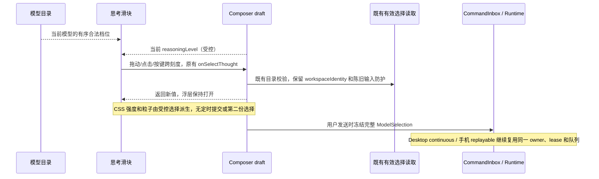

# Composer 思考档位滑块

## 产品规则

- 参考 [Effort Slider 演示视频](https://recent.design/i/x6k4i8j-effort-slider-microinteraction)，将聊天 Composer 的思考级别入口改为紧凑 Popover：标题、当前档位、两端取舍提示、脑形滑块、离散刻度及可点击的档位标签。
- 档位值、顺序、别名及默认值全部沿用当前模型目录和 `thoughtLevelOptions`，不增加 Galaxy 或推荐档，不根据名称重排。关闭、极低、低、中、高、极高、最高、极致、开启及供应商自定义名称均按实际声明呈现。
- 拖动、点击轨道、点击档位、方向键与 Home/End 走同一个 `onValueChange` 接口；跨越离散刻度才更新受控草稿。同一档位不重复发送变更。浮层在改选后保持打开，可用 Escape 或点击外部关闭。
- 单档模型保持静态档位，不创建可拖动入口；无目录不渲染；未选择或失效值显示原有占位/失效文案与零强度，不能写回首档。用户仍可明确选择第一档。
- 多档模型的低强度使用弱填充，中高强度逐步增加密集像素方块，形成向脑形手柄流动的连续能量带。像素按多行网格独立分布，不以简单取模生成斜线；亮度、运动速度和显露密度随目录强度增强。最高强度的脑形图标和光晕轻微呼吸。关闭值不产生填充或粒子。粒子限于浮层内部，不遮住文字、不越出轨道；不解释供应商预算或承诺模型更聪明。
- 滑轨、填充和粒子区域与脑形手柄同高（36px），共用组件内的尺寸常量；垂直中心对齐。44px 操作区保留触摸余量，水平端点按手柄半宽内缩，防止边缘裁切。刻度和档位标签位于轨道下方。
- 颜色使用既有 brand、foreground、surface、border 等语义 token，适配暗夜黑、草木灰、落晖黄、天空蓝、远山绿、朱砂红、烟墨紫及跟随系统，不复制主题色板或新增主题写入。
- 手柄位置、填充长度及像素显露边界在档位变化时短暂平滑过渡；拖动时缩短过渡以跟手，不延迟草稿写入，不增加连续业务档位或第二份选择。CSS 像素带循环仅在已打开浮层内执行，无 React 定时器。
- 工具条触发器和浮层标题为当前目录中全部本地化档位标签预留同一宽度。普通档位切换不能改变触发器、浮层或轨道的位置和尺寸；不通过延时、固定屏幕坐标或第二份锚点掩盖布局变化。重排目录、切换语言/模型或调整窗口尺寸仍按实际布局响应。
- `prefers-reduced-motion` 关闭像素流、呼吸及所有过渡，保留网格像素的静态显示与控件几何。主题变化不重置档位或重挂浮层。
- 桌面和手机 Web 共用组件；320px 窄屏、大字号及中英文标签保持可操作，不水平溢出。滑块提供名称、当前档位 `aria-valuetext`、可见键盘焦点及触摸命中区域。桌面关闭恢复 Composer 焦点，触摸手机关闭不弹出输入键盘。

## 所有者、接口与边界

- Provider Registry / ModelSelectionView 拥有模型支持的档位目录；既有 Composer draft 仍是下一次提交选择的唯一所有者。
- 滑块只是目录索引到原始字符串值的 UI 投影，不持有另一份已接受选择，不访问 Repo、平台桥接或 Service。
- `ThoughtLevelCycleControl` 增加可选 `interactionMode="slider"`，仅 Composer 接入；原有 select/cycle 调用保持原接口和提交语义。
- 复用共享 `components/controls/Slider` 的受控值和连续变更，按需扩展脑形手柄、样式及可访问属性；白板画笔粗细的默认外观、范围和连续更新保持原契约。
- 主题仍经 `setTheme -> applyTheme -> CSS tokens` 投影；Popup 开关仍由 Composer `activeConfigPicker` 管理，内部不新增主题或选择 store。

## 失败与迁移边界

- 目录/Host 读取失败仍按现有规则阻止未经校验的提交，滑块不编造档位、预算或请求结果。
- 切换模型时按目标目录重建刻度并复用现有最高档初始化和 stale 防护；不把旧模型索引当作目标模型原始值。
- 本次不改变协议、会话持久化、速度选项、owner/lease、远程路由或运行中的冻结请求。

## 验收场景

1. 桌面拖动跨越关闭到极致的真实档位，标题、刻度、脑形手柄和草稿同步；无 Galaxy/推荐标记。实际 DOM 中滑轨与手柄高度及垂直中心一致，粒子区域同高，拖动端点不裁切。
2. 配置自定义名称或非典型顺序，拖动/键盘/标签都严格返回目录原值与原顺序。
3. 单档静态、无档隐藏、禁用不可打开；无效/空值不自动变首档，明确点选第一档可恢复。
4. 箭头、Home/End、Escape、键盘焦点恢复及 Ctrl+T 沿用一致档位和关闭语义。
5. 320/390px 触摸拖动、英文和 20px UI 字号不溢出；关闭不自动聚焦手机输入框。
6. 七种主题与跟随系统在浮层打开时更新颜色，原始值保持；减少动态效果停止像素动画但几何一致。
7. 真实 Composer 在桌面/手机改选后发送，Submission 冻结选中的 reasoningLevel 和既有 speed；复用画笔 Slider 的范围和连续回调回归通过。
8. 实际执行目标浏览器 E2E、`pnpm typecheck`、`pnpm lint` 和变更架构检查；记录环境限制与真实失败。
9. 同一最高档停留时，两个时刻的轨道像素画面和实际位移不同，而草稿没有写入；减少动态效果后能量带停止。跨档切换时手柄和填充有过渡，拖动与关闭仍保持原受控契约。
10. 右对齐入口及真实 Composer 在 Low、Medium、Extra high 等不同长度标签之间连续切换，按钮、浮层与轨道的 x/width 保持一致；所有主题和手机布局仍通过。

## 实施与验证（2026-10-13）

- 涉及模块为 ui 与 web 测试夹具；选择仍由 Composer draft 持有，滑块事件沿用图中的原有写入与冻结路径。拖动回调通过最新只读投影消除 Mantine 同次手势的旧闭包，目录变化重挂 Slider 以取消旧手势，主题变化不重挂。
- `node --test test/thought-slider.test.mjs test/model-speed.test.mjs` 在 web 包运行：20/20 通过；最终调整英文大字号标签换行后，滑块套件 11/11 复跑通过。覆盖拖动往返与重复事件、合法/失效/单档、键盘、主题、减少动态效果、触摸、画笔回归及真实 Composer 提交。
- Windows、Node 24.21.0（按 mise.toml 通过临时 npm runtime 运行）、pnpm 10.34.6、Chromium。验证共享 Renderer 和手机浏览器模拟；未运行 macOS/Linux 原生窗口或真实手机远控恢复。
- 最终 `pnpm typecheck`、`pnpm lint`、`pnpm architecture:check --changed` 均通过；架构 0 violations / 0 baseline / 0 new；本次文件定向格式检查通过。截图在 `.lcode/thought-slider/`。
- 首版 14 个文件净增 868 行（包含规格、浏览器夹具与测试）；保留既有无关本地改动，没有修改协议、主题注册表、运行时 owner 或提交顺序。

## 滑轨高度调整（2026-10-13）

- 按用户反馈，滑轨从 14px 增至 36px，与脑形手柄同高；粒子区域同步加高，水平端点使用同一尺寸的半宽。选择所有者、事件顺序及公共接口保持原契约。
- 滑块浏览器 E2E 11/11 通过，新增实际 DOM 同高及中心对齐断言；Node 24.21.0 下 `pnpm typecheck`、`pnpm lint`、定向格式检查通过，架构仍为 0 violations / 0 baseline / 0 new。
- 本轮涉及 ui、web 测试及对应规格共 4 个文件，净增 23 行；已验证七种主题及 320px 英文大字号布局，并复核深色、浅色与手机截图。

## 像素流与浮层稳定性（2026-10-13）

- 已确认旧动效只有 48 个固定位置像素的透明度变化，线性取模产生斜线；右对齐英文入口由 Low 切到 Extra high 时触发器变宽，浮层横移约 37px。改为独立网格、双份 CSS 位移循环、强度渐进显露与最高档呼吸；目录标签通过 CSS grid 预留最大宽度，受控选择和事件顺序保持原契约，没有增加锚点状态或计时写入。
- Windows / Node 24.21.0：滑块及动效 E2E 16/16、指定 `packages/ui/tsconfig.json` 的 RollingToolbarLabel 回归 2/2 通过；`pnpm typecheck`、`pnpm lint`、9 个文件的定向格式检查通过；架构 0 violations / 0 baseline / 0 new。本轮 ui、web 测试及规格共 9 个文件净增 346 行。
- 比较实际像素画面与位移、手柄中间位置及桌面/手机跨档几何，入场测试等待真实 Radix 动画结束，没有放宽断言或增加固定延时。动效录屏为 `.lcode/thought-slider/thought-slider-motion.webm`（368×360，约 10 秒），峰值画面为 `flow-peak.png`。
