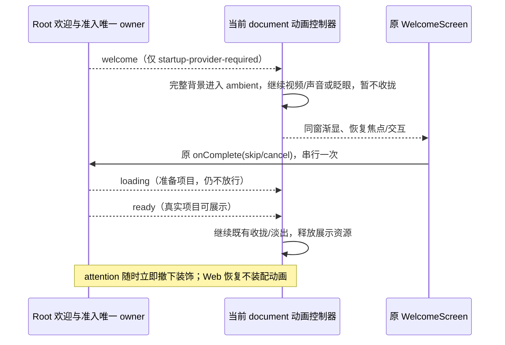
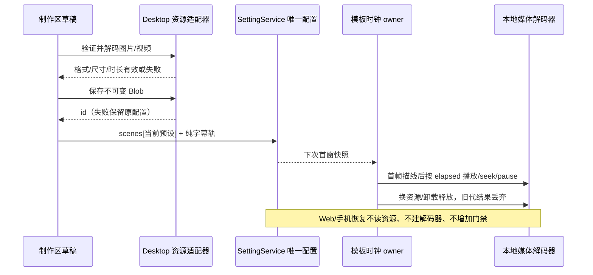
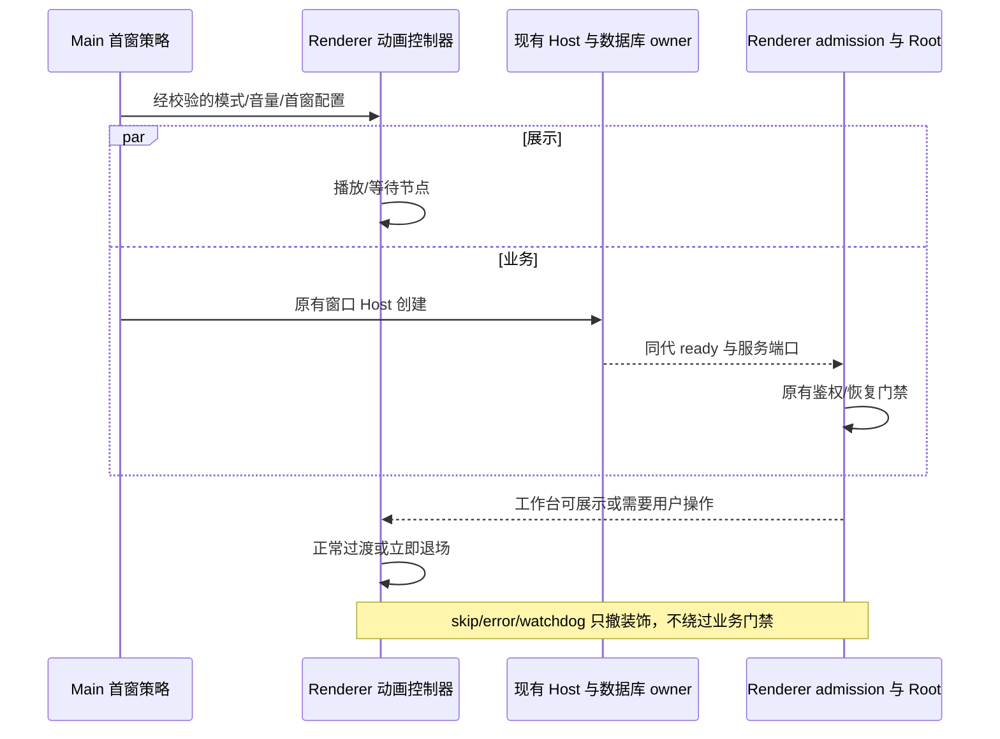
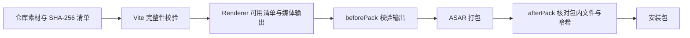
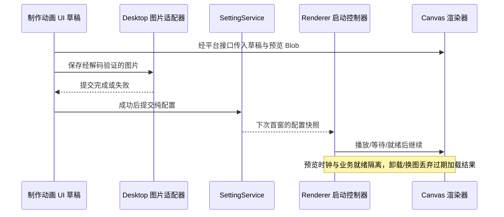

# 桌面启动动画与真实界面交接

## 产品规则

- 欢迎卡片的鼠标点击必须适用于 Windows/Linux 无边框及 macOS 隐藏标题栏窗口：卡片及欢迎期间的全屏动画底层明确为 `app-region: no-drag`，只保留顶部标题拖动条。鼠标点击「进入」与键盘回车沿同一原 onComplete(skip) 路径，处理中幂等；不能只使用有边框测试窗口或仅验证回车。
- 欢迎出现后画面和声音继续：原版白璃视频循环播放且保持用户音量；Canvas 模板保持完整彩色场景，独立推进同一渲染器的背景展示时钟（眨眼、动态视频继续），不重新播放碎片或提前收拢。卡片一旦出现，在视频循环回片头时仍保持可见。确认后准备项目期间继续动态背景；只有真实 Root ready 才结束循环并收拢/淡出，静态资源依旧是静态。Canvas 沿用后台暂停与前台续播；错误/减少动态效果/跳过仍释放媒体。
- 时间所有者仍在 Renderer：动画状态机只拥有 welcome/ambient 展示阶段；Canvas 时钟唯一拥有剧情位置和派生媒体时钟，背景续播不生成业务 ready。新验收使用与安装版一致的无边框 Electron，验证 no-drag、真实鼠标进入、视频音量及进度继续、眨眼继续、视频循环后卡片不消失、确认后 loading 不放行及 ready 后清理。

- 启动动画新增独立「自定义 / Custom」，选择项顺序为原始、白璃、爱弥斯、自定义、关闭。模板保存于 `scenes.custom`，与两个角色模板独立；未编辑时使用代码绘制的抽象背景，不依赖角色素材。自选静态图/视频、字幕、位置、大小、时长、缓动、预览及保存沿用同一编辑器、资源验证和提交路径。所有模板主标题必须为 LCode，仅允许调整位置和大小。
- 桌面首窗白璃、爱弥斯、自定义在 Root 投影首次欢迎入口时，播放至既有完整背景等待点，保留背景并渐显原来的欢迎卡片（约 480ms）；不创建第二份进入/取消按钮、不重新挂载 Root、不导航新页面。Root 仍独占欢迎 reason 和完成流程；动画控制器只接收新增 `welcome` 展示投影，并管理展示时钟/透明度/焦点。
- 欢迎卡片出现前 Root 保持 inert；出现后仅在 Root 当前只渲染首次欢迎页的前提下恢复交互，动画捕获器放行卡片键盘输入并聚焦进入按钮。进入/取消仍调用原处理器，待 Root 实际 ready 后才继续收拢/淡出到项目；处理中不重复提交。确认后的 loading 继续保留背景，不能把 welcome 当 ready。无需欢迎时沿原时间轴直接进入项目。
- 原始、关闭、减少动态效果、媒体失败、Esc/跳过采用原有欢迎页；手动登录、会话失效、OAuth 错误、确认对话框等仍立即让出。欢迎正常播放时不因等用户决定而超时；异常停帧仍沿用 watchdog 让出。其它加载等待仍有原预算。结束移除全部展示 class、inert 和监听器，不复活动画。Web/手机/远控恢复不接入此交接。
- 验收：独立自定义模板保存/重载、固定 LCode、与角色配置隔离；真实 Electron 中三种动画接原欢迎组件、卡片渐显与键盘可达、进入/取消 reason 不变、确认后未 ready 不放行、ready 后同窗交接；原始/关闭/跳过/减少动态效果/错误立即露出欢迎与其它操作界面。Windows 实测，macOS/Linux 由现有同源 CI 回归，不宣称本机已测。



- 启动选择器文案统一为「原始、白璃、爱弥斯、自定义、关闭」，英文 Original / Baili / Aemeath / Custom / Off。既有 official/simple 和角色 preset 配置兼容。
- 制作区表单使用一致的标签间距与控件基线；缓动预览和曲线选择器属于右侧同一字段，在同一行并排，不占左侧下一格。颜色、数值与选择控件统一最小高度，字号放大后自然增高。资源选择与操作按钮按控件底部对齐，窄窗口整行换行而不横向溢出，兼顾深浅主题。
- 布局调整保留 SettingService、UI 草稿、资源时钟和保存路径。验收在真实 Electron 中验证新名称、选择/保存回归、宽窄布局、20px UI 字号、颜色/输入/选择器高度、曲线所在字段与文件选择/按钮基线；保存截图并执行类型、Lint 和架构检查。

- 制作区的本机背景资源支持静态 PNG/JPEG/WebP/AVIF（10 MiB）及静音 MP4/WebM（100 MiB，最多 120 秒）；均需解码验证且不超过 4000 万像素。视频循环，其展示时间由模板时钟派生；seek、暂停、后台、减少动态效果及卸载同步控制解码器。文件仍是不可变本机 Blob ID，不进入 AppSettings/RPC。
- 自选资源与白璃无字视频从解码首帧提取 768×512 的连续边缘轮廓，连接并简化为折线，避免旧 192×128 水平短线丢失细节。脉冲/碎片/从左到右描线之后，彩色原资源沿相同方向渐进生成，保留未着色区域轮廓；动态资源在着色开始后播放，自选资源不套用内置眨眼坐标。
- 白璃也提供「制作动画」：默认无字 `baili-wallpaper.mp4` 做背景，使用与爱弥斯相同的模板编辑器/渲染器。未保存白璃模板时仍播放已有带字视频；保存后白璃选择使用模板。白璃和爱弥斯分别保存到 `scenes.baili` / `scenes.aemeath`；读取边界把旧 `scene` 迁入 `scenes.aemeath`，规范输出不保留第二份状态。
- 副标题为 0–8 条，每条有稳定 id、内容（最多 120 字符）、独立位置、字号和显示起止时间，可添加、选择编辑、删除。缺省结束时间表示到模板结束；超出当前时间轴的显示范围裁切，不改变阶段时长。主标题继续固定 LCode，只能改变位置/大小。旧 subtitle/subtitlePosition/subtitleSize 在共享 schema 读取边界迁成首条；旧默认欢迎语迁移保留，其它自定义内容不丢失，已有 subtitles 优先，不双写旧字段。
- 白璃制作区提供「恢复原版白璃」，沿同一设置提交路径移除 `scenes.baili`，保留爱弥斯和本机资源；之后白璃重新使用原片头。一般「恢复模板」仍只重置草稿，不提前提交。



- 验收补充：旧配置单向迁移且两个预设配置互不覆盖；多字幕增删、独立排版/显示区间、保存重载；MP4/WebM 导入、解码、播放、seek/暂停、减少动态效果、清理；损坏/超限资源与设置保存失败保留旧资源。自选图实际轮廓密度与连续性、描线到着色方向用真实像素和阶段截图验证。白璃未编辑原视频、编辑预览、保存后模板冷启动均回归；Windows 实测和 macOS/Linux CI 结果分别报告。

- 爱弥斯内置背景增加双眼眨眼，启动、制作区与动态壁纸使用同一个局部闭眼补帧绘制器；补帧仅在眼部羽化遮罩内合成，不移动脸部其它部分。补帧随仓库打包并参与哈希校验。时钟确定性驱动闭合、短暂停留、睁开，可 seek 复现；只作用于内置背景，自选图片不套用眼部坐标。减少动态效果保持睁眼静帧。
- 主标题固定为 `LCode`，制作区只读；保留位置拖动、X/Y 和字号调整。共享 schema 将旧的自定义主标题归一为 LCode，设置、预览和冷启动统一生效，不新增迁移写入路径。默认副标题改为 `欢迎回来…主人 ～`；旧默认 `幽灵来到…你身边～` 读取时迁移，其它自定义副标题保留。

- 外观页只保留一个「启动动画」选择器：原始、白璃、爱弥斯、自定义、关闭；移除「播放方式」「动画预设」。simple 显示为原始，cinematic 按 preset 显示对应模板，off 显示关闭。复用原 mode/preset，不新增选择状态；默认仍为原始，不覆盖已保存选择。
- 开发、生产构建和 Windows/macOS/Linux 打包均默认包含白璃视频、白璃无文字壁纸以及爱弥斯模板所需背景图/轮廓，不依赖环境变量。来源声明及 SHA-256 清单随资源纳入仓库，干净检出后无需兄弟目录或本机缓存。
- Vite 校验仓库素材的完整性后生成同一份可用清单并复制媒体；缺失、空文件、清单损坏或哈希不符直接构建失败。electron-builder 在打包前校验输出，在 ASAR 完成后校验实际包内资源与仓库素材相同，禁止再次生成“能安装但选项置灰”的缺素材包。

- 完整动画预设标识为 baili（白璃）、aemeath（爱弥斯）、custom（自定义），与壁纸分别选择。删除龙娘的素材、时间轴、导入支持及界面文案；旧 dragon 或未指定 preset 的 cinematic 设置在共享配置读取边界回到原始，保留音量，不自动改播其它视频。其它非法 id 仍拒绝。设置及预览复用同一契约与控制器。
- 爱弥斯改为本仓库的可编辑 Canvas 模板，使用用户提供的 `codex-startup-animation` 背景及轮廓素材。阶段为脉冲加载 → 线段碎片从中央散开 → 从左到右汇聚成角色线稿 → 彩色背景生成 → 向中央收拢并交接既有 LCode 页面。完全移除头像、旋转圆环及头像纹理碎片，不保留被删阶段的空白时长。不导入上游原生启动器、CDP、设置存储、壁纸或预览结束页。
- 「制作动画」提供固定 LCode 标题的排版、副标题内容、字体尺寸、文字与背景位置拖动和数值输入、背景缩放、颜色、自选背景图、各阶段时长与 Tween 风格缓动曲线。内联画布与冷启动使用同一渲染器，支持播放、暂停、拖动时间和全窗预览；编辑草稿在 UI 局部，只有保存才提交 AppSettings。默认总长 9 秒，文字/图片内容按纯 schema 严格校验，不执行用户脚本或外部 URL。
- 配置唯一所有者仍为 SettingService/AppSettings；自选图片/视频以不可变 ID 的 Blob 仅由 Desktop 资源存储适配器写入 IndexedDB，UI 经 hook/IPlatformService 调用，不经过 RPC/relay。资源经同一平台接口校验解码、保存成功后再提交引用；失败保留已生效配置。预览可使用尚未保存的 Blob，换资源与关闭释放对象 URL 和解码器，后台及卸载清理帧回调。
- 默认在 7.9 秒完整彩色画面等待 Root 可展示，8–8.95 秒收拢交接；首次欢迎在等待点同窗渐显，确认后的真实 ready 才收拢。自定义时长时，从阶段时长统一计算等待及交接点，不能硬编码。Esc、错误、其它需要操作的界面及减少动态效果沿用已有退场规则。Renderer 控制器唯一拥有启动展示状态，Canvas 只接受播放/暂停/seek，不保存业务就绪事实；不以动画结束替代 Host/Root 就绪。
- 白璃启动视频从原始 Canvas 工程重绘为 LCode 品牌：主标题为 `LCode`，左上角为 `OPENAI / LCode`，保留原字体、渐变、文字显现、人物/星光/眼睛动态与配乐。保持 3840×2160、60 fps、16 秒，等待点 14 秒、15–15.95 秒同窗淡出；不以播放器叠字或不透明色块覆盖原视频。无文字壁纸保持原素材。
- 品牌重绘只在素材维护时读取本地原工程，在隔离 Electron 导出上下文重绘并验证视频；结果纳入仓库内置资源及 SHA-256 清单，普通构建仍不依赖原工程或编辑工具。保留来源与修改说明，不改原工程目录。播放器、设置与业务状态所有者不变。
- `packages/desktop/assets/startup-media/` 是内置素材唯一来源；媒体白名单与清单校验由桌面构建工具维护。素材更新脚本只用于维护这些仓库文件，不是正常构建的前置条件。

- Windows、macOS、Linux 使用主窗口内的同一 HTML/video 启动壳，不创建额外窗口、Host、Agent，不扫描快捷方式，不移动或缩放原生窗口。
- 仅进程冷启动的第一个主窗口播放；第二次启动、托盘/Dock 激活、新窗口和 renderer reload 直接进入既有启动/项目界面。更新状态等辅助窗口不播放。
- 内部兼容字段 mode 为 simple（默认官方 Logo）、cinematic（完整动画）和 off；默认静音。设置保存在现有 AppSettings，旧配置缺省兼容 simple。设置页通过单个动画选择器投影这些字段，支持音量和显式预览；预览不启动任何业务进程。
- 内置媒体及来源说明随桌面安装包分发；运行时解码失败、播放被拒绝或停滞时撤下视频并显示现有加载/错误/项目页。
- 手机 Web、Web 远控恢复和桌面远控重连不播放品牌启动动画、不增加人为等待；已有项目恢复后直接进入项目。鉴权、同代端口、快照恢复和错误处理仍按原流程执行。
- 业务加载与动画并行。HTML 先显示静态启动壳，React 入口始终独立加载，不等待动画结束。
- 生产构建必须保留独立启动壳入口，不能被 Vite 合并进依赖完整 React/UI 的入口。业务入口通过当前 document 内的类型化展示事件桥发出投影；桥在 DOM 上保留最新展示值供先后加载重放，不持久化业务事实。
- React 首次 commit 仅证明启动页可以显示；数据库 ready 加同代服务端口证明可以挂载业务 Root；Root 既有门禁决定工作台、登录页或需要操作的界面可展示。三者不混用。
- simple 在短动画结束且已有可绘制页面后退场；cinematic 在既定等待节点可暂停，Root 可展示后继续至交接段，再在同窗内淡出。视频结束而业务尚未完成时显示既有加载页，不伪造成功。
- Esc/跳过立即结束装饰动画，仍保留数据库和 Root 门禁。首次欢迎按上述规则同窗合成；迁移进度、启动失败、其它登录/授权、恢复确认和渲染错误必须及时露出，不被完整动画遮住。
- 尊重 prefers-reduced-motion；减少动态效果时直接撤下装饰。保留主题、国际化、窗口标题栏、已有尺寸和最大化状态；跳过按钮可点击、键盘可达，不能落入 app-region:drag 区。
- 播放期间不产生页面滚动条；退场恢复原有页面滚动。需操作的 Portal 对话框获得焦点后，动画退场不得把焦点抢回项目。
- 任何媒体超时仅触发展示降级，不生成 ready。动画终态幂等，晚到的媒体/Root 回调不能复活动画；退场释放解码、帧回调、定时器及事件监听。

## 所有者与边界

| 事实                   | 唯一所有者                           | 消费接口                                           |
| ---------------------- | ------------------------------------ | -------------------------------------------------- |
| 模式、音量和模板纯配置 | 既有 SettingService / AppSettings    | useSettings 更新；Main 启动只读快照                |
| 首个主窗口是否可播放   | Main 进程级一次性启动策略            | WindowBootstrapOptions → loadWindow 的严格配置快照 |
| 播放、暂停、跳过、退场 | 当前 Renderer document 的动画控制器  | 本地类型化展示接口；不写 Zustand/服务端状态        |
| 数据库与服务端口准入   | 既有 Host / DatabaseStartupAdmission | 原有 startupId、sequence 和服务端口                |
| 工作台/登录/需操作界面 | Root 既有门禁的派生展示投影          | Root 可选 callback，Desktop 装配；Web 不装动画     |
| 预览                   | Renderer 动画控制器                  | UI hook → IPlatformService 的可选展示能力          |

不改 lcode-protocol、CommandInbox、owner/lease、workspaceIdentity、desktop-continuous 或 web-remote-replayable。Main 不拥有 task/session 业务状态。动画不会重置项目导航、重新初始化 Root 或重建 Host。



## 接口及素材



- 构建工具只拥有不可变资源清单，不引入业务状态；打包检查的文件、哈希和相对路径始终派生自仓库内置资源。

- 共享配置 schema 校验 mode、preset 和 0–1 有限音量；完整设置 schema 与 patch schema 使用同一契约。Bootstrap 中只携带配置，不携带任意文件路径或可执行内容。
- Root callback 仅投影 loading / welcome / ready / attention；welcome 仅为首次欢迎，ready 包括已恢复的项目，attention 包括其它登录、确认、迁移失败及错误边界。
- 本地视频以受控相对 URL 加载，播放器 object-fit:contain，字幕/按钮按窗口适配；使用 metadata 校验白璃时间轴与片长。
- 第一轮使用同窗淡入；透视屏幕、截图或 WebContentsView 迁移不属于本轮。无需 OS 屏幕捕获权限、原生 DWM 或持续抓帧。

## 验收

1. 首窗、第二窗、重复激活、reload、辅助窗口：仅首窗可自动播放；显式预览独立且结束后恢复原有页面。
2. simple/off/cinematic、设置持久化、非法 mode/音量、旧配置缺省、减少动态效果。
3. 先到端口/先到 ready、旧代 ready、新代端口、Root 恢复未完成：动画不改变既有准入结果。
4. 完整视频真实解码、等待/继续、结束退场；Esc/按钮跳过；播放拒绝、缺失、损坏、停滞均可看到现有页面。
5. 启动失败/迁移进度/登录/授权或目录确认先出现时立即可见可操作；不会等待 14 秒或凭超时放行业务。
6. 过渡后项目输入可用，焦点回到正确目标；媒体/监听器释放，晚到事件无效果；动画中的点击不提交项目命令。
7. Windows、macOS、Linux 的同一实现；覆盖小屏/宽屏、浅/深主题、页面缩放、原生窗控、Linux Wayland。当前 Windows 主机的实测与其它平台待运行验收分别报告。
8. 手机 Web / 远控已有凭据恢复、断线重连、跨项目恢复：不请求动画视频、不加动画定时门；保持原项目身份与现有会话，不另建 Host/Agent。
9. 常规 Vite 与安装包默认包含全部内置媒体、声明和清单；无环境开关，资源在真实 ASAR 相对 file URL 下可解码。缺失、损坏、旧输出或包内漏文件均阻止出包。
10. 选择器不出现已删除选项；构建产物和实际 ASAR 不包含已删除资源，旧输出夹带额外媒体时拒绝打包。旧动画配置回到原始，不影响其余 AppSettings 或业务准入。
11. 导出关键帧与真实视频均显示两处 LCode；开头、文字显现、稳定展示与末尾无旧标题残影、覆盖块或裁切。媒体元数据和实际解码验证 4K/60 fps/16 秒与音轨，原交接和壁纸回归通过。
12. 爱弥斯可选择、编辑、保存、重载、预览、冷启动播放；验证完整阶段、无头像/圆环、无空白等待、默认 7.9 秒暂停与就绪后收拢，自定义时长改变对应等待点。拖动与数值位置一致；固定标题不可编辑但字号/位置可保存；默认副标题迁移、自定义内容保留；内置背景双眼眨眼、自选背景不套用眼部坐标。草稿不提前覆盖配置；自选图与失效存储、快速重绘无旧结果覆盖。默认构建及实际 ASAR 包含模板素材/声明/校验值；手机/远控恢复不读取模板图片或请求素材，壁纸仍独立选择。



## 验证计划

先添加配置、首窗策略、播放器状态与 Root 展示投影的回归，再实现。浏览器/Electron E2E 使用真实入口启动壳和同一动画控制器，保存播放与跳过截图；媒体解码不能用模拟 ended 代替。执行 pnpm typecheck、pnpm lint、架构检查及相关启动/远控回归。跨平台运行时未执行时明确标记，不把源码共用视为已完成三平台实测。

## 开发与打包

```powershell
pnpm dev:desktop:test
pnpm bundle:desktop -- --os win --arch x64
```

普通开发、生产构建和安装包默认包含两份内置视频及爱弥斯背景/轮廓模板，不需要导入、设置环境变量或访问兄弟目录。macOS/Linux 使用既有 bundle 命令选择对应 os/arch，执行同一媒体校验。

在「设置 → 外观 → 启动动画」选择原始、白璃、爱弥斯、自定义或关闭；同页「壁纸」独立选择关闭、白璃动态、爱弥斯动态或自选图片。旧安装包不会因源码改变自动更新，需要重新打包安装。旧输出缺少素材时不能跳过构建直接出包。

只有维护内置素材时才运行 `node packages/desktop/scripts/import-startup-media.mjs [startup.mp4]`，一并审阅 `assets/startup-media` 中视频、来源声明与校验清单。普通构建不运行导入脚本。

```powershell
pnpm test:startup-animation
pnpm test:startup-animation:ui
```

UI 回归默认使用本机 Electron；Linux 无显示环境使用 xvfb-run。Windows/macOS/Linux CI matrix 从仓库素材运行完整解码场景，不额外下载视频。测试会创建实际 ASAR，检查包内哈希并加载包内 index.html，验证白璃启动、爱弥斯模板编辑和壁纸。业务部分仍为隔离 fixture，不读写正式用户数据，不等同于完整 Host/Agent 冷启动验收。

## 使用制作区

选择「设置 → 外观 → 启动动画 → 白璃 / 爱弥斯 / 自定义」，点击「制作动画」。主标题固定为 LCode，可调整位置和字号；副标题默认「欢迎回来…主人 ～」，使用「添加副标题」「选择副标题」「删除当前副标题」管理最多 8 条内容，每条独立设置位置、字号和显示区间。选择文字/背景图层后拖动标记或输入 X/Y 百分比，按需设置缩放、颜色、阶段时长和缓动。

自选背景支持静态图片及 MP4/WebM 动态视频；首次解码画面提取连续线稿，沿描线方向生成彩色背景，视频在着色后静音循环。播放或拖动时间轴检查效果，全窗预览复用启动控制器；点击保存后下次冷启动生效，三个模板互不覆盖。「恢复模板」只改草稿，仍需保存；「恢复原版白璃」直接提交并恢复已有片头。

配置只保存声明式数据；自选背景图只保存本机不可变 Blob ID，预览及设置提交失败不会改写旧配置引用的图片。没有配置导入脚本、用户 JS 或远程素材请求。

## 本轮验证结果（2026-10-17）

- `pnpm test:startup-animation`：62 项通过，包含欢迎 ambient 与循环、确认后仍等业务 ready、Canvas 剧情/媒体时间分离及前台续播连续性；原有配置迁移、自定义固定主标题、多副标题、动态资源、连续轮廓、眨眼、缓动、启动准入、打包及手机/远控恢复仍通过。
- `pnpm test:startup-animation:ui`：Windows 无边框原生 Electron 25 项通过，使用真实启动壳、共享渲染器、原 WelcomeScreen 及实际 ASAR。新增真实鼠标进入、卡片/底层 no-drag、白璃欢迎期间视频进度与 25% 音量继续/循环后卡片保留、爱弥斯持续眨眼、自选 MP4 欢迎期间解码继续；回车/Tab/快捷键隔离/重复提交防护/确认后 loading 不放行/ready 后交接、取消及退场、新名称/制作区对齐/多字幕/资源/壁纸回归仍通过。业务及异步准入为隔离 fixture，不等同于完整生产 Host/Agent 冷启动实测。
- MP4/WebM 的格式及体积规则均有核心回归，实际动态解码交互使用 MP4；本机未单独运行 WebM 解码验收。Web/手机场景零模板/壁纸存储及资源请求。
- `pnpm typecheck`、`pnpm lint`、播放器与构建插件有界 strict tsc、完整 Desktop Renderer 生产构建通过；资源与实际 ASAR 哈希核对通过。既有 Node 版本提示、大 chunk / 无效动态拆分及依赖 use-client warning 未在本轮扩展处理。
- 架构检查 violations / baseline / new 均为 0；图谱/CI YAML、目标文件格式和空白检查通过。沿用 desktop/shared/ui；Root 唯一拥有欢迎及准入，当前 document 控制器拥有欢迎展示交接；wallpaperStore、SettingService 仍分别唯一拥有偏好，未新增 Host/Agent 或业务协议。眼部补帧提示词记录在内置素材声明中。
- Windows 正式版安装包生成于 `packages/desktop/.e2e-artifacts/startup-animation/release-welcome-live-production/LCode-3.19.1-win-x64.exe`（239966003 字节）；生产 build、资源/实际 ASAR、运行依赖、mise、产品身份与体积检查通过，并读回 ASAR 确认欢迎卡片及底层 no-drag。退出当前应用后安装到原目录生效，未替换正在运行的安装。macOS/Linux 沿用 CI matrix，本机未实测。
- 补充完整包隔离探测到达 ready，但未触发欢迎卡片（前置场景未建立），不计入完整 Host 欢迎交接通过项；业务交接验证仍以 fixture 范围为准。
- 本次统计的启动 Renderer、startup\* 脚本/共享协议、制作区/hooks、Root/Welcome、本地化及相关 spec/CI/图谱文本路径相对 HEAD 累计净增 5712 行（包含此前未提交实现，非本轮单独补丁）；本轮新增 Canvas 展示时钟、欢迎持续播放与无边框鼠标回归，保留其它本地改动。
