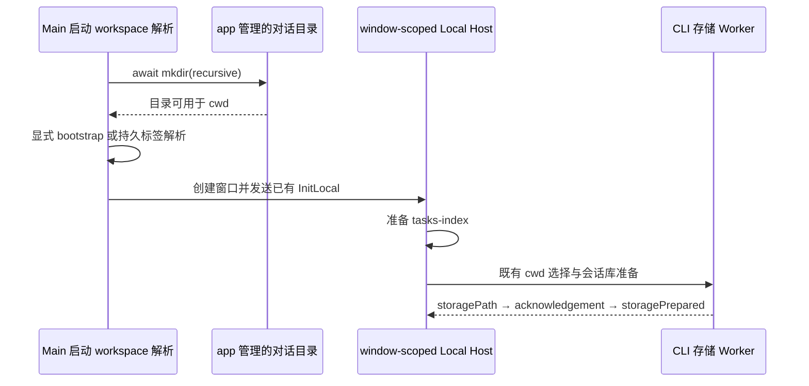

# 桌面启动工作目录恢复

## 问题与产品规则

删除 app 管理的 `.lcode/workspace/default` 后，已有项目/远程标签恢复可能跳过默认对话目录创建。尤其上次激活远程标签、其后有本地对话标签时，Main 会选择已删除的对话目录预热，Host 的备用 cwd 又指向同一目录。CLI 在存储握手前因 `--cwd` 不可访问退出，最终只显示 `preparing_session_storage / transport_closed`。

- 每次创建主窗口前，Main 的唯一启动 workspace 解析入口必须异步、幂等地确保当前数据根下的默认对话目录存在；已有本地项目、远程标签、首次启动、显式打开项目都经过这一步。
- 只创建 app 管理的对话目录，不恢复用户删除的项目，不改持久 workspace identity、路径、标签顺序、激活索引或历史会话。
- 显式打开项目仍优先于持久恢复；本地预热目标选择及数量沿用当前规则。
- 同路径已有文件、无权限等真实 IO 错误直接向启动调用方传播；不删除占用文件，不切换另一数据根，不用延迟重试掩盖问题。

## 所有者、接口与事件顺序

Main `resolveStartupWindowBootstrap` 拥有 app 管理工作目录的初始化副作用，接收 `settingsFile`、`conversationWorkspaceDir` 及可选的已验证 `explicitBootstrap`。Main 的显式请求解析仍负责确认与路径校验，最终统一调用此入口。Host 沿用既有数据库准备协调器；CLI 沿用会话库的唯一持久 owner，无新增协议、状态、数据库迁移或队列。

初始化按每次窗口创建执行，`mkdir(recursive)` 为幂等边界，不缓存目录永远存在的事实。手机仍连接桌面已有 attachment，不额外创建 Host 或 Agent；desktop-continuous 与 web-remote-replayable 的交付语义不变。

## 验收场景

1. 已有有效本地项目且默认对话目录被删：目录恢复，项目预热目标不变。
2. 上次激活远程标签，后面有已删除目录的本地对话标签：先恢复目录，再返回原对话预热目标；不标记远程路径为本地不可用。
3. 只有远程标签：备用目录仍存在，本地不预热远程项目。
4. 用户本地项目被删：只创建对话备用目录，返回原不可用项目路径，不重建项目目录。
5. 显式打开项目及首次无标签启动：同一入口准备默认对话目录，分别保留显式项目/对话 bootstrap。
6. 多次解析保留目录内容；目录删除后再次解析可重新创建。
7. 目录位置被文件占用：启动解析失败，文件内容保持不变。

回归入口：`node --import tsx --test packages/desktop/src/main/startupWorkspace.test.ts`。运行时核验应覆盖存储 Worker 使用缺失 cwd 的失败及恢复目录后的成功握手。

## 验证结果

- 修改前回归 8 项中 6 项失败，修改后 8 项全部通过；`pnpm typecheck`、`pnpm lint` 及本轮文件格式检查通过。
- 架构模块为既有 `desktop`，源码新增 15 行、删除 9 行，净增 6 行；架构检查 violations / baseline / new 均为 0。目录初始化仍由 Main 所有，Host/CLI 的存储及协议所有权不变。
- Windows 上使用已安装 CLI 存储 Worker 复现缺失默认 cwd 时的可访问性错误；通过修复后的启动解析恢复目录，再启动已安装桌面应用，日志确认数据库 `ready`、本地服务与 desktop-continuous attachment 就绪。源码自动恢复路径需新构建交付；未执行 macOS/Linux 桌面运行时验证。
