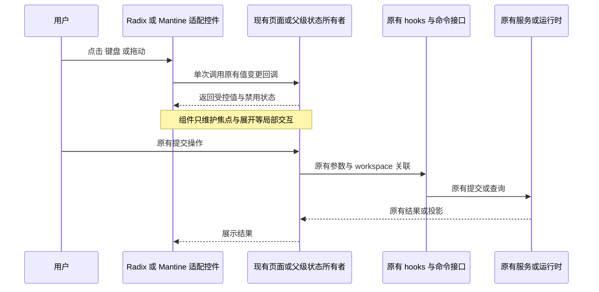

# 前端控件组件化改造方案

## 目标与交付范围

将应用内可见控件统一到 UI 组件体系：已有组件使用当前 Radix/shadcn 实现，缺少对应组件时引入 Mantine。系统下拉弹层、默认复选框、默认滑杆等原生控件外观不再作为页面设计方案。保持功能、数据来源、提交时机、权限、校验、持久化和远程控制语义不变。

本版为 2026-10-12 的源码盘点与实施规范。首版实施已于同日执行：Mantine 9.7.2 已安装锁定，适配层已创建，首版 12 个业务文件的控件替换与配套测试改动已写入工作区，但最终门禁未全部通过（typecheck、lint、fmt:check、architecture:check --changed 未通过，复核未触发），详见“本版验证记录”。下文“改造后”中已实施部分以验证记录为准；截图类证据仍未生成，不能当作已取得的证据。

完整候选文件和源码位置见 [前端控件盘点清单](../docs/frontend-ui-component-inventory.md)。现有设计规则继续遵循 [DESIGN.md](../DESIGN.md)、[前端共享组件品控](./frontend-component-quality.md)、[主题规范](./ui-theme-modes.md)和[手机布局规范](./mobile-remote-layout.md)。涉及插件商店时使用 [CONTEXT.md](../CONTEXT.md) 的当前术语。

## 盘点结论

采用 TypeScript JSX AST 扫描业务源码及独立 HTML 入口，排除测试文件和 `packages/ui/src/components/ui/` 的基础组件实现。行号指控件起始标签，不是 `type` 属性行；重复 map 中的一个 JSX 节点只计一个源码位置。

| 区域                                | 扫描文件 | 候选文件 | 原生标签位置 | 主要结论                                                                                                                        |
| ----------------------------------- | -------: | -------: | -----------: | ------------------------------------------------------------------------------------------------------------------------------- |
| `packages/ui/src`                   |      712 |      165 |          329 | 4 个 select、10 个 checkbox、1 个 range、1 个 textarea、7 个直接输入区、12 组 details/summary；其余为按钮、label 和隐藏文件输入 |
| `packages/web/src`                  |        4 |        3 |            5 | 分享页的 3 个按钮及 Web 启动、手机配对各 1 个重试按钮                                                                           |
| `packages/desktop/src/renderer`     |        5 |        0 |            0 | 本轮入口扫描未找到上述标签；主要 UI 由共享包提供                                                                                |
| `apps/lcode-cli/packages/debug/src` |        9 |        6 |           23 | 2 个 select、1 个输入区、9 个按钮、3 个 label、4 组 details/summary                                                             |
| 合计                                |      730 |      174 |          357 | 候选位置用于组件收敛，不等同于 357 处视觉缺陷                                                                                   |

已确认系统控件替换目标：6 个 select、10 个 checkbox、1 个 range。另有 8 个可见直接输入区、1 个直接 textarea、16 组折叠区，以及 206 个 button、87 个 label 候选。6 个文件输入均有 `hidden`，保留其系统文件选择能力。

当前仓库已经使用 `radix-ui`、`shadcn`、Tailwind 和自有 UI 基元；`packages/ui/components.json` 的风格为 `radix-mira`。盘点时没有 Mantine 依赖，也没有已封装的 Slider；首版实施已按用户确认引入 Mantine 并创建 `packages/ui/src/components/controls/` 适配层，首个真实使用点是白板画笔粗细滑杆，实施结果见“本版验证记录”。

## 产品规则

1. 可见普通按钮、字段、选择器、开关、复选框、弹层和折叠入口必须通过 UI 组件呈现。不得以给原生 select/checkbox/range 加 CSS 或 `accent-color` 作为迁移完成标准。
2. 已有的 Button、Input、InputGroup、Textarea、Label、Select、Checkbox、Switch、Tabs、Collapsible、Popover、Dialog、菜单等继续复用。无需为同类控件引入第二套实现。
3. 共享包缺少对应组件时，在项目适配层封装 Mantine；业务页面不直接混用 Mantine 的默认主题。缺少组件不再退回“原生美化”。
4. 基础组件内部必要的 HTML input/button、隐藏表单桥接节点和隐藏文件输入允许存在。验收对象是用户可见的控件外观与业务页面使用方式，不以全仓 HTML 标签清零为目标。
5. 定制列表行、选项卡、单选卡、权限选项、拖拽入口要保留当前 role、键盘模型、事件冒泡、ref、命中区域和已实现视觉。先适配现有组件，再判断是否确有组件缺口；不得把 listbox option 直接替换成另一套 checkbox 行为。
6. Mantine Select、Combobox 等自定义选择器可以作为缺口组件；不得采用 `NativeSelect` 或弹出系统列表的方案。
7. 用户主动打开的操作系统文件对话框保留。禁止为了页面组件化改写文件授权、平台服务、Host、Agent 或协议。
8. 界面只改变展示实现。禁止新增选项、搜索、清空、自动提交、数值舍入、通知、颜色选择器或日期入口等产品行为。

## 改造前后效果与具体位置

### 首版优先处理

首版以以下 12 个业务文件为重点，并增加必要的依赖、适配层与测试。表内行号为本次检出 AST 起始标签位置，实施时需重新核对。

| 当前源码位置                                                                  | 改造前                                                | 改造后目标                                                     | 组件与功能保持要求                                                                                         |
| ----------------------------------------------------------------------------- | ----------------------------------------------------- | -------------------------------------------------------------- | ---------------------------------------------------------------------------------------------------------- |
| `packages/ui/src/settings/usage-stats/ProviderUsagePanel.tsx:140,161,185,202` | 触发器手写输入外观，展开后是系统 select 列表          | 触发器和选项列表都使用应用主题；勾选、键盘焦点、滚动和边界一致 | 现有 Select；保留 24h/7d/30d、供应商切换时账号/模型重置、分页归零、历史账号和未归属值                      |
| `packages/ui/src/settings/RemoteMcpSyncDialog.tsx:138,208,266`                | 复选框依赖原生绘制；全选通过 DOM indeterminate 投影   | 统一 Checkbox，显示清晰的未选、半选、全选与禁用态              | 现有 Checkbox；保留选择集合与既有 onSelectAll/onClearAll/onToggle                                          |
| `packages/ui/src/settings/RemotePluginSyncDialog.tsx:1105,1175,1233`          | 同款原生复选框                                        | 与 MCP 同步面板一致                                            | 现有 Checkbox；保留安装状态、可选范围、禁用与同步提交                                                      |
| `packages/ui/src/settings/RemoteSkillSyncDialog.tsx:163,234`                  | 过滤开关和全选使用原生 checkbox                       | 两处统一 Checkbox，不改变过滤和批量选择含义                    | 现有 Checkbox；不得把“显示已存在”改为另一套开关业务                                                        |
| `packages/ui/src/settings/RemoteSkillSyncSelectionList.tsx:94`                | 列表 checkbox 与旁边的组件按钮混用                    | 列表选择外观与其他同步列表一致                                 | 现有 Checkbox；保留 id/htmlFor、已存在项禁用与展开详情                                                     |
| `packages/ui/src/v4/ConversationShareConfirmationDock.tsx:327,374`            | 分享标题手写 input，知情同意使用原生 checkbox         | 标题和勾选统一 UI 外观，长说明对齐                             | 现有 Input、Checkbox；保留标题草稿、同意门槛、动画取消顺序、焦点引用与提交规则                             |
| `packages/ui/src/WhiteboardPane.tsx:296`                                      | 原生画笔粗细 range，外观由浏览器决定                  | 使用主题一致的 Slider 轨道、滑块及焦点                         | 缺少已封装 Slider，采用 Mantine Slider；保持 min=2、max=18、step=1、初值 5、连续 onChange 和现有 md 可见性 |
| `packages/ui/src/settings/AutomationInstructionsComposer.tsx:102`             | textarea 已有手写主题和自动增高，仍与共享组件重复维护 | 复用共享 Textarea，边框、圆角、placeholder 和错误反馈统一      | 保留 116–156px 自动高度、长内容滚动、onInput/value/ref 及既有手动高度处理；不切换提交逻辑                  |
| `packages/ui/src/settings/model-provider-section/ModelConfigHelp.tsx:29`      | label 未显式使用共享标题组件                          | 字段标题与同类表单一致                                         | 现有 Label；帮助按钮保持兄弟节点，不能抢占输入关联                                                         |
| `packages/web/src/share/ConversationShareLandingPage.tsx:210,648,667`         | 主题按钮手写；登录及重试按钮主要提供静态外观          | 统一 Button 的尺寸、聚焦、悬停和禁用反馈                       | 保留主题切换、登录跳转、重试及链接目标；不假设每个按钮当前都没有反馈                                       |
| `packages/web/src/main.tsx:394`                                               | 启动失败重试按钮重复维护主题串                        | 与其他次操作 Button 一致                                       | 通过 `@lcode/ui` 已有 Button 公共导出复用；保留原重试动作                                                  |
| `packages/web/src/remote/MobilePairingPage.tsx:332`                           | 配对失败重试按钮与启动页复制样式                      | 手机点击目标与共享按钮外观一致                                 | 保留配对凭据、重连和既有重试动作；不改变 attachment                                                        |

首版完成标准：上述可见控件不再显示系统下拉、系统复选框或系统滑杆；不要求重做主布局、状态面板、品牌或所有定制列表。

### 后续批次

| 批次                  | 文件或范围                                                                                                                                                                                     | 改造前                                            | 改造后与约束                                                                                                   |
| --------------------- | ---------------------------------------------------------------------------------------------------------------------------------------------------------------------------------------------- | ------------------------------------------------- | -------------------------------------------------------------------------------------------------------------- |
| 第二批 输入区         | `ChatEmptyState.tsx:349`、`ModelTrajectorySearchBar.tsx:40`、`quickpick/TaskFindDialog.tsx:281`、`ProviderModelReasoningLevelEditor.tsx:111,155`、`workspace-grouped-tasks/group-item.tsx:576` | 局部 input 各自维护透明背景、搜索和编辑样式       | Input/InputGroup 等组件适配；保留 IME、Enter/Escape/blur、自动聚焦、搜索类型和拖拽编辑互斥                     |
| 第二批 普通按钮及标题 | 清单中的普通 button、label；优先设置、自动化、分享、项目及工具栏                                                                                                                               | 多数已手写主题，缺少统一组件入口                  | 普通按钮使用 Button，字段标题使用 Label；保持现有密度、pill 造型例外、语义状态、事件与提交类型                 |
| 第二批 手写开关       | `settings/AutomationSwitchToggle.tsx:24`                                                                                                                                                       | 自绘 button role=switch                           | 适配现有 Switch，保留 scheduled/idle 的颜色含义、尺寸参数、受控 checked 和 onChange                            |
| 第二批 折叠区         | 主 UI 12 组 details/summary，见完整清单                                                                                                                                                        | 部分仍有系统折叠标记，部分已自绘箭头              | 现有 Collapsible/Accordion 适配，保留默认展开、展开保持、内容挂载、键盘和错误展示                              |
| 第三批 定制语义       | `ElicitationDialog`、`PermissionDialog`、`MentionPanel`、`OnboardingChoiceGroup`、`ConversationSharePermissionPicker`、`ExternalAgentImportDialog`、`SubagentsSection`、命令中心和工作表 tabs  | 已有 option/checkbox/radio/tab 等角色的定制按钮   | 按真实交互模型适配现有组件；确有缺口才封装 Mantine。禁止用普通按钮替代键盘选择模型，禁止嵌套 button            |
| 第四批 独立 debug     | `debug-controls.tsx:11,31,33,51,53`、`network-panel.tsx:31,35,42,50,134,145,181`、`context-panel.tsx:104,121,167`、`panel-parts.tsx:6` 等 6 文件                                               | 2 个系统 select、输入框、按钮和折叠区使用独立样式 | 通过轻量公共控件入口复用现有组件，完整替换弹层；保留 Project/Trace、网络筛选、复制、Shell 选择、视图切换和折叠 |

206 个 button 与 87 个 label 都纳入组件使用方式复核，不宣称它们全部存在原生外观缺陷。动态列表、命令面板和错误边界单独验收，不批量替换后仅看编译结果。

## 组件选择与接入边界

### 现有组件

沿用 `packages/ui/src/components/ui/` 的当前基础组件，遵守该目录 README：不因这次页面改造批量修改第三方基元实现。页面适配和新增控件放在另一个项目拥有的适配目录；任何必须修改基础 API 的情况先记录具体缺口。

现有 `@lcode/ui` 根入口公开导出了 Button，未提供全部基础控件的公共出口。Web 当前五个按钮可以使用已有出口；独立 debug 的 Select/Input 等不得深导入共享包内部文件。

### Mantine 首版接入

1. 第一阶段只在 `@lcode/ui` 引入兼容当前 React 19 的稳定 `@mantine/core` 与其匹配的 `@mantine/hooks`，锁定版本并记录依赖与许可。已实施：版本经真实查询 npm registry 选定为 `@mantine/core` 9.7.2 + `@mantine/hooks` 9.7.2（均精确锁定；`@mantine/core@latest` 为 9.7.2，peer 要求 react ^19.2.0 + react-dom ^19.2.0 与同版本 @mantine/hooks，本仓 react 19.2.7 满足；备选 8.3.18 兼容但非当前稳定线），`pnpm install --filter @lcode/ui` 实际执行成功并经安装产物核验；最终 typecheck 门禁未通过（见“本版验证记录”）。
2. `packages/ui/src/components/controls/` 已创建：`MantineControlsProvider.tsx`（Provider 桥接，观察 documentElement 的 dark class 派生明暗）、`Slider.tsx`（自带 Provider，宿主零改动）与 `css-modules.d.ts`。业务调用方使用稳定的 value/onChange/min/max/step/disabled/aria-label 接口。
3. Slider 保持受控 number，不保存第二份画笔粗细。原来连续更新就继续使用 onChange，不改用 onChangeEnd 延迟更新。设 `label={null}`，不新增数值浮层、刻度或新操作。
4. Provider 的明暗由现有主题注册表和设置投影决定，不启用 Mantine 自有主题持久化、不另设颜色模式 store。资源管理器和独立入口需要各自验证宿主 Provider；普通 Radix 控件不因接入 Mantine 增加 Provider 依赖。
5. Mantine 的颜色、字号、圆角、状态及轨道尺寸映射现有语义 token。保持 `text-ui-*`、手机输入安全字号与根字体不缩放规则，禁止照搬库默认字号和另一套主题色板。
6. 样式接入采用 Mantine 官方支持的方式，只加载实际使用组件所需样式；验证全局 reset、Portal、z-index、Electron no-drag 与原有布局没有冲突。不得为了 Slider 导入整套 Mantine 布局和表单体系。
7. 本轮扫描没有直接的 date/time/color 原生输入；当前数字字段多数已使用 Input。因此首版不引入 `@mantine/dates`、颜色选择器或 NumberInput，不新增日期、颜色、数值步进功能。

Mantine 官方依据：[Slider 受控值、事件与范围](https://mantine.dev/core/slider/)、[Provider 与外部主题配置](https://mantine.dev/theming/mantine-provider/)、[样式接入](https://mantine.dev/styles/mantine-styles/)。库能力不代表本项目已经完成兼容验证。

### 独立 debug 接入

debug 当前没有 `@lcode/ui`、Tailwind Vite 插件或 Radix 依赖。迁移时先提供拟新增的轻量 `@lcode/ui/controls` 公共入口及对应的控件样式入口，只输出所需控件；不通过 App 根入口拉入会话、服务、终端或平台初始化。

控件主题变量必须复用单一事实源；样式出口和 debug 构建要证明实际产出所需 utility，不复制整份主题色板，不把主应用的 `#root` 高度/滚动规则直接覆盖 debug 布局。debug 的开发构建配置、包依赖和测试单列一个批次。缺少轻量出口是需要解决的工程工作，不能以保留系统 select 弹层结案。

`apps/lcode-cli/packages/debug/src/network-model.ts:18` 的 textarea 是复制回退时临时创建、放在屏幕外并立即删除的桥接节点，不是可见控件；保留该复制回退。Web 下载使用的临时 anchor 同样不属于页面控件迁移。

## 状态所有者与事件顺序

| 场景         | 现有事实或草稿所有者                                                                 | 组件职责                             | 不变的提交边界                                              |
| ------------ | ------------------------------------------------------------------------------------ | ------------------------------------ | ----------------------------------------------------------- |
| 使用量筛选   | ProviderUsagePanel 的 filters；数据经 useProviderUsageStats/useProviderAccounts 读取 | 投影选项、值、焦点，触发原有筛选回调 | 原查询参数、目录查询、重置顺序及刷新                        |
| 远程同步     | 原对话框的 selectedIds 与过滤状态；同步业务由现有 hooks/service 接口承担             | checked/mixed/disabled 和标签关联    | 原同步请求与远程 workspace 关联，不引入第二个选择集合或队列 |
| 分享确认     | 现有父级传入的 title/同意状态/权限及提交回调                                         | 控件展示及单次事件适配               | 同意门槛、权限、动画取消、生成分享与重试                    |
| 白板画笔粗细 | WhiteboardPane 的 strokeWidth 局部状态                                               | Mantine Slider 受控展示与连续事件    | 原绘制过程消费该值；board/历史仍由现有白板 store 维护       |
| 自动化指令   | 调用者传入的 value/onInput；现有 textarea 高度逻辑负责几何                           | Textarea 提供 UI 外观                | 原表单验证与保存，不创建独立 form 状态                      |
| 主题与字体   | 既有设置、主题注册表及 UI 投影                                                       | Mantine Provider 派生展示            | 原设置写入和广播，禁止回环或第二份主题存储                  |

远程操作保留 `workspaceIdentity?.trim() || workspacePath` 隔离、`remoteSessionId`、owner/lease 与 stale 防护。桌面 `desktop-continuous` 与手机 `web-remote-replayable` 仍由原有传输所有者处理；控件替换不增加 Host、Agent 或恢复链路。

## 功能等价与验收场景

| 编号 | 设置与动作                                                            | 必须断言                                                                 | 所需证据                                                  |
| ---- | --------------------------------------------------------------------- | ------------------------------------------------------------------------ | --------------------------------------------------------- |
| C01  | 打开四个使用量下拉并选择时间、供应商、账号、模型                      | 弹层不是系统 select；原查询参数、历史账号、unknown 值和分页结果不变      | 真实 ProviderUsagePanel 截图、键盘操作与 fixture 查询记录 |
| C02  | 切换供应商后切换账号/模型、翻页再重新筛选                             | 原重置规则执行一次，账号/模型/offset 不产生残留                          | 现有 usage-analytics E2E 的请求断言                       |
| C03  | 三类同步面板分别单选、部分选择、全选、取消全选                        | 半选点击全选，全选点击清空；已存在/不可选项不进入提交                    | 选择集合与提交 payload 断言；零项时禁用                   |
| C04  | 分享标题编辑、勾选同意并提交                                          | title 与权限不变，同意门槛不绕过，点击事件不重复，焦点引用有效           | 真实分享确认组件与提交 spy；不能只验证勾选图标            |
| C05  | 拖动画笔粗细及使用方向键、Home/End                                    | 初值 5，范围 2–18，步长 1，变化连续进入 setStrokeWidth；实际笔迹宽度匹配 | 真实白板交互及画笔数据断言                                |
| C06  | 自动化输入短文、多行长文、中文组合输入                                | 草稿内容、onInput、116–156px 高度与滚动规则保持，Enter 不意外提交        | 输入内容、回调次数与实际几何                              |
| C07  | 普通按钮、行内按钮与表单按钮通过鼠标和键盘激活                        | type、disabled、冒泡、默认提交及 ref 行为保持；不出现双提交或嵌套 button | 真实入口事件与表单提交断言                                |
| C08  | 打开/关闭折叠区与弹层，使用 Escape、Tab、方向键                       | 正确默认展开、焦点、回焦、内容状态；option/radio/tab 的原语义保持        | 键盘 E2E 与 DOM role/焦点记录                             |
| C09  | 七色主题、system、中英、12/14/20px、1280×720/1440×900/390×844/320×568 | 控件与实际主题一致，文字与触控可达，无横向溢出；切主题不重置草稿和选择   | 同一状态的前后截图、computed style 与文字边界             |
| C10  | 独立 debug 切 Project/Trace、网络筛选、Shell、复制及折叠              | 控件弹层组件化，既有数据筛选及复制结果不变；开发/生产构建均有样式        | debug 单测、构建、浏览器截图和交互断言                    |
| C11  | 手机远控重连后再次操作原同步或分享入口                                | 原 attachment、身份、投影和提交语义保持，未提交草稿不因控件重挂载丢失    | 原远控恢复场景与操作记录；模拟手机不代替真机              |

截图规则：改造前后采用同一页面、主题、字号、视口、语言和数据，至少保存默认、展开、选中、半选、禁用、错误及键盘焦点中的相关状态。此阶段没有生成或验证这些截图。

## 实施与验证顺序

1. 先补真实控件场景，再安装 Mantine 并接入适配层；现有组件优先直接替换。按批次运行，失败时定位事件或状态差异，不用延时掩盖。
2. `packages/web/test/usage-analytics.test.mjs` 已改为实际 combobox/option 操作，原请求和分页断言保留；改写经 `node --check` 与 oxlint 校验，文件内已无 `selectOption()`/`inputValue()` 调用，迁移后的浏览器运行结果未验证。
3. 复用 `packages/web/test/component-quality.test.mjs`、`theme-quality.test.mjs`、`component-mobile-platform-cases.mjs`、`component-overlay-cases.mjs` 及其真实 fixture，补 Mantine 与迁移后的控件。现有原生 number 等组件内部兼容测试继续有效。
4. 首版远程选择、分享确认、白板和输入的迁移用例已补齐为 `packages/web/test/component-migration.test.mjs`、`component-migration-cases.mjs` 及 sync/share/slider/composer 四组 fixture；编写时运行全部仅在迁移契约断言处失败（当时控件未迁移、slider fixture 引用的适配器文件不存在），另以临时探针用例（验证后已删除）确认 fixture 与流程驱动 8/8 通过，迁移完成后的运行结果未随本次数据提供（未验证）。
5. 根目录执行 `pnpm typecheck`、`pnpm lint`、`pnpm architecture:check --changed`。Web 定向浏览器用例可使用 `pnpm --filter @lcode/web exec node --test test/usage-analytics.test.mjs test/component-quality.test.mjs test/theme-quality.test.mjs`，这些文件当前存在；未执行前不声称通过。
6. debug 实施后单独执行 `pnpm --filter debug typecheck`、`pnpm --filter debug lint`、`pnpm --filter debug test`、`pnpm --filter debug build`。涉及 CLI 代码时另遵守该目录 AGENTS.md 的 CLI 检查。
7. 新增代码前重新运行架构检查与目标模块受控上下文。公开出口使用 package exports，不深导入跨包实现。UI 通过既有 hooks 访问服务，平台操作继续经 IPlatformService。

## 本版验证记录

### 方案阶段（2026-10-12）

本轮仅新增方案及盘点 Markdown，未修改组件、依赖、协议或业务功能。

| 已执行检查                                                      | 结果                                                                | 结论范围                                               |
| --------------------------------------------------------------- | ------------------------------------------------------------------- | ------------------------------------------------------ |
| `node scripts/check-workspace-freshness.mjs`                    | 基线新鲜；L-GO 相对 origin/main ahead 27 / behind 1，无远端跟踪分支 | 仓库基线检查                                           |
| `pnpm architecture:check --changed`                             | OK，violations 0、baseline 0、new 0                                 | 当前工作区边界检查                                     |
| `pnpm architecture:context ui`、`pnpm architecture:context web` | 两模块均为 legacy，managed=false，无已发现直接契约                  | 已读取目标模块的受控上下文，不推断缺失契约为允许深导入 |
| `pnpm typecheck`                                                | 通过                                                                | 当前未实施迁移的仓库，Node 24.21.0                     |
| `pnpm lint`                                                     | 通过                                                                | 当前未实施迁移的仓库，Node 24.21.0                     |

两份新增 Markdown 已使用 oxfmt 格式化；首次格式检查发现问题后已修正。

该阶段未执行：Mantine 安装及真实集成、迁移 E2E、前后截图、debug 新构建，以及 macOS/Linux/手机实机验证；其中 Mantine 安装与首版迁移已在实施阶段执行（见下），其余仍属未验证。

### 实施阶段（2026-10-12，首版）

实施内容（依赖、适配层、首版 12 个业务文件迁移与配套测试）：

| 项               | 文件                                                                                                                                                                       | 实施结果                                                                                                                                                                                                                                                                                                                                                                                                                                               |
| ---------------- | -------------------------------------------------------------------------------------------------------------------------------------------------------------------------- | ------------------------------------------------------------------------------------------------------------------------------------------------------------------------------------------------------------------------------------------------------------------------------------------------------------------------------------------------------------------------------------------------------------------------------------------------------ |
| Mantine 依赖     | `packages/ui/package.json`、`pnpm-lock.yaml`                                                                                                                               | `@mantine/core` 9.7.2 + `@mantine/hooks` 9.7.2 精确锁定；版本经真实查询 npm registry 选型（`@mantine/core@latest` 为 9.7.2，peer 要求 react ^19.2.0 + react-dom ^19.2.0 + 同版本 @mantine/hooks，本仓 react 19.2.7 满足；备选 8.3.18 兼容但非当前稳定线）；`pnpm install --filter @lcode/ui` 实际执行成功（Done in 14.4s，+9 packages），并经 `node_modules/@mantine/core/package.json` 核验 version 9.7.2 与 peer 声明                                |
| Mantine 适配层   | `packages/ui/src/components/controls/MantineControlsProvider.tsx`、`Slider.tsx`、`css-modules.d.ts`                                                                        | Provider 桥接自包含：Slider 渲染时自带 MantineControlsProvider，宿主（经 `app-shell/AnimatedSidePanePanel.tsx:1262` 挂载的 WorkspaceShellLayout 及 web fixture）零改动接入；明暗由 Provider 观察 documentElement 的 dark class 派生（applyTheme 为唯一写入方），forceColorScheme 叠加只读 colorSchemeManager 双保险，Mantine 不读写 localStorage、不新增持久化或颜色模式 store；App 根部不挂全局 MantineProvider，普通 Radix 控件不进入 Mantine 上下文 |
| 用量面板迁移     | `packages/ui/src/settings/usage-stats/ProviderUsagePanel.tsx`                                                                                                              | 4 个原生 select（原 140/161/185/202 行）替换为现有 Radix Select；受控状态仍归现有 filters state，aria-label、外层 label、选项与顺序、供应商切换重置、分页归零、历史账号与 unknown 值、data-testid 不变；删除不再使用的 selectClass                                                                                                                                                                                                                     |
| 同步面板迁移     | `packages/ui/src/settings/RemoteMcpSyncDialog.tsx`、`RemotePluginSyncDialog.tsx`、`RemoteSkillSyncDialog.tsx`、`RemoteSkillSyncSelectionList.tsx`                          | 9 处原生 checkbox 替换为现有 Radix Checkbox，以 checked="indeterminate" 取代 ref+useEffect DOM 投影与手写 aria-checked；selectedIds 所有者、onSelectAll/onClearAll/onToggle、禁用与同步提交链路不变                                                                                                                                                                                                                                                    |
| 分享确认迁移     | `packages/ui/src/v4/ConversationShareConfirmationDock.tsx`                                                                                                                 | 分享标题手写 input 替换为共享 Input（size="lg" + min-h-9），知情同意原生 checkbox 替换为共享 Checkbox，checkboxRef 改为 HTMLButtonElement；标题草稿所有者、同意门槛、动画取消顺序、data-testid 不变                                                                                                                                                                                                                                                    |
| 白板滑杆迁移     | `packages/ui/src/WhiteboardPane.tsx`                                                                                                                                       | 画笔粗细原生 range（原 295-305 行）替换为 controls Slider；strokeWidth 局部 useState(5) 仍唯一所有者，min=2/max=18/step=1、连续 onChange、aria-label 透传、label={null} 不变；md 可见性类移到外层包裹 div，规避 Tailwind v4 @layer 与 Mantine 未分层组件 CSS 的层叠冲突                                                                                                                                                                                |
| 指令输入迁移     | `packages/ui/src/settings/AutomationInstructionsComposer.tsx`                                                                                                              | AutomationInstructionsTextarea 内部原生 textarea 替换为共享 Textarea；公开 props、116/156px 自动增高与手动高度逻辑保留，调用方零改动                                                                                                                                                                                                                                                                                                                   |
| 帮助标题迁移     | `packages/ui/src/settings/model-provider-section/ModelConfigHelp.tsx`                                                                                                      | ModelConfigInputLabel 的原生 `<label htmlFor>` 替换为现有 Label 组件，htmlFor 透传，帮助按钮保持兄弟节点                                                                                                                                                                                                                                                                                                                                               |
| Web 按钮迁移     | `packages/web/src/share/ConversationShareLandingPage.tsx`、`packages/web/src/main.tsx`、`packages/web/src/remote/MobilePairingPage.tsx`                                    | 5 个手写 button 替换为 `@lcode/ui` 公共根入口 Button（主题切换 ghost、登录 default、重试 outline）；type="button"、data-\* 钩子、主题切换语义、登录顺序、重试动作与链接目标不变                                                                                                                                                                                                                                                                        |
| 测试改写         | `packages/web/test/usage-analytics.test.mjs`                                                                                                                               | 原生 select 交互整体改写为 Radix Select 真实交互契约：按可访问名定位 combobox、role=option 选择、键盘路径、触发器文本断言；window.\_\_analytics 请求断言等业务断言全部保留                                                                                                                                                                                                                                                                             |
| 新增迁移验收用例 | `packages/web/test/component-migration.test.mjs`、`component-migration-cases.mjs`、`packages/web/test/fixtures/component-migration-{sync,share,slider,composer}.html/.tsx` | 覆盖方案 C03–C06 的迁移后契约：同步 checkbox 三态与提交 payload、分享确认门槛与焦点、白板滑杆语义属性/键盘/拖动、指令输入 IME 与几何                                                                                                                                                                                                                                                                                                                   |

实际运行的门禁命令与结果（2026-10-12 执行环境恢复后于主会话重跑）：

- `pnpm typecheck`：通过。基线一次，迁移落地与适配器必填 props 修正后各复跑一次，tsc -b 全链均 exit 0。
- `pnpm lint`：通过（oxlint，0 warnings 0 errors，3368 文件）。
- `pnpm architecture:check --changed`：OK，violations 0、baseline 0、new 0。
- `pnpm fmt:check`：全仓 3826 个文件中 3625 个报差异，含大量本次未改动文件（如 `tsconfig.base.json`、`components/ui/button.tsx`）——本机 `core.autocrlf=true` 使工作树为 CRLF 而索引为 LF，属换行符伪差异，非本次改动引入。对本次全部改动文件做 LF 副本逐文件核验：发现并修复 4 处真实格式偏差（`controls/Slider.tsx`、`usage-analytics.test.mjs`、`component-migration-cases.mjs`、`component-migration-sync.tsx`，均以 oxfmt 修复），其余文件 LF 口径合规；全仓 `fmt:check` 需在 LF 检出环境（如 CI/Linux）复核。
- Web 定向浏览器测试：
  - `test/component-migration.test.mjs`（新增，C03–C06）：8/8 通过。
  - `test/component-quality.test.mjs`、`test/theme-quality.test.mjs`：component-quality 9/9 子测试连续两次全过；theme-quality 6/7——"production timeline empty state and dock never mask the logo or greeting" 在本机 5 次运行（含单独运行）全部失败，失败模式为 20 次导航循环深处 `load` 事件停滞（10s/26s/60s 导航超时上限均未等到），无并行负载仍复现；该页面（欢迎时间线/logo/问候/composer dock）不含任何本次迁移的控件。已将全部 fixture 导航显式放宽到 60s，消除了冷启动类 goto 超时（run1 4 处、run2 2 处的漂移失败不再出现，component-quality 因此稳定全过）；timeline 子测试的停滞另有成因，见"仍未验证"。
  - `test/usage-analytics.test.mjs`：6/6 通过。其依赖的 `usage-analytics-data.js` 从未入库（原文件不存在于任何检出），已依据测试既有断言与 fixture 消费方式反推重建并加入 `.gitignore` 豁免。重建数值约定：codex 汇总 120 请求 / 27 失败 / 1 取消 / 缓存命中率 27.1%（`/27.*1/` 需同行匹配——summary innerText 按单元格换行，正则 `.` 不跨行）/ 240 推理 tokens；claude 汇总含恰好 "240" 的单元格（deferred 场景 exact 文本断言）；已移除账号经 catalog snapshot 的 accounts 组投影进账号下拉。
- `.gitignore` 按既有逐文件豁免惯例新增 `component-migration*` 测试与 fixture 豁免，否则新增测试文件不可提交。

独立复核（复核员未参与实施，只读；逐项以 path:line 证据核对）：

- 方案产品规则、首版表格与接入边界 8 项检查全部通过：无行为变化、无第二份状态所有者、无原生换皮结案、全仓无 NativeSelect、Slider 未改 onChangeEnd、`components/ui/` 基础组件零改动、跨包只用公开导出、Mantine 仅 9.7.2 两包且按需加载 Slider.css、明暗派生自现有 dark class、测试断言未放宽。
- 3 个 low 级发现已全部修复：slider fixture 导入大小写改为与 `Slider.tsx` 一致（大小写敏感文件系统上原写法无法解析）；fixture 移除不在适配器公开接口内的 `label` prop；适配器 `min/max/step` 改为必填 props，不再默认白板专用 2–18 区间。
- C05 首跑失败根因是测试驱动而非适配器：Mantine useMove 以 rAF 合并 onChange 且新事件会取消上一次未渲染的值，原驱动采样点全部越过轨道右缘，所有值被钳为 18。已改为分段扫过轨道、每段等待双 rAF 落地；适配器连续 onChange、键盘 Home/End/方向键、aria 语义属性均经真实浏览器交互验证。

实施过程中各组真实运行的检查（在对应改动落地时执行，不代表最终门禁状态）：

| 命令                                                                                                                                  | 结果                                                                                                              | 执行阶段                                 |
| ------------------------------------------------------------------------------------------------------------------------------------- | ----------------------------------------------------------------------------------------------------------------- | ---------------------------------------- |
| `pnpm install --filter @lcode/ui`                                                                                                     | 成功，Done in 14.4s，+9 packages                                                                                  | Mantine 选型与安装                       |
| `node --check packages/web/test/usage-analytics.test.mjs`                                                                             | exit 0                                                                                                            | usage-analytics 测试改写                 |
| `pnpm exec oxlint packages/web/test/usage-analytics.test.mjs`                                                                         | 0 warnings 0 errors                                                                                               | usage-analytics 测试改写                 |
| `pnpm lint`                                                                                                                           | 0 warnings 0 errors（全仓 3359 文件）                                                                             | usage-analytics 改写落地时               |
| `pnpm run architecture:check --changed`                                                                                               | OK，violations 0、baseline 0、new 0                                                                               | usage-analytics 改写落地时               |
| `pnpm typecheck`（tsc -b 全链）                                                                                                       | exit 0；注：`packages/web/tsconfig.json` include 仅 `["src"]`，test/\*.mjs 不在其覆盖面内                         | usage-analytics 改写落地时               |
| `node scripts/check-workspace-freshness.mjs`                                                                                          | 基线新鲜：lcode/task-新会话，ahead 27 / behind 1                                                                  | usage-analytics 组与新增用例组各运行一次 |
| `pnpm --filter @lcode/web exec node --test test/component-migration.test.mjs`                                                         | 7 个子测试全部仅在迁移契约断言处失败（当时控件未迁移、slider fixture 引用的适配器文件不存在），pageerror 集合为空 | 新增用例编写阶段，属预期失败             |
| `pnpm --filter @lcode/web exec node --test test/component-migration-probe.test.mjs`（临时探针，契约断言换原生等价断言，验证后已删除） | 8/8 通过                                                                                                          | 新增用例编写阶段                         |
| 6 个新增测试文件单独 `pnpm exec oxlint`                                                                                               | 0 warnings 0 errors                                                                                               | 新增用例编写阶段                         |

补充事实：

- 六个页面迁移组实施时 shell 环境不可用（每次命令返回 resource-busy），未能自行运行 typecheck、lint、架构检查或 git diff 自查；其改动范围以各组工具调用记录核对，最终以重跑门禁为准。
- Mantine 选型阶段 typecheck 因环境故障未执行；该阶段所称验证通过仅指安装与源码级 API 核验。
- 本节为实施结果回写；因 shell 环境不可用，本次回写未能执行 oxfmt 单文件格式化，格式化状态未验证。

仍未验证/未执行：

- `usage-analytics-data.js` 是依据测试断言反推的重建件：原文件从未入库，无法逐字节还原；若原作者后续提供原始版本，以测试断言为最终准绳（当前 6 用例全部通过）。
- theme-quality 的 "production timeline empty state" 子测试：本机 5/5 失败（20 次导航循环深处 load 停滞，含单独运行；60s 导航超时未等到）。页面不含迁移控件，本机亦无迁移前通过记录可对照（迁移期间环境故障未运行过该套件），不能确立与迁移的因果；待 CI/Linux 或套件作者环境确认，若为环境固有问题再行定位（疑似与 20 次快速导航 + 视口切换的循环应力相关，与控件迁移无涉）。
- "改造后"截图类证据（C01、C09 等所需前后截图与 computed style 记录）。
- 第二批、第三批、第四批（含 debug 独立构建与轻量控件出口）改造。
- macOS/Linux/手机实机验证。

复核结论：独立复核 8 项全部通过，3 个 low 发现已修复；typecheck、lint、架构检查、新增迁移用例（8/8）、usage-analytics（6/6，数据模块重建后）与 component-quality（9/9）真实运行通过；theme-quality 6/7，唯一失败子测试（welcome timeline 布局）不含迁移控件、为本机环境固有的 load 停滞（5 次运行确定性复现、含单独运行），如实标注为未验证而非通过。
