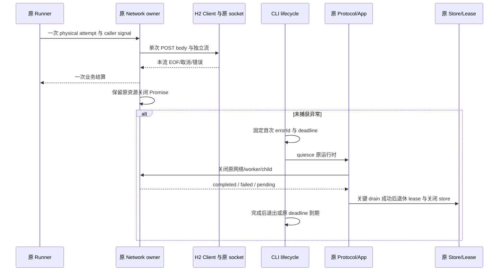

# HTTP/2 崩溃系统修复：实施与验证

范围仅 zcode-full，实施基于方案提交 `12a1ef76`。Magpie/plugins 外部仓库保持只读，固定 vendor revision 没有替换。桌面产品版本保持 3.18.8，构建 CLI 的 `--version` 为仓库现有 0.16.9，无数据库 migration；未修改原业务会话或重跑失败工作流。

## 已完成的修复

| 工作项       | 实际变化与依据                                                                                                                                                                                                         |
| ------------ | ---------------------------------------------------------------------------------------------------------------------------------------------------------------------------------------------------------------------- |
| A 正式复现   | 将旧探针改为真实 TLS、POST/SSE 和进程隔离测试。旧实现的 8 路正常结束复现 `null.servername`，另有断言/悬挂；4 个 H1 对照通过。原日志不能据此解释成 AI 主动取消或确认供应商不稳定。                                      |
| B H2 引擎    | 7.25 候选失败后淘汰，最终固定 Undici 8.12.1。由库按请求/流身份结算，移除旧 dispatch/onConnect singleSend、abort 集合及 pipelining 调整。保留 H1 回落和每 session 8 流上限。                                            |
| B 不重放     | 非 GET/HEAD 的协商请求使用单次流 body。JSON/空 POST 在 headers 前被 REFUSED_STREAM/GOAWAY 拒绝也只发一次；恢复仍回原 Runner 预算。                                                                                     |
| B 连接退休   | GOAWAY 后 draining session 已脱离 Client，故关闭原 connector socket，并传入故障原因；同时退休原 Client，避免 SSE 悬挂或不完整 body 被当正常 EOF。单流取消保留健康兄弟流。                                              |
| B 代理兼容   | 显式保留 Host 默认 CONNECT，CLI 原 forward 配置不变；HTTPS 代理端固定 H1，隧道内目标再协商 H2。直连、认证 HTTP/HTTPS CONNECT、SOCKS5、自定义 CA、协议回落均有真实本地测试。                                            |
| C 物理清理   | 原 network owner 保存 body cancel、迟到响应、初始化中 dispatcher 与淘汰连接的清理。活动租约归零与物理完成分开。真实关闭失败向上传递，重试仅处理原失败资源。Model cache 和账号 driver 关闭同步保留失败进度。            |
| C worker     | 先封闭准入并取消原 operation，再等待原网络、reader、child close、callback server 与原 operation settle。ACK 与真实 worker exit 分开；无响应 worker 在受限预算下终止并报告失败。                                        |
| C Cursor     | 裸 H2 session 归原 operation；取消会关闭原 session，通用池仍由 transport 持有。取消发生在 headers 前/后均不触发 H1 重发，同账号后续请求可用。未更换 vendor pin。                                                       |
| C Claude     | 先 stdin EOF 给 CLI 落盘机会，再逐级终止原 child；等待真实 close 后删除自有 profile，借用 profile 不删除。                                                                                                             |
| D 诊断 v2    | v1/v2 严格兼容读取；增加 code、有界 cause、独立顶部/尾部 frames、原始长度及裁剪标记、Node/Electron/Undici 版本和有界网络事实。按实际 JSON 帧长收敛，Host 脱敏后再次限长。                                              |
| D 因果与构建 | 首次 errorId 显式传入不可变 close context，清理结果关联 closeId/errorId；Host spawn/exception 绑定原 child 的入口 SHA-256。Desktop 上报保留 v2 原因与 frames。未知命令或 bytecode 全依赖不能靠入口 hash 冒充完整身份。 |
| D stderr     | UTF-8 分片只认 LF，单行缓存有界；超长行后仍能解析下一帧，退出 drain 保留最后一行。                                                                                                                                     |
| D Codex 轮换 | 已绑定账号的 refresh 单飞，发送前捕获固定 generation 的 Host CAS 句柄。caller 取消立即结束等待，成功轮换可有界收尾；账号删除、禁用、重授权、Host 退休仍拒绝旧写回。原文件锁等物理刷新完成后释放，失败收尾有脱敏诊断。  |
| D 本地写回   | 先持久化 Host，再对既有 Codex 来源校验文件快照，同目录临时文件 flush 后原子替换。两处存储不是跨文件事务；外部文件失败不丢失 Host 中的新令牌。批量导入候选各自验证，不共用账号 flight。                                 |
| E 交付一致性 | provider-node、Desktop 外置、Services、Server 都精确固定 8.12.1。保留其他工具原有 7.30 解析，淘汰实验 7.25。远程 Node 从 22.16 更新为仓库已固定 24.21；CLI target 改为 Node 24。                                       |

## 所有者和时序

Desktop continuous 与手机 replayable 仍使用原 Core/Protocol owner、序号和恢复入口；未创建第二套队列、快照或自动重放路径。Bootstrap 回归覆盖两种 delivery 语义，Web 覆盖停止归因的宽屏/手机、语言和主题。

## 验证记录

执行环境：Windows，开发 Node 24.21.0、pnpm 10.34.6；隔离 Electron 41.10.7，内嵌 Node 24.18.0。运行日志保留在本机 `.artifacts/http2-repair-implementation/`，不提交临时证书、凭据、数据库和测试 bundle。

| 检查                                                | 实际结果                                                                                                                                           |
| --------------------------------------------------- | -------------------------------------------------------------------------------------------------------------------------------------------------- |
| 根 typecheck / lint                                 | 退出码均为 0                                                                                                                                       |
| CLI typecheck / lint                                | 27 个类型任务、14 个 lint 任务通过，退出码 0                                                                                                       |
| 架构                                                | changed 检查违规/基线/新增均为 0；相关 provider-node、services、shared、CLI、server-cli 主要区域仍为 unmanaged，不把这说成所有边界均受机器规则覆盖 |
| 网络、native/plugin、账号、CLI 诊断、Host collector | 292 项主回归加新增 peer SETTINGS 1 项，去重 293 项通过；含真实子进程 fatal、Electron 内嵌 Node H2、原资源关闭失败重试、取消/代次 fencing           |
| 模型 adapter/Runner 全部现有测试                    | 226 项通过                                                                                                                                         |
| Bootstrap 全部 src 测试                             | 536 项通过；含 shared store 保护、Browser/checkout 原路清理、continuous/replayable、CommandInbox、恢复及关闭次序                                   |
| 固定插件 mjs 契约测试                               | 23 项通过；使用 `--import tsx` 加载当前 TS 源码                                                                                                    |
| 运行时/打包与远程资产                               | 已执行 17 项组合检查及 Desktop 外置版本重查；不等于在四种远端平台实际运行                                                                          |
| Web/Electron                                        | Web 停止归因 E2E 和隔离 Electron Host 各 1 项通过；Electron 重新装配当前 Host 与后端 fixture                                                       |
| 压测边界                                            | 同一 H2 session 完成 32 轮、256 次八流乱序 POST，发送计数准确、活动租约归零；没有据此宣称真实供应商吞吐提升或长期 RSS 无泄漏                       |

本轮去重共 1,098 项测试通过；重复的定向运行不重复计数。许可检查为现有常规门禁，另有基线材料复核债务，不等于零债务 strict 审计。

| 交付检查                               | 记录                                                                                              |
| -------------------------------------- | ------------------------------------------------------------------------------------------------- |
| worker 生成                            | 已由原构建器重建，vendor SHA 检查保留                                                             |
| 许可生成与 check                       | 均退出码 0；1,246 个包版本生成声明，1,746 个实装包检查通过；保留既有 20 项材料复核债务            |
| Desktop Agent build / 实际 staging     | 均退出码 0，Agent 约 17.3 MiB；实际 staging 字节一致检查 1 项通过，版本/许可入口 smoke 均退出码 0 |
| 当前修改格式 / pre-push                | 69 个本轮文件格式检查通过，pre-push 的 lint 与架构检查通过                                        |
| Agent / worker / Electron fixture hash | 见下方明确用途的 SHA-256                                                                          |

- Agent `apps/lcode-cli/packages/cli/dist/lcode.cjs`：`01b1285848651875316176b181cf43647c898e5889175d1de78a9e14300fd68d`。
- 生成的 `worker-source.ts`：`8abaf89eb8befc5d30365dcbed2b65e71d5d2f66c5bcdfb09f48b0ef10dbd850`；这是生成文件字节 hash，不混称 worker 裸脚本 hash。
- 固定 vendor manifest：`c0ce379a746de3ca094552c2b334f1fed585fe88a7369b6c2ac8d841a37ba348`，revision 仍为 `da7e2f67a5c7c2fe2ca776156d08ce2f144e86dd`。
- 隔离 Electron 后端 fixture：`327a06d58358765995ffdd9a8d43904252522b2542a49752f82f58f9a50cc697`。它使用真实 Core/Host 生命周期与固定模型响应，与生产 Agent 是不同产物。

功能提交：`dcc7e87b` 网络引擎/物理清理与运行时一致性；`9af3455f` 账号刷新及 worker/Claude 清理；`d0e29caa` 诊断 producer/consumer 与真实 fatal 验证。文档及补充 peer SETTINGS 测试另作验收提交。此前已有的远控重连改动和 artifacts 均保留，未混入这些提交。

## 本轮额外发现与限制

候选升级暴露了 HTTP proxy 默认变化、HTTPS proxy ALPN 变化、批量导入被误合并、Desktop 外置旧依赖、旧远程 Node pin、JSON 转义膨胀和无界 stderr 缓冲，均已纳入修复。依赖操作产生的无关 7.x 回退已恢复原锁定版本，保留冻结安装检查。

测试中曾有真实候选失败；另有夹具使用错误的 provider 字面量及 mjs 未启用 TS loader，均修正后重跑。最终结果只依据修正后的执行，不将失败日志改写成通过。

未在 macOS/Linux 真机、手机真机、用户原安装包或真实供应商上运行；没有推送、发布或替换安装。新远程运行时必须配套新资产，不能把新 bundle 放到旧 Node 22.16 上。强杀、远端已轮换但尚未持久化的情况仍可能未确认，不能保证所有资源都有优雅 ACK，也不自动重跑旧业务。

收益是恢复真实并发、隔离单流取消、保留可信的首次原因并准确报告关闭失败。代价包括 Undici 主版本与远程运行时升级的兼容面，以及原资源强制退出仍需明确 pending/failed 的运维处理。本轮保留 owner/lease fencing 与共享 store 的原有保护。
