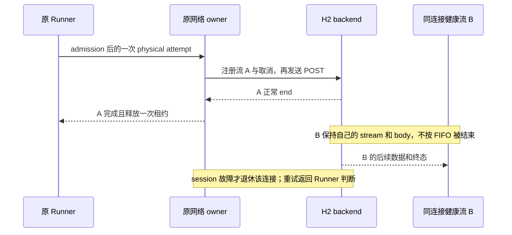
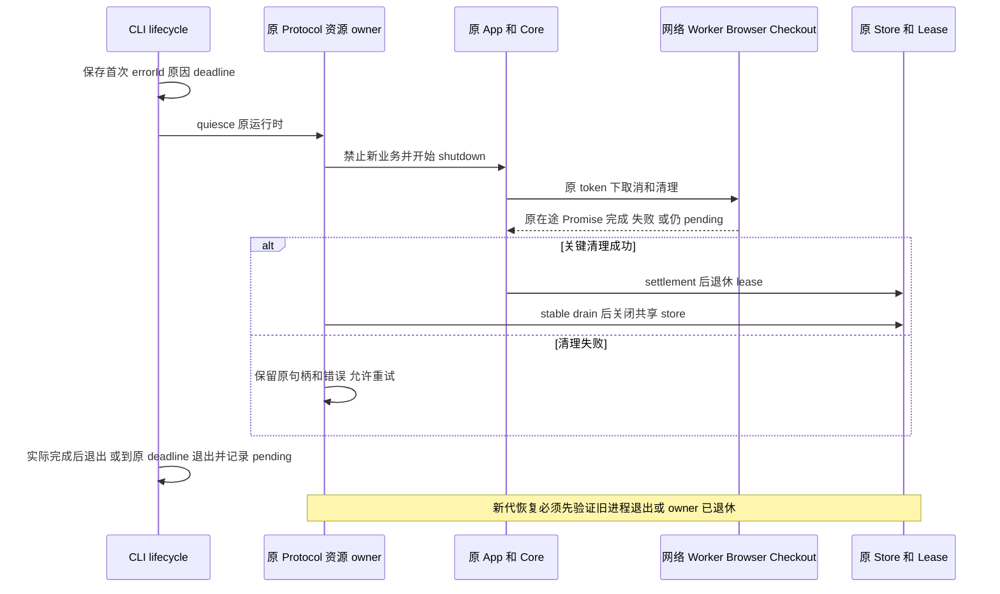

# HTTP/2 并发流与后端崩溃系统修复增强方案

状态：方案完成，待实施。本轮仅编写 zcode-full 的修复规格，不修改运行代码、依赖、固定插件或原会话。基线为 `429d5da2`，桌面仓库版本 3.18.8；本机复现使用 Node 24.21.0、Undici 6.29.0。

范围仅为 zcode-full。Magpie `707fbb249df755423d3b2b77c6f001dd376d75c4`、plugins `5d5d86e2251169e0f5c0fd7a884957ac2dbe184a` 是只读参考，不更新、修改、构建或运行这两个外部仓库。运行时继续使用 zcode-full 的公开端口和受控适配器，不引入 Magpie 网关、旁路 Host 或第二个 Agent。

建议按 **A 固定复现并止血 → B 修复通用 H2 与 C 补齐关闭事务 → D 诊断及相关适配增强 → E 整体验收** 推进。池化 H1 负责先恢复可靠性，经过验证的 H2 实现负责最终恢复并发能力；仅禁用 H2 不能标记本方案全部完成。

## 一 已确认问题与证据边界

| 事实                                                                            | 证据                                                                                              | 对方案的约束                                                               |
| ------------------------------------------------------------------------------- | ------------------------------------------------------------------------------------------------- | -------------------------------------------------------------------------- |
| 原报告两次工作区后端因未捕获异常退出，父子任务随后取消                          | 脱敏桌面日志源行 522 为 `null.servername`，890 为 `ERR_ASSERTION`；后端源行 180、374 起关闭       | 修复请求层触发源，同时验证进程关闭链，不能只修改取消提示                   |
| 两次 workflow service.closing 的 liveRunCount 都是 0，五个 Explore 均已 spawned | 报告后端摘录                                                                                      | 本事故主要暴露模型传输与 Core 子代理链；不能套用动态工作流常驻池误回收结论 |
| 当前通用 H2 两流正常完成仍能触发未捕获断言                                      | `.artifacts/workflow-crash-20261015-review/h2-completion-a-repeat.log`、`h2-completion-empty.log` | 正常完成也必须进入正式回归，覆盖 onData 和 onComplete 的迟到路径           |
| B 先结束时，两条正常响应未在 5 秒内全部结算                                     | `h2-completion-b-deadline.log`；隔离探针以退出码 2 结束                                           | 判定为未能按测试边界结算；不能把增加等待时间当作修复                       |
| H1 两种完成顺序均成功                                                           | `h1-completion-control.log`、`h1-completion-b-control.log`                                        | 可作为止血基线；不代表所有供应商实测或性能等价                             |
| 现有网络回归 18 项全部通过                                                      | `network-tests.log`，包含 H2/代理/取消/GOAWAY 与 transport 生命周期                               | 原测试漏掉并行流正常结束和完成顺序，原通过数不证明此缺陷已修复             |
| Browser 未激活、checkout settlement、sessions shutdown 失败出现在关闭链上       | 原报告后端源行 207–228、384–406                                                                   | 作为清理组合场景验收，不反向认定为最初崩溃原因                             |
| 第二次原异常栈被截断，报告未携带安装包 hash 和精确依赖版本                      | 原报告 manifest/README/桌面摘录                                                                   | 当前复现证明同类缺陷仍存在，尚不能证明两次现场完全同根                     |

本次复现没有请求真实供应商、账号或业务文件。第二次原日志中的 HTTP/2 replay 错误发生在关闭开始之后；它本身不能证明最早的异常来源。

### 当前源码中的触发链

普通 CLI 模型请求在 `model-execution.ts:resolveProviderTransport` 默认选择 negotiate。公开网络入口创建的 H2 Pool 在 ALPN 成功后，把 Undici 6 Client 的 pipelining 改成 8，并用 singleSend 拦截第二次 onConnect。

当前依赖的 H2 end 路径会修改共享的 running/pending 索引，再调用 resume；本机正常完成探针随后进入同请求的再次 onConnect，被本地 singleSend 拒绝，另一个流收到 terminated。迟到 data/end 又到达已中止的 Request，分别在 onData/onComplete 抛出断言。这条链同时涉及 Undici 6 队列实现与本地并发适配，不能只在某个 `.catch()` 中处理返回的 fetch Promise。[固定版本上游实现](https://github.com/nodejs/undici/blob/v6.29.0/lib/dispatcher/client-h2.js)。

`client.js:_resume` 中读取队列项的 servername 与第一次现场异常相符，但本次尚未复现原安装包的精确空项触发。正式测试保留两种异常指纹，不以捕获其中一个替代全部验证。

## 二 Magpie 与 plugins 可以吸收什么

zcode-full 原生适配参考 Magpie `93c5d846`，固定插件仍为 `da7e2f67`；外部参考 checkout 前进不代表内置实现已经升级。

| 参考增强                                                                                      | 与本事故的关系                                                                    | zcode-full 内的处理                                                                                 |
| --------------------------------------------------------------------------------------------- | --------------------------------------------------------------------------------- | --------------------------------------------------------------------------------------------------- |
| Cursor 在 H2 response head 与取消交接处二次检查，关闭迟到 req/session；取消不触发 H1 fallback | 直接改善固定 driver 的打开/取消竞态；Cursor 每 Run 的协议与普通 Undici 共享池不同 | 吸收事件顺序、幂等关闭和测试场景；在本仓库固定 driver/worker 组合下先验证差距，再决定必要的定点适配 |
| Cursor 的协议阻断分类与 H1 路径                                                               | 可区分 H2 不可用和普通断网；其 RunSSE/BidiAppend 是供应商专用协议                 | 只用于该 driver，不把厂商 H1 协议复制成通用模型 fetch fallback；取消或已发出业务请求后不能偷偷重发  |
| Magpie 对 ChatGPT 后端单独采用 H1                                                             | 支持按请求用途和供应商隔离策略                                                    | 复用现有 `http2` 执行配置及网络 owner，不照搬 Go transport，不把全部 OAuth 变成同一种传输           |
| Magpie Codex 已发出刷新脱离 caller 取消、有界完成                                             | 减少取消时丢失轮换令牌；不是普通 API Key H2 崩溃修复                              | 修改本仓库 native OpenAI 刷新收尾，继续使用 Host account generation/CAS 和原凭据存储                |
| Claude 退出的优雅收尾思路                                                                     | 减少子进程、MCP、profile/锁残留                                                   | 在本仓库 ClaudeSession 与既有进程管理 adapter 内实现退出确认，不按进程名称批量结束                  |
| 工具历史配对、Gemini 参数、WorkBuddy Schema、Cursor deferred usage 等                         | 可以改善供应商兼容，但没有证据能解决本次通用 H2 队列崩溃                          | 列为后续独立增强；本轮不打包升级 15 个 vendor，不新增供应商或扩展额度 UI                            |

参考源码：[Cursor 打开和取消](https://github.com/magpie-community/plugins/blob/5d5d86e2251169e0f5c0fd7a884957ac2dbe184a/packages/cursor/index.mjs#L1667)、[Cursor opener 测试](https://github.com/magpie-community/plugins/blob/5d5d86e2251169e0f5c0fd7a884957ac2dbe184a/packages/cursor/open.test.mjs)、[Magpie Codex 刷新](https://github.com/yetone/magpie/blob/707fbb249df755423d3b2b77c6f001dd376d75c4/internal/provider/account.go#L1053)、[Magpie transport](https://github.com/yetone/magpie/blob/707fbb249df755423d3b2b77c6f001dd376d75c4/internal/gateway/upstream_transport.go)。

特别保留差异：Magpie transport 的 replayable 会为部分 POST 添加仅供 Go 使用的可重放标记。zcode-full 的 physical attempt、计费预留、requestId 和重试归 Runner 所有，不能移植该机制绕过预算。Cursor 专用 fallback 也不成为通用 POST 重放许可。

## 三 产品规则与唯一所有者

1. 某流正常结束、取消或失败不能破坏同连接其它健康流；session 级真实故障只影响其所属连接。
2. 一个 physical attempt 最多发送一次业务 POST。是否允许新尝试由现有 Runner/admission/输出提交边界决定，并分配新 requestId；不承诺未知服务端是否已处理的 POST 具有端到端 exactly-once。
3. 已提交文本、工具调用或世界副作用后不从头自动重放。用户取消和 owner 关闭不触发换 Key、换账号、换协议继续执行。
4. response headers 不等于 body、socket、Browser 或 checkout 已释放；关闭请求、排水结算和物理关闭确认分别记录。
5. 未知进程异常继续走首次 fatal 边界与有界退出，不能全局吞异常继续复用可能损坏的运行时。
6. 每个窗口仍使用既有 Local Host；手机连接已有 attachment。Desktop continuous 与手机 replayable 共用执行 owner，保持各自恢复语义。
7. 身份隔离使用 `workspaceIdentity?.trim() || workspacePath`，文件操作使用 workspacePath；remoteSessionId、原 App 实例、run generation 和资源 token 贯穿清理及恢复。

| 状态或资源                                     | 权威所有者                                         | 其它层的职责                                               |
| ---------------------------------------------- | -------------------------------------------------- | ---------------------------------------------------------- |
| attempt、重试预算、输出提交、Key/账号候选      | 原 Runner、admission、Key/Account Pool             | 网络层报告事实，不另建 accepted 队列                       |
| dispatcher、连接、request/body、关闭在途工作   | 原 ProviderNetworkTransport                        | 持有原 Request 到结算，按原 owner 清理；不保存鉴权 header  |
| H2 stream 与 session 内部队列                  | 选定的单一 H2 backend                              | 本地适配不修改库私有索引，不复制第二套库内队列             |
| plugin operation、worker、该 worker 分配的资源 | PluginWorkerTransport 与现有 worker scope          | Host 持有 worker 生命周期及账号权限，worker 不能提升权限   |
| 持久凭据与账号代次                             | 既有 ProviderAccountService/Credential Store       | caller 取消不能删除另一个操作的事实；失效代次拒绝迟到写入  |
| App close 进度、未发布构造清理、durable drain  | SessionFacade / ProtocolRuntimeResources / 原 Core | 复用上一轮实现，不增加新的资源总表                         |
| workflow journal 与执行权                      | 原 SQLite lease                                    | 仅证明旧进程退出或原 owner 退休后接代，未知 owner 继续拒绝 |
| 首次 fatal 与进程关闭 deadline                 | CLI process boundary / lifecycle                   | Host 关联其创建的原 child，不反查当前 workspace 猜旧进程   |
| exception 到 close 到 exit 的诊断投影          | 既有 Host lifecycle reporter                       | Main 只接收和转发诊断，不保存任务业务状态                  |



## 四 A 固定失败场景并隔离不安全路径

### 正式化复现

把本机临时探针迁入本仓库正式测试。使用真实 TLS H2 fixture 和独立子进程；服务端明确控制两个流的 headers、data、end 和 RST，不用随机 sleep 决定结果。测试父进程捕获 exit code、signal、stderr 和 fixture 请求计数，子进程的断言不能导致测试套件提前退出后被误算通过。

必须保留 A 先结束、B 先结束、剩余流有数据、剩余流空 end 四种情况；在进程级超时到达时判失败并回收测试自己创建的进程。这个超时只限制测试，不进入生产资源关闭逻辑。

### 可独立交付的止血

- 普通 model-api 在不安全 backend 下有效策略使用已有池化 H1。disabled 仍是 H1；negotiate 在该阶段解析为 H1，并记录一次有界的 requested/effective 协议及 `http2_temporarily_unavailable` 原因。用户保存的原配置不改写。
- 决策必须在业务 POST 发送前完成。已有 H2 请求不在后台改协议重发；候选 backend 通过后，negotiate 才恢复 ALPN 协商。
- 保留每 origin 最多 8 条连接和 H1 单连接原行为，不把所有模型请求全局串行化，不降低 Agent 并发或延长 TTL 掩盖问题。
- Host/MCP 既有 H1 默认值保持；Cursor 等专用 driver 的原生 H2 是另一条有限协议路径，单独验证取消与资源收尾，不强行套通用 H1。
- 沿用 `@lcode/provider-node/network`、原 CA/代理/取消/连接缓存，不增加全局 dispatcher 或临时网络服务。

A 的完成只表示默认通用请求不再走已复现的危险路径。没有通过阶段 B 的 H2 测试时，报告必须明确“止血完成，H2 修复未验收”。

## 五 B 替换通用 H2 并修正请求结算

### Backend 选型门

首选对现有 Undici 公共 API 做受控升级验证，以 `7.25.0` 为第一评估候选，不将它当作已经证明修复的版本。先运行本方案所有致命复现，再验证代理、SSE、取消、重放约束和打包；通过后固定确切版本与根锁文件。候选的公开 Client 提供 allowH2 和 maxConcurrentStreams，是否满足本仓库的行为仍由测试决定。[候选官方接口](https://github.com/nodejs/undici/blob/v7.25.0/docs/docs/api/Client.md)。

成功迁移后移除 `network-http2-client.ts` 中为 Undici 6 修改 pipelining、覆盖 dispatch/onConnect 和故障后递归 abort 的适配；若保留某个公开能力 helper，须由真实调用和测试说明必要性。删除导出前用 dep:refs 核对，不留下两条同时可选的生产 H2 实现。

候选有任一致命或无重放测试失败就不能上线 H2，也不能继续叠加私有队列补丁。保留 A 的安全 H1，B 标记未完成；按同一接口进入 Node 24 原生 H2 backend 的独立实现评估。原生路线需要自己承担 body/backpressure、压缩、Response 兼容及代理隧道的成本，不能只搬 Cursor 的 session.request 片段。最终选择单一 H2 backend，另一个实验实现不进入生产分支。

| 路线                                   | 优点                                                           | 主要代价与限制                                                        |
| -------------------------------------- | -------------------------------------------------------------- | --------------------------------------------------------------------- |
| 升级并适配 Undici 公共 API，首选       | 复用现有 fetch/ProxyAgent/连接池与 Response 行为，改动边界较小 | 依赖行为变化；不能以版本更新代替完整回归，需覆盖 CLI 与 Electron Node |
| Node 原生 H2 backend，候选不合格时启用 | 明确按 stream 身份管理，避开旧 Undici 队列适配                 | 新维护面大，尤其 CONNECT/SOCKS、流控、压缩与 fetch 语义               |
| 保留 Undici 6 并继续增加队列兜底       | 短期 diff 小                                                   | 已有正常完成崩溃证据，维护私有状态成本高；不采用                      |

### 请求与连接不变量

- 本地请求租约结算入口收敛到一次 finish；body error/cancel/end 与底层物理关闭分开。取消后调用者可立即收到取消，但原 reader/socket 的关闭 Promise 仍由原资源 owner 保有，不能因活动计数归零就提前宣称物理释放。
- 先注册取消和错误观察，再发送；headers 到达与取消同时发生时，迟到 Response/reader 必须回收。跨 await 后复核 owner generation，不能发布关闭后的新可用资源。
- 流正常结束只完成自己的操作；取消用原 stream handle。迟到回调在 adapter 边界以该请求的终态和代次判断，不通过错误字符串兜底，也不能取消另一个请求。
- session 故障封闭新 stream，释放所属操作，形成一个连接故障因果链。GOAWAY 按 backend 能证明的 lastStreamID/接收状态处理；不确定结果不伪装未发送，不在网络层重放。
- 单流 RST 不退休健康 session；确需 session 退休时，清理只使用该 session 所属句柄。关闭请求并不等于 close 事件确认。[Node 24 关闭与销毁语义](https://github.com/nodejs/node/blob/v24.21.0/doc/api/http2.md#http2sessionclosecallback)。
- 并发上限先保持既有每 origin 连接上限 8、每 H2 session 上限 8，并服从对端 SETTINGS；不靠提升这些值交付性能收益。

### 路由兼容

身份继续由原 transport/出口缓存隔离，策略变化产生新资源代次；连接池本身按 origin 和 TLS/代理能力路由，不按 Key 建池。新 backend/policy 也要参与 dispatcher cache 身份，避免 H1/H2 或不同 CA/SNI/代理复用错资源。

必须覆盖直连、认证 HTTP CONNECT、HTTPS CONNECT、SOCKS5、noProxy、自定义 CA、SNI、H1 ALPN 回落。不得为了 H2 绕开企业代理或改走全局 fetch。代理尚未通过验收时保留该路线的 H1，给出有效协议原因，不能说全部 H2 路由已经恢复。

### 错误边界与恢复决策

| 分类                               | 网络层返回的事实                                                     | 恢复权威                                       |
| ---------------------------------- | -------------------------------------------------------------------- | ---------------------------------------------- |
| caller 取消或 owner 关闭           | 保留原取消原因及所属操作，不转为供应商认证失败                       | 原调用方/关闭 owner，不自动恢复                |
| 单流错误                           | 原 backend code、流身份、已观察到的发送/响应阶段、有界 cause         | 原 Runner 在输出提交边界和预算内判断新尝试     |
| 连接错误                           | 原连接 generation、受影响请求、GOAWAY/关闭事实；未知发送结果保持未知 | 网络 owner 退休连接，Runner 决定各请求是否重试 |
| backend 不变量损坏或未知未捕获异常 | 保留首次原异常，不能伪造普通可重试网络错误                           | 原 fatal lifecycle 封闭进程准入并有界退出      |

上表是规范分类，实施时映射现有模型失败类型与 context，不另建业务错误总线。需要跨进程新增字段时先定义 shared schema，再配套 producer/consumer；错误文本不参与流程判断。

## 六 C 崩溃与关闭后的资源事务

上一轮已修复 App 关闭失败保留、失败 close 重试、未发布构造清理、shared store 保护和原 owner 恢复。本轮在其上补真实网络崩溃组合，不建立第二套 shutdown 管理器。

### 三种退出分别处理

| 场景                           | 必须采取的动作                                                                                 | 不能据此宣布                                 |
| ------------------------------ | ---------------------------------------------------------------------------------------------- | -------------------------------------------- |
| 单请求或单流可处理错误         | 在本请求返回结构化失败，原 Runner 判断；健康同级流保留                                         | 整个进程已不可信或其它任务必须停止           |
| Agent 未捕获异常，入口仍能执行 | 首次 fatal 封闭业务准入，保存原原因和 deadline，原资源清理、durable drain 后退出               | 捕获了异常就能继续接新任务                   |
| Agent 强杀或无法清理           | Host 按原 runtimeInstanceId/进程身份回收自己持有的 attachment/后代；下次恢复验证旧进程确实退出 | 原进程内所有资源都有 ACK、旧业务可无条件重跑 |

### 有序清理

1. CLI 保存首次 fatal；重复 fatal、后续 EOF 或资源清理错误不覆盖它。
2. Core/Protocol 关闭新业务 admission，终止原模型请求和子代理；只保留现有 allowlist 中原资源 cleanup 请求及响应。
3. 网络和 plugin owner 封闭准入，取消所属操作，收集原在途 body、dispatcher、worker、CLI 子进程的真实退出工作。
4. Browser close/turnEnded 与 checkout release 使用原 route、scope generation、owner token；关闭中不重新注册 scope 或获取新的执行 permit。
5. 等待原 Core 稳定 drain、App 构造 flights 和未发布候选清理。失败项保留句柄与全部原因，成功项不重复执行。
6. workflow settlement 与关键清理成功后退休原 lease，再关闭所属 store；共享 store 不被单 App 提前关闭。
7. 原绝对 deadline 到达时记录 pending 和未确认资源，入口有界退出；不能把超时写成成功 ACK，也不为每一层重新续时。

资源间存在依赖时按上述顺序；独立资源仍使用 allSettled 获得清理机会。一项 model/MCP/Browser 清理失败不能阻止其它独立资源开始清理。



### 需要补齐的具体点

- `worker.mjs:dispose` 当前调用网络 dispose 后立即 process.exit；未来 ACK 应区分“收到关闭”和“资源已结算”，父 transport 以真实 worker exit 及清理结果为准。给 worker 的预算受宿主剩余 deadline 限制，强制 terminate 后不能伪造优雅完成。
- `ClaudeSession.dispose` 的 child.kill 不等于 waitClosed。允许先结束业务响应，但 profile/相关锁清理等待实际 exit；优雅关闭无效再由原进程 adapter 在剩余预算内升级，不扩大到非所属进程。
- Browser `scope is not active` 只有在原 scope/代次已经明确关闭时才能作为幂等结果；未知 scope、旧代 ACK、真正失败分别处理。禁止全局 catch 后把任意 missing scope 当成功。
- checkout writer settlement 在 closing 时仍能走原受信 release；取消任务不提前丢弃 permit，也不新增 UI→Repo 或 Main 业务状态写入路径。
- Host 进程清理沿原 managed child、启动标识和平台 adapter；防 PID 重用，不能用 taskkill/进程名兜底删除别的 Node、Browser 或厂商 CLI。
- 崩溃后恢复会话和自动重放已执行工具是两件事。保持 CommandInbox 去重、原 lineage 导入和完成 occurrence 复用，不自动重跑原失败业务。

## 七 D 诊断与相关供应商适配增强

### 诊断沿既有链路扩展

现有 `[lcode-process-exception]` 结构化 stderr → Host parse → lifecycle reporter 已存在，不能重建第二个崩溃日志系统。现有文本 tail 每行 1,000 字符不足以保留压缩代码断言；应先解析结构化异常，再保存有界的人类可读 tail。

| 记录层         | 建议字段或行为                                                                                                  | 级别与边界                                                            |
| -------------- | --------------------------------------------------------------------------------------------------------------- | --------------------------------------------------------------------- |
| 请求生命周期   | 原 traceId、requestId、attempt、provider/connection 的安全标识、requested/effectiveProtocol、发送阶段、结算原因 | 正常 begin/terminal 为低频事件；逐 chunk 仅 debug                     |
| 连接生命周期   | 不透明 connectionInstanceId、generation、ALPN、active stream 数、GOAWAY code/lastStreamID、退休原因             | 建立/退休 info，可恢复异常 warn；不记完整地址、header、证书或代理凭据 |
| 进程异常       | errorId、kind、name、稳定 code、有界 cause 链、顶部与尾部 stack frames、裁剪标记和原长度                        | error；保留首个原始异常，清理异常作为关联原因                         |
| 关闭生命周期   | closeId、原 origin、errorId 关联、phase、deadline、资源结果 completed/failed/pending                            | phase/summary info；失败 warn/error 按可恢复性区分                    |
| 构建与运行身份 | Agent build hash、Node/Electron/Undici 版本、worker/vendor revision、runtimeInstanceId、generation、lane        | 启动时一次 info，敏感路径不进入导出                                   |

`sent`、`possibly_sent`、`response_started` 等诊断必须来自可验证观察点；不能用“onConnect 调过一次”当成上游未收到 POST 的证据，也不能用业务错误分类猜连接协议。

### 协议兼容与裁剪

- 在 `packages/shared/src/process-diagnostic.ts` 定义 v2 严格 schema，保留 v1 reader。新 Host 接受 v1/v2，未知版本拒绝旁路帧但不中断业务协议。新 Agent 仍输出兼容的人类可读错误；旧 Host 至少得到旧 tail，不宣称新字段对旧 Host 可见。
- 增加稳定 error.code、最多有限层 cause、frames 和 truncation metadata。长断言源码摘录从中间裁剪，优先保留异常名、code、首个业务/依赖 frame 与收尾 frame，避免 16 KiB 全被压缩源码占满。
- Host 在脱敏后再次限长；CLI/schema/stdio framing/Host IPC/desktop lifecycle 消费者同时更新测试。若涉及正式业务协议字段，同步 `packages/shared/src/lcode-protocol/index.ts`；不允许客户端传入清理权限或 owner。
- 同一个进程的 errorId→closeId→exit 通过受信入口显式关联。跨进程只关联已知 runtime 身份，不能凭相近时间或错误文本合并。旧 runtime 的迟到事件不能归到重启后的 child。
- `process-errors` 的首次异常回调需要显式把不透明 errorId 交给 lifecycle，再经内部关闭上下文传到 Bootstrap；同步更新对应 contracts 类型，不能依赖从 message/stack 重新解析 ID。provider-node 不反向导入 CLI runtime 的具体类型。
- 关闭失败日志保留有界的 error code/message/cause 和 resource，不再只有 errorType。summary 列出失败和 pending，不把多项异常覆盖成最后一项。
- 采用有界内存事实缓冲或现有生命周期快照，fatal 时输出一次；不保存模型输入输出正文，不在每个流 chunk 落生产日志。

构建保存 hash 对应的依赖清单和受控映射材料，避免用另一份 bundle 的压缩行号还原事故；若新增 source map 产物，单独定义存放与访问范围，不作为生产运行依赖或随原始凭据日志公开。服务侧使用 createServiceLogger，CLI/adapter 沿注入 Logger 或有限观察端口输出，不从 UI/底层网络模块直接写 console。

### Codex 轮换令牌收尾

只修改 zcode-full 的 native OpenAI driver 和现有 Host 凭据事务。发送刷新前仍尊重 caller 取消；刷新一旦发送并得到成功轮换，业务 caller 可以立即结束，但 Host account owner 在有界预算内完成保存，不能因 caller signal 再次检查而丢掉新令牌。

刷新 single flight、写回和代次校验属于原账号 owner。账号删除、禁用、重新授权或 host owner 失效后拒绝旧代写回；外部登录源身份切换仍按现有防护处理。原本已获授权写回的本地凭据改为同目录临时文件、flush 后原子替换，失败不损坏旧文件，不扩大外部凭据写入范围。

正常 caller 取消可参考上游 30 秒刷新上限；真正 host 关闭必须受其剩余 deadline 约束。强杀或远端已轮换但进程尚未落盘时，不能保证令牌一定恢复，必须报告未确认结果，不能绕过账号代次保护。

### 固定 Cursor 与 worker 的边界

先把上游 opener 取消交接场景改写为本仓库真实 worker fixture，不直接运行 Bun 测试或依赖外部 checkout。若固定 Cursor 确认存在缺口，优先在现有有限资源兼容层处理能保证的关闭；需要替换固定源时，单独提交来源 pin、同步/生成器、manifest、兼容适配和测试。

不能在标称 `da7e2f67` 的 manifest 下替换成新版 Cursor 文件，也不能手工改 SHA 绕过新鲜度检查。若只升级一个包，先显式定义逐包 revision 与旧 manifest 兼容，并更新所有 manifest/notice 消费者；不为了它一并升级其余 14 个包。新的 deferred usage 若随升级引入，须先接入现有账本与上下文统计区分，否则该升级不准入。

## 八 源码落点与依赖边界

以下均在 zcode-full 内。新文件名是实施建议，当前不存在的测试不算已覆盖。

| 工作项                   | 当前入口                                                                                                                                           | 实施边界                                                           |
| ------------------------ | -------------------------------------------------------------------------------------------------------------------------------------------------- | ------------------------------------------------------------------ |
| 通用协议与 backend       | `packages/provider-node/src/network-transport.ts`、`network-http2-client.ts`、`network.ts`                                                         | 继续公开 ProviderNetworkTransport；仅 adapter 操作网络和 Node 句柄 |
| body 与物理关闭结算      | `packages/provider-node/src/network-request-lifecycle.ts`                                                                                          | 原租约区分业务终态与真实清理 Promise，不复制 accepted 队列         |
| model-api 默认策略与重试 | `apps/lcode-cli/packages/adapters/src/model/model-execution.ts`、`apps/lcode-cli/packages/adapters/src/network/network-fetch-cache.ts` 及原 Runner | 使用原 admission、attempt 和模型配置，不下沉预算到 fetch           |
| App/Protocol 清理        | `bootstrap/src/app/session-resource-close.ts`、`failed-app-startup.ts`、`lcode-protocol/runtime-resources.ts`、`runtime-cleanup.ts`                | 相对 `apps/lcode-cli/packages/`；复用上一轮资源进度 owner          |
| Browser/子代理/checkout  | `apps/lcode-cli/packages/core/src/runtime/agent-runtime-close.ts`、既有 resource_cleanup 端口                                                      | 原 scope/token/代次，受信接口，不放宽通用输入                      |
| worker 与固定适配        | `packages/provider-node/src/provider-auth/plugins/transport.ts`、`worker.mjs`、`worker-network.mjs`                                                | account/operation scope；只经现有 Host 凭据接口写回                |
| native 刷新/进程         | `packages/provider-node/src/provider-auth/native/openai.ts`、`claude-session.ts`、`claude-process.ts`                                              | 无反向依赖 CLI runtime；关闭上下文经有限端口传入                   |
| 异常与诊断契约           | `apps/lcode-cli/packages/cli/src/process-errors.ts`、`protocol-lifecycle.ts`、`packages/shared/src/process-diagnostic.ts`                          | 稳定 schema、版本兼容、首次原因与原 deadline                       |
| Host 进程投影            | `packages/services/src/lcode-agent/lcodeAgentProcessManager.ts` 及既有 lifecycle reporter                                                          | 原 child 身份、异步 IO；Main 只转发                                |
| 来源与构建               | `scripts/sync-auth-plugin-vendor.mjs`、`build-auth-plugin-worker.mjs`、`licenses.mjs`                                                              | 按真实修改范围生成 worker/notices，禁止假 hash                     |

实施前生成 provider-node、services、shared、lcode-cli 的受控上下文并补对应接口注释/契约示例。当前策略把相关主要区域识别为 unmanaged，检查通过不等于全部依赖边已受规则覆盖。CLI 新源码遵守 400 行限制；禁止 UI 直接 Repo、Service 导入 Runtime 具体实现或新增循环依赖。

## 九 测试矩阵与验收

### 网络与请求

| 场景                                                         | 必须断言                                                                                |
| ------------------------------------------------------------ | --------------------------------------------------------------------------------------- |
| N01 两流正常完成，两种顺序及剩余流有/无尾数据                | 两者内容完整、各结算一次、子进程正常退出，无断言/null.servername                        |
| N02 三流与八流乱序完成                                       | 每个 stream 按身份结算；固定可重放种子，没有 FIFO 误关联和多发 POST                     |
| N03 取消队首或后续流                                         | 只取消目标；健康兄弟流继续并正常完成                                                    |
| N04 预取消及 headers 交接取消                                | 预取消零发送；迟到 Response/reader 被原 owner 关闭，不触发协议 fallback                 |
| N05 EOF/error/cancel/close 的迟到与重复事件                  | 仅一个业务终态和租约释放，物理关闭工作仍可追踪                                          |
| N06 慢消费者与 backpressure                                  | 字节完整、内存有界，不能为观察 EOF 预读整个 SSE                                         |
| N07 单流 RST 与 session 故障                                 | 单流错误保留健康兄弟；session 错误结束所属流，不影响其它连接                            |
| N08 GOAWAY 与 lastStreamID                                   | 不接新流、不隐式重放；已发送/未知结果如实分类，Runner 决定后续尝试                      |
| N09 半关闭、断连与迟到 data/end                              | 不触发进程级异常，无悬挂的 disposeAndWait                                               |
| N10 owner 关闭、初始化中的 dispatcher 与后续请求             | 不新发 HTTP；迟到资源原样回收，成功资源不重复关闭                                       |
| N11 H2/H1 ALPN、直连与代理路线                               | 认证 HTTP/HTTPS CONNECT、SOCKS5、noProxy、CA、SNI 正确；无私自直连                      |
| N12 传输与配置代次切换                                       | 新旧 policy/CA/backend 不误复用；旧流按原 owner 结算                                    |
| N13 gzip/deflate/Brotli、UTF-8、碎片 SSE 与错误 Content-Type | 保留现有前缀识别、首字与字节完整性，不等待 EOF 才返回                                   |
| N14 重试预算和世界副作用                                     | 一个 requestId 一个 POST；重试经过新 admission/记账；输出提交后不重放                   |
| N15 身份与账号隔离                                           | 同路径异 workspaceIdentity、remoteSessionId、账号 worker 与 Key 不互相关闭或串归属      |
| N16 资源和负载                                               | 1/2/8/超过上限的在飞请求受控；持续建立/完成后 request/listener/socket/worker 数回到基线 |

### 崩溃与资源清理

| 场景                                  | 必须断言                                                                             |
| ------------------------------------- | ------------------------------------------------------------------------------------ |
| C01 真实网络异常与人工 fatal 注入两类 | 可处理网络错误不退出进程；未知 fatal 按首次原因关闭，不继续 admission                |
| C02 无 live DWF 但有 Explore/Bash     | Core 事实仍保有资源，fatal 后两个子代理准确取消，无创建失败误报                      |
| C03 Browser 与 checkout 关闭期间 ACK  | 原 scope/token/route 有效；未知代次不成功，不遗留实际 permit                         |
| C04 App 构造在途及未发布 lease        | 保留上轮原句柄重试与 shared store 顺序，不抢建同 ID App                              |
| C05 清理真实拒绝及迟到拒绝            | 独立资源仍尝试、全部错误可见、重试仅处理未完成项                                     |
| C06 deadline 与永不返回的资源         | 同一绝对 deadline；pending 不当 closed，测试不靠放宽 timeout 通过                    |
| C07 强杀与 Host 回收                  | 只处理原 managed child/后代；PID/代次更换不误杀，未知旧 owner 不被标死               |
| C08 恢复与旧结果迟到                  | continuous/replayable 各自恢复；原 CommandInbox 去重、lineage 和已完成工具副作用保留 |

### 诊断与适配

| 场景                                          | 必须断言                                                         |
| --------------------------------------------- | ---------------------------------------------------------------- |
| D01 fatal 后再 EOF/重复 fatal/cleanup failure | 首个 errorId/origin/deadline 稳定，后续错误关联且不覆盖          |
| D02 超长断言、错误 cause 和压缩 bundle frame  | 保留 name/code/关键 frames/truncation；不只剩压缩源码开头        |
| D03 stderr 分片、多行、v1/v2/损坏帧           | framing 和严格 schema 正确；不污染 stdout，不因诊断失败再崩溃    |
| D04 生产 debug 关闭                           | 一次性异常和资源失败仍可观察，无逐 chunk 大量日志                |
| D05 脱敏、限长与旧 runtime 事件               | 不泄漏凭据/真实地址/正文，旧 child 事件不串新代                  |
| D06 构建身份与因果导出                        | 完整 Agent/worker hash、Node/Undici、errorId→closeId→exit 可核对 |
| P01 worker 单请求取消及 worker 崩溃           | 不取消同账号健康请求或其它账号；worker 失败不击穿 Agent 进程     |
| P02 worker dispose 与 Claude exit             | ACK 不冒充真实退出，profile/锁不提前删除，强制回收标为降级       |
| P03 Codex caller 取消及成功轮换               | 业务保持取消，原 Host owner 有界保存新代凭据，无重复刷新         |
| P04 账号删除/禁用/重新授权期间迟到刷新        | 原代次 CAS 拒绝，旧写回不复活账号或覆盖新凭据                    |
| P05 Cursor open/response/Run 接管窗口取消     | 原 req/session/heartbeat 收口，无取消后 fallback 或新请求        |

这些是验收场景而非已执行测试数。新增测试优先落在现有 `network-http2.test.ts`、`network-transport-lifecycle.test.ts`、plugin fixtures、App/Protocol close 测试旁；进程级探针建议新增 `packages/provider-node/src/network-http2-process.test.ts`。不得把临时复现的“成功触发崩溃”算成修复通过。

### 整体与交付验证

先跑每项旧实现失败/新实现通过的定向回归，再跑相关完整测试组。最终必须验证真实模型 adapter + 两个 Explore + 原网络 transport，不以伪造异常的 mock 替代 H2 故障用例。隔离 Electron Host 验证父回合完成后的保活、网络错误不退出、真正 fatal 的诊断及原资源关闭。

Desktop continuous 与手机 replayable 分别测试断连、重连、snapshot/ACK 和重复 commandId；Web 使用真实状态组件验证“请求失败”“运行时崩溃”“用户取消”“恢复不可用”可区分。UI 仍经 hooks/平台端口访问，新增交互前读取 DESIGN.md 并补 E2E。

固定 Node 24.21.0、pnpm 10.34.6；同时在实际打包的 Electron Agent Node 验证依赖兼容，不能把开发 Node 结果当安装包结果。Windows/macOS/Linux 的进程退出、socket、文件原子替换分别验收；没有实机条件的项标记未验证。

从根目录执行已核对存在的入口：

```text
node scripts/check-workspace-freshness.mjs
pnpm architecture:check --changed
pnpm architecture:context provider-node
pnpm architecture:context services
pnpm typecheck
pnpm lint
pnpm --dir apps/lcode-cli typecheck
pnpm --dir apps/lcode-cli lint
node --import tsx --test packages/provider-node/src/network-http2.test.ts packages/provider-node/src/network-transport-lifecycle.test.ts
node --test packages/desktop/scripts/workflow-lifetime-electron.test.mjs
pnpm verify:pre-push
pnpm --dir apps/lcode-cli --filter @lcode/cli build:desktop-agent
node --test scripts/workflow-snippet-bundle.test.mjs
```

新测试入口创建后再加入执行清单，测试命令不假定全仓统一 test 入口。修改 native/固定兼容层后按现有构建顺序生成 worker，再执行 `node scripts/licenses.mjs notices` 和 `node scripts/licenses.mjs check`；涉及 vendor 同步先定义并验证 pin。源码、生成物、Agent、Desktop staging 的 hash 与版本一起保存，测试数量按互斥分组去重。

## 十 实施顺序与回退

| 阶段 | 交付与完成门                                                                | 回退边界                                                                  |
| ---- | --------------------------------------------------------------------------- | ------------------------------------------------------------------------- |
| A    | 正式进程级失败用例、H1 双顺序对照、通用危险 H2 路径隔离                     | 保留 pooled H1 与所有预算/身份防护，不能回退为危险默认 H2                 |
| B    | 选定并固定单一 H2 backend，N01–N16 通过；清理旧私有队列适配                 | H2 未通过保持 A，不能靠开关掩盖失败后宣布完成                             |
| C    | C01–C08，worker/Claude/Browser/checkout 真实清理确认                        | App close 进度、原 lease fencing、cleanup admission 与 store 顺序成组保留 |
| D    | 诊断 v1/v2、cause/frames、构建身份；选定相关 native/driver 增强             | 诊断保留 v1/plain-text 读取；适配与来源/生成物/兼容测试一起回退           |
| E    | 定向与完整回归、两模式/Electron/Web、构建/staging/notices、性能和跨平台报告 | 回退完整 Agent/worker 配套产物，不混用不同诊断/driver 生成代次            |

B、C 可以按独立提交实施，合并后必须做组合验收；不要求为此创建新聊天或多个 Agent。D 的 shared schema 先于 producer/consumer 配套修改。无数据库表、列或 migration 变更；若实施发现确需新增持久结构，先补兼容/回滚规格，不临时绕过维护要求。

上线前不自动关闭用户原应用、改动原会话、批量标记 interrupted 或重跑失败业务。用隔离 Host 验收新 bundle，再按用户指定的安装/发布流程处理。相同严重错误的反复重启不应自动无限重放命令，复用原恢复与幂等边界。

## 十一 收益与代价及完成标准

主要收益是将正常流结束与同级流完全隔离，把可处理的网络故障限制在所属请求/连接；真实 fatal 保留可追踪原因并正确收尾，避免子代理取消成为唯一可见结果。来源明确的供应商取消与刷新收尾增强，可以减少崩溃以外的隐性资源和凭据损失。

主要代价是 H1 止血期可能增加连接数和握手成本，依赖升级会扩大网络兼容回归面；若必须实现原生 H2，代理与 fetch 语义的维护成本明显增加。更强的物理退出确认会暴露过去被忽略的 pending/failed，但不能为了消除告警提前关 store。诊断需要限长、脱敏和兼容测试，不能无界保存请求内容。

完成必须同时满足：正常并行完成无异常/悬挂；单流取消不影响健康流；无 transport 内部 POST 重发；fatal 的原资源和 store 顺序正确；诊断能定位首次异常与实际 bundle；两种客户端模式与受影响平台通过；新 Agent/worker 构建和 staging 可核对。仅有历史 713 项通过、现有网络 18 项通过、外部仓库更新或 H1 止血，都不能代替这些完成条件。

本方案编写期间没有实施运行行为或依赖升级；此前网络探针和 18 项回归是设计基线。后续新增测试、候选 Undici、Cursor 定点增强、真实供应商和原安装包均须另记实际结果，不能预填通过。

本次文档检查：根 typecheck、lint 与架构检查通过；引用的现有源码路径可解析，关系图 ID/边端点/rank 及新增 3 个节点的 6 个源码 seed 已校验。新测试文件明确标为计划，不要求它在本轮文档阶段已存在。相关日志保留在 `.artifacts/http2-repair-plan-20261015/`，不提交运行数据或临时证书。
