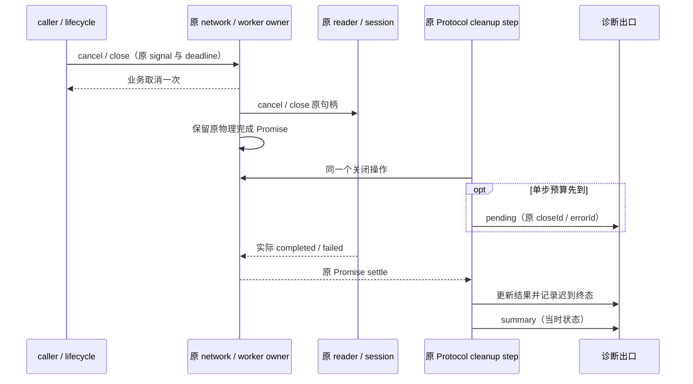

# HTTP/2、崩溃清理和诊断的二次系统复核

基线 `5b954768`，范围仅 zcode-full。上轮验收不能代替本轮执行；保留工作区已有远控重连改动。本轮不升级外部仓库、不请求真实供应商、不重跑原业务、不替换安装包。

## 复核发现与规则

1. **发送前请求体取消缺口**：transport 的 `request.arrayBuffer()` 不受其租约 controller 控制；无限等待的上传源可在 caller 取消后继续读取。改由原租约注册上传 reader，取消立即结束业务等待、取消原 reader，物理 cancel Promise 仍登记原 NetworkCleanup。EOF 后释放上传 reader，不影响响应 reader；发送前再次核对取消，零发送。不新增上传队列或超时。继续核对调用链发现 model cache 会额外构造中间 Request、插件入口在 worker call 前自行读取 body；cache 直接传递原输入/配置，插件序列化收回原 PluginWorkerTransport，通过同一个读取 helper 和它自己的原资源账本处理 caller/context/driver 关闭。worker 退出与上传清理均受原关闭预算约束，不能把 worker exit 当作上传源已关闭。
2. **worker reader 清理遗失**：cancel/finally 使用 fire-and-forget cancel，operation 随即被删除；真实清理失败无法进入 dispose 结果。由 worker 内唯一 reader 清理账本保存原 reader 的一次 cancel Promise；重复 cancel 合并，成功删除，失败留到退出汇总。取消仍立即结束业务；退出同时等待原 operation 与该账本，不把同一次 signal reason 当清理故障，不吞掉其它错误。无需跨进程新增业务协议。
3. **清理诊断的迟到结果缺失**：Protocol 的单步 budget 只给其它资源关闭机会，不能吞掉之后的失败。原 step 持有唯一结果对象，实际 Promise settle 时更新状态；pending 后补发 correlated completed/failed 事件，最终 summary 使用当时的实际状态。仍等待同一个 session shutdown，失败保留共享 store，不续原 deadline，不重复报失败。
4. **聚合错误原因遗漏**：进程 v2 诊断复用现有有界 causes，按确定顺序遍历 Error.cause 与 AggregateError.errors，去重、防环、最多四项，超限/环标记裁剪；保留错误 code 和独立 frames。读取异常对象字段失败时保留可校验的降级事件，不能整条 fatal 诊断消失。保持 v1/v2 schema，不引入 v3。
5. **worker 退出的证据边界**：独立探针证明 `Worker.unref()` 不能保证捕获 stdout/stderr 后父进程自然退出；Node 的 stdio MessagePort 有独立 ref。保留日志隔离和公开 API，不访问 Node 私有字段，不把 unref 当物理关闭。unref 移到 listener 注册之后；关闭始终经原 owner 的 dispose 等真实 exit，补独立父进程自然退出测试（显式关闭原 worker 及其 stdio 后），不能声称未关闭 worker 的探针通过。
6. **账号 driver 构造/发布跨 await 的关闭竞态**：原账号清理 owner 同时跟踪授权及账号 driver 的构造工作；关闭等待原构造 Promise 与原 driver 清理，不另建账号缓存。每次异步凭据读取之后检查 owner，再发布原 driver。构造晚到、读取失败或 owner 已关闭时，原 driver 交回同一个 cleanup owner；成功关闭幂等，失败保留原句柄/原因并在关闭汇总中失败，后续显式重试。构造失败没有创建资源时不虚构清理故障。清理等待不阻止已存在的 driver 开始关闭。

构造门与退出进度收敛到现有 ProviderAccountDriverCleanup。为遵守 400 行门禁，将原授权输入的纯校验从 ProviderAccounts 提取到同模块 helper，默认值、条件字段、必填及 select 规则保持不变，由现有账号授权回归验证；不在大文件继续堆叠生命周期逻辑。

Network transport、worker scope、Protocol cleanup step、CLI diagnostic producer 分别仍为对应事实的唯一所有者，Host/Main 仅消费原诊断。关闭错误不上升为自动业务重试权限。Desktop continuous 与手机 replayable 复用原 owner/lease 和命令准入，未改变传输恢复语义。

## 必须执行的验收

- 流式上传在 caller cancel / owner dispose 时零发送、停止读取、业务不悬挂；关闭等待被 gate 阻塞的 cancel，真实 cancel 错误可见；普通上传字节不变。
- reader 重复取消只调用一次；异步清理未完成、失败、正常 EOF 与 abort reason 分别验证；worker 生成后跑真实插件 fixture/强制退出回归。
- pending 后成功与失败各有且只有一个终态事件；summary 与最终结果一致，首个 closeId/errorId 不变，session 失败仍不关 store。
- AggregateError 多原因、混合 cause、防环、超限、异常 getter 均生成可通过 Host schema 的有界事件。
- 真实 TLS H2 八路未消费 SSE 在 owner 退出后全部 socket/session 关闭；另一 owner 的流仍可读。保留八路乱序、peer SETTINGS、GOAWAY、RST、代理和 Electron 内嵌 Node 回归。
- 执行 root 与 CLI typecheck/lint、changed 架构检查、相关格式检查；重建 worker/许可与 Desktop Agent 后校验 staging 和 smoke。报告实际执行、失败及未验证范围。

## 结果

待本轮实现与实际执行后填写。
