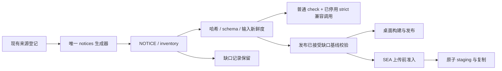

# 取消许可材料零缺口门禁

基线 `0fa09f2f`。2026-10-15 用户明确取消材料补齐，并要求取消严格许可检查，不让既有 20 项材料缺失阻断构建和发布，其他检查保留。本决策取代先前的材料补齐目标；不替换依赖，不改变版权归属或把缺口登记改写为完整。保留已有远控重连修改。

## 规则与所有者

- `third-party/inventory.json` 继续拥有材料状态，原生成器是声明与 inventory 的唯一写入入口；20 项 reviewRequired 仍可追踪，不清空、不伪造材料。
- `third-party/release-review-baseline.json` 继续拥有发布已接受的缺口集合；桌面和 CLI SEA 发布均通过 `readReleaseVerifiedNotices`，集合新增、删减、理由变化、重复项或非法结构仍阻断。CI 不自动改写基线。
- `readVerifiedNotices` 不再提供 requireComplete 零缺口选项；始终验证 inventory schema、reviewRequired 数组、声明字节哈希和输入新鲜度。仅材料缺口非空不会失败。
- `node scripts/licenses.mjs check --strict` 保留为普通 check 的兼容调用，明确提示该参数已停用；仍执行原有许可标识 allowlist、实装生产依赖完整性、声明哈希和输入新鲜度检查。已登记材料缺失只报告数量，不输出“许可完整”。
- CLI SEA 上传在任何目标目录创建、覆盖及复制之前完成发布校验。`--force` 只控制既有目录覆盖，不能绕过哈希、新鲜度或基线检查；版本、目标文件、路径与原子 staging 规则保留。
- NOTICE 随 Web、桌面、CLI/原生工具产物分发的路径保留；不修改依赖、锁文件、许可标识 allowlist、原始材料或既有发布基线。
- 根脚本属于 unmanaged 构建工具；CLI 脚本属于 legacy lcode-cli 模块，通过既有公共脚本接口读取声明，不改变运行时业务状态、模块依赖或远控协议。

## 验收

- 固定 20 项缺口的 fixture 与真实仓库普通 check、旧 --strict 调用、桌面发布校验、SEA 本地上传均成功；旧参数输出停用说明与缺口数量。
- 缺失或非法 inventory、声明字节改变、输入变化仍失败；发布基线新增、删除、理由变化、重复项、结构错误仍失败。
- SEA 校验失败即使 force 也不创建发布目录；合法本地上传仍校验全平台文件、路径及覆盖规则，不执行真实 SMB 上传或 GitHub 发布。
- 执行发布相关测试、根与 CLI 类型检查/Lint、架构检查及格式检查。补充本轮真实结果，不把先前测试记作本轮验证。

## 实施结果

- 已移除 readVerifiedNotices 的零缺口分支；旧 --strict 明确提示停用并执行普通检查。SEA 上传在写入前复用桌面发布基线校验。
- 新增 14 个回归用例并纳入既有 test:release。先运行反例确认旧实现阻断 20 项缺口的 SEA 上传；修复后整套发布测试 110 项中 109 通过、1 项跳过、0 失败。跳过项为需要 Chromium 的页面 helper 实机测试，本轮没有浏览器交互改动。
- 普通 `node scripts/licenses.mjs check` 通过：1746 个实装包、18 项构建依赖复核，明确报告 20 项缺口只作记录；旧 --strict 在回归测试中真实运行并成功。真实桌面 `prepareDesktopAgentInputs` 在 LCODE_VERIFY_RELEASE_INPUTS=1 下验证成功，worker 为 1772867 字节。
- 根 `pnpm typecheck`、`pnpm lint` 通过；CLI typecheck 27/27 成功（26 命中缓存），Lint 14/14 成功（13 命中缓存）。本轮脚本显式 oxlint 通过。
- 架构检查 baseline=0、new=0；本轮改动文件格式检查与 git diff --check 通过。全仓 pnpm fmt:check 仍报告 3100 个存量文件格式问题，未批量改动与任务无关的文件。
- NOTICE、inventory、发布基线、依赖/锁文件均无差异；既有 20 项材料记录完整保留。未执行真实 SMB 上传、GitHub 发布或三平台安装包重建；本轮验证了修改涉及的构建准入、发布契约与本地 SEA 复制链路。
- 执行日志保存在 `.artifacts/license-gate-policy-20261015/`。根工具与 legacy lcode-cli 模块没有新增跨模块依赖、持久化状态或异步所有者，构建/上传校验先于写入的顺序不变。
