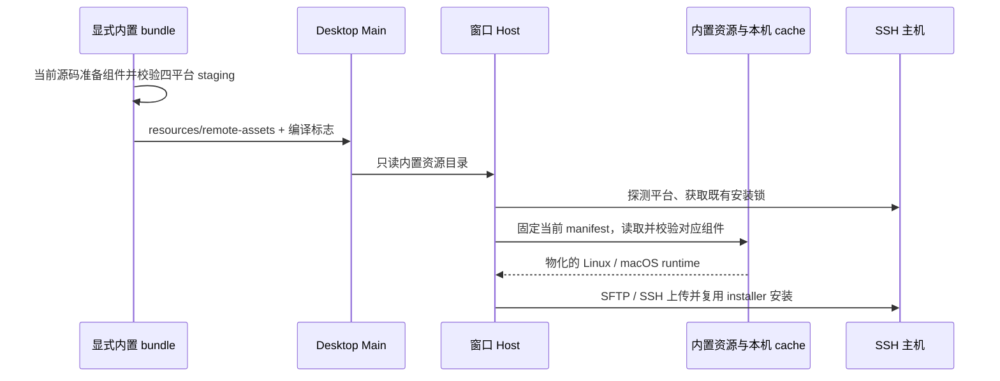
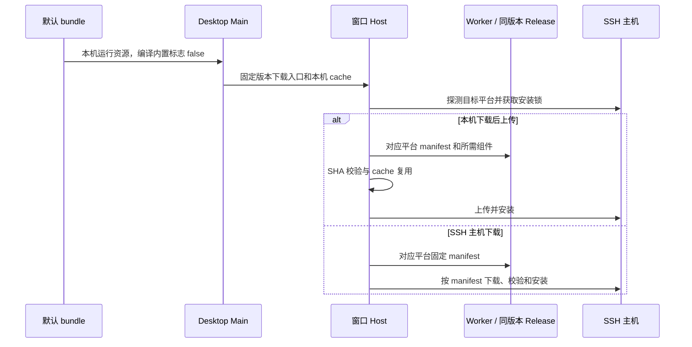

# 本地安装包的远程运行资源模式

## 产品规则

- 默认 bundle 使用轻量下载模式，`LCODE_BUNDLE_REMOTE_ASSETS` 未设置或为 0 时不携带远程资源。
  SSH 连接只按目标平台下载自身版本所需组件，沿既有 cache/SHA/安装锁通路；同版本资源必须已发布。
- 用户需要未发布 tag 或离线运行时，显式设置 `$env:LCODE_BUNDLE_REMOTE_ASSETS = '1'`，再执行
  `$env:LCODE_ENV = 'production'` 与 `pnpm bundle:desktop -- --os win --arch x64`。
- 只有显式内置模式携带四个平台的压缩运行资源，来源是当前源码生成的 manifest/components；
  复用既有 `prepare:remote-assets` 和发布 staging，不新增版本所有者或另一套归档生成器。
- 资源在 `resources/remote-assets/`，不解压进安装包内其他平台的可执行目录。
  客户端按 SSH 主机的平台选择组件、校验 SHA、物化本机缓存，再复用现有 SSH/SFTP 上传安装。
  内置源日志使用读取、复制和上传，避免把本机文件读取显示为联网下载。
- 有内置资源时，两种历史下载方式都使用该资源并通过本机上传，不要求 SSH 主机能访问 GitHub。
  仍需要 SSH 主机的 POSIX shell/tar 执行既有部署；mise 不是下载、解压或 SHA 工具。
- GitHub tag 的桌面 job 显式设置 `LCODE_BUNDLE_REMOTE_ASSETS=0`，继续使用独立 remote-assets job
  及固定版本下载服务；本地默认同样为 0，仅 1 显式开启内置模式。
- skip-prepare 只校验已有压缩资产，缺件或 SHA 错误时失败；不静默继续生成不能连接的包。
- 包体预算只增加已校验的内置压缩资产实际字节，原应用的 500 MiB 预算不变。
  v3.18.4 发布资产元数据实测：四平台远程资源约 391 MiB，Windows 安装包约 205 MiB；
  因此不能继续把携带资源的本地包硬套发行下载模式的固定预算。
- 需要读取内置源时，缺件、版本不符或损坏明确失败，不回退网络或另一版本。
  构建阶段必须验证源目录，不能用旧 runtime cache 掩盖本地构建缺件。

## 所有者和事件顺序

| 职责                                       | 所有者                                                             |
| ------------------------------------------ | ------------------------------------------------------------------ |
| 源码、版本和组件归档                       | 既有 prepare-prebuilds / 根 package.json                           |
| 本地是否携带资源与构建顺序                 | desktop bundle 入口                                                |
| 内置资源目录                               | Main 从编译标志与 resourcesPath 推导，经已验证的 remoteAssets 下发 |
| 本机文件读取与 manifest/组件响应           | server 的 bundled asset network port，异步只读                     |
| SHA、cache、组件安装和安装目录锁           | 既有 remote deploy / installer                                     |
| 任务、workspaceIdentity、owner/lease、队列 | 不变，保留既有 Desktop continuous 与手机 replayable 语义           |

包体优化实际验证：`bundled-remote-assets.test.mjs` 4 / 4 通过，默认与 0 的真实 builder 配置
均没有 remote-assets extraResources，dry-run 显示 on-demand；显式 1 仍保留归档和未发布源准备。
`pnpm test:release` 90 项，89 通过、1 项 Chromium 平台跳过；`pnpm test:remote-assets` 20 / 20 通过。
根 typecheck、lint、changed architecture 通过，baseline 0、new 0；改动文件格式检查通过。
只执行只读打包计划和夹具，未生成新安装包；实际 EXE 缩减量需用户重建后测量。

## 验收

1. 未发布版本的四平台夹具从本地压缩目录进入真实 cache，网络调用次数为 0。
   完整部署夹具通过真实 startup schema、组件校验和上传安装路径；仅持久锁 channel 使用
   内存 stdin/stdout，避免 Windows Git Bash 后台 heartbeat 的管道继承影响测试。
   该夹具不代表已连接真实 SSH 主机，安装锁前置另由 deployLockBoundary 回归覆盖。
2. GET/HEAD、下载进度大小、缺件、坏 SHA、错误版本和路径边界均正确；源目录只读。
3. 默认和显式 0 的构建配置没有 remote-assets extraResources；显式 1 开启准备和包内注册。
   tag 显式关闭；内置模式 skip 不构建，坏资源阻止后续打包。
4. 既有源选择、发布验证、类型、Lint、架构和格式检查通过；不构建应用、不发布 tag。

mise 的能力边界另见 `remote-mise-probe.md`。此场景不会把资源分发修复冒充为托管能力的解耦。

## 验证记录（2026-10-13）

使用 Node 24.21.0 / pnpm 10.34.6 实际执行：

- `pnpm test:remote-assets`：20 / 20 通过，包括未发布内置资源、真实 cache、完整模拟部署及固定 tag HTTP 下载。
- `pnpm test:release`：89 项，88 通过，1 项 Chromium 测试按平台跳过。
  包含本地默认准备、tag 关闭、skip 校验、包体预算和 esbuild 编译的 Main 注册边界。
- `node --import tsx --test packages/server/src/remote/runtimeToolDeploy.test.ts packages/server/src/remote/deployLockBoundary.test.ts packages/desktop/src/host/windowRemoteConnectionRegistry.test.ts`：28 / 28 通过。
- `pnpm typecheck`、`pnpm lint`、`pnpm architecture:check --changed`：通过；架构 baseline 0、new 0。
- 改动文件格式检查通过；未运行整个仓库的格式门禁。

首轮完整模拟部署因 Windows Git Bash 后台进程继承持久锁管道，导致 fixture 的 close 超时；
测试只将持久锁传输改为内存 channel，没有调整生产锁或增加等待时间。
内置源日志先补回归复现“本机复制被显示为下载”，再修复为读取/复制/上传。

本次涉及 legacy desktop、server、shared 及非 managed 构建脚本；运行协议/源码净增 95 行，
构建/工作流净增 71 行，测试/夹具净增 319 行，不计文档及已有 `.artifacts/`。
Main 独占资源目录推导，既有 remote deploy 独占 manifest/cache/安装与锁；没有新增业务状态所有者。
部署发生在 workspace 会话启动之前，现有 identity、lease、连续与可恢复交付顺序不变。

未构建原生安装包、未发布 tag、未修改 Worker、未连接用户真实 SSH 主机。
四平台安装包落点已有校验代码，尚未以用户实际安装包完成验收。

## 包体优化修订（2026-10-13）

用户已确认真实 SSH 使用成功，并要求安装包默认不携带多个远程平台的资源。
本节修订此前记录中的默认 1：现在默认 0，发行与本地普通构建统一按需下载。
未发布/离线需求由显式 1 保留，默认下载模式不能宣称无需对应版本资源即可连接。
不删除内置部署实现、不改变已修复的 Shell 边界或 mise/CJS 校验，不恢复旧版本回退。

