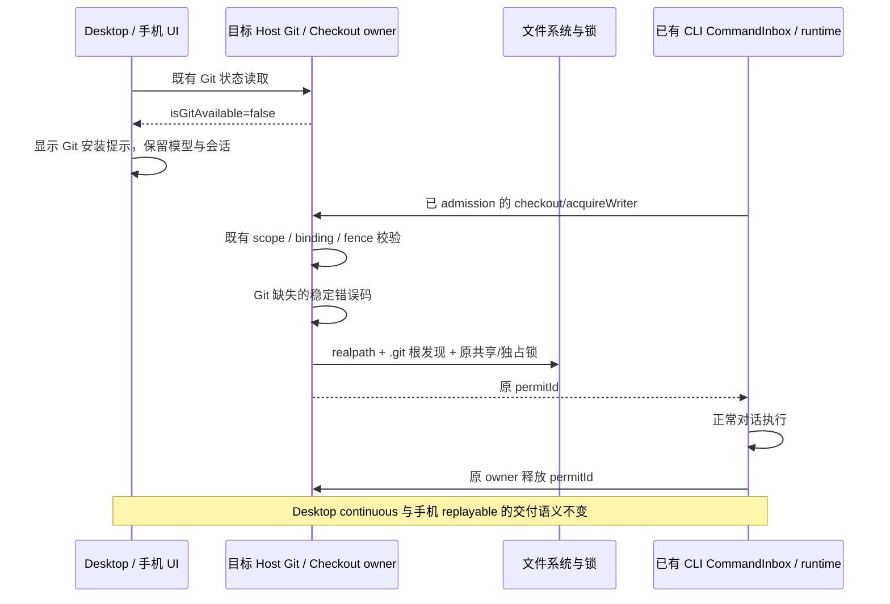

# 缺少 Git 时的运行与安装提示

## 产品规则与失败语义

- Linux 未安装 Git（Windows/macOS 同样遵守能力检测）时，显示“当前运行环境未检测到 Git，请在运行 LCode 的电脑上安装 Git，并在 `git --version` 可用后重启 LCode”的明确提示；普通目录内的对话仍可执行。
- 缺少 Git 是环境依赖问题，不是模型配置错误。只有结构化 Git 不可用错误可替换模型首读的通用错误文案；真实模型配置错误仍显示原错误提示并保留重试。
- Git 创建工作树、提交、集成等能力仍要求 Git，不能伪造成功。安装不由 UI 自动执行；安装后重启重新发现 Git。

## 所有者、接口与边界

- Host 的既有 GitEnvironmentProvider 仍是 Git 可执行文件发现的唯一所有者；GitCommandProvider 对发现失败抛出共享稳定错误码 `LCODE_GIT_NOT_AVAILABLE`，不通过错误文本判断。
- CheckoutCoordinator 仍拥有跨进程共享/独占许可。普通目录的许可不能因为 Git 探测失败而拒绝：仅捕获上述错误码，使用真实文件路径及向上发现的 `.git` 文件/目录确定 checkout 根；仓库内不同子目录保持同一锁域。其他 IO、权限、超时、未知命令错误仍传播。
- 工作树绑定、scope、identity、状态 fence、owner、lease 的校验与释放顺序保持不变；缺少 Git 不授予创建、归档、集成或绕过这些校验的权限。
- UI 复用当前执行目标的 `useWorkspaceGitState` 成功快照：loading、未取数、错误和其他 workspace 的快照不产生“缺少 Git”的事实。组件不新增 Git 探测、缓存、后台轮询或写入。
- 工作区的安装提示内联于对话区顶部，不遮挡手机输入区；Root 尚未完成首读时沿用原错误提示位置与重试按钮。
- Root 对模型读取的 Git 错误只做结构化文案归因；不更改 Provider 状态或模型选择，不把其他模型错误隐藏成依赖提示。
- 手机使用桌面已有 Host 的同一 Git 服务事实，提示用户在运行 LCode 的电脑安装；不检测手机浏览器系统，不创建新的 Agent/Host。

## 验收场景

1. GitEnvironmentProvider 无 Git：命令返回稳定错误码与安装指引，不启动无效子进程。
2. 真实 Host checkout 请求使用无 Git 的命令端口：普通目录可获得并释放许可，再次执行可成功；并发独占请求仍受互斥保护。
3. 缺少 Git 的仓库根及其子目录（含 `.git` 文件的 linked checkout）共享同一锁域；不是仓库的目录仍按自身真实路径加锁。
4. 其他执行失败、目录缺失、权限错误仍明确失败；worktree 创建仍不可用，既有 stale scope / binding / fence 回归继续通过。
5. 桌面与手机窄屏、中英文、明暗主题均显示安装目标与 `git --version` 指引；未取数、加载中、读取失败、旧 workspace 数据不得误报。
6. 模型首读返回 Git 稳定错误时显示 Git 指引并可重试；普通模型错误仍显示“模型配置加载失败”；重试成功后提示消失。
7. Git 已安装的成功状态无缺失提示；安装后重启服务重新探测。无数据库、配置、协议数据迁移。

## 验证入口

服务回归覆盖 GitCommandProvider、CheckoutCoordinator 与真实 worktree 请求桥；浏览器 fixture 覆盖生产提示组件及模型读取 hook。执行根目录 typecheck、lint、architecture:check --changed，并分别报告 Windows 测试与未执行的 Linux/macOS 实机验证。

## 本轮验证结果

- 修改前定向测试 8 项中 4 项失败，真实 checkout 请求在 `canonicalCheckoutPath` 因 `Git binary is not available` 中断；修改后同组通过。
- Windows 上运行 Git provider、缺少 Git 的真实 Host 请求桥、跨进程 checkout coordinator、worktree safety / spawn admission，共 35 项通过。
- `pnpm test:remote-control`：111 项通过，覆盖 attachment、scope、generation 与两类客户端恢复边界。
- `node --test test/missing-git.test.mjs`（cwd=`packages/web`）：通过。覆盖 390/1280 宽度、中文浅色/英文深色四组组合，成功状态、loading、未读取、断线、旧 identity / path、Git 结构化错误、普通模型错误与重试恢复；断言安装提示不遮挡草稿输入并保留草稿。
- `pnpm typecheck`、`pnpm lint`、本轮 14 个源文件的 `pnpm fmt:check -- <files>`、`pnpm architecture:check --changed` 均通过；架构 violations / baseline / new 均为 0。
- 变更模块：shared、services、worktree、ui、web。GitEnvironmentProvider 继续拥有可执行文件发现，CheckoutCoordinator 继续拥有许可，UI 只读已有目标 Host 快照；没有额外队列、探测缓存、协议载荷或数据库迁移。
- 本任务源码与测试新增 461 行、删除 15 行，净增 446 行（不含 spec、contract、忽略规则及其他任务已有的 locale 改动）。
- 无 Git 情况通过注入生产 GitCommandProvider 的空发现结果复现；尚未执行 Linux/macOS 安装包实机验证，也未生成新的发布安装包。
