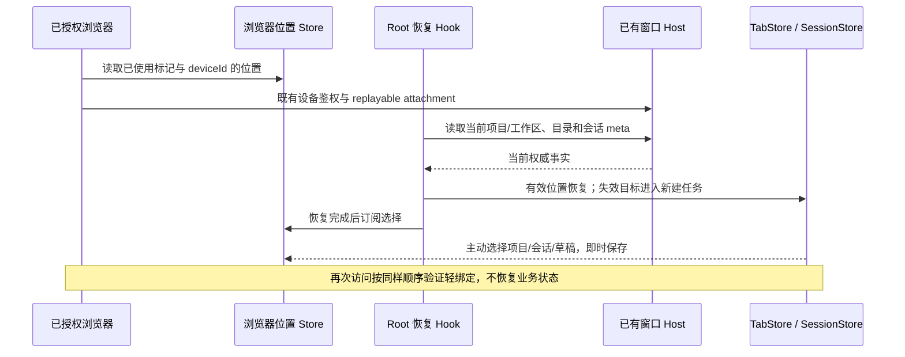

# 手机远控浏览器位置记忆

## 产品规则

- CF 配对入口 `/p/<roomId>` 在授权完成后启用浏览器位置记忆。同源浏览器第一次进入时显示“欢迎来到 LCode”；点击进入或取消即视为已使用。以后访问、刷新、关闭标签页或浏览器后重开均不再自动显示欢迎页。手动打开账号连接入口仍沿用原规则。
- 同源 localStorage 保存版本化的已使用标记与每个已授权 deviceId 的最后位置；deviceId 是非秘密的隔离键，房间更新不重置浏览位置。浏览位置只包含 workspacePath、workspaceIdentity、remoteSessionId、workspacePurpose、localProjectId 和 taskId，不保存凭据、消息、运行状态或业务队列。
- 浏览器优先恢复自己的最后项目和会话，不受桌面端最后激活项目影响。新建任务也作为明确位置记忆，不能被旧会话绑定抢回。当前分组、项目展开态继续沿用浏览器已有偏好，不将桌面分屏工作台投影到手机。
- 浏览位置是轻绑定。启动时从现有 settingService 和 taskService 读取权威事实：项目关联 ID 已删除时不能因同路径新项目而复活；旧单目录项目按当前 workspace 清单回退验证；workspaceIdentity 优先于路径。CF 入口通过桌面窗口目录解析已有远端连接，禁止新建远端连接；有效 identity 使用当前 session，失效路由回落默认新建任务，绝不能按同路径恢复本地会话。
- 项目仍在但会话已删除：在该项目进入新建任务。项目已移除或本地目录不存在：进入已有 Host 的默认对话工作区的新建任务。不得回到欢迎页，不创建新的 Host、Agent 或远端连接。远端项目的当前目录、绑定和浏览位置恢复以 [远控窗口项目、工作树与分组](./remote-control-workspace-catalog.md) 为准。
- 网络读取失败不当作删除，保留浏览器原位置，当前访问显示可用的新建任务；下次访问仍可重试原位置。用户后续主动选择项目、会话或新建任务时覆盖原位置。
- 恢复完成前显示启动 loading，不渲染临时项目/草稿，不覆盖记忆；选择变化即时保存，不能依赖关闭事件或延迟定时器。存储损坏或不可用时不阻断应用；已存在的记忆记录保留“已使用”语义，损坏目标回落新建任务。浏览器禁止持久存储时只能保证当前页面可用。
- 该入口只读取桌面标签页和项目设置，不把手机当前选择写回桌面 lastWorkspaceSession、lastActiveTabIndex 或 recentProjects。普通 Web 与桌面的既有启动规则不变。

## 所有者、接口与边界

- `remoteBrowserNavigationStore` 是浏览器记忆唯一所有者；窗口 TabStore 和 LCodeSessionStore 仍拥有当前 UI 选择，浏览器记忆是其派生投影。
- Root 通过 `remoteBrowserNavigationScope` 显式启用，由 Web 配对入口传入已授权 deviceId。`useRemoteBrowserNavigationPersistence` 通过既有服务读取项目、目录和会话，不直接访问 Repo。
- 恢复只经现有 restoreTabs/addTab、setActiveTaskId/startDraft 写入 UI；启动每次只消费一次位置。组件卸载后的迟到结果不得写入新页面。持久化订阅仅在恢复完成后开启。
- Desktop `desktop-continuous` 原有冷启动/刷新语义不变；手机选择恢复后依旧经 `web-remote-replayable` 的快照和 gap repair 读取相同 Host owner/lease。此改动不修改协议、stream、snapshot、queue 或 attachment 调度。

## 验收场景

1. 无浏览器记录时出现欢迎页，进入后关闭页面重开直接进入新建任务；取消也不导致下次重新欢迎。
2. 选择项目 B 的会话 B2，刷新、重新访问、关闭页面重开、关闭浏览器并以保存的浏览器状态重新启动，均恢复 B/B2；桌面激活项目 A 不影响恢复。
3. 显式新建任务后重开仍是该项目草稿；侧栏切换、新建后不得被 desktop last-session 键抢回。
4. 删除 B2 后重开进入 B 的新建任务；删除 B 后进入默认对话新建任务；同路径新建不同 ID 项目不能复活旧绑定。
5. 同路径不同 identity 或不同 remoteSessionId 不串位置；新房间沿用同一 deviceId 的记忆，不同已授权设备隔离目标。
6. 损坏存储、拒绝存储、迟到异步结果、网络失败分别回归；恢复期间不写浏览记忆，网络失败不清除有效原位置。
7. 浏览器 E2E 使用生产 hook 和 stores、仅模拟 Host 服务边界；实际执行类型检查、Lint、架构检查。未部署 Worker 或未执行真机验证时如实说明。

## 本地验证（2026-10-14）

- 新增 5 个 Store/恢复测试已纳入 `pnpm test:remote-control`；原有远控测试与这些测试全部通过。另执行启动门禁和项目删除的 6 个既有测试，全部通过。
- 浏览器的 3 个测试全部通过：新增位置恢复与真实 Root 欢迎门禁两个测试，以及既有项目持久化测试。位置恢复测试覆盖 390/1280 宽度、刷新、标签页关闭重开、独立浏览器加载同源持久状态、会话/项目删除、新建任务、跨设备目标隔离、验证等待及网络失败保留位置。Root 测试使用真实 Root/WelcomeScreen，项目/会话测试使用生产 hook 和 stores，Host 服务边界为测试桩；未执行真机或线上 Host 联调。
- 根 `pnpm typecheck`、`pnpm lint` 和 changed 架构检查通过，架构 baseline/new 均为 0；修改文件的格式检查通过。状态所有者保持 UI TabStore/SessionStore，新增浏览器 Store 只拥有轻绑定记忆；恢复先验证后写入，之后才开启即时保存订阅。
- `pnpm build:mobile-web` 成功，已更新本地 `cfworker-remote/public`。构建仍有现有大 chunk 和无效动态导入提示；未发布或部署 Worker。
