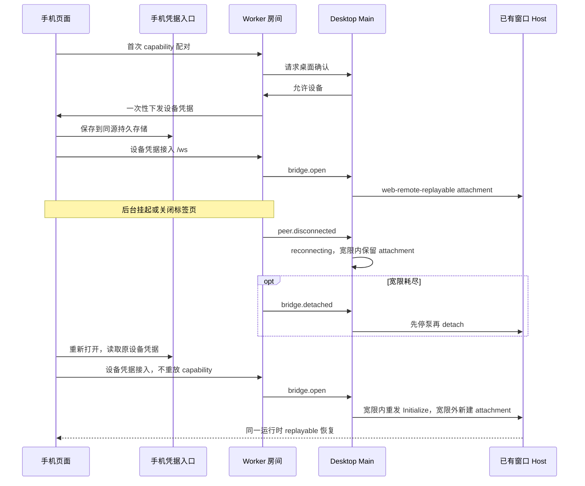
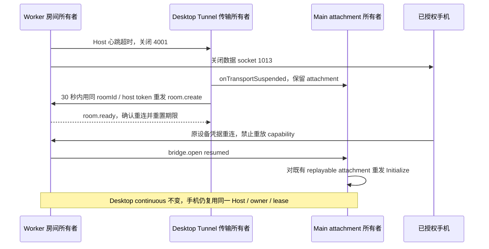

# 手机远控后台恢复与关闭页面后重连

## 产品规则

- 用户已选择记住已授权设备。首次配对仍需桌面确认，一次性 capability 仍 consume-once；成功后手机同源持久保存设备凭据，关闭标签页或浏览器后重新打开同一房间链接先用设备凭据连接。
- `pairingCredentialStore` 是手机凭据唯一读写入口；版本化 localStorage 键为 `lcode:remote-pairing:device:v1`，仅保存 roomId、deviceId、deviceCredential、grantedAt。旧 lcode/zcode sessionStorage 记录迁移后移除；持久存储不可用时降级到当前标签页的 sessionStorage，不伪称能够跨关闭恢复。凭据不得写入日志、示例、HTTP fragment 之外的页面地址或构建产物。
- 设备授权由桌面设备表与 Worker 哈希校验决定。网络闪断、心跳超时、busy、房间缺失/过期/作废与停止不等于设备撤销，不删除有效凭据；明确设备鉴权失败或吊销时清理对应记录及旧键，迟到失败不得清除新配对结果。
- 已授权设备重连的网络/房间错误不能退回已使用的 capability。只有设备鉴权失败、链接指向不同房间且提供 capability 时允许完整新配对；同房间已配对的旧链接不得重放。
- 未接管的建桥超时仍归当前配对页处理，不调用已接管镜像的整页重连监督者；连接已接管后才可刷新恢复，避免两个重试所有者互相打断。
- Main 是桌面连接状态唯一所有者。手机断连进入 `reconnecting`，不是配对失败；宽限内保留 attachment 并重发 Initialize，宽限外先停泵再 detach，之后已授权设备可建立新的 attachment。房间仍存活，镜像 target、owner/lease、workspaceIdentity 与 remoteSessionId 不变。
- 已收到 `room.ready` 的桌面 Host socket 因心跳超时 `4001` 关闭时，按传输中断进入既有 30 秒有界重连，使用相同 roomId / host token 幂等重发 `room.create`；`room.ready` 才重置重连期限。重连中的反复 `4001` 或网络失败不延长期限，不新增重试所有者或恢复已消费的 capability。
- 首次房间注册前的 `4001`、鉴权/协议失败、房间缺失/到期/作废/停止/占用和正常关闭仍按原终态处理；用户停止或释放时取消待执行重连。旧 socket 的迟到心跳超时不能拆新桥或重置新连接心跳。
- Worker 仍唯一拥有房间和 30 秒 Host 宽限，阈值与清房规则不变。Host 心跳超时使手机数据 socket 收到 `1013`；手机使用原设备凭据等待 Host 恢复。宽限内新 Host 注册后，同一设备恢复原桥并可双向转发；没有 Host 恢复时宽限结束仍清房并返回 `4004`。
- Worker 已桥接房间的 room.ready.expiresAt=null 表示没有配对 TTL；Main 与共享运行时校验必须接受该既有语义，不能恢复已消费的二维码。`reconnecting` 不显示二维码，不自动新建房间。
- Desktop continuous 与手机 web-remote-replayable 继续使用已有 Host；此修复不另起 Agent，不放宽吊销、单房间桥槽或一次性链接校验。
- 本阶段只修复和验证；不推送桌面 tag、不推送 Worker 仓库或部署。后续发布前从修复后的源码重新构建手机资源，并分别发布桌面与 Worker。

## 所有者与事件顺序

存储仅拒绝写入时，当前标签页的版本化 sessionStorage 降级记录优先，不在读取时反向覆盖其它标签页的持久授权。清理时逐个载体比较房间和凭据；明确设备吊销则退休所有匹配凭据的副本，迟到失败不能清除其它房间的新恢复结果。

## 验收场景

1. 手机授权后关闭页面，在同一浏览器同源重新打开原链接，免二次确认恢复；旧 sessionStorage 可迁移，存储损坏/拒绝访问不崩溃。
2. 后台断线与超过宽限的重连均成功；Main 展示等待重连，不出现 BRIDGE_DETACHED 配对错误；不会停止房间或复用已 detach 的 port。
3. busy/网络重试耗尽与房间终态只显示对应原因，不请求 /ws/pair；设备凭据仍可用于后续有效房间。
4. 新房间允许已授权设备重连；凭据不被识别且具有新 capability 时仍可完成桌面确认。
5. 吊销后无法连接并清理持久及旧键；旧记录不能复活。旧连接失败不能清除新设备记录；停止房间不会擅自撤销设备授权。
6. room.ready.expiresAt=null 及 reconnecting 的状态快照通过严格校验，界面不显示已消费二维码；stale room/device 事件不能拆新桥。
7. 实际执行 Node 回归、桌面控制器回归、浏览器关闭/重新打开与失败分支 E2E、类型检查、Lint 和架构检查；真机后台杀进程与生产 Workers 部署未执行时明确报告。
8. 桌面首次注册后 `4001` 自动重连且重发同一房间；反复超时的期限有界，成功后再次超时获得新期限；停止、释放、首次未注册及终态关闭不重试，迟到旧事件无效。
9. 真实生产 Worker Room 状态机在 Host 心跳超时后保留房间，恢复 Host 与手机后仍使用原设备与桥并可双向传输；不恢复时按既定宽限清房。浏览器经历 `1013` 和 Host 暂时未就绪后自动恢复，capability 只消费一次。

## 本地验证（2026-10-08）

- 33 个 Web 纯逻辑回归、40 个 Desktop 控制器/隧道/界面回归、11 个浏览器测试均通过。
  浏览器测试运行真实配对组件与 WebSocket 客户端，仅模拟 Worker 网络边界，覆盖窄/宽屏
  关闭重开、心跳断线、busy 截止、撤销、停止后跨房间恢复和建桥超时。
- 根 `pnpm typecheck`、`pnpm lint`、changed 架构检查通过；Worker 类型检查及 27 个测试通过。
  初轮根类型检查未覆盖 Main，额外检查为 94 → 85 个既有错误。用户要求一并解决后，
  已将 Main 纳入根命令并清零独立全量检查；修复与真实运行时回归见 `desktop-main-typecheck.md`。
- `pnpm build:mobile-web` 与 Desktop `build:no-runtime-assets` 通过；本地 Worker public
  已更新为当前源码。两份任务外文件的 SHA-256 保持一致。
- 尚未在真机验证系统杀后台进程，也未部署 Worker 或发布新桌面安装包；本地构建产物不代表线上已更新。

## 心跳恢复与 RPC 隔离验证（2026-10-17）

- 采用 [PR #1](https://github.com/lemon-casino/LemonCode/pull/1) 的 RPC 事件订阅隔离、原始两项回归及 spec，来源提交为 `5900511730a159bb4cd89539fa2320d25860f982`。将其测试加入既有 `pnpm test:remote-control` 入口。
- 修改前 RPC 两项和 Host 心跳恢复五项回归均失败；修复后通过。`4001` 复用原有重连状态机与期限，只有确认 `room.ready` 才重置期限；授权/房间终态、主动停止、旧 socket 换代门禁保留。
- Windows / Node 24.21.0：129 项远控回归、45 项 Worker 回归（含真实 workerd 运行时）、14 项浏览器回归，以及 10 项 Desktop continuous / Web replayable、workspace identity 与会话恢复回归通过，共 198 项。
- 浏览器执行真实配对组件和 WebSocket 客户端，仅模拟 Worker 网络边界；新增场景覆盖 Host 超时引发 `1013`、连续两次 Host 尚未恢复、随后使用原设备凭据恢复，capability 仅消费一次。Worker 状态机测试覆盖宽限内原桥双向恢复及宽限外明确清房。
- 根 `pnpm typecheck`、`pnpm lint`、Worker `typecheck`、相关文件格式检查及两个仓库的 `git diff --check` 通过；根架构检查 total / baseline / new 均为 0。
- 改动所有者为 RPC 订阅生命周期与 Desktop Main 传输状态机；手机授权入口、Worker 房间 owner、已有 Host attachment / lease 和业务恢复运行时不变。Worker 仅增加回归及协议说明，没有生产逻辑改动。
- 未发布桌面安装包、未部署 Worker、未进行真机长时间运行验证；需要构建并发布修复后的桌面客户端才能改变线上用户的 Host 心跳重连行为。
- GitHub PR #1 已使用 `lemon-casino` 身份合并至 `main`，并读取确认 `merged=true`；合并提交为 `40851a32349ed4e233e5a5dd4578eb8e91d556a3`。本地仍保留该 PR 的等价源码及独立心跳修复，未改写当前工作分支或无关改动。
- 本轮审计范围为主仓库与嵌套 Worker 仓库共 11 个文件：新增 470 行、删除 16 行，净增 454 行（含两份新 RPC 文件与本验证记录）；生产修复仅位于 RPC 与 Desktop 传输边界。
