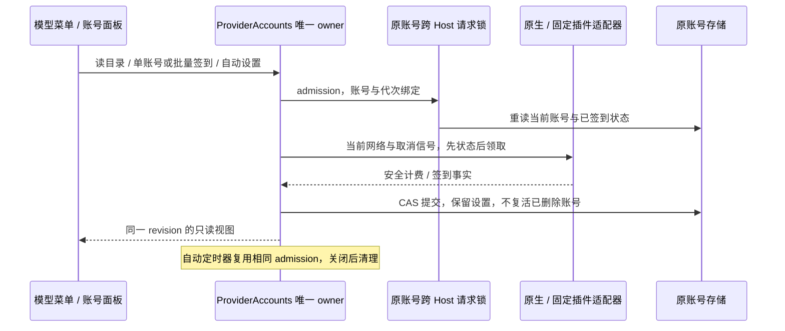

# OAuth 模型展示、计费与账号签到

基线 `1c7a13e7`。仅修改 zcode-full；Magpie `707fbb24`、plugins `5d5d86e` 是只读参考，不修改或更新参考仓库。保留工作区既有远控重连改动。使用 architecture-governance、feature-boundary-planner 和 React 规范。

## 产品规则

- 会话、工作流等共用模型菜单按名称、视觉能力、计费、选中状态分列；能力缺失保留列位，长名称可截断并查看全名，手机、中英文和放大字号均不横向溢出。模型身份仍为精确 providerId/modelId。
  - 窄视口复用现有 768px 断点，供应商分组直接展开在同一菜单中，避免并排子菜单挤走模型名称；桌面子菜单使用独立 Portal，正文宽度为名称和元数据共同留位。验收检查真实元素边界和名称可见宽度，不能仅凭 document.scrollWidth 判断通过。
- 模型友好名称与计费元数据是账号目录的只读事实，不进入请求选项、个人可编辑能力覆盖或另一份前端状态。Registry 的同一 Account revision 传递安全目录元数据；远端与本地一致。
- 倍率、积分单价与 API token 货币价格分别建模。按用户补充要求，未知倍率的计费列留空，不显示“未知”占位、不视为零；只有厂商明确的免费事实可显示免费，不从插件占位 cost=0 或名称推断。显示单位、原倍率与促销截止时间；促销过期不继续显示免费，夜间优惠不当成全天免费。
- 多账号同一模型的计费事实一致才展示单值；不一致或部分来源缺失显示“随账号”，不显示具体倍率；全部未知留空，不能借首个账号推断实际选中账号的费用。价格展示不改变既有路由。
- Copilot 模型列表、权限、端点与计费随当前账号读取。区分请求倍率和 token-based AI Credits；数据不足留空。正常禁用模型仍不可测试，不绕过禁用或套餐限制。
- 用户报告 claude-opus-4.8、claude-fable-5.1、gemini-3.7-flash、gemini-4-argon、gpt-6.1-sol 的 model_not_supported；这只是已确认的服务端拒绝现象，实际账号权限/运行包/目录原因待证实。回归覆盖这些精确 ID，不硬编码为可用、不静默换模型。失败需保留有用诊断并提供刷新目录/账号权限提示。
  - 明确的 model_not_supported 可在出流前尝试同模型的另一已启用账号；普通 400 不重试。用户成功刷新目录时清除本账号的临时拒绝记录，避免提示刷新但仍被六小时缓存屏蔽；刷新失败不清除记录。

## 签到渠道与界面

Magpie 当前原生签到适配覆盖 WorkBuddy 中国、Trae CN、MiniMax 中国/国际、Qoder 中国/国际，共六个渠道；插件还预留 auth.checkin 能力。WorkBuddy AI、Trae Global 等未确认渠道不伪装为可签到。签到通过选中账号的插件 loader/原生接口执行，保留代理、证书、刷新与取消边界，不从 UI 发厂商请求。

- 已登录账号卡的“删除账号”前增加“签到”；标题“已登录账号 · 数量”后增加“一键签到”和“自动签到”。一键处理当前供应商已登录且启用、支持签到的账号，逐个报告结果；服务接口允许无渠道过滤的一键全部账号。
- 自动签到默认关闭，由用户在当前供应商开启后作用于当前已登录账号，设置持久化；每张卡可独立开关。新增账号默认关闭。自动调度归 Host，页面关闭后继续，Host 退出后停止，不承诺退出程序后的执行。
  - 已禁用账号仍可保存自动设置，但不会签到；判断签到能力使用渠道元数据，不为设置开关创建需要启用账号才能创建的请求 driver，避免批量设置被禁用账号阻断。
- 统一结果：claimed、done、inactive、ineligible、own-app、captcha、failed、unsupported；奖励积分、连续天数、时间与活动有效期仅展示厂商明确返回的值。拒绝、无活动、已签到不能当作成功领取；需要厂商应用或验证码时显示原因，不循环领取。
- 日期使用 Asia/Shanghai，与参考签到活动一致。自动检查启动延迟两分钟、其后每三十分钟；普通渠道当日终态不再请求，失败间隔三十分钟；Qoder 活动每三十分钟重新查询且不越过活动有效期。手动可重试失败和重新查询活动，重复并发点击复用同一 flight。
- Host 进程、跨窗口与自动/手动均共用账号请求文件锁：锁内重读当日记录，再发状态请求，只有可领取才 claim。结果与自动设置随原账号存储，删除账号同步删除；不新增平行凭据库。禁用、重新授权、移除账号或 Host 关闭使迟到结果失效；自身令牌刷新可推进原账号代次。
- 操作失败不清空余额、目录或登录状态；成功领取后使额度缓存失效。界面通过现有 service/hook 接收结果与 revision，手机/远端代理仍调用本机账号 owner。
  - running 开始/结束也推进 Host 视图 revision，防止缓存命中或失败时同版本的迟到视图卡在“签到中”；超时显示可重试失败，用户取消/账号退休不提交失败结果。部分领取有明确奖励时也刷新额度缓存。诊断仅记录连接 UUID、渠道、结果、自动标识及安全错误类别。

## 实现边界与验收

1. 先补计费与签到数据合同、边界反例测试，再贯通驱动、存储、目录、RPC 和 UI。旧账号无新增字段仍可读取；新字段严格白名单，凭据/原始响应不进入公共 DTO。
2. 固定 plugins 新 revision，核对网络与刷新补丁、源码哈希及 worker 新鲜度；若上游改变钩子，适配现有入口，不移除既有资源清理增强。同步来源登记与声明；保留已取消的零缺口门禁决策。
3. 验证倍率 0.25/0.71、免费、未知、非有限/负值、促销到期、夜间活动、多账号差异和 Copilot 两类计费；目录刷新失败保持成功事实，但过期优惠不继续承诺。
4. 签到 fixture 验证六渠道状态/领取、已签、无活动、验证码/原生应用、401、部分失败、跨北京午夜/活动边界、并发与跨 Host 去重、移除/禁用/重新授权/关闭、自动开关持久化与重启。
5. 浏览器回归验证模型列对齐与精确选择、单账号与一键签到按钮位置、自动开关、局部失败反馈、手机、中英文及主题；本地测试不调用真实账号领取或产生真实模型费用。
6. 必须实际执行根 typecheck、lint、架构检查及相关测试，涉及 CLI 时补 CLI 检查；重建 worker/Agent 并检查声明与发布入口。全仓既有格式失败单独报告，不改无关文件。
   - 新增 shared 公共子入口时，同步 CLI 的正式 bundle alias，避免根入口的前缀匹配把子路径拼成 `index.ts/model-catalog`；用实际 esbuild 回归覆盖发布解析。

## 实施结果

实现已落地，保留原账号存储、Registry、请求文件锁和远端 relay 的唯一所有者；没有增加并行凭据库或计费路由。

| 问题 / 新发现                                                                          | 已完成的处理                                                                                                                                      |
| -------------------------------------------------------------------------------------- | ------------------------------------------------------------------------------------------------------------------------------------------------- |
| 视觉标签跟随名称长度移动，固定菜单宽度挤没名称，嵌套浮层在窄屏被裁掉                   | 共享名称/能力/计费列，长名完整 title；窄屏内联供应商分组；桌面子菜单独立 Portal；边界、可见宽度和截图验收                                         |
| 插件已有价格却被 model adapter、严格 DTO 和 Account 快照丢弃                           | 新增只读 modelCatalog 合同，贯通驱动、账号源、Registry、跨进程解析及 UI；未知留空、占位 cost=0 不推断免费                                         |
| 首个账号价格不能代表整个账号池，促销会过期                                             | 多账号一致性合并；WorkBuddy 从已消费的 config 投影促销截止时间，无额外请求或 clone 缓冲；到期刷新显示，保留全天/夜间区分                          |
| Copilot 冷恢复后手选模型未恢复 policy 集，账号拒绝不能切换账号                         | 冷恢复加载账号目录并按原协议启用策略；只对确认的模型拒绝尝试同模型另一账号；保留请求 ID 和可操作原因，不改模型 ID；成功刷新目录可解除临时拒绝缓存 |
| Copilot 两种计费口径不同                                                               | 按当前账号明确的 token_based_billing / tokenPrices / multiplier 投影；信息不足留空，不硬编码套餐倍率                                              |
| 六渠道签到缺少统一入口、调度和持久化                                                   | 单账号、一键、每账号/当前供应商自动开关；默认关闭；原账号文件锁内状态后领取、CAS 提交、北京日期与活动有效期去重、失败退避、超时和退休取消         |
| 批量自动设置可能继续写旧 Host，禁用账号会阻断设置；相同 revision 的 running 可迟到覆盖 | 每次写前检查 Environment；渠道能力校验与请求 driver 解耦；活动开始/结束推进 Host revision；禁用账号只存设置、不领取                               |
| 部分领取仍保留旧额度；迟到结果误记成功                                                 | 明确的部分奖励也使额度缓存失效；只有 CAS 提交后记录结果；删除、禁用、重授权及 Host 关闭不提交迟到结果                                             |
| MiniMax loader 把 GET 空正文变成字符串，正式 Agent 缺少新子路径 alias                  | 签到统一 URL + init 调用原 loader，保留刷新和取消；补正式打包 alias，并用真实 esbuild 和捆绑 worker 回归                                          |
| 插件更新可能冲掉缓存计数修复                                                           | 固定 15 个插件快照到 5d5d86e，保留 HTTP/2/代理/轮换/清理边界；适配新版 Trae，额外保留顶层明确的缓存写入 0；原始 vendor 字节继续受 manifest 校验   |

验证证据保存在本机 `.artifacts/oauth-billing-checkin-20261015/`；浏览器截图位于 `.tmp/oauth-billing-checkin/`，均为虚构 fixture。

| 验证                                                                       | 结果                                                                                          |
| -------------------------------------------------------------------------- | --------------------------------------------------------------------------------------------- |
| 根 `pnpm typecheck` / `pnpm lint`                                          | 通过                                                                                          |
| CLI `typecheck` / `lint`                                                   | 27 / 14 个任务成功，0 错误                                                                    |
| `pnpm architecture:check --changed`                                        | baseline 0，new 0，violations 0                                                               |
| 驱动、provider、账号、relay、HTTP/2、资源清理、共享合同和 CLI 账号同步回归 | 489 项全部通过，0 跳过、0 失败                                                                |
| 既有 OAuth 浏览器回归                                                      | 10 项通过；最初一次英文依赖用例超时，独立复查及无编辑干扰的完整重跑均通过，未据此改动产品行为 |
| 新增模型计费/签到浏览器回归                                                | 2 项通过，覆盖中英文、主题、1280/390px、20px 字号、键盘子菜单、截图与精确选择                 |
| 发布门禁 `pnpm test:release`                                               | 110 通过、1 项平台不适用跳过，0 失败                                                          |
| 定向格式检查 / `git diff --check`                                          | 70 个任务文件及生成 worker 格式通过；差异无空白错误，没有修复全仓无关格式问题                 |
| 固定 worker、Desktop Agent 编译与 staging                                  | 成功；worker 1,820,526 bytes；Agent 17.3 MB，正式 alias 回归通过                              |
| 发布声明及源输入校验                                                       | 正常校验通过；20 项既有材料缺口仍按现行非阻断策略保留，未恢复零缺口严格门禁                   |

边界：没有调用真实账号领取奖励或生成付费模型响应，因此不能据 fixture 推断用户的 Copilot 套餐、组织策略或某个模型实际可用。Qoder 国际版沿用厂商原生设备身份 runtime，缺失时返回可操作依赖提示，不伪造身份。厂商原应用/验证码限制会明确展示；自动签到只在 Host 存活时执行。本轮在 Windows 本机验证，其他系统的签名安装包和真实厂商客户端未运行。
