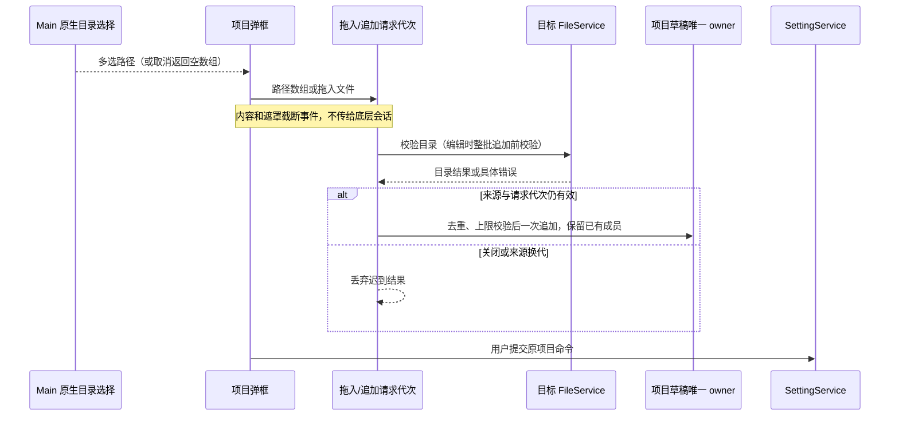
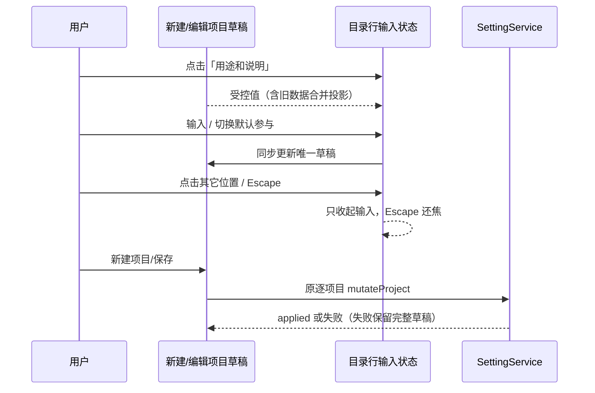
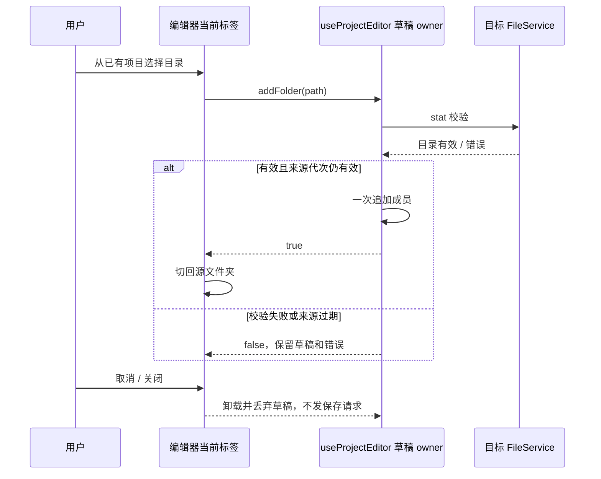

# 新建与编辑项目的目录配置

## 产品规则

- 项目菜单、弹框标题和提交按钮统一称为「新建项目」（英文 New project）；编辑入口保持「编辑项目」。
- 新建和编辑表单不提供「项目说明」，仅保留项目名称、源文件夹及各目录用途；每个源目录只设置「用途和说明」和「默认参与」。目录名称直接取文件夹名称，不提供显示名输入。新建不提交项目说明；编辑保留已保存的旧项目说明，不因移除输入项而清空历史配置。
- 所有目录配置在同一页面完成，不再提供目录详情页或「返回 / 完成」。每个目录行直接展示「用途和说明」及已填内容；点击文字区域切换为原位多行输入并聚焦，空输入显示「例如：前端页面与交互，或后端接口与数据存储。」占位，示例不作为值保存。原「新会话默认参与」精简为「默认参与」，勾选开关在「用途和说明」右侧同一行显示，含义仍为新会话的默认范围。
- 用途输入的每次变化立即更新父级项目草稿，失焦收起输入并展示最新草稿，切换其它目录同理。Escape 仅收起当前输入并还焦文字区域，保留草稿，不触发关闭弹框。点击项目保存/新建时，无须先点击别处即可提交最新输入；失焦、Escape 和参与切换均不自行持久化。
- 指针点击其它控件时，pointerdown 引起的失焦不能提前收起并移动点击目标；等 click 已确定目标后再收起，键盘失焦则立即收起。原位行仅持有这段 UI 手势状态；不使用延时，保证手机大字号下点击「默认参与」不会被列表回滚吞掉。
- 新建和编辑均使用同一尺寸的弹框外壳，原位输入只改变列表内的目录行，弹框位置、宽高、标题和提交栏保持稳定，小屏使用全屏弹框。
- 桌面外壳收紧为最多 28rem。名称在源文件夹之前，目录列表使用 12rem 固定高度独立滚动，目录来源与路径同一行，用途输入至少两行，避免输入框被过短列表截断；添加/移除目录不推移名称。短屏允许正文滚动，标题和提交始终可达。
- 新建、编辑的本地目录选择支持系统多选，也支持把多个本地目录拖到弹框中；沿既有路径规范化、去重和 20 个上限，已配置成员的用途、主目录和显示顺序不得因追加重建。取消选择不改草稿。
- 编辑批量目录由目标服务一次校验后原子追加草稿，连接换代/弹框卸载使迟到结果失效；非目录项和超限项明确提示。远程项目继续经目标连接浏览目录，不接受本机文件夹拖入远端项目。
- 弹框内容和遮罩拦截文件拖拽事件；内容在可添加目录时接收，关闭确认阶段拒绝添加，遮罩上松手不追加。事件不得冒泡到被遮罩会话、全局输入框高亮或附件接收器。
- 新建时保留目录选择、拖入、去重、20 个目录上限和自动项目名；移除目录同步移除其元数据。至少一个目录默认参与，否则禁用提交。
- 用途只保留一个「用途和说明」文本框，直接填写前端、后端、自定义职责与细节，不提供用途下拉或自定义输入。说明可空、最多 1200 字；实际编辑文字时统一写入 member.description，role 与 label 清空，不写自定义占位。仅打开/收起输入不改写旧数据；单独切换默认参与也保留原用途元数据。
- 旧 role/description/label 仍可读取。旧用途名称（内置值按当前语言显示）与说明合并回填，完全相同或已经包含前缀时不重复。旧 role 最多 80 字、description 最多 1000 字，合并后的最长 1081 字必须完整保留，不能截断。实际编辑并保存后转为一个 description；列表、冲突预览和会话范围统一显示同一内容及默认目录名。
- 编辑既有项目的主目录仍不能移除；新建草稿可移除主目录，下一目录接替。保存失败保留完整草稿；既有项目冲突处理、离线编辑及真实执行范围不变。
- 编辑项目使用「源文件夹 / 从已有项目选择」两个标签，默认显示源文件夹。后者在同一正文区域列出当前来源的其它项目目录，已添加项禁用，空列表明确提示；不再把选择器堆在源列表下面。选择目录沿原校验/追加入口执行，成功后自动切回源文件夹，保留名称及已有成员草稿；失败停留原标签并显示错误。标签切换不持久化、不改目录顺序，两个页面使用同一高度的列表。
- 取消、右上角关闭、遮罩关闭和主表单 Escape 均直接放弃未保存草稿并关闭，不再二次确认；正在用途输入内按 Escape 仍只收起输入。底栏始终只有取消/保存，取消不发送设置请求，保存才提交。已发送保存命令的关闭和迟到回执仍沿原规则，关闭不会撤回已接受的命令。

## 所有者与接口

- 新建弹框持有唯一项目草稿（名称、members）；sourceFolderPaths 从 members 派生，不维护第二套可变目录列表。项目级 description 继续由原协议与设置层兼容读取，表单不新增迁移或清除路径。
- 编辑继续由 useProjectEditor 持有唯一项目草稿。ProjectMemberRow 只持有是否正在输入的 UI 状态和还焦引用；受控输入从父草稿派生、通过 ProjectSourceFolders.onChange(member) 回写，不保留第二份内容缓冲或提交路径。
- LocalProjectCreateRequest 增加可选 description、members。根级 handleCreateLocalProject 将这些字段与归一化目录一起交给已有 projectDefinitionSchema 校验，再通过原 mutateProject 保存，成功后才打开项目。
- SettingService 仍为持久化唯一 owner，不新增服务、协议命令或存储格式；旧调用方不传元数据时兼容原行为。
- shared 定义统一 PROJECT_MEMBER_PURPOSE_MAX_LENGTH=1200，项目设置和会话范围的严格 schema 同时使用该上限；原 role 类型和 label 字段只保留旧数据兼容。
- IPlatformService 增加可选 selectDirectories()；桌面 renderer → preload → 类型化 PlatformChannels.SelectDirectories → Electron showOpenDialog(openDirectory + multiSelections)，取消返回 []。保留原单目录接口兼容其它入口；旧平台从单选结果转换为一个路径数组。
- useProjectFolderDrop 仅持有拖拽视觉状态/请求代次，校验后调用父草稿的追加入口；ProjectDialogContent 在内容与遮罩的事件边界阻止传播，不修改底层会话状态。
- SidebarProjectEditor 仅持有当前标签这一 UI 状态；切换到已有项目标签时暂停目录拖入，但仍拦截文件事件，避免追加到不可见源列表。useProjectEditor.addFolders/addFolder 返回本地追加是否成功，仍由同一个草稿 owner 校验和更新；成功后由调用方切回源文件夹，不创建新协议或写入路径。ProjectEditorFooter 仅投影取消/保存，无确认状态。







## 验收与验证

1. 新建项目添加前后端两个目录，在列表原位填写不同用途和说明，点击新建；保存请求和重载后的编辑页保留各成员字段。新建和编辑均无项目说明输入；编辑含历史项目说明的项目并保存其它字段后，历史说明保持原值。
2. 点击其它位置、切换目录与 Escape 收起用途输入，保持草稿且不发保存请求；只有一个项目弹框，没有详情页和完成按钮。直接从输入点击最终提交保存最新文字，Escape 还焦后可再次编辑。
3. 新建失败后重试保留元数据；移除后重新添加目录不复用已移除说明；全部不参与时不能提交。
4. 编辑已有项目展开与收起原位输入，弹框 bounding box 不变，主目录删除规则、冲突及远端路由回归通过。
5. 中英文、390px 手机及短屏、20px UI 字号验证无横向溢出，输入、默认参与和最终提交按钮可达；明暗主题截图复核。
6. 执行新增浏览器场景、现有项目编辑回归、pnpm typecheck、pnpm lint 和 pnpm architecture:check --changed，记录真实结果。
7. 每次聚焦仅出现一个用途文本框，空值显示示例占位；没有自定义、目录显示名或用途下拉。清空后保存为空；实际文字经历保存、重载和再编辑后仍保持一致。
8. 桌面、390px 手机、短屏和 20px 字号下，取消、X、主表单 Escape 均一次关闭脏草稿，没有继续编辑/放弃确认；重新打开仍为原保存内容且设置写入数为零。
9. 旧自定义用途 80 字与说明 1000 字完整合并回填；只展开/收起不改旧事实，实际编辑后保存为 description。旧目录别名不再显示，默认名、来源路径、身份和目录顺序保持明确。
10. 新建与编辑多选/拖入多个目录后去重且保留配置，名称坐标不变，列表内部滚动；文件、取消、超限、离线和过期异步结果不产生错误追加。
11. 向弹框内容和遮罩派发带多个目录的真实 DataTransfer；底层真实输入框拖拽反馈 hook、React 会话祖先与 document 附件监听器均不被触发。关闭弹框后底层反馈恢复，证明隔离有明确生命周期。
12. 已有项目标签选择目录后自动切回源文件夹并可立即原位编辑；名称、已填用途、主目录和顺序保留。已添加目录禁用；校验失败不切页、不追加，来源不同的项目不列出。标签在手机与大字号下可见且不造成横向溢出。

永久浏览器回归及其 fixture 沿仓库 .gitignore 精确白名单纳入版本管理，避免本地通过但提交后缺失。以下为迭代历史，当前交互以上述产品规则为准；目录详情页和取消确认在本轮精简中移除。

## 2026-10-16 实施验证

- 初版新建和编辑复用弹框与目录行，并使用详情缓冲在完成时回写（本轮已改为原位受控输入）。新建的 members 为唯一可变目录草稿，项目持久化沿原 SettingService 命令。role 扩展为有长度限制的文本，内置用途 key 与旧 custom 读取兼容。
- 浏览器新增 3 项与既有项目/分区编辑 1 项，最终 **4/4 通过**。覆盖实际 Root 新建命令、保存失败后重试、重载后再编辑、自定义值、三种返回方式、焦点、固定尺寸、去重/移除/重加、390×640 与 1280×850、20px 字号、中英文和既有七主题回归。浏览器场景使用生产组件与显式服务桩，不代表安装版设备验收。
- `pnpm test:sidebar-collaboration`：**58/58 通过**，包含新增真实 SettingService 重建读取及会话范围自定义用途测试。
- 拖入目录、项目生命周期、项目菜单针对性回归 **11/11 通过**；共享项目及设置针对性测试另行 **8/8 通过**。
- 最终 `pnpm typecheck`、`pnpm lint`、`pnpm architecture:check --changed` 与改动文件格式检查通过。架构 violations / baseline / new 均为 0；ui/shared/services 为当前策略中的未受管模块，不新增模块或依赖方向。
- 首轮浏览器失败查出 textarea 回填后标签名称不稳定，已显式绑定无障碍名称；尺寸断言另等待真实入场动画完成，避免采样缩放中间帧。最终失败数为 0。
- 代码和测试相对本任务开始时净增 746 行（含抽取、测试与 fixture，不含文档），未将工作区其它未提交功能计入本任务。源目录列表、详情页均无额外持久化 owner；没有修改流、远端路由、owner/lease 或既有工作集范围。
- 截图：`.artifacts/project-form/create-configured.png`、`member-zh-CN.png`、`member-en-US.png`、`create-zh-CN.png`、`create-en-US.png`，已人工查看桌面主表单及手机详情布局。未打包或替换安装版。

复跑新增与既有编辑交互：

```powershell
node --test --test-concurrency=1 packages/web/test/project-form-details.test.mjs packages/web/test/sidebar-project-editing.test.mjs
pnpm test:sidebar-collaboration
```

### 编辑项目关闭确认补充验证

- 原因：关闭提示插入滚动正文，同时保留常规底栏，导致两组操作并存且确认操作可能滚出视口。改为编辑器原 discard 状态投影固定底栏，确认期间正文 inert；继续编辑与 Escape 还焦取消，未产生设置写入。
- `node --test --test-concurrency=1 packages/web/test/project-editor-close.test.mjs packages/web/test/project-form-details.test.mjs packages/web/test/sidebar-project-editing.test.mjs`：**5/5 通过**，包括 1280×850、390×640、844×390、20px 字号和中英文；原保存、详情、迟到 ACK、冲突及远端编辑回归通过。
- 此轮最终 typecheck、lint、改动文件格式与 architecture changed 检查通过，架构 baseline / new / total 均为 0。变更仅 UI 状态投影，源代码与测试相对本轮开始净增 139 行；另补齐 5 个浏览器测试/fixture 精确白名单。
- 已查看 `.artifacts/project-form/close-confirm-1280.png`、`close-confirm-390.png`、`close-confirm-844.png`；所有确认按钮在视口内，常规取消/保存在确认期间不渲染。未打包或替换安装版。

### 用途精简、固定说明与批量目录补充验证

- 目录详情现只有用途说明和默认参与开关；默认目录名来自真实路径。旧 80 字用途与 1000 字说明完整合并，确认保存后成为 description，取消不迁移。项目配置与会话范围严格校验采用同一个 1200 字上限。
- 新建和编辑共用 ProjectSourceFolders；桌面外壳最多 32rem，项目说明在目录列表前，列表内部滚动。selectDirectories 贯穿 Main、preload、平台桥和严格频道类型；其它单目录入口沿原接口。
- 浏览器 **7/7 通过**：新建/编辑多选、去重、取消、无效目录整批拒绝、20 个上限、说明坐标不变、旧元数据、保存/重载、关闭确认、390px/短屏、20px 字号、中英文与原七主题回归。使用真实 DataTransfer 和底层 usePromptEditorDragState，验证遮罩不收目录、内容批量接收、React 祖先/document 无事件，弹框关闭后底层反馈恢复。
- `pnpm test:sidebar-collaboration` **58/58 通过**，包含真实 SettingService 重建读取合并后的长说明和会话范围；最终根 typecheck、lint、27 个本次文件格式与 changed 架构检查通过，baseline/new/total 均为 0。
- 变更涉及 ui/shared/client/desktop 与测试；当前均为策略中的未受管模块。源代码与测试相对本轮开始净增 321 行（含新用例及旧组件删除，不含文档和忽略配置），项目定义仍由原 SettingService 持有，草稿追加没有新增持久化路径。
- 已复核 `.artifacts/project-form/folders-create.png`、`folders-edit.png`、`member-zh-CN.png`。保留公共 DialogContent 的单 Portal 和原焦点/关闭管理，拖拽隔离通过 overlayProps 接入。
- 首次格式化遇到 Windows 文件瞬时写锁，重试后通过；目录级探测还发现无关的 useUnifiedSidebarProjection.tsx 格式未满足，未改该文件，最终仅核对本次 27 个文件。首轮旧冲突预览测试仍按拆分字段断言，已随合并展示更新，最终 0 失败。
- 系统原生多选窗口未做安装版实机验收；浏览器明确使用选择框桩。未打包或替换安装版，Main/preload 的新增能力需重启桌面开发进程或重新构建后生效。

```powershell
node --test --test-concurrency=1 packages/web/test/project-folders.test.mjs packages/web/test/project-form-details.test.mjs packages/web/test/project-editor-close.test.mjs packages/web/test/sidebar-project-editing.test.mjs
```

### 移除项目说明补充验证

- 新建和编辑移除项目级说明输入，新建不再维护或提交该字段。编辑继续提交原 useProjectEditor 草稿，历史 description 随其它元数据保留；目录用途说明仍按原流程保存。桌面统一外壳从 32rem 收紧到 28rem，手机全屏和正文滚动规则不变。
- 上述四个浏览器文件 **7/7 通过**；增加新建无项目说明、编辑无输入且保存后保留旧说明的断言，原冲突与迟到回执用例改为编辑目录用途，保留其原验证语义。批量添加、拖拽隔离、关闭确认、手机、中英文与七主题回归通过。
- 根 `pnpm typecheck`、`pnpm lint`、`pnpm architecture:check --changed` 和本次 8 个文件格式检查通过；架构 violations / baseline / new 均为 0。仅涉及未受管的 ui 模块及 Web 测试，不改变接口、持久化 owner 或事件顺序。源代码与测试相对本轮开始净减 19 行。
- 已查看 `.artifacts/project-form/folders-create.png` 与 `folders-edit.png`；新建和编辑已移除说明区域并使用收紧的弹框。未打包或替换安装版。

### 原位编辑、目录标签和直接取消补充验证

- 新建与编辑均在目录行原位编辑「用途和说明」，空值使用示例占位；「默认参与」位于其右侧。文字直接更新父级唯一草稿，失焦收起，Escape 收起并还焦，直接点击最终保存提交最新文字。移除独立目录详情组件、返回/完成文案、详情缓冲与父级页面切换状态。
- 编辑项目使用源文件夹/已有项目两个标签；选中目录由 useProjectEditor 校验并追加，成功才切回源文件夹，失败留在原页显示错误。取消、X、主表单 Escape 直接关闭，不再显示确认底栏；已接受的保存与迟到回执路径不变。
- 四个浏览器文件最终 **8/8 通过**。覆盖原位输入和真实逐字输入的空格/换行、清空、失焦、Escape、切换目录、直接提交、失败重试、重载、旧用途完整合并及历史项目说明保留；同时验证标签自动返回、重复禁用、失败不切页、草稿保留、取消零写入、批量拖拽隔离、390px/短屏/20px 字号、中英文、七主题与远端路由回归。
- 首轮发现手机大字号下 blur 立即收起导致 scrollTop 改变、checkbox click 丢失；改为指针 click 定靶后收起，键盘失焦仍立即处理，未使用延时。固定列表调整为 12rem，来源与路径同行，原位输入不改变弹框尺寸。
- 最终根 `pnpm typecheck`、`pnpm lint`、`pnpm architecture:check --changed` 与本次 13 个文件格式检查通过；架构 violations / baseline / new 均为 0。代码仅涉及未受管 ui 模块与 Web 测试，没有新增协议或持久化 owner。源代码和测试相对本轮开始净减 5 行。
- 删除前通过 dep:refs 与文本搜索核对详情组件引用，两个实际页面调用均已迁移。额外全量 `pnpm knip` 未通过，输出包含仓库及 .artifacts 镜像的未使用项，未据此删除无关代码，也未将该扫描记为通过。
- 已复核 `.artifacts/project-form/inline-create.png`、`inline-390.png`、`tabs-desktop.png` 和 `tabs-mobile.png`。首次 oxfmt 对新建弹框原地写入失败，改用同一格式器 stdin 输出并应用差异，最终格式检查通过。未打包或替换安装版。
