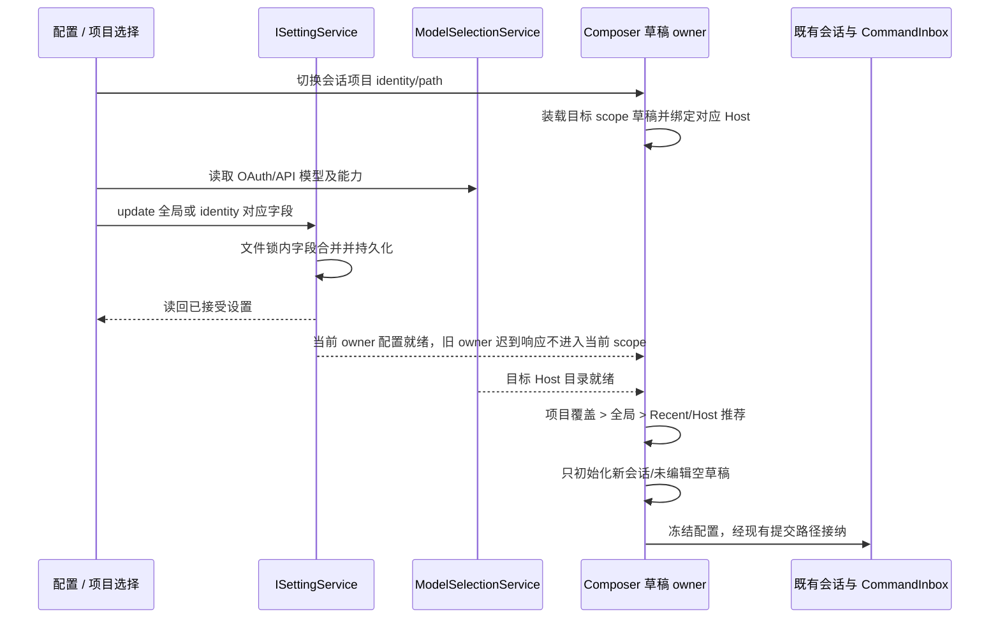
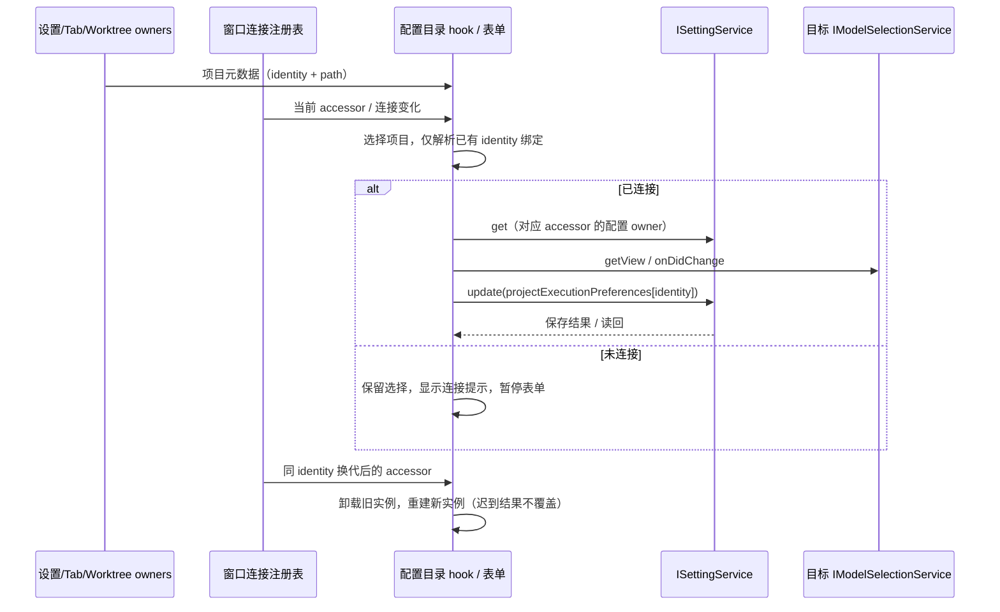

# 基础设置中的项目会话配置

## 产品规则

- 设置 → 基础设置新增「配置」，位于常规之后；将常规中的「新会话默认执行方式」「任务完成后的提交审核」移到这里，字段和旧值兼容规则不变。
- 配置顶部始终提供项目选择，包含「默认配置」、已定义本地项目、最近项目、`lastWorkspaceSession` 保存的远程项目、连接注册表中具有项目元数据的在线项目和打开中的项目。项目身份使用 `workspaceIdentity?.trim() || workspacePath`；实际工作树不作为新的项目作用域。
- SSH、WSL、Docker 项目使用目标类型和目标名称区分同名项目；已保存但未打开的项目仍可选择。选择项目只切换配置视图，不打开项目、不调用 connect/bind/dispose、不读取凭据、不启动 Agent。未连接项目显示配置专用的连接提示，暂停配置表单及模型 RPC；重连后按相同 identity 使用当前注册服务恢复，不能借用同路径本地或其它远端目录。
- 默认配置提供供应商、模型、推理强度、审批策略、速度、执行方式和提交审核。项目可以覆盖模型组合、审批策略、执行方式和审核，也可继承默认配置。
- 供应商和模型只读既有 ModelSelectionView（模型设置中 OAuth/API 的可用列表），不新增硬编码列表；推理强度和速度只展示所选模型的 optionSpecs。选择新供应商/模型时按现有补全规则初始化档位，之后允许分别修改。
- 模型组合以结构化 ModelSelection 保存；切供应商时选择它的第一个可用模型，切模型时清除旧模型的档位。无模型的供应商不能选为默认；不支持速度的模型显示「不支持」。已失效的配置可见并可修改，不静默保存替代值。
- 显式默认配置优先于最近提交偏好；没有配置时保留既有 Recent/Host 推荐初始化规则。默认值只初始化新会话及尚未编辑的空新任务草稿；已有会话、输入正文或手动改过配置的草稿保持当前意图。
- 默认配置与会话可执行选择解耦。默认模型被禁用、失效或删除时，新会话及未编辑空草稿自动使用最近已接受提交的供应商：最近模型仍可用则复用模型，否则使用该供应商第一个可用模型；最近供应商也不可用时沿用 Host 推荐/目录顺序。候选始终来自目标 Host 的可用 ModelSelectionView，禁止跨 Environment 取模型。
- 自动回退只改变 Composer 的初始化/未编辑空草稿，不写回设置、不清空默认值、不生成 Recent 接受记录；设置中保留不可用配置供用户调整。真实会话和手动改选继续使用已有模型解析/运行时门禁。
- 项目切换在同一次渲染中绑定新 identity/path 的草稿与设置 owner；目标设置未成功读回时，不刷新恢复草稿的档位。没有显式默认配置的自动初始化模型失效时，未编辑空草稿同样优先回退该项目最近使用供应商，不能因模型 identity 改变而拒绝回退。用户在异步初始化前手动选过的模型也不得被迟到默认值覆盖。
- 引导仍使用 `defaultSessionExecutionMode` / `gitCommitReviewMode`，保留仅真正编辑且未跳过时写入的语义；本次不修改引导行为。

## 所有者与接口

- ISettingService/AppSettings 是默认配置唯一持久所有者。新增可选 `defaultSessionModelSelection: ModelSelection | null` 和 `defaultSessionApprovalMode: build | edit | yolo | null`；项目同名字段放入既有 projectExecutionPreferences。项目 null/缺失继承全局，全局 null/缺失使用既有自动初始化。
- 复用现有 settings.update 的 scope/字段合并，不另建设置文件；ModelSelection 是一个完整原子字段，修改档位只更新该组合。配置 UI 经 hooks 获取服务，按项目绑定正确 Environment；默认配置使用 base Host。远端断连不可回落到本地 Host。
- 纯共享解析器只负责默认配置优先级。Composer owner 在设置和模型目录到齐后初始化，保留 scope、Service/revision 守卫；defaults 不进入已接受的队列或运行事实。
- 配置选择器本身的项目选择为 UI 局部状态；保存中的旧 scope 完成/失败不得串到新项目（表单按 scope/Environment 重挂载）。
- 当前选中的远端项目暂时离开 live 目录时，UI 仅保留该选择的最后一份展示元数据，以显示断连提示；不能悄悄切到「默认配置」。这份选择不构成项目目录、连接或在线事实，重新上线仍由注册表决定 accessor。
- 项目目录是只读派生视图：设置拥有保存的项目，窗口连接注册表拥有 live accessor，tab/worktree owner 拥有已打开项目及工作树归属。目录合并 hook 不保存第二份目录，也不拥有连接；表单继续通过所选 accessor 的设置和模型公开接口访问各自 owner（Desktop 远端 accessor 中设置沿用桌面设置 owner，模型沿用远端 Environment owner）。
- 表单实例同时绑定项目 identity 与 accessor 身份；同 identity、同 remoteSessionId 的服务换代也重置 pending/error/模型订阅，旧请求的完成只归属旧实例。已接收的写入仍由原设置 owner 完成，不因视图切换迁移到新 owner。
- Desktop continuous 与手机 replayable 复用当前配置与提交路径，不改变 stream、snapshot、queue、owner/lease、stale-run 和恢复语义。

## 验收

1. 导航和移动端均有配置入口；常规不再显示这两项；引导继续保存相同字段，跳过不写。
2. 全局和项目保存、重读、并发补丁、inherit/null、旧审核值兼容、远端同路径 identity 隔离均正确；其他项目和高级工作树字段不丢失。
3. 实际浏览器操作 OAuth/API 供应商、模型、推理和速度后新草稿使用对应值；切供应商不会沿用旧模型档位。无模型/不支持速度/失效配置有明确显示。默认模型删除后会话优先回退最近供应商的可用模型，默认值保持原样；最近模型或供应商也删除时按上述优先级解析。
4. 项目切换、保存失败、迟到结果、中英文、桌面和手机宽度、键盘选择通过；断连远端不误写本地。
5. 最近选择不覆盖显式默认值；手动修改和已有会话不受影响；实际执行 typecheck、lint、架构检查和相关测试。
6. 同一组件真实切换项目 A → B → A、同路径的本地/远端 scope 时，新会话读取目标项目的模型、档位和审批设置；正文和手动选择按原 scope 恢复。目标 Host 设置首读挂起期间不得升级恢复草稿；迟到设置/目录响应不能覆盖已切换项目。删除自动初始化的模型（未显式配置默认模型）也能回退本项目 Recent；删除目录或修改设置不重新初始化已有会话。
7. 保存的 SSH/WSL/Docker 项目未打开时仍可选择；旧数据缺少 identity 时用现有构造工具生成；同路径四种环境互不去重。模型菜单只含对应 Environment 的 OAuth/API 供应商与 optionSpecs，默认模型、推理、审批、速度和执行/审核设置仍写同一项目 scope。
8. 390/1280 宽度浏览器验证远程选择、默认模型保存/重载、继承、本地隔离和工作树排除；未连接时零配置/模型 RPC，连接后无需打开 tab 即恢复；同 sessionId 服务换代时新表单可操作，旧保存失败不锁住新表单或显示跨代错误。桌面与手机都复用现有 accessor；原 continuous/replayable 传输语义不变。

## 验证记录

### 初版验证

2026-10-14，Node 24.21.0 / pnpm 10.34.6：

- 基线 freshness 通过；目标上下文为 shared、ui、services（当前策略均为非 managed 模块），浏览器夹具属于 web。状态所有者仍为 ISettingService，Composer 只保存下一次输入意图；先等设置/目录就绪，再经既有 prewarm/submission 接纳，不改变 Desktop continuous 或手机 replayable 的业务恢复链路。
- 最终 `pnpm typecheck` 通过。`pnpm architecture:check --changed` 的 baseline/new/total 均为 0；28 个本次文件的格式检查和 diff 空白检查通过，本次源码/测试的定向 oxlint 通过。
- 已执行 `pnpm lint`：失败于工作区原有 `.artifacts/project-website/worker-deploy-dry-run/index.js` 的 max-lines（2154 行，上限 400），另有 no-control-regex / no-useless-spread 警告；保留该无关产物，未把全仓 Lint 写成通过。
- 97 项相关测试通过：共享设置/旧策略 11 项、真实设置并发持久化 3 项、Recent/新草稿/引导/移动布局 31 项、冻结提交和模型档位 5 项、新配置浏览器 8 项、现有工作树与提交审核浏览器回归 39 项。新浏览器场景使用真实共享设置组件和 Composer hook，覆盖 OAuth/API 切换、模型能力、全局/项目继承、远端同路径/断连、保存失败/迟到结果、模型删除后的最近供应商回退，以及中英文、明暗主题、390px 窄屏滚动和键盘操作。
- 引导的执行选择 UI 与保存实现未改动；原字段、编辑才写入、跳过不写入的测试继续通过。默认模型失效仅改变新会话/未编辑空草稿的可执行选择，测试确认不回写默认配置。
- 实现和测试差异（不计本验证记录，两个已有混合 locale 仅计新增配置词条，gitignore 仅计本次浏览器回归白名单）：新增 1601 行、删除 31 行，净增 1570 行。其余本地改动保留，未提交或推送。截图在 `.artifacts/session-configuration/`；手机验证为浏览器窄屏，未宣称实体手机或打包桌面三平台实测。

### 项目切换与失效回退复查

2026-10-14，复查期间先补测试并实际复现三个问题：目标 Host 设置尚未读回时恢复空草稿被升为最高档；没有显式默认值的自动模型删除后跨模型回退被阻止；初始化 IO 期间手动选模被迟到默认值覆盖。已分别修正设置就绪门槛、未编辑自动选择的重新解析边界、初始化对手动选择的保护；没有增加配置持久 owner 或运行时写入路径。

- `newTaskDraft.test.ts` 与 `composerRecent.test.ts` 共 18 项通过；配置浏览器共 13 项通过。新增真实 A → B → A 切换、正文/手动配置按项目恢复、同路径本地/远端切换、冷 Host 读设置挂起、手动选模等待初始化、迟到远端配置返回后仍保持新项目默认值，以及无显式默认配置的模型删除回退场景。已有会话在默认审批变更及目录更新完成后仍保持原 Composer 配置。
- 最终 `pnpm typecheck` 通过；定向 oxlint、格式检查、diff 空白检查通过；架构 total/baseline/new 均为 0。再次执行全仓 `pnpm lint`，仍失败于前述原有网站构建产物，没有把该结果报告为通过。引导、协议交付语义、Host owner/lease、CommandInbox 和已接受会话的配置初始化边界保持原规则。
- 累计实现及测试差异相对 Git 基线（排除本验证记录及无关本地改动）：新增 1964 行、删除 33 行，净增 1931 行；复查代码属于 ui，浏览器回归属于 web。新分离的场景文件加入既有测试白名单；其他本地改动保留，未提交或推送。

### 保存的远端项目配置补齐

2026-10-14，先运行 freshness 与架构检查，读取引用任务和 ui/services/shared/web 受控上下文。新增浏览器场景在修复前实际失败：默认配置与本地项目仅有 2 个候选，保存的 SSH/Docker 和在册但未打开的 WSL 均缺失（预期共 5 个）。目录合并现收口在 `useSessionConfigurationProjects`；组件只拥有所选项目的展示元数据及当前 accessor 的表单生命周期，配置与连接、模型 Environment、运行时保持原所有权。

- 最终 `pnpm typecheck`、`pnpm lint` 均通过；此前 `.artifacts` 产物已由远控修复任务排除 Lint 扫描，本次没有放宽源码规则。`pnpm architecture:check --changed` 的 total/baseline/new 均为 0；定向 10 个文件格式检查与 diff 空白检查通过，feature graph 的 YAML、唯一节点、关系端点和 5 个新增代码种子验证通过。
- 26 项源码回归通过：新增目录测试 3 项，加上共享默认配置、真实设置持久化/并发合并、Recent 与新草稿初始化；原配置浏览器 13 项继续通过；新增远端配置浏览器 4 项通过，合计 43 项。浏览器使用真实配置组件、服务解析 hook、远端 session store、Composer 初始化 hook，模拟服务边界，与 Desktop 一样共享设置 owner、分离各远端模型目录。
- 新场景覆盖保存但未打开的 SSH/Docker、仅注册表在线的 WSL、同路径 local/SSH/WSL/Docker 隔离、缺少 identity 的旧数据补全、目标 OAuth/API 目录、模型/推理/审批/速度/执行与审核默认值、高级字段保留、保存重载与新草稿初始化、删除模型后同 Environment 回退且配置不被改写、inherit、离线零设置/模型 RPC、同 sessionId accessor 换代与旧订阅释放、迟到保存失败不污染新表单。配置选择不产生 connect/dispose 调用；断线仍保留当前选择。
- 390px 英文暗色与 1280px 中文亮色截图已检查，无横向溢出；截图位于 `.tmp/remote-session-configuration/`。这属于浏览器服务边界验证，未进行实体 SSH/WSL/Docker 和手机联调；底层 desktop-continuous / web-remote-replayable 与 CommandInbox、owner/lease 未改动。
- 本次触及的目录 hook、选择器、新增语言词条和新增测试/夹具相对 Git 的定向差异为净增 851 行（目录 hook 114、选择器 122、语言词条 3、测试/夹具 612）；选择器 122 行包含引用任务原已存在但未提交的实现，不能把这个统计当作本轮独立源码增量。其他本地修改保留，未提交或推送。
