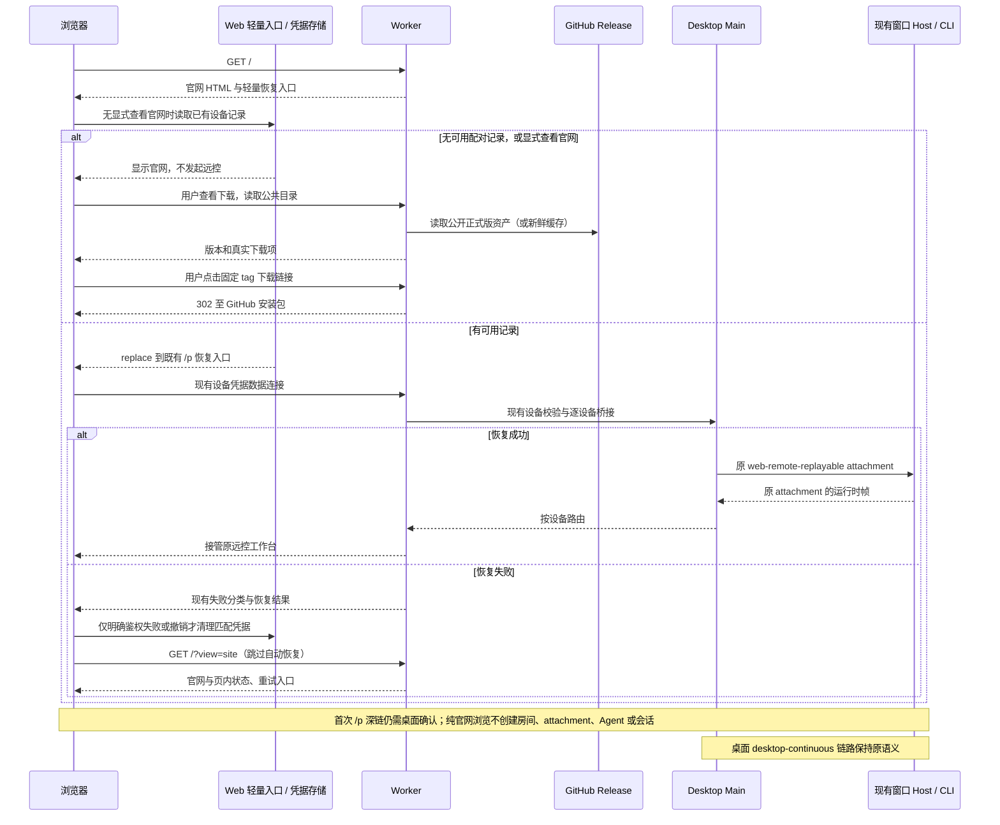

# LCode 官网与跨平台下载方案

日期：2026-10-14。状态：已完成本地实现与验证；独立 Worker 已推送至 `lemon-casino/cfworker-remote` 的 `main`（`15bcbdf`），由现有 Cloudflare 自动部署流程发布，线上效果由用户检查。

将 `https://code.lemon.vin/` 建设为 LCode 的产品官网入口，在同一域名下提供产品介绍、跨平台下载和远控使用说明。根路径根据浏览器配对状态分流：已配对浏览器恢复远控，没有有效配对的浏览器显示官网。现有 `cfworker-remote` 继续承担远控桥接、桌面更新和发行资源下载职责。

## 1. 产品目标与硬性约束

- 电脑和手机浏览器直接访问根路径时，没有有效配对则显示官网；已配对浏览器自动尝试恢复原远控连接，成功后进入工作台。浏览器保存的记录只是恢复线索，有效授权仍由原 Worker 与桌面设备表确认。
- 首页讲清楚 LCode 的定位、OAuth 供应商接入、多模型协作、工作流、记忆、SSH / WSL / Docker 远程工作区、浏览器远控与自主备份，并提供明确的下载入口。
- 不设置定价板块、套餐卡片、购买引导或销售弹窗。下载选项、安装说明、FAQ 和手机导航均在页面内展示，不使用模态弹窗；不自动下载、不自动跳转外部授权、不自动播放声音。
- **现有其他功能正常使用是上线前提。** 保留配对深链、设备授权与恢复、Host attachment、模型调用、SSH / WSL / Docker 连接、桌面自动更新、SSH 运行资源下载及静态资源地址的兼容性。
- 官网只介绍应用中的 OAuth 接入。账号授权、模型配置和凭据保存继续由现有应用与 Host 服务负责，官网不增加账号登录系统或供应商授权代理。
- 本次范围为官网、下载体验与根路径恢复入口；恢复复用已有远控流程，不修改任务、会话、队列、模型接入或设备授权语义。

## 2. 当前基础

实施前基线：2026-10-14 读取线上根路径得到 HTTP 200，内容是“LCode 远程控制入口”及开启等待、扫码连接的说明。原 `cfworker-remote/src/index.ts` 直接返回这份简单 HTML；`/p/:roomId` 等客户端路径经 Static Assets 加载 `packages/web` 构建产物。本地实现已用官网替换根入口，线上尚未变更。

[v3.18.7 发布](https://github.com/lemon-casino/LemonCode/releases/tag/v3.18.7)已提供 Windows、macOS、Linux 的 x64 与 ARM64 安装包。官网应读取发布信息，不能用仓库 `package.json` 的版本推断线上可下载版本。

用户确认已测试供应商接入且没有问题。当前账号渠道注册表包含 25 个渠道，官网按正式支持能力展示。用户提供的两张截图仅用于理解渠道名单，不进入官网或发行产物。

参考 [Codex 产品页](https://chatgpt.com/zh-Hans-CN/codex/)的产品定位、界面展示、功能叙事与跨入口介绍结构，使用本项目自己的视觉和内容。官网不设置定价与弹窗，也不沿用第三方客户背书或效率数字。

## 3. 品牌定位与首屏文案

对外主品牌使用 **LCode**。社区增强版的项目关系放在页脚和项目介绍，首屏先解释产品价值。

建议首屏文案：

> **LCode**
>
> **连接你的模型，让 AI 协作落到项目里。**
>
> 一个支持 OAuth 账号接入与 API Key 的 AI 编程工作台。选择适合任务的模型，编排多智能体工作流，延续项目记忆；连接本地、SSH、WSL 和 Docker 工作区，再从电脑或手机接着工作。

主按钮为“下载 LCode”，次按钮为“了解功能”。按钮下展示“Windows · macOS · Linux”和“OAuth + API Key”。手机保留桌面下载入口，并在下载区说明通过浏览器远控使用手机。

首屏使用产品文案与品牌视觉；供应商区域用连续移动的 SVG 图标带展示 25 个渠道，不展示用户截图或供应商平铺网格。

## 4. 页面与内容结构

首版提供三张中文页面，页面文字按国际化结构组织，英文版本作为后续内容阶段。导航固定为“功能、供应商、下载、远程控制、GitHub”。

| 页面        | 内容                                                                                        | 主要行动                               |
| ----------- | ------------------------------------------------------------------------------------------- | -------------------------------------- |
| `/`         | 未配对显示官网；已配对恢复远控。官网包含首屏、OAuth 接入、核心功能、场景展示、下载摘要、FAQ | 恢复远控，或下载与阅读功能             |
| `/download` | 完整平台和架构选择、版本/发布日期/体积、安装说明、历史版本                                  | 选择真实发行资产下载                   |
| `/remote`   | 浏览器远控及 SSH / WSL / Docker 工作区的用途、操作步骤与平台条件                            | 在应用连接工作区，或开启等待后扫码配对 |

首页按以下顺序组织：

1. **产品首屏**：一句定位、品牌视觉、主下载按钮。
2. **OAuth 供应商接入**：25 个供应商 SVG 图标从左向右连续移动，接入方式说明，与 API Key 并存。
3. **核心能力**：用简短功能卡片呈现模型选择、工作流、记忆、SSH / WSL / Docker 连接、浏览器远控、Worktree 和 Git 备份。
4. **四个实际场景**：不同模型协作完成任务；新会话延续项目约定；在服务器、WSL 或容器中执行任务；离开电脑后用手机查看进度并继续操作。不虚构任务成果或性能指标。
5. **三步开始**：下载安装 → 接入供应商并打开项目 → 创建任务，让 Agent 执行并审阅结果。
6. **跨平台下载摘要**：三个平台入口及“查看全部下载”。
7. **FAQ**：账号授权与 API Key、SSH / WSL / Docker 连接条件、手机连接与根路径恢复规则、模型来源、备份范围和项目关系。
8. **页脚**：项目源码、发行记录、快速开始、许可证与第三方声明、社区增强版说明。

GitHub 和发行记录指向当前发布仓库；快速开始可先链接仓库现有 README。首版不添加尚无内容的文档导航。

### OAuth 专区

建议标题：**你的供应商账号，在同一个工作台中使用。**

建议正文：

> 接入 OpenAI Codex、Claude Code、GitHub Copilot、Gemini CLI、BigModel、Z.AI 等供应商账号。在一个界面管理多个账号、刷新可用模型，并为不同任务选择供应商和模型。你也可以使用 API Key 接入。

供应商图标采用单行循环带，从左向右连续移动；只在视口中展示部分渠道，完整一轮覆盖当前 25 个渠道，不再提供平铺网格。每个渠道使用本地 SVG 品牌图标和名称；同品牌的地区/产品渠道保留各自名称。循环副本 `aria-hidden`，读屏仅读取一次完整名单。提供页内暂停/继续按钮，悬停或键盘焦点进入时暂停；`prefers-reduced-motion` 下停止动画、隐藏副本并允许手动横向滚动。移动端保持单行，不造成页面横向溢出。动画状态仅由当前页面 CSS 与按钮控制，不访问应用状态、设备授权或业务连接。

展示当前 25 个注册渠道：

- BigModel Coding Plan、Z.AI Coding Plan、OpenAI Codex、ChatGPT API、GitHub Copilot。
- Google Gemini CLI、Google Antigravity、Claude Code、Cline、Command Code。
- Cursor、Devin、Factory、Grok、Kiro。
- MiniMax Coding Plan、MiniMax Global、MiMo、Qoder、Qoder CN。
- Trae CN、Trae Global、WorkBuddy、WorkBuddy AI、Zed。

名称与图标优先沿用应用当前的供应商目录。25 个渠道共用 20 个品牌 SVG，其中 16 个直接复用项目文件，缺少矢量版本的 OpenAI、MiniMax、xAI 与 MiMo 从项目已采用的 Magpie/Lobe 图标源按同一固定提交补齐，不增加运行时依赖或外部图片请求。保留来源、摘要和 MIT 许可。渠道名单表示账号接入支持范围；各渠道按已有驱动提供浏览器授权、设备码、客户端登录读取或显式凭据导入等方式，不把全部方式描述成同一种浏览器 OAuth。

### 核心亮点与推荐表达

| 能力           | 官网表达                               | 展示内容与范围                                                                   |
| -------------- | -------------------------------------- | -------------------------------------------------------------------------------- |
| OAuth 与多账号 | 接入已有供应商账号，集中管理和选择模型 | 账号授权、账号列表、模型刷新；可用模型随供应商账号权益变化                       |
| 多模型选择     | 为不同任务选择合适的模型               | OAuth 和 API Key 配置、任务模型选择、思考选项；不承诺所有模型具有相同能力        |
| 动态工作流     | 把复杂任务拆成能协作的步骤             | 多智能体、分支与循环、每通道模型配置、保存与复用、运行进度                       |
| 工作区记忆     | 让项目约定延续到下一次会话             | 工作区隔离、Markdown 记忆、召回与设置开关                                        |
| 远程工作区     | 在 SSH、WSL 和 Docker 环境里继续开发   | 桌面选择连接目标并打开项目，文件与命令在目标环境执行；复用已有模型接入与任务界面 |
| 多设备远控     | 离开电脑，也能接着处理工作             | 电脑浏览器和手机分别授权，接入桌面已有工作区，断线恢复；桌面与网络需可用         |
| Git Worktree   | 为任务提供独立的执行目录               | Worktree 任务执行、工作树管理和结果整合入口                                      |
| 自主 Git 备份  | 把 Git 仓库备份到自己的存储            | 自主选择工作区、OSS/MinIO、用户持有密钥；说明备份 `.git`，不包含未提交文件       |
| 工具扩展       | 按工作需要增加 Agent 的能力            | Skills、插件、浏览器与 Computer Use；平台能力和权限遵循应用现有实现              |

内容优先讲用户收益，具体运行时、协议、缓存等实现细节留在项目文档。Git 备份 FAQ 明确当前没有内置恢复命令；远控 FAQ 明确 Worker 做鉴权和转发，不持久化任务业务数据。模型请求会发往用户选择的供应商，官网不宣传“所有数据不离开电脑”或“远控端到端加密”。

### SSH、WSL 与 Docker 连接专区

建议标题：**项目在哪里，AI 就在哪里工作。**

建议正文：

> 用 SSH 连接服务器，在 Windows 上打开 WSL 项目，或进入已有 Docker 容器。在熟悉的工作台中查看项目、创建任务和审阅结果，文件操作与命令在所连接的环境执行。远程工作区也能使用桌面已接入的 OAuth 供应商与 API Key 模型。

| 连接方式   | 介绍重点                                                                  | 当前范围与使用条件                                                                                |
| ---------- | ------------------------------------------------------------------------- | ------------------------------------------------------------------------------------------------- |
| SSH        | 连接服务器或其他开发机器，打开远程项目；支持密码、私钥和已有 SSH 配置别名 | 目标需能通过 SSH 访问，并具备当前部署链路所需的 POSIX shell 环境；当前不支持 Windows 原生远程主机 |
| WSL        | 在 Windows 桌面选择发行版与用户，在 Linux 环境中处理项目                  | Windows 桌面入口；使用已安装的 WSL 发行版                                                         |
| Docker     | 选择或输入容器名 / ID，在容器中的项目执行任务                             | 使用桌面可访问的 Docker CLI 与运行中的容器；不承诺自动创建容器或编排环境                          |
| 浏览器远控 | 手机或另一台电脑接入桌面已打开的本地或远程工作区                          | 首次需桌面确认；已配对浏览器访问根路径恢复；桌面及对应连接需可用                                  |

首页提供 SSH、WSL、Docker 三张能力卡和真实连接界面；`/remote` 分别说明“桌面连接开发环境”和“浏览器远控桌面工作区”的步骤。用户通过桌面应用配置连接，官网仅介绍和引导，不收集 SSH 密码、私钥或容器配置。手机沿用桌面已有远程连接及会话，不经 Worker 另建 SSH、WSL 或 Docker 运行时。

OAuth 专区增加与远程工作区联动的说明：桌面已有账号可供远程任务选择；长期 OAuth 凭据继续由本机 Host 管理，远端只消费现有公开模型投影和受控调用通路。API Key 沿用当前远程配置路径，官网不改变凭据来源和网络出口。

## 5. 下载体验与发布数据

### 平台与安装格式

| 平台          | 架构选择             | 默认格式           | 其他现有格式                   |
| ------------- | -------------------- | ------------------ | ------------------------------ |
| Windows       | x64、ARM64           | `.exe`             | —                              |
| macOS         | Apple Silicon、Intel | `.dmg`             | `.zip`                         |
| Linux         | x64、ARM64           | `.AppImage`        | `.deb`、`.rpm`、`.pkg.tar.zst` |
| iOS / Android | 浏览器远控           | 显示连接桌面的步骤 | 不提供虚构的手机安装包         |

识别操作系统只用于把对应平台卡片排在前面。架构通过清楚的页内选项确认：Windows 默认推荐 x64 并保留 ARM64；macOS 同时展示 Apple Silicon 与 Intel；Linux 同时展示两种架构和安装格式。UA 无法可靠确定架构时不据此自动下载。

所有下载按钮在点击前显示平台、架构和格式。页面显示正式发布版本、发布日期、安装包体积、更新说明与历史版本入口。macOS 当前发行包未签名/公证等安装提示放在对应平台卡片附近，按实际发布情况更新。

### 数据接口与兼容

建议新增只读接口 `GET /api/v1/releases/catalog`，返回最新正式版的公共下载目录。这是**拟新增接口**，尚未实现。

响应按严格 schema 校验，至少包含：`version`、`tag`、`publishedAt`、`releaseUrl`、`fetchedAt`、`stale` 和 `installers[]`；每个安装包包含 `os`、`arch`、`format`、`name`、`size`、`downloadUrl`。

- GitHub 已公开的非 draft、非 prerelease Release 是版本和资产的唯一事实源。沿用 `updateFeed.ts` 当前发布仓库和 stable 选择语义，不新增另一套仓库地址配置。
- 从该 Release 的真实资产列表筛选安装包，检查 tag、版本、平台、架构、格式和文件名。远程运行组件、更新 YAML 与 blockmap 不进入普通用户的下载列表。
- 仅输出真实存在的资产链接；同一响应不混合不同 Release 的安装包。某目标缺包时该项显示“暂不可用”。
- 链接复用 `/api/v1/releases/download/<tag>/<文件名>`，继续由既有 Worker 返回到固定 GitHub 资产的 302。官网不修改下载代理语义。
- 更新器继续使用 `/api/v1/releases/electron/manifest`，其 query、响应与缓存语义独立保持兼容。新目录只读公开发布元数据，不参与更新器的状态推进。
- 公共目录在 Worker 使用有界缓存，不保存账号或设备信息。建议新鲜缓存 5 分钟、最近成功目录最多保留 24 小时；回退时 `stale=true`，页面显示“最近获取的发布信息”和实际更新时间，不称其为最新版本。
- 上游失败且无有效缓存时，返回明确的服务不可用状态。页面保留平台说明、重试按钮和 GitHub Releases 链接；不猜测版本或拼装不存在的包。
- 无 JavaScript 时仍可阅读官网、平台说明，并通过明确的 GitHub Releases 链接进入下载。

## 6. 路由与资源隔离

| 路径或资源                           | 处理方式                 | 兼容要求                                                 |
| ------------------------------------ | ------------------------ | -------------------------------------------------------- |
| `GET /`                              | 官网 HTML 与轻量恢复入口 | 无有效配对显示官网；已有配对复用原客户端恢复连接         |
| `GET /?view=site`                    | 显式查看官网             | 跳过自动恢复；不读取配对凭据、不启动业务 WebSocket       |
| `GET /download`、`GET /remote`       | 独立官网页面             | 无房间状态、Host 调度或账号授权副作用                    |
| `/site/assets/*`                     | 官网静态资源专用目录     | 缺失资源真实返回 404，不返回客户端 HTML                  |
| `/p`、`/p/:roomId`                   | 现有配对客户端           | fragment capability、本地设备凭据、授权和恢复入口兼容    |
| `/assets/*` 等现有客户端资源         | 现有 Web 构建产物        | 保留根地址、动态 import、worker、字体/图标及许可资源解析 |
| `/connect/host`、`/ws/pair`、`/ws`   | 现有升级和 Room 路由     | 鉴权、限速、multiDevice 协商、逐设备桥接与代次防护兼容   |
| `/api/health`                        | 现有连接测试             | 托管与自建模式鉴权行为兼容                               |
| `/api/v1/releases/electron/manifest` | 现有桌面更新服务         | 既有平台参数、通道、状态码和版本链接兼容                 |
| `/api/v1/releases/download/*`        | 现有版本化资源下载       | 安装包与 SSH 运行资源下载兼容                            |
| `/api/v1/releases/catalog`           | 拟新增公开目录           | 严格限制为元数据读取                                     |

官网路由采用明确的路径匹配，避免拦截已有协议接口和客户端路由。`wrangler.jsonc` 的 `run_worker_first` 保留。实施前枚举当前客户端入口；`packages/web/src/main.tsx` 还包含分享页与 OAuth callback 分流，不能通过全域重定向或粗略的“其余路径返回官网”覆盖这些入口。未知路径的现有回退行为本期不作全域调整。

`/remote` 是使用说明页。浏览器远控步骤为：桌面打开“远程控制”并开启等待 → 远程设备扫码或打开桌面生成的链接 → 桌面分别允许新设备；随后可通过根路径恢复。SSH / WSL / Docker 步骤为：桌面打开远程连接入口 → 选择连接方式与目标 → 打开目标环境中的项目。说明页不自行建立这些连接，也不创建房间或连接 `/ws`。

官网内容代码不导入应用 store、服务注册或客户端 bootstrap。根路径只额外加载由 `packages/web` 构建的轻量恢复入口，凭据读取留在 Web 现有模块内，官网不跨包导入其内部实现。官网样式只随官网页面加载，官网资源不进入配对客户端 HTML。`/?view=site`、`/download` 和 `/remote` 纯浏览不读写配对数据、不启动远控。

### 根路径的配对恢复规则

根路径兼顾官网与已授权设备的快捷入口。Worker 无法从 HTTP 请求判断浏览器 localStorage 中的授权；服务端先返回官网 HTML，浏览器轻量入口使用现有 `loadStoredPairingCredential()` 判断是否有可用于恢复的记录。设备授权始终通过原数据连接鉴权，不能仅凭本地记录显示已连接。

| 条件                                       | 根路径结果                                                 | 凭据与连接处理                                                                         |
| ------------------------------------------ | ---------------------------------------------------------- | -------------------------------------------------------------------------------------- |
| 明确访问 `/?view=site`                     | 显示官网                                                   | 不探测凭据，不自动恢复；下载页与说明页也始终直接显示                                   |
| 没有配对记录、记录不可用或存储无法读取     | 显示官网                                                   | 不发起配对或数据 WebSocket，不复活被新版记录覆盖的旧凭据                               |
| 有可用配对记录                             | 自动尝试恢复，成功后进入原远控工作台                       | 复用存储的 roomId 与设备凭据、现有 `/p/:roomId` 恢复及 attachment 流程，不要求再次扫码 |
| 明确设备鉴权失败或撤销                     | 显示官网                                                   | 按原规则清理匹配凭据；可在页内提示重新从桌面扫码，不自动申请新授权                     |
| 网络失败、桌面离线、busy、房间停止或不可用 | 原有恢复策略结束后显示官网，附页内状态、重试和连接说明入口 | 保留有效凭据，不把临时不可达当成撤销；没有模态弹窗，不循环跳转                         |

具体入口设计：轻量入口校验保存的 roomId 后，用 `location.replace` 进入 `/p/:roomId?entry=root`。该参数只标识本次从根路径发起恢复，不构成授权；页面地址不携带 deviceCredential 或一次性 capability。配对客户端沿用已有数据连接过程，不另做一次探测连接，不增加 Worker 的设备查找接口或配对状态副本。

仅从根路径发起的恢复，在原有重试所有者判定失败后，返回 `/?view=site`；如需展示失败原因，仅传递受控公共状态枚举，不传凭据、设备 ID 或私有错误正文。成功接管连接后移除入口标记，交还原镜像重连与导航所有者，保留其后台恢复和断线语义。直接打开已有 `/p` 深链的授权、失败提示和重连行为保持原契约。

页面提供“查看官网”入口使用 `/?view=site`，失败后的“重试远控”由用户点击后重新访问 `/`；不自动在官网与客户端之间反复恢复。无 JavaScript 时显示官网，恢复依赖浏览器脚本。浏览器关闭后能否继续记住设备，沿用现有 localStorage / sessionStorage 降级能力，不新增存储策略。

凭据读写唯一所有者仍是 `pairingCredentialStore`，包括现有 legacy 迁移和按 roomId / deviceCredential 精确清理规则。迟到失败不得清除新配对或把用户新导航拉回官网。当前存储只保存一份设备记录，根入口恢复该记录对应的房间，不新增多桌面选择器；桌面重新开启生成新房间时，用户打开桌面当前链接，按既有跨房间授权规则继续连接，不猜测当前 roomId、不重放旧 capability。

### 构建与部署

推荐在独立的 `cfworker-remote` 仓库维护官网源码，使用轻量静态页面与少量下载交互脚本；官网输出放在 `public/site/`。现有 Web 客户端继续占用原来的 `public/index.html` 与客户端资源地址，保留深链和 `<base href="/">` 行为。

现有 `scripts/build-mobile-web.mjs` 会删除整个 `cfworker-remote/public`，直接增加官网产物会被后续构建覆盖。需要把发布产物改为统一装配：

```text
官网源码 ─────────→ 官网构建产物 ──────────────┐
                                              ├→ 临时装配目录 → 完整性校验 → public → Worker 部署
packages/web 源码 → 客户端产物 + 轻量恢复入口 ┘
```

`public` 仍是可完全重建的发行产物。主仓库的手机 Web 构建入口必须同时调用官网装配步骤，不能靠手工把文件复制回去。两份构建和资源校验全部成功后才替换托管目录；失败时保留上一次完整产物。

Workers Builds 部署同一份已校验产物。官网新增文件不改变 Room binding、迁移或鉴权配置。首版不新增 Cloudflare 数据库、用户状态存储或任务 API。回滚采用完整上一版 Worker 与静态资源产物，避免 HTML 与 chunk 跨版本混搭。

## 7. 状态所有者与事件顺序

| 事实                                       | 唯一所有者                                                  | 官网或客户端角色                                      |
| ------------------------------------------ | ----------------------------------------------------------- | ----------------------------------------------------- |
| 官网文案和供应商展示名单                   | 官网版本化源码，按当前应用目录维护                          | 静态展示                                              |
| 正式版本和安装包                           | GitHub Release，现有 staging 生成发行资产与摘要             | Worker 只读投影和有界缓存，官网展示                   |
| 平台推荐和架构/格式选择                    | 官网当前页面的局部状态                                      | 不变更任何应用设置                                    |
| 根路径是否尝试恢复                         | Web 轻量入口的本次导航状态                                  | 只选择已有恢复入口或官网；不充当设备授权事实          |
| 浏览器保存的设备凭据                       | Web `pairingCredentialStore`                                | 根入口与配对页复用同一读写入口和失效清理规则          |
| OAuth 账号、授权 attempt 和私有凭据        | 现有 Environment 的 ProviderAccounts 与加密凭据服务         | 官网只介绍，不读取；应用继续通过 hook 操作            |
| 配对、设备授权和桥接状态                   | 现有 Worker Room、Desktop Main 与凭据存储，各按原职责       | 配对客户端读取原投影                                  |
| SSH / WSL / Docker 连接与目标工作区        | 现有窗口 Host 连接注册表、Main 调度和目标运行时，各按原职责 | 官网仅介绍；浏览器接入既有 attachment，不新建远端连接 |
| 会话、队列、快照、模型调用与命令 admission | 现有 Host 与 CLI/runtime                                    | 桌面实时视图和远程恢复视图继续共享同一事实            |



保留 `workspaceIdentity?.trim() || workspacePath`、`remoteSessionId`、owner/lease、跨 Host 路由与 stale run 防护。官网无需触及这些字段；不得为了展示下载或介绍功能而修改共享会话协议。

## 8. 视觉与交互

采用与 LCode 草木灰/暗夜黑一致的克制视觉：暖白底、清晰文字、品牌色按钮、细分隔线和本地 SVG 品牌图标。页面以产品文案与功能叙事组织，不包含用户提供的两张截图；动画仅用于单行供应商图标循环带。

应用 UI 继续遵守 `DESIGN.md` 的 `text-ui-*`、语义颜色、圆角与平台规范。官网若采用更大的营销标题，应先在 `DESIGN.md` 增补**只适用于官网页面**的展示字体 token 和响应式规则，再实施；不改应用的字体缩放或全局样式。官网控件复用已有设计规则。

桌面使用分段叙事，手机改为单列，供应商始终保留单行滚动。下载选项在手机仍完整可见，触控目标足够大；支持键盘焦点、清楚的链接语义、图标相邻名称和减少动态效果设置。页面初始颜色跟随系统偏好，不写入应用主题设置。

供应商专区使用本地 SVG 真实品牌图标；名称保留每个产品与地区渠道的区别，重复循环组对辅助技术隐藏。正常偏好时从左向右匀速连续移动，可暂停，悬停与焦点进入暂停；减少动画偏好时停止并允许手动横向浏览。官网 HTML 中直接包含介绍文字、title、description、canonical 和社交分享元数据，搜索与分享不依赖应用初始化。

## 9. 实施顺序与文件边界

1. **契约与回归先行**：更新 Worker 端点说明、官网展示字体规则，补齐根路径配对分流与失败回官网、构建装配回归、公开目录解析测试、官网浏览器场景。检查现有入口清单。
2. **资源隔离与入口恢复**：增加官网源码、Web 轻量恢复入口与产物装配，复用原凭据入口和配对客户端；确认连续构建不会覆盖任何一方资源，直接深链行为兼容。
3. **官网内容**：完成中文首页、OAuth 专区、SSH / WSL / Docker 专区、真实界面和远控说明页。
4. **下载目录**：实现只读目录、页内平台选择与异常状态，复用原版本化下载链接。
5. **兼容性验证与上线**：通过下列验收，并用实际桌面、电脑浏览器和手机检查远控与更新，再发布完整产物。

| 文件或模块                                                                                                                                                            | 依赖级别   | 本方案涉及的工作                                                                         |
| --------------------------------------------------------------------------------------------------------------------------------------------------------------------- | ---------- | ---------------------------------------------------------------------------------------- |
| `cfworker-remote/src/index.ts`、`wrangler.jsonc`                                                                                                                      | 必须检查   | 独立官网路由、资产映射、保留升级优先级                                                   |
| `cfworker-remote/src/updateFeed.ts`、`test/updateFeed.test.ts`                                                                                                        | 必须检查   | 复用发行源与下载映射；新增目录元数据读取和测试                                           |
| `scripts/build-mobile-web.mjs`                                                                                                                                        | 必须检查   | 合并官网与客户端产物，防止整个 public 被单方覆盖                                         |
| `cfworker-remote/PROTOCOL.md`、`README.md`                                                                                                                            | 必须同步   | 当前仍将 GET / 写成 SPA，与已有根引导页不一致；实施前修正并写入官网/目录契约             |
| `packages/web/index.html`、`src/main.tsx`、`src/remote/`                                                                                                              | 必须检查   | 构建轻量根恢复入口，复用凭据所有者；仅根入口恢复失败回官网，保留直接深链、分享和回调分流 |
| `packages/shared/src/remoteTarget.ts`、`packages/ui/src/hooks/useRemoteConnectionForm.ts`、`packages/server/src/remote/create-backend.ts`、`remotePlatformSupport.ts` | 能力证据   | SSH / WSL / Docker 现有入口、目标类型与 POSIX 平台范围，官网按当前能力表述               |
| `packages/services/src/model-provider/remoteProviderAccounts.ts`、`specs/remote-provider-account-relay.md`                                                            | 能力证据   | 远程任务复用桌面 OAuth 的公开模型与受控调用；不改变账号 owner 或凭据路径                 |
| `scripts/stage-release-artifacts.mjs`、`.github/workflows/desktop-release.yml`                                                                                        | 发行证据   | 使用当前真实格式和命名规则；本期不改变桌面打包矩阵                                       |
| Host、CLI、Main 远控 controller、ProviderAccounts                                                                                                                     | 不变量验证 | 保留状态所有者、调用路径与安全投影；官网不修改其运行逻辑                                 |

现有功能图的 `capability.mobile-remote-control`、`boundary.cfworker-remote-room`、`service.desktop-update-manifest` 和 `capability.oauth-provider-details` 可定位本次边界。实现后已加入 `capability.project-website-downloads`，登记 `buildWebsite`、`createReleaseCatalog`、`getRootRecoveryTarget`、`assembleMobileWeb` 及原配对、发行装配、更新接口的关系。

## 10. 验收场景

以下为验收契约。已执行的自动化范围和仍需部署后检查的场景分别记录在 §11，不将夹具测试等同于真实设备联测。

| 场景                    | 前置与动作                                                               | 验收断言                                                                                                        | 所需证据                                         |
| ----------------------- | ------------------------------------------------------------------------ | --------------------------------------------------------------------------------------------------------------- | ------------------------------------------------ |
| 未配对根路径            | 电脑/手机访问 `/`，无配对记录、记录损坏或存储不可读                      | 显示官网；不启动远控或申请授权，不读取会话；损坏的新版记录不复活旧凭据                                          | 页面、网络请求、存储夹具                         |
| 已配对根路径恢复        | 同源浏览器已有有效设备记录，桌面在线，再次访问 `/`，包含关闭浏览器后重开 | 自动恢复原远控；不再次扫码，不重放 capability；接管成功后保留原导航与镜像重连语义                               | 浏览器 E2E、真实电脑和手机、连接/attachment 证据 |
| 配对失效根路径          | 设备凭据鉴权失败或授权被撤销，再次访问 `/`                               | 精确清理匹配记录后显示官网；无强制配对或弹窗；迟到失败不影响新授权和新导航                                      | 凭据清理回归、E2E                                |
| 恢复暂时失败            | 桌面离线、busy、房间停止/缺失或网络失败，从 `/` 恢复                     | 复用原有有界恢复；失败显示官网与页内重试；保留有效凭据，无自动跳转循环                                          | 恢复夹具、存储比较、E2E                          |
| 显式查看官网            | 已配对浏览器访问 `/?view=site`、`/download` 或 `/remote`                 | 直接显示对应官网内容，不读写凭据、不启动业务 WebSocket                                                          | 页面、网络与存储比较                             |
| 新房间与旧深链          | 根入口保存旧 roomId；桌面重开后用户打开当前 `/p` 链接                    | 不猜测新房间；直接深链按原跨房间授权与 capability 规则处理，旧失败不撤销新凭据                                  | 原配对回归、浏览器 E2E                           |
| 无弹窗浏览              | 浏览首页，使用供应商暂停/继续按钮、FAQ/下载选项与手机导航                | 无模态遮罩、强制登录、定价板块、自动下载或自动外跳                                                              | 宽窄屏浏览器 E2E                                 |
| OAuth 与 SVG 循环带     | 检查名单、图标、实际移动方向、悬停/键盘暂停与减少动画偏好                | 名单与 25 个渠道一致，全部使用 SVG 并从左向右移动，重复组对读屏隐藏；无平铺网格或用户截图，减少动画时可手动滚动 | 目录比对、宽窄屏浏览器 E2E、构建资源检查         |
| SSH / WSL / Docker 介绍 | 检查首页、说明页与平台说明                                               | 三种方式均有介绍；WSL 明确 Windows 桌面，Docker 明确运行中容器，SSH 目标遵守当前 POSIX 边界；官网不采集连接凭据 | 当前源码比对、内容审阅、页面 E2E                 |
| 跨平台下载              | 枚举三个系统、两种架构及现有安装格式                                     | 每个按钮显示目标，指向同一正式 Release 中真实存在的资产                                                         | 公共目录夹具、API 与真实链接检查                 |
| 手机下载入口            | iOS/Android 访问下载页                                                   | 显示桌面安装包和手机远控说明，无手机安装包或强制系统跳转                                                        | 浏览器 E2E                                       |
| 发布缺包与服务失败      | 夹具返回缺资产、上游失败、无缓存/有效旧缓存                              | 缺包显示不可用；旧数据标明时间；无数据保留发行页入口；不编造链接                                                | handler 测试、页面 E2E                           |
| 新设备配对              | 原 `/p/:roomId#c=...` 链接，桌面允许/拒绝                                | 原授权结果、逐设备连接与 capability 语义正常                                                                    | Worker/Main 回归、真实电脑和手机                 |
| 远控恢复与隔离          | 多设备在线，一台断线、重连或撤销；同时访问官网                           | 其他设备和桌面继续工作；原凭据和宽限恢复正常                                                                    | workerd、Main 回归与端到端操作                   |
| 原远程工作区兼容        | 桌面已有 SSH / WSL / Docker 工作区与模型任务；访问官网及从根路径恢复远控 | 既有远端连接、任务、模型列表与 OAuth 调用继续可用；手机沿用原 owner / remoteSessionId，不新建远端会话           | 现有连接与 relay 回归、实际环境抽查              |
| 原更新与 SSH 下载       | 原更新参数、固定 tag 安装包/远程组件链接                                 | 清单和 302 目标保持兼容；官网目录失败不阻断原接口                                                               | 更新器测试、下载回归、桌面与 SSH 实测            |
| 原客户端入口            | 刷新配对页、加载动态 chunk/worker，检查分享和回调分流                    | 不进入官网 HTML，不被全域重定向覆盖                                                                             | 路由测试、网络响应类型、浏览器 E2E               |
| 连续构建与失败构建      | 连续执行手机 Web 构建，再注入一方构建失败                                | 官网/客户端/许可材料完整；失败保留上一份完整产物                                                                | 构建装配测试、文件清单/摘要比较                  |

裁剪原则：应用业务功能不随新增页面重写；以“纯官网浏览无业务副作用”“根入口复用原授权恢复”和“原接口契约保持”约束范围。重点覆盖有凭据/无凭据、有效授权/明确失效/暂时不可达、显式查看官网、多设备/legacy、桌面连续/远程恢复、发布正常/缺包/失败这些会改变行为的组合，不扩大为全部功能和全部状态的笛卡尔积。

新增入口：根目录 `pnpm test:website` 包含 `packages/web/test/rootRecovery.test.mjs`、`scripts/mobile-web-assembly.test.mjs`、`scripts/project-website.test.mjs`；浏览器使用真实官网页面与原 `MobilePairingPage`，仅在 Worker 网络边界提供确定性夹具。独立 Worker 的 `npm run test:website` 包含目录、路由与实际 workerd 集成场景，也加入其 `npm test`。现有可复用入口包括 `pnpm test:remote-control`、`pnpm test:remote-providers`、`pnpm test:remote-assets`，以及 Web 的原配对重连回归。

实施必须执行 `pnpm typecheck`、`pnpm lint` 和 `pnpm architecture:check --changed`，并检查改动文件格式。独立 Worker 不在主仓库 workspace 中，根检查不覆盖其类型与测试，必须单独运行。部署后再验证真实远控、更新与下载；任何未执行的场景单独记录。

## 11. 本轮结果

### 实施契约补充

- Worker 精确匹配官网路径，从 `public/site` 读取静态 HTML；Static Assets 设置 `html_handling=none`，防止内部 HTML 映射被规范化重定向。官网文件必须带站点标记，缺失文件不能用 SPA fallback 冒充；官网资源缺失返回 404。原 Web 的 index、资源和深链 fallback 保留。
- 官网源码位于独立 Worker 的 `site/`。装配工具先复制客户端、构建官网、打包 Web 轻量恢复入口并检查必需资源，再通过同父目录 rename 切换 `public`；任意准备失败不触及现有 public，切换失败回滚原目录。轻量入口仅导入 Web 同域深链解析和唯一凭据入口，不装载 React、UI、服务或业务 store。
- 从根恢复的失败跳转使用 `remote=unpaired` / `remote=unavailable` 公共状态，纯官网通过页内提示提供重试；只有导航仍属本次入口、没有更新的设备凭据时才跳转。成功移除 `entry=root`，保留其他 query / hash 和原历史状态，镜像恢复语义不变。
- 公共目录先用现有 stable 选择器选正式 Release，再严格检查 tag、发布时间、真实资产文件名与大小。缓存按请求 origin 隔离，新鲜 5 分钟、兜底最多 24 小时；响应及缓存都经过 schema 验证。上游调用有界超时，失败不修改更新器缓存或接口。缓存只保存公开发行数据。
- 首版中文页面，使用独立文案数据和浏览器 Intl 日期/数字格式；展示所有 25 个支持渠道、OAuth / API Key、SSH / WSL / Docker、工作流、记忆、Worktree、备份及工具扩展。官网不包含用户截图；供应商以本地 SVG 图标循环带展示。

### 已实现

- 三张官网页面、25 个供应商渠道、核心功能介绍、SSH / WSL / Docker 条件、浏览器配对与恢复说明；无定价、模态弹窗或自动下载。供应商图标带与截图移除按本轮补充契约调整。
- Windows / macOS / Linux 的 x64 与 ARM64 选择及现有 14 种安装包组合；只展示当前正式 Release 实际存在的文件，缺包明确不可用，发行源失败时保留 GitHub 入口。
- 未配对、记录损坏或存储不可读时根路径显示官网；已有记录转入原配对页验证和恢复。明确失效清理匹配凭据，暂时失败保留授权并回到页内重试提示；显式查看官网不读写设备凭据、不建立业务 WebSocket。
- 官网与 Web 客户端统一构建和校验后装配，失败保留旧产物；原深链、OAuth 回调、分享、桌面更新与远程组件下载继续走原路径。未修改 Room、Main、Host、会话协议或供应商驱动。

### 验证记录

已运行基线新鲜度检查，结果 L-GO；Node 24.21.0、pnpm 10.34.6 与 `mise.toml` 一致。

| 检查                                                                                                     | 实际结果                                                                                                         |
| -------------------------------------------------------------------------------------------------------- | ---------------------------------------------------------------------------------------------------------------- |
| `pnpm typecheck`、`pnpm lint`                                                                            | 退出 0                                                                                                           |
| `pnpm architecture:check --changed`                                                                      | 退出 0，0 个架构违规                                                                                             |
| `pnpm build:mobile-web`                                                                                  | 首版两次、本轮调整后再构建一次成功；官网、轻量恢复入口、客户端与许可文件完整，恢复入口 1818 字节                 |
| `pnpm test:website`                                                                                      | 本轮 14/14 通过；含 SVG 向右位移、按钮/悬停/键盘暂停、减少动画手动滚动、截图资源移除、宽窄屏下载和各种根恢复场景 |
| `node --test packages/web/test/mobile-pairing-reconnect.test.mjs`                                        | 原配对与重连浏览器回归 13/13 通过                                                                                |
| `pnpm test:remote-control`                                                                               | 81/81 通过                                                                                                       |
| `pnpm test:remote-providers`                                                                             | OAuth 远端转发回归 13/13 通过                                                                                    |
| `pnpm test:remote-assets`                                                                                | 远程发行与下载回归 37/37 通过                                                                                    |
| `node --import ./cfworker-remote/node_modules/tsx/dist/loader.mjs --test cfworker-remote/test/*.test.ts` | 独立 Worker 43/43 通过，包括实际 workerd 的多设备与官网路由集成                                                  |
| `node cfworker-remote/node_modules/typescript/bin/tsc --noEmit -p cfworker-remote/tsconfig.json`         | 独立 Worker 类型检查退出 0                                                                                       |

首版改动文件格式检查通过（根 15 个、Worker 14 个文件）；本轮修改的根 4 个与 Worker 5 个文件再次通过格式检查。根 typecheck、lint、架构检查，以及独立 Worker 类型和修改源码 Lint 均再次退出 0；未修改根 Lint 配置。

受架构策略管理的本次源码归属 `web` 模块；构建脚本与独立 Worker 另按上述所有者和接口契约检查，未改变依赖方向。本轮只调整官网展示、装配资源清单与浏览器测试；动画状态归官网页面所有，未引入业务状态、接口或跨模块依赖。累计代码、配置与测试净增 2368 行（Web / 构建 / 测试 +800，Worker +1568），不含文档、图标和许可材料、功能图及生成的 `public` 资源，也不计无关本地改动。

已审阅首页及下载页宽窄屏、浅色和暗色截图；本轮额外审阅 `providers-1280.png` 与 `providers-390.png`。最终 public 校验确认 20 个 SVG 摘要与来源记录一致，HTML 包含 25 个渠道与辅助技术隐藏的循环副本，两张用户截图不在官网源码或装配资源中。浏览器截图和构建日志位于 `.artifacts/project-website/`，页面使用的是明确标记的测试发行数据，不将夹具版本当作线上正式版。

### 执行边界

独立 Worker 已提交并推送（`15bcbdfdd08cbf6ea51dfa3e0c454980a25d1a6e`），已确认远端 `main` 与本地提交一致；主项目未提交或推送。发布前 Worker 43 项测试及 Wrangler 部署 dry-run 通过。按用户要求，线上效果由用户检查，本轮未确认线上部署完成。线上安装包链接、真实桌面/手机和关闭整台浏览器后重开的恢复、实际 SSH / WSL / Docker 环境及桌面更新需要部署后联测；当前验证使用源码回归、浏览器和 workerd 夹具。保留与本任务无关的本地改动。

生产 Web 构建仍有原有 Vite 大 chunk、动态导入与未来原生运行时提示，构建退出 0；本次不修改这些无关模块。根 lint / typecheck 不覆盖独立 Worker，已对其类型、测试与改动源码另行检查。
