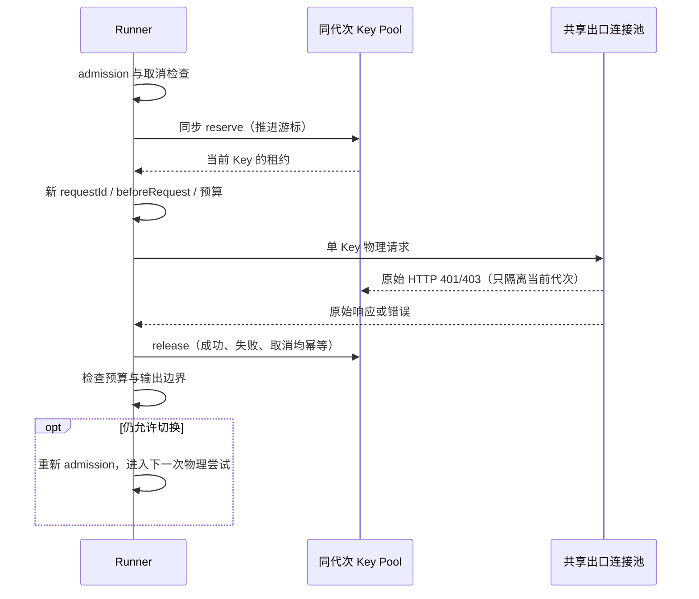
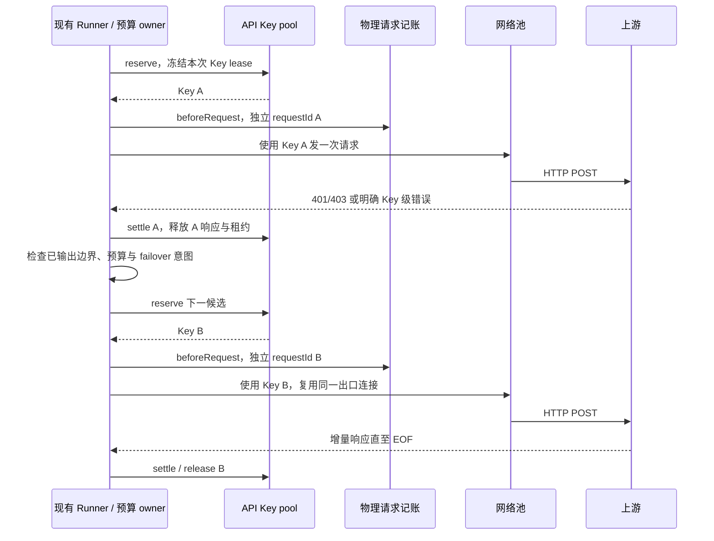

# API Key 与批量 Key 运行时增强方案

状态：终端注入回归修复、K1 并发调度与代次失败隔离、429 冷却和批量限流隔离已实现；后续调度指标与更细配额策略仍按下文推进。日期：2026-10-13。

## 本轮实施范围（2026-10-13）

### 第二轮：429 冷却与批量限流隔离

采用可验证的响应契约 `X-LCode-Rate-Limit-Scope: key|provider|account|team|organization|project`；只有精确的 `key` 允许单 Key 冷却和快速换 Key。此头是兼容网关的显式扩展，不宣称所有供应商原生提供。缺失、非法或未知值一律按 owner 内的供应商共同限流处理，不根据错误文案、Key 数量或标准剩余额度头推测独立配额。

`Retry-After`（秒/HTTP 日期）和 `retry-after-ms` 采用同一解析契约，合法等待保留，单次冷却上限 5 分钟，无合法提示默认 1 秒。截止时间使用单调时钟，冷却结束可重新使用 Key；401/403 的保存代次失败记忆继续独立存在。并发迟到 429 只能延长冷却，不能缩短已有窗口；保存 Key 不清除共同限流。Key 冷却通过索引最小堆恢复，不扫描十万候选，不为每把 Key 创建 timer。

KeyPoolRegistry 是模型执行 owner 内共同窗口的唯一所有者，各保存代次引用同一供应商窗口；单 Key 冷却仍隔离在 catalog/代次内。Runner 在等待冷却时归还 admission，恢复时重新准入；等待不发送 HTTP、不预留物理请求账本。HTTP 429 和已有分类确认的 JSON/SSE 429 都能回馈当前租约，观察结算幂等；输出提交后不重放。

重新准入的 signal 同时覆盖 caller 与 KeyPool owner；关闭若发生在冷却结束后的排队期间，也必须退出，不遗留等待票据。

Provider Catalog Client 自己拥有同端点的批量检测/目录共同窗口；未知或共同 429 阻止后续批量发送，已在飞最多 8 路，429 只返回 error，不保存为 invalid。取消不补发、不中途遍历全部 Key。模型与 Catalog 使用同一公开解析/窗口实现，各执行进程持有自己的 owner；本轮不建立跨进程配额协调服务，也不声称独立 Host/Agent 的内存窗口全局共享。

新增验收：明确 Key 级与未知/共同 429、Retry-After 两种格式及边界、并发窗口延长、全冷却的可取消等待、不持准入槽/不记物理请求、代次与供应商隔离、200 JSON/SSE 429、十万冷却索引、批量检测暂停与取消、全部恢复后再次公平分配。

### 第一轮：注入回归与并发调度

已修复终端 transport 注入的 4 个失败回归，并实现 K1 的并发 reserve、按冻结 catalog 复用索引及失败隔离。正常 Runner 采用每次一个 Key 的物理请求边界；每次切 Key 都重新经过 admission、requestId、beforeRequest 与总预算，不保留生产路径中的隐藏多 POST 循环。直接调用公开兼容 helper 的既有有限轮换语义保留，并复用同一个调度实现。

401/403 按现有规则记住同代次失败 Key；500、网络错误、取消和作用域未知的 429 不永久隔离 Key。全部已失败的后续调用保留一次实际请求取得上游错误的规则；非空列表全禁用在模型绑定准入失败，不能落到 SDK 环境鉴权。新代次、不同供应商与迟到旧代次的状态互相隔离。

执行 owner 关闭后，旧绑定的请求解析与 reserve 均明确取消；即使请求使用无上限预算，也不能反复准入或继续发送 HTTP。

第一轮验收先于实现：并发响应乱序仍分配不同候选、并发途中失效的 Key 不被旧候选快照再次选择、单 Key/全部失败的原始错误、预取消不推进游标、大 catalog 的稳态选择不全量扫描、每个 Runner Key 尝试独立记账，以及关闭释放所属资源。已输出后不重放；H2 和 Key 级 429 冷却已在第二轮补齐。

### 已落地的边界与证据

- `ApiKeyPoolRegistry` 是每个 AiSdkModelExecution 的唯一调度 owner：冻结 access 的规范化、主 Key 与指纹按 catalog 复用；供应商、保存代次及 Key 内容共同隔离调度池。历史池用弱引用登记，旧 Model 自己持有旧池。
- 可用环用索引维护，发送前同步 reserve；选择与 401/403 移除为 O(1)。租约 release 幂等。500、网络失败、取消和未细分作用域的 429 不永久隔离 Key，不写配置 enabled。
- 正常 generate 与 stream 每个 Key 尝试重新经过 Runner 的 admission、requestId、beforeRequest 和已有预算；SDK fetch 只发送选定 Key。无可用后续 Key 或预算耗尽时保留上游错误；已提交输出后不自动重放。既有重试事件契约保持不变。
- 直接调用公开兼容 helper 保留有限轮换行为；它复用相同 pool 实现，不能作为生产请求绕过 Runner 记账的入口。
- 原 Key 文件的 9 项测试全部通过，其中 4 项原失败项由终端 fetch 注入修复恢复。新增覆盖同时分配 A/B/C、乱序失败途中跳过 B、预取消不推进游标、全部禁用拒绝兼容字段回退、新旧代次及不同供应商隔离。
- 十万条 catalog 完成初始化后，执行一万次 reserve / observe / release 未再次读取密钥值；相同版本复用同一池。此验证证明稳态无全量扫描，初始化仍为 O(N)，未承诺消除所有配置构建成本。
- generate 与实际 AI SDK SSE 完整链路验证：一次预算只发第一把 Key；两次预算发两把 Key，生成两个不同物理 requestId、记两次 Token 预留、分别获取并归还 admission。原批量检测继续保持 8 个消费者及取消边界。
- `@lcode/provider` 公开同一限流提示解析和 owner 窗口；明确 Key 作用域才进入索引冷却堆，未知作用域进入供应商共同窗口。共同窗口跨保存代次保留，单 Key 冷却与 401/403 永久失败记忆独立，十万堆节点的延长不产生重复记录。
- Runner 的冷却等待归还 admission，并把 caller/owner 组合信号传入恢复排队；等待期间取消或关闭不会新发 HTTP、不会预留未发送请求账本。HTTP/200 JSON/200 SSE 429 均有实际 SDK 回归；提交文本后的 429 记录冷却但不重放。
- Catalog 的 429 只投影为 error；共享限流暂停后续候选并覆盖同端点其他批次/目录读取，其他端点不受影响。单 Key 作用域不阻断其余 Key；每批保留最多 8 个在飞请求，取消和 dispose 不补发剩余队列。



本文补充 [模型上游网络增强方案](provider-network-enhancement.md)。普通单 Key API、少量备用 Key 和十万条批量 Key 都应受益；网络连接资源按执行环境与供应商出口复用，Key 的选择、失败隔离和请求预算由模型执行链管理。

本轮最终验证共 441 项模型、网络、强制 GC 取消及批量 Key 回归通过；完整命令、构建结果、格式检查限度和日志位置见网络方案的「本轮验证结果」。

## 1. 实施前基线与已确认缺口

本表记录增强前的能力与问题；已经修复的项以本文开头的实施记录和当前源码为准。

| 项目           | 当前源码与证据                                                                                               | 方案判断                                                              |
| -------------- | ------------------------------------------------------------------------------------------------------------ | --------------------------------------------------------------------- |
| 批量导入与列表 | 已有 Worker 解析、128 MiB 导入边界、每页 25 条，支持十万条 Key                                               | 保留，不重做导入 UI                                                   |
| 批量检测       | `runProviderApiKeyProbe` 使用最多 8 个消费者、单条默认 15 s、64 条或 100 ms 进度分块，支持取消               | 已有受控并发，不应再启动十万条 Promise                                |
| 401/403 切换   | `createApiKeyFailoverFetch` 尝试下一 Key，并记住失败 Key；全部已失败时后续调用仍发一次实际请求以保留上游错误 | 现有产品语义，迁移须回归                                              |
| 保存代次       | `providerId + providerSaveGeneration + Key 签名` 隔离失败游标；同供应商重保存重置，新旧 Model 冻结代次       | 保留配置与 sidecar owner                                              |
| 并发分配       | 当前 nextIndex 在响应回来后更新；两个请求都在前一个响应前进入时，fixture 实际选择 `[A, A]`                   | 已确认存在并发热点，串行轮询测试不能证明并发均衡                      |
| 大列表请求成本 | 绑定/解析会构造包含所有 Key 的签名；fetch 创建和执行使用 filter、slice、展开、findIndex                      | 已确认热路径存在全量扫描/复制，收益幅度需规模基准                     |
| 物理请求边界   | 401/403 切换在内部 fetch 循环；Runner 的 beforeRequest 位于 SDK 调用前                                       | 需要让每次实际 Key 请求进入记账、预算和诊断，不隐藏多个 POST          |
| 全部禁用       | helper 无启用 Key 时直接返回原 fetch                                                                         | bug-candidate：需验证完整准入是否已拦截；不能宣称已确认使用了环境 Key |
| 注入 transport | 此次 16 项测试中 4 项未进入 mock；3 项尝试解析保留测试域名，1 项 mock 调用记录为空                           | 现有回归缺口，先厘清注入契约，再作为增强验收入口                      |

单 Key 的连接复用、压缩、重定向与 SSE 识别直接使用网络增强方案，无需新增“批量模式”才能开启。批量 Key 的额外收益是减少调度开销和并发热点，改善明确的 Key 级失败恢复；多把 Key 属于同一团队额度时，不意味着额度或并发可以按 Key 数相加。

## 2. 范围与必须保留的规则

1. 覆盖现有 API Key access：`api-key` 与 `zhipu-coding-plan-api-key`。OAuth account 和平台账号票据继续走原 owner，不把它们转换成通用 Key 列表。
2. 配置列表仍为 ProviderConfigService 的个人覆盖层事实。UI 只持有草稿；模型 Runtime 不自动改写 enabled、label 或删除 Key。
3. API Key 值是逐请求鉴权材料；连接池不保存 Authorization 或 x-api-key。相同出口的多个 Key 默认共享连接资源，不创建每 Key 一套 dispatcher。
4. 保留当前列表优先于兼容 apiKey 的规则。非空列表全部禁用时，应由准入明确拒绝，不能回退到兼容字段、SDK 环境变量或其他供应商。
5. 401/403 的同代次失败记忆、同供应商重保存重置、保存 B 不影响 A、旧 Model 使用旧代次的行为保留。已开始的调用不等待用户追加 Key，也不使用之后保存的新列表。
6. 后续 403 分类细化和 429 冷却属于新增行为，不描述为现有能力；实施前同步更新相关产品 spec 和验收场景。
7. 已提交内容后的失败不换 Key 从头生成。取消、权限错误、无效请求和业务安全拒绝不能被泛化成“多试几个 Key”。
8. 不引入跨 Agent 进程的 Key 调度服务。首期同一 AiSdkModelExecution 及其共享子执行使用同一个调度 owner；独立 CLI/Host 上下文互相不拥有关闭权限。

## 3. 状态所有者

| 状态 / 资源                                 | 唯一 owner                                  | 生命周期与传播                                                 |
| ------------------------------------------- | ------------------------------------------- | -------------------------------------------------------------- |
| 原始 Key 列表、启停、名称与供应商配置       | ProviderConfigService / Personal Repository | 原保存接口、文件锁、覆盖层与共享文件读取                       |
| 供应商保存代次                              | 现有 sidecar 与 Repository                  | 继续跨 Host/Agent 进程传播，不写入第二套主配置                 |
| 冻结 Key catalog                            | 当前 Model 绑定所引用的不可变 catalog       | 每个配置版本建立一次索引，支持同版本多个绑定复用               |
| 候选游标、失败记忆、租约与后续冷却状态      | AiSdkModelExecution 内的 API Key pool       | 取代当前 providerApiKeyStates 的调度职责，不并存第二份健康事实 |
| 逻辑调用、admission、重试预算与物理请求账本 | 现有 Runner / Runtime                       | Key pool 只建议候选，实际发送仍经原调用边界                    |
| 连接、代理隧道、TLS 与 body 资源            | 网络增强方案的 Provider Network Runtime     | 同供应商出口复用，与 Key 数量解耦                              |
| 批量检测队列、取消和进度                    | 现有 Provider Settings Service              | 按 providerId + operationId 隔离，与正常模型调度分开           |
| 检测结果展示、分页与尚未保存草稿            | 既有 Key 管理 hook                          | 关闭/切换供应商使迟到结果失效，不复制运行时健康状态            |

运行时健康状态属于当前 owner，不写成持久化 enabled=false。设置页的显式检测自动禁用规则仍按现有 spec 执行；运行中的短暂限流不能借用该写入路径禁用 Key。

## 4. 调度与大列表性能

### 4.1 按版本构建，不按请求遍历

- 建立不可变 catalog：规范化条目、启用索引、keyId 到条目的查找表及配置身份。允许初始化为 O(N)，同版本请求不再复制十万条列表或拼接包含全部密钥的大字符串。
- 使用配置对象身份/冻结列表身份复用规范化结果；跨进程仍依现有配置快照与保存代次。需要内容指纹时，只在版本构建时计算且不输出原始材料。
- 保存代次相同但导入值、启停或 Key 内容改变时，也必须区分 catalog 身份；不能仅以 providerId 或 Key ID 判断内容未变。
- 大 catalog 的构建不能长时间阻塞取消和协议心跳。优先复用已校验快照，新增处理按块让出事件循环；是否引入 worker 由指定 Node 版本的基准决定，不默认再复制一份完整列表给 worker。
- 以稳定索引维护可用环或等价结构。正常选择和失败移除目标为 O(1)；未来冷却可用按截止时间组织的索引，目标为 O(log N)，不能每次调用扫描所有 cooling Key。
- 不为每个 Key 创建 Agent、Promise、后台探测或独立 timer。新增可变健康记录按实际使用创建；全量配置索引与活跃请求数量分别计量。
- 旧代次仍被 Model 或请求使用时继续可用；绑定与请求最终释放后清理旧代次引用。不能使用固定定时器删除仍然活跃的旧绑定，也不能保留所有历史密钥签名直到进程退出。

### 4.2 并发分配

在同步 reserve 边界推进轮询游标并登记请求租约，然后才 await 路由、鉴权包装或网络 IO。同一执行上下文的两个同时进入请求按 A、B 分配；响应返回顺序不反过来修改游标。

初期采用公平轮询和失败跳过，记录 inFlight 供验证；不默认使用耗时加权，因为生成时长受输出量和推理档位影响，不能当作 Key 网络质量。

如后续需要每 Key 并发上限，应新增明确策略与验收，不凭一个 429 自动推断上限。候选不可用时返回带原因的结果，让既有 Runner/admission 决定等待或失败；Key pool 不拥有新的 accepted queue。

租约释放必须幂等，覆盖 EOF、错误、取消和 owner close。响应 headers 已到达而 SSE 仍在输出时，租约仍然活跃；不能过早清零 inFlight。

### 4.3 接口草案

以下为拟新增的内部契约，不是现有可用 API：

```ts
interface ApiKeyPool {
  reserve(input: {
    logicalCallId: string;
    excludedKeyIds: ReadonlySet<string>;
  }): KeyLease | NoCandidate;
  settle(lease: KeyLease, outcome: KeyAttemptOutcome): void;
  release(lease: KeyLease): void;
  dispose(): void;
}
```

lease 使用 owner 分配的唯一 ID，包含 catalog/saveGeneration/keyId 的身份，不在日志或产品事件中携带 Key 值。实际鉴权由可信 adapter 使用冻结 catalog 取得。settle 更新已确认的健康事实，release 结束资源占用；重复调用与迟到旧代次结果不能污染新代次。

## 5. 失败分类与恢复规则

| 返回或故障                      | 首期行为                                    | 后续增强边界                                                                       |
| ------------------------------- | ------------------------------------------- | ---------------------------------------------------------------------------------- |
| 401                             | 依既有规则记住失败 Key，尝试其他启用 Key    | 供应商重保存才重置；不凭定时冷却自行恢复鉴权失败                                   |
| 403                             | 保留现有切换与同代次跳过行为                | 仅有稳定业务码/明确适配契约时区分 Key 权限、额度与请求级拒绝；禁止模糊匹配错误文本 |
| 明确 Key 级 429                 | 当前交原 Runner 限流处理                    | 新阶段允许短期冷却该 Key；在总预算内选择其他可用 Key                               |
| 明确团队/供应商级 429           | 不视作无效 Key                              | owner 内按相应限制作用域等待，不能遍历所有 Key 增加负载                            |
| 作用域未知的 429                | 保守交原限流恢复，保留 Retry-After          | 不假定每把 Key 有独立配额；未证实前不开启逐 Key 快速切换                           |
| 500/502、网络失败、TLS/代理错误 | 交原 Runner 重试和分类，不永久标记 Key 无效 | 不通过无限轮换掩盖共同出口故障                                                     |
| 取消或请求级拒绝                | 释放租约并结束对应调用                      | 不换 Key，不增加第二次模型请求                                                     |
| 200 内的 SSE/JSON 业务错误      | 经现有协议分类后决定，不能仅按 200 标为健康 | 只有确认是 Key 级失败才影响 Key pool；已输出后不重放                               |

429 作用域来自可验证的供应商契约或稳定机器字段；label、Key 前缀、账号猜测或 Key 数量都不能作为依据。明确团队额度不足时，Key 轮换不能恢复服务。

新增 cooldown 只存单调时钟截止时间，尊重合法且有界的 Retry-After；不为十万 Key 注册十万 timer。所有候选暂时冷却时，由现有 Runner 管理一个可取消等待；未实际发送 HTTP 时不记为物理请求。等待仍遵守原请求预算、外部取消与退出边界。

同一逻辑调用已经确认失败的候选不反复选择。保留“全已鉴权失败时后续调用发一次请求取得当前上游错误”的兼容规则；这次请求仍必须消耗预算，不能形成隐式循环。更改该规则为直接失败属于另一个产品决定，本期不顺带修改。

## 6. Key 切换与物理请求记账

当前内部 fetch 可以在一次 SDK 调用中尝试多把 Key；增强后将候选分配接入 Runner 的物理调用边界，内部 fetch 只负责一次已选定 Key 的 HTTP 发送。



每次实际 Key 请求必须有独立 requestId、attempt、开始/结束事实和记账；仍关联同一个 logicalCallId。缺失 usage 保持未知，不能把失败或取消调用都写成已知零 token。

普通有界调用中的 Key 切换与瞬时重试共享既有总尝试预算，不能变成“每次 retry × 全部 Key”。默认 10 次重试对应的总尝试数为 11；签名修复、off-peak、workflow 的 unbounded 等现有例外继续通过原 typed budget 表达，不能偷偷改成统一的 11 次。

**明确的提案行为变化：**大列表的单次调用不再保证扫完整个列表；预算耗尽时返回最后实际尝试的上游错误及有界诊断，说明尚有未尝试候选，不能把未尝试 Key 判为无效。即使上层有意使用 unbounded 恢复策略，已确认鉴权失败的 Key 集合仍不能无限循环。

立即切换 Key 也要经过原 admission、取消检查、failover 安全边界和 beforeRequest。不能只给隐藏循环增加计数器，却继续绕过这些边界。重定向不代表换 Key；HTTP hop 与新的物理 Key 尝试分别观测。

## 7. 连接资源与批量检测

连接分组采用网络增强方案的 owner/provider/purpose/route/CA 身份，正常 API 多 Key 不将 keyId 或原始 Key 放进 dispatcher 分组键。每个请求单独更新 Bearer / x-api-key，防止并发串用鉴权。

若某个经过验证的专用 driver 有连接绑定鉴权，才按其真实协议隔离；这不能成为普通 API 每 Key 建池的默认理由。总连接数由资源策略控制，与一万或十万条 Key 数量无关。

批量检测保留独立 purpose 和 owner，避免一次检测占满正常会话的模型池；但不能通过另建检测池绕过已经确认的供应商共同限流。检测总并发不超过现有 8 路，取消立即停止调度并 abort 活跃请求，operationId 的迟到结果保护保留。

检测结果按当前规则持有并保存；429、网络超时与代理故障不能新增为 invalid。不要为了运行时调度主动检测所有 Key，按需使用与用户显式检测保持不同职责。

设置/启动的大配置快照缓存、分页、Worker 导入和分块 RPC 保留。运行时健康列表不能被全量广播到 UI；如果以后展示只提供按页或有界摘要，并另补严格协议与 E2E。

## 8. 规模、所有权与隐私验收

| ID  | 设置与动作                                          | 必须断言                                                                            |
| --- | --------------------------------------------------- | ----------------------------------------------------------------------------------- |
| K01 | 单 Key、多 Key 请求同一出口                         | 共用网络资源实现，温连接复用；鉴权逐请求正确                                        |
| K02 | A、B、C 同时进入，响应顺序反转                      | reserve 时分配 A/B/C；不全部命中 A；响应顺序不回退游标                              |
| K03 | 100k Key，同版本反复创建绑定并发请求                | catalog/index 复用；请求不拼全量签名或复制候选数组；取消/协议心跳可运行             |
| K04 | A 401/403 后切 B                                    | 每次实际 HTTP 有独立 requestId 与 beforeRequest；保留上游错误与 saveGeneration 语义 |
| K05 | 十万候选全部失败、普通有界预算耗尽                  | HTTP 数量不乘上 Key 总量；未尝试 Key 不标 invalid；无无限循环                       |
| K06 | 同供应商重保存、保存其他供应商、旧请求迟到          | 本供应商新代次重置；其他供应商不影响；迟到旧代次不污染新状态                        |
| K07 | 明确 Key 级、团队级、未知作用域 429                 | 仅明确 Key 级可快速切换；共同限流不遍历列表；Retry-After 可取消                     |
| K08 | SSE 已输出后断流、取消、500、代理失败               | 不永久标 Key 无效；不偷偷换 Key 重放；资源释放一次                                  |
| K09 | 列表全部禁用、重复 ID、兼容 apiKey 与非空列表共存   | 在现有准入/保存契约补明确校验；不使用被禁用或环境 Key；身份无歧义                   |
| K10 | 十万条检测与活动会话同时存在，检测停止/关闭         | 最多 8 路；检测资源隔离；取消停止后续调度；不污染运行时健康                         |
| K11 | 注入 mock transport，显式 direct/default/custom     | 有效网络策略仍经过解析，终端 IO 确实进入 mock；不访问保留测试域名                   |
| K12 | Owner 关闭、外部注入 adapter、多个执行上下文        | 只释放所属 Key/网络租约；清理旧代次；不误关其他上下文                               |
| K13 | 配置更新、Key 轮换、统计与日志                      | 无 Key 值/指纹原文/Authorization；usage 未知不当零；网络池不缓存鉴权头              |
| K14 | 显式 unbounded workflow、signature repair、off-peak | 使用原预算类型与豁免；Key 层不发明预算或计账漏洞                                    |

规模基准至少覆盖 1、10、1,000、100,000 个合成 Key：分别记录首次编译、同版本绑定复用、reserve/settle、候选失败移除、峰值内存和旧代次释放。O(N) 初始化与热路径成本分开，不能通过真实密钥或生产配置测压。

并发顺序用 release gate 和同步 reserve 断言，不依赖 sleep。真实上游只做受控、可取消的有限验证，不因导入十万 Key 就对十万 Key 自动发请求。

## 9. 实施顺序与接口影响

| 阶段 | 交付内容                                                                               | 前置条件                                                         |
| ---- | -------------------------------------------------------------------------------------- | ---------------------------------------------------------------- |
| K0   | 所有 API Key 请求享受公共连接复用；明确 mock/外部 transport 注入契约；修复现有测试基线 | 网络增强 P0，既有代理与 ownership 规则通过                       |
| K1   | 大 catalog 复用、reserve 时推进游标、失败跳过、逐 Key 物理记账与统一预算               | 先写 K02～K06 的失败用例；明确总预算变化与原 spec 的关系         |
| K2   | 有证据的 Key 级冷却与共同限流处理                                                      | 错误分类契约、Retry-After 和预算回归通过；不以 UI label 推测账户 |
| K3   | 可选健康摘要、按页诊断与容量策略                                                       | 有真实运行证据；需要 UI 时另补 DESIGN/i18n/手机 E2E 与严格协议   |

计划影响 `model-execution.ts` 的 API Key 状态/装配、Runner generate/stream 的物理请求边界、现有 request-accounting 与 network-status 类型，以及 Provider Settings 检测的资源用途。可将 Key pool 拆为 model 层内部文件；不把业务调度放进 Provider Node 网络内核，不让 Services 引用 Runtime 的具体实现。

存量 `apiKey`、`apiKeys` 配置保持兼容。K1/K2 的新健康与冷却首先属于运行元数据，不向主配置追加隐式字段。若后续增加持久化并发/额度分组策略，需同时更新 Provider schema、保存 overlay、文件 codec、provisioning 与旧客户端兼容，不能仅在 UI 草稿加字段。

现有 `options.transport` 在当前 direct 分支没有生效于本次测试的终端 IO。实施时应明确“策略解析”和“终端 IO 注入”的责任：测试通过可注入网络 runtime 依赖观察 dispatcher 与请求，不绕过实际策略；外部注入资源由原创建者关闭。现有失败用例要迁到该契约后实际运行，不能改为访问公网或删除断言来得到通过结果。

## 10. 相关规格与本轮验证

- [API Key 鉴权失败游标重置](provider-api-key-failover-reset.md)：保持保存代次、401/403 与供应商隔离；实施 K1 前补统一预算行为。
- [供应商 API Key 批量导入](provider-api-key-bulk-import.md)：保留十万条支持、8 路检测、分页、Worker、取消和大配置缓存。
- [API Key 个人覆盖层保留](provider-api-key-overlay-preservation.md)：编辑 network/endpoint 不丢失完整 Key 列表，不物化继承字段。
- [API Key 探测隔离](provider-api-key-probe-isolation.md)：关闭/切换供应商的迟到结果不得回写新状态。

当前可用定向入口：

```powershell
node --import tsx --test apps/lcode-cli/packages/adapters/src/model/model-execution-api-key-failover.test.ts packages/provider/test/provider-api-keys.test.ts packages/services/src/model-provider/providerApiKeyProbe.test.ts
node --import tsx --test packages/services/src/model-provider/providerSettingsLargeKeys.test.ts packages/services/src/model-provider/providerRuntimeLargeKeys.test.ts
```

实现后还要执行根 `pnpm typecheck`、`pnpm lint` 与 CLI 自身 typecheck/lint、架构检查；涉及统计或产品事件新增字段时同步严格协议。文档-only 验证不代替运行时改动验收。

本轮未修改实现代码：基线新鲜度检查通过；两个并发请求在任一响应完成前均选择 A 的 fixture 已复现；第一条定向命令实际结果为 16 项、12 通过、4 失败。失败位置集中在注入 transport 的完整 Model 用例：3 项 ENOTFOUND 保留测试域名，1 项预期 mock 调用记录为空。直接 helper、配置规范化、100k 检测并发/取消等其余 12 项通过。

此结果不是批量增强已通过，也不能单凭它认定生产保存代次逻辑失效；它是实施前需要处理的注入契约与回归缺口。第二条大配置命令本轮未运行。当前 Node 为 24.14.1，正式交付须在仓库指定的 24.21.0 上复验。
