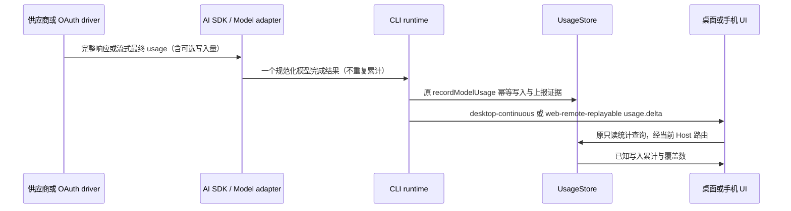

# 供应商缓存写入统计修复

## 产品规则

- 缓存写入是供应商报告的输入分类；不能用输入减缓存读取推算，不能再次加到输入或总 Token。
- Chat Completions 接收 `prompt_tokens_details.cache_write_tokens`，兼容 Copilot Auto 的历史 `cache_creation_tokens` 和上游顶层 `cache_creation_input_tokens`；显式 0 必须保留。字段无效或缺失时为未知，不默认成 0。兼容读取顶层 `cache_read_input_tokens` / `prompt_cache_hit_tokens`，不把 `prompt_cache_miss_tokens` 当作写入。
- Responses 沿原 SDK 的 `input_tokens_details.cache_write_tokens`；Anthropic 沿 `cache_creation_input_tokens`，保留缺失语义。Copilot Auto 转换 Anthropic/Responses 时统一输出 `cache_write_tokens`。
- OAuth 汇总继续保留数值累计，新增可选 `cacheWriteKnownRequests` 表示有写入上报证据的请求数；没有证据显示“未知”，只有部分请求有证据显示已知下界。旧 Agent 未提供覆盖字段时，正数仍展示，零显示未知。
- 新请求在既有 `raw_usage_json` 保存 `cacheWriteTokensReported`，明确区分报告的零与旧 SDK 合成的零。历史正数列是有效证据；旧零缺乏上报证据时为未知。不修改数据库结构、不重写历史账本、不补算已经丢失的写入量。
- 会话 Token 明细的 `usage.delta.cacheWriteTokens` 改为可选；缺失显示 `-`，真实零显示 0。已有累计快照中的数字保持兼容，不能据此推断写入是否上报。

## 所有者、接口与事件顺序

唯一事实所有者是每次模型请求结果，CLI UsageStore 是唯一持久化账本；UI 仅读取现有查询和会话 telemetry。重试/请求身份、连接归属、owner/lease、跨 Host 路由与 stale run 防护均沿现有接口。

失败、取消、未报告字段均不伪造写入量。流式起始与结束字段是同一请求的最终水位，不将重复 usage frame 相加。Shared schema 的新覆盖字段及可选 telemetry 兼容旧快照；API/OAuth 均沿同一模型适配器。

## 厂商检查与验收

- Cursor、Devin、Command Code：固定插件已输出 Chat `cache_write_tokens`，修复统一兼容 SDK 的读取丢失。
- Copilot（含 Auto）：验证 Chat、Responses、Anthropic 转换后写入/读取与总量，覆盖流式与非流式。
- Kiro、Claude、BigModel/Z.AI、MiniMax CN/Global：走 Anthropic 字段，验证正数、零与缺失，以及起始/结束 usage 合并。
- Codex、ChatGPT API：走 Responses 字段，验证 SDK 已支持的写入字段；不制造不存在的上报。
- Gemini CLI、Antigravity：原生 Google wire 当前只映射读取，写入缺失应保持未知。
- WorkBuddy CN/Global、Cline、Factory、Grok、MiMo、Qoder CN/Global、Trae CN/Global、Zed、Zen Free：核查各自 wire 的透传/转换；统一兼容解析保留真实字段，无证据不补零。
- Qoder CN/Global 的固定插件仅复制缓存读取字段，会丢失上游已有写入分类；在 worker 构建阶段应用有界兼容补丁，保留输入分类对象及顶层缓存别名。固定 vendor 原始字节、revision 与校验哈希保持不变；补丁匹配失败即停止构建，不手工改哈希。
- Trae CN/Global 的 `tokensOf` 只复制总输入/输出，需在同一有界构建补丁中保留上游缓存分类；不能将 Trae 自身未提供的字段变成零。
- 回归使用虚构响应，验证 SDK → normalizeUsage → 真实内存 SQLite → 汇总，以及 telemetry → 会话明细。未知、显式零、非零、别名冲突、非法数据、旧账本均覆盖；桌面/手机、中英文验证相同摘要展示。
- 执行相关 Node 回归、浏览器场景、根目录/CLI类型检查和 Lint、架构检查；无法逐家真实账号调用时明确披露。

## 验证记录（2026-10-12）

- 使用 `mise.toml` 指定的 Node 24.21.0：相关模型 wire、真实内存 SQLite、会话 Token 明细、telemetry、原生 Copilot/Google 和固定插件测试共 134/134 通过；Chat 的 CJS/ESM 入口均已验证。
- 浏览器场景 7/7 通过，其中缓存写入新增场景覆盖桌面中文、手机英文、非零、真实零、未知、部分上报与旧 Agent 的零，以及页面宽度。
- 根目录和 CLI 的类型检查、Lint 通过；修改文件格式检查通过；架构检查 baseline=0/new=0。未新增状态所有者、账本、数据库迁移、网络调用或远程控制路径。
- 核查以当前原生/固定插件源码及虚构响应为依据，没有逐家真实账号联网调用。历史已丢失的写入数值不恢复；更新构建后的新请求开始保留写入分类和上报证据。
- 变更模块为 lcode-cli、provider-node、shared、ui、web 与现有 SDK 补丁；净增 928 行（含规格、回归和补丁，不计生成的 worker 与发行清单），原有本地改动保留。
- `node scripts/licenses.mjs check` 通过，补丁字节哈希与来源新鲜度均已验证；20 项既有材料债务沿 `third-party/release-review-baseline.json` 接受，未宣称零债务或执行 `--strict`。
