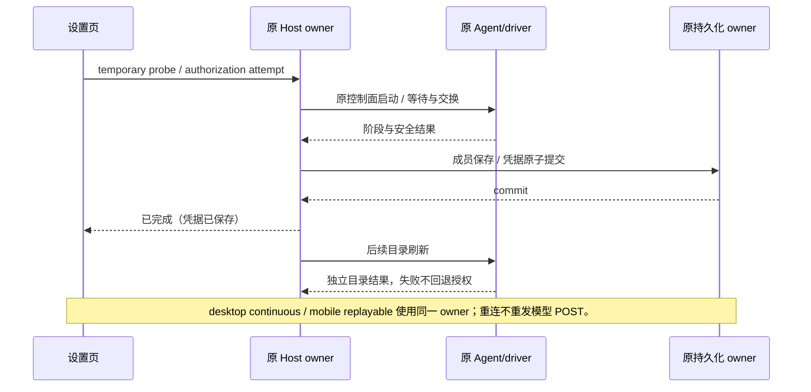

# Provider 首次配置、授权终态与路由优化

本规格承接 provider-routing-hardening，覆盖 2026-10-17 日志排障及后续性能工作。生产配置仅选择五种调度策略；无 legacy 回退、无批量 Key 手动路由面板。API 配置与调用独立于 OAuth。

## 所有者与时序

- ProviderSettingsFacade 仍独占模型成员写入；临时检测无入库副作用，成功后 UI 仍通过原 add/enable 命令提交。
- LCodeAgentService 复用原 workspace runtime。temporary probe 使用现有控制面启动入口，但不提升 modelExecutionEnabled；默认检测、会话执行与后台观察保持原门禁。identity/remoteSessionId、workspace release、进程 single-flight 与取消边界不改变。
- ProviderAccounts 独占授权 attempt、进度与终态，driver/worker 仅报告受信阶段和安全错误事实。credentials storage 的原锁和 generation CAS 决定提交。凭据成功提交后禁止改回 failed，也不能因目录/发布失败销毁已移交账号的 driver。取消仍只撤销本 attempt 新建且代次未变的连接，不能覆盖另一 Host 已完成的重新授权。
- 原 Scheduler/ledger 独占预留、在途、信用与历史。冷建索引只是可丢弃投影；分块让出执行权由 adapter 执行，不另建 accepted queue。原 Runner 仍独占 POST 尝试预算。

## API 首次模型检测

temporary 模式在没有任何可执行供应商/模型时，仍能通过现有 getOrStartReadOnlyClient 创建原 workspace runtime 并调用 provider/testModelConnectivity。不能将临时模型变成默认选项、写入 Registry、启用正常会话或要求 OAuth 登录。正式 CLI 继续按所选 provider 的配置、代理、API Key 和协议解析临时模型。失败不添加模型；关闭/切换后不提交迟到结果。

## OAuth 阶段与终态

公开诊断使用严格 schema：phase（preparing/waiting/exchange/identity/persisting/post-login/completed），code（timeout/network/rejected/cancelled/dependency/storage/unknown），可选 HTTP status、retryable 与 credentialsSaved；不携带 URL、state、code、凭据、原始响应或异常文本。阶段不拥有第二份授权状态。日志只记录 attemptId/channelId/methodId/phase/code/durationMs/status/credentialsSaved；不记录参数。

授权开始与完成、失败和提交后告警各记录一次安全生命周期事件。网络细节由原网络 adapter 分类；不能从 UI 错误字符串猜派发。原生 callback 页面表达“已收到，返回应用确认”，不能把接收 code 当成授权完成；交换错误保留 cause 供安全分类。插件 worker 从原操作传递受控阶段与错误事实。

commit 前失败为 failed；commit 后为 completed，可带 post-login warning。目录刷新/发布失败不撤回凭据、不丢 driver 所有权。开始阶段在 challenge 尚未创建时失败也返回安全 failed 视图，由同一 attempts Map 保留无资源终态；非法协议输入/已关闭 Host 仍拒绝。poll 返回完成状态必须包含 credentialsSaved；同 attempt 迟到 pending/失败不能覆盖完成。存储失败继续 failed，不谎称已保存。批量全部失效时 credentialsSaved=false。commit 后目录工作期间 followupPending=true，最终结束置 false；UI 继续短轮询这段已提交状态并接收告警，但终态不可回退 pending。

## 各渠道单次派发

原生 HTTP、插件 fetch/H2 和外部 CLI 分别审计；不允许只加 capability 标志就宣称完成。插件在原 worker operation 上持有一次推理许可，刷新/目录/鉴权不消耗推理许可；二次模型请求、跨协议重试、已建立 H2 后 H1 回退均不得产生第二次 POST。首个失败的 HTTP 状态与 Retry-After 必须传回原 owner。取消和不确定 IO 不恢复许可。外部 CLI 只有存在可验证物理派发边界时才认证，无法认证须保留明确能力原因，不能静默 legacy。

## 十万 Key 与评分

冷索引使用有界分块构建；同 profile 合并准备，等待者可独立取消；构建中 quota/health/credit 变化必须合并重放，换 catalog/policy/owner 后旧结果不可发布。索引按差异度选择有界等价分组或紧凑胜者树，避免完整候选、全部分组和五套对象评分重复常驻。profile 总成员预算 200000、最多八个；热路径无全量扫描。报告冷建总时长、最长执行片段、事件循环延迟、heap/RSS、淘汰与真实共享文件 IO。

五策略先执行绑定、资格与硬额度，再排名：主备沿目录顺序；轮转沿原 deficit credit；余量比较完整/部分/未知质量、每个相关窗 5% 分档压力向量、归一在途与一小时半衰期工作量；可靠优选先失败风险，再含 admission 等待的预计完成时间（15% 分档）、可比费用和余量；到期优先只比较本请求可归属的正收益，预测缺失或单位不可比回退余量。未知维度不补零，排名索引与全量 planner 必须差分一致。

## 验收

| ID    | 场景                                        | 断言                                                           |
| ----- | ------------------------------------------- | -------------------------------------------------------------- |
| PC-01 | API-only，空模型列表，temporary 检测        | 到达原 CLI；成功后原保存命令入库；正常会话门禁保留             |
| PC-02 | 并发首次检测、identity 隔离、取消/进程重启  | 复用原进程，不误提升能力，不提交迟到模型                       |
| PC-03 | WorkBuddy 两站点 Token/账号查询超时或拒绝   | 可见安全阶段/错误类别；无秘密；取消不继续                      |
| PC-04 | 凭据已保存后目录、发布、driver cleanup 故障 | completed + 警告，账号可恢复；commit 前存储错误为 failed       |
| PC-05 | 全部渠道能力清单与真实 HTTP/H2 单次派发     | 401/429/5xx/刷新/取消下模型 POST <= 1；不伪认证 CLI            |
| PC-06 | 十万 Key 首次/九 profile/并发构建及额度更新 | 有界片段、无旧结果、内存明显低于旧 1452 MiB 实测；热扫描不增长 |
| PC-07 | 五策略数学反例与随机差分                    | 多窗、归一负载、衰减、排队时间和正到期收益均影响正确排名       |

先执行失败测试再改代码。实际验证包含 Windows 当前环境、本地 HTTP、真实独立进程与现有 UI E2E；Ubuntu/macOS、真实厂商账号及长期墙钟浸泡未执行时明确记录。

## Claude CLI 的受控单次派发

Claude 保留原 CLI 授权、凭据刷新和外部工具会话，不直接改成另一个 OAuth 客户端。每个 CLI session 仅增加绑定到 loopback 随机 capability 路径的模型 relay；ANTHROPIC_BASE_URL 指向该 relay，HTTP 转发仍通过原 Host 网络 adapter。只接受选定 Anthropic messages/count_tokens 路径，拒绝任意转发；模型 messages 每次原派发许可只转发一次，CLI 内部重试收到本地拒绝，不能产生第二个上游 POST。count_tokens 是独立辅助请求，不能重置派发许可。

同 session 工具继续沿原 MCP bridge；下一次 continue 必须在上次上游物理流结束后重新获得一次原请求许可。对外响应 EOF 同时等待 CLI 输出与 relay 上游 EOF，不用超时猜完成。失败保留首个 HTTP 状态/Retry-After；取消关闭 relay、网络与原 CLI，并等待真实进程退出。Loopback 路径 capability 不进日志；子进程 NO_PROXY 补 loopback，实际上游仍服从原供应商代理/CA。认证依赖 CLI 遵守其模型 base URL，必须实测 fixture 子进程并尽可能验证本机实际 CLI；缺少真实 CLI 或其它 OS 时报告限制。

## 冷索引端口与紧凑投影

Scheduler.prepareIndexed(request) 返回纯 generator：最多 128 个候选分类或 2048 个树节点合并后让出控制，不包含 timer/IO。原 API adapter 使用 setImmediate 驱动并合并同一需求 profile 的准备；取消等待者不取消其它等待者，owner 关闭或策略/catalog 替换使旧 generator 失效。原 acquire 先同步推进至多一个有界计算片段；小目录在此完成时沿用当前 admission，大目录才在 outsideTicket 中继续准备，重新获得 admission 后检查索引仍就绪，再同步预留；就绪前不扣额度、不产生 POST。低层同步 reserveIndexed 的确定性契约保留，生产 acquire 不依赖它做冷扫描。

构建过程与 quota/usage 并发时，原目录仅保留有界 dirty journal；发布前重读这些 Key，共享资源更新则分块重建受影响排名。期限弹出同样有批大小上限。低差异 profile 最多保留 128 个等价分组及整数位置；分组签名包含所有私有事实、负载和近期工作，公共共享窗口只存资源身份，选择时从原账本重读，因此共享池变化不遍历十万成员。超过 128 组后单向提升为紧凑胜者树并释放分组/membership，不同时常驻两种投影。高差异共享组失效仍按块刷新，不能以旧胜者取代真实硬约束。目录不保留完整候选；胜者树使用位置、typed score 列、全局比较证据和一个期限索引，账本/绑定/统计仍由原 owner 持有。profile 淘汰发生在分配下一棵树前。诊断区分 preparing、profile 容量、rankedEntries 与每次工作，不把冷准备计成 HTTP 尝试。

## 评分模型的确定性定义

- 窗口质量分为完整、部分、未知。完整要求所有相关硬窗均 fresh、有 remaining/limit 和本次单位需求上界；只有百分比或缺少请求换算属于部分，未知维度绝不补零。余量优先完整组；完整组按窗口 kind/unit/resetMode 多重集合确认公共维度，维度不一致回退份额轮转（quota-incomparable）。完整可比组按降序排列的 5% 压力向量逐项比较；部分组只使用已知瓶颈粗档。有完整组时部分/未知候选仍只通过原 32 次一次的有界探索承接。
- 归一在途为 inFlight / effectiveConcurrency；effectiveConcurrency 与硬 admission 共用同一函数（候选事实、默认上限 2、未知额度限制共同取小），不另建手动配置。
- 近期工作在原 History 中以 model/route/generation 隔离，按一小时半衰期累计实际 workUnits；实际值未到时使用原 reservation 的工作估计，迟到反馈只作一次差额修正。比较等价于衰减工作 / 4096 / effectiveConcurrency；采用对数时间坐标避免为了全局同倍率衰减每分钟重建十万叶子。它只是软估计，不修改额度借记。统计桶各有 8192 容量；淘汰某个 route/model 桶时立即使原目录对应路由失效，不能留下与全量 planner 不同的陈旧软分数。
- History 同时记录 dispatch→end 的 serviceMs 与 createdAt→dispatch 的已知等待；completionMs 是两者之和。可靠优选在同风险档比较 completionMs + serviceMs × 归一在途，再按原 15% 对数档、同币种费用、窗口压力档、归一在途、近期工作与稳定顺序比较。不存在原队列投影时，不制造排队人数。
- 主备顺序与原 deficit 轮转不受软评分覆盖；到期优先仍以本请求可归属正收益为首要条件、以截止时间作后续比较；无法预测时回退上述增强余量。预测仍来自原 owner 的真实资源样本，不根据未确认的厂商缓存/价格或未知未来队列制造收益。
