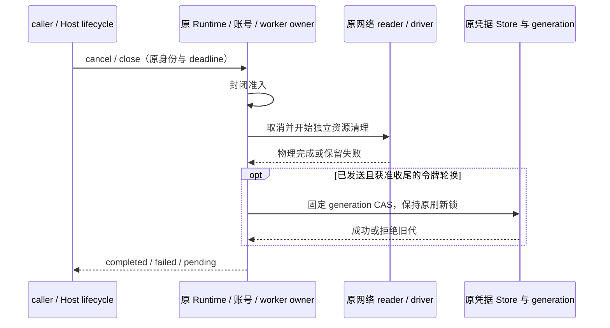

# 供应商、API 与 OAuth 生命周期补齐

基线 `52b2c509`。范围仅 zcode-full，保留已有远控重连改动；不更新 vendor pin，不操作真实账号、供应商或安装包。延续前两轮 HTTP/2 修复，本轮补齐其余 owner 的关闭与令牌边界。

## 产品规则与所有者

1. 通用 API、OAuth 原生 driver、插件 worker、模型目录、代理探测、MCP 各自持有原网络 owner；关闭请求不等于物理关闭。同步 dispose 封闭准入并观察失败，等待式关闭必须排空原资源；重复关闭合并，失败保留句柄，重试仅处理原未完成项。
2. 原生 OAuth 工厂负责 driver 和注入网络两个资源。无论 driver 关闭成功、失败或初始化失败，网络都有清理机会；多个失败聚合并保留原 cause。成功资源不重复关闭，关闭后的 driver 不接受新业务。
3. ProviderRuntime 负责目录网络、探测 owner、配置/registry 及账号来源释放。公开 `disposeAndWait()`，原同步 `dispose()` 保留兼容。Host 等待式出口真正等待该接口和原 Host 网络；账号来源 disposer 必须返回账号服务的 Promise。独立网络资源均有清理机会，不因某项失败跳过。
4. 目录与探测在关闭/取消后不创建新连接、不切换到下一个 Key 或 profile。迟到 Response 回到原 owner 取消，body cancel 的物理 Promise 与业务取消分开。失败取消不能被伪装为 valid/reachable；目录停用期间 resolveTransport 不能先创建资源。
5. API Key 没有 refresh grant；认证失败保持现有 Key/Runner 准入策略，不在网络层自动重放 POST。普通 API 和 MCP 保留各自的 H1/H2 策略，不全局强开 H2。

## 令牌策略核对

| 类别                 | 必须保留的协议与取消边界                                                                                                                                                                                                                              |
| -------------------- | ----------------------------------------------------------------------------------------------------------------------------------------------------------------------------------------------------------------------------------------------------- |
| Codex / ChatGPT API  | 原 OpenAIRefresh 单飞、固定 Host generation CAS、有界轮换收尾。预取消零交换，Host 关闭取消原工作；导入未绑定账号仍随 caller 取消。不得把强杀/远端已消费而本地未保存宣称可恢复。                                                                       |
| Gemini / Antigravity | Google OAuth refresh 响应可能不带 refresh_token，保留旧值；带新值才替换。发出刷新后仅在 Host 提供固定 CAS 且保留完成能力时允许有界收尾，普通上下文仍遵守 caller；项目探测、模型请求及后续业务继续遵守 caller。不同账号、原生渠道的 flight 不共用。    |
| Copilot              | GitHub OAuth/device token 与派生 Copilot session token 分离；派生 session 获取不冒充 rotating refresh。取消/关闭后不写入 session 缓存，不执行后续模型/策略请求。                                                                                      |
| Claude Code          | 令牌由原 CLI/profile 管理，等待真实 child close 后清理自有 profile，不手工轮换其内部 token，也不删除借用 profile。                                                                                                                                    |
| 固定插件各渠道       | 依据固定源码逐包核对 API Key、会话票据、OAuth refresh、CLI/profile 与授权轮询；沿现有 worker scope 和 Host CAS。取消后不发送推理/切协议重试。若插件刷新存在一次性令牌风险，须在 Host 授权的专用刷新边界保留结果，不把任意迟到 credential.write 放开。 |
| MCP OAuth            | 保留原跨进程刷新锁、issuer/resource、generation 与 invalid_grant 分类；不能把普通取消/网络错误视为撤销凭据。未返回新 refresh_token 时不得丢旧值。                                                                                                     |

Google 行为依据 [官方桌面 OAuth 文档](https://developers.google.com/identity/protocols/oauth2/native-app#refresh)；可选轮换规则见 [RFC 6749 §6](https://www.rfc-editor.org/rfc/rfc6749.html#section-6)。Copilot/Codex/插件的专用协议以当前固定适配源码为证，不将其内部接口当成官方稳定公共协议。

### 固定插件的受限轮换交接

插件有一部分刷新藏在 loader 内，不能只处理 auth.refresh hook。保持固定 vendor 原字节，由现有 worker 网络适配器在已核对的 HTTPS host + 精确 token path + POST + refresh 参数边界识别轮换。仅包含 Factory、Cline、MiniMax 两区、Qoder 两区及受控 VPC、Trae 两区 cloudide 轮换、WorkBuddy 两区和 Kiro 已知 social/IDC；Kiro 自定义外部 IdP、CLI/profile 和不消耗 refresh 的 Trae device exchange 保留原取消语义，不猜测端点用途。

沿原私有 worker credential 通道增加 `refresh-begin` action 与 `refresh-end` 事件（安全整数 operationId、布尔 admitted；不接收任意权限/owner）。父端必须同时拥有原 pending context、未取消的准入、OAuth grant、固定 CAS 与 retainRefreshCompletion；在 POST 前捕获代次并登记有界收尾，缺少任何能力则保持原 caller 取消。worker 仅该 token exchange/读取与一次凭据提交可脱离 caller，预算不超过 30 秒且仍受 vendor 自有 deadline 和 worker 关闭约束；普通推理/目录/额度网络不能借此绕过取消。

父端在 caller 取消移除普通 pending 后，仅保留该 operation 的固定 commit 和 grant 快照。晚到 read 不推进代次，一次 write 仅通过原 CAS；成功立刻撤销交接，后续业务恢复原取消。无提交的轮换结束记录未确认；worker 真实 exit 前仍保留 completion，正在持久化的 Promise 完成前不能释放账号锁。Host 关闭拒绝旧写回，不能把任意迟到 credential.write 放开。所有新消息在父端校验形状并绑定原 pending operation；不修改正式业务协议或新增 RPC。

Desktop continuous 与手机 replayable 仍复用同一业务 owner、lease、序号与恢复入口，不增加第二套队列或自动恢复业务尝试。服务通过既有公开依赖注入端口连接，不导入 CLI/runtime 实现。

## 验收

- 工厂初始化失败、driver 失败、网络失败及两者失败；并发关闭合并、成功资源不重复关闭、原失败资源显式重试。
- Runtime/Host 关闭期间的目录、API Key 探测、代理探测和迟到 body；预取消零发送、取消后不继续排队、失败清理可见。
- 按上表验证各家预取消、交换中取消、响应后写回、禁用/删除/换代、Host 关闭及同账号后续请求；至少使用本地协议 fixture，不能只做 mock 状态断言。
- 重跑网络/H2、原生与插件、账号/目录/探测、MCP 相关测试及 Bootstrap 生命周期；根和 CLI typecheck/lint、架构/格式、worker/许可生成检查、Agent 构建/staging 和隔离 Electron/Web 验证。

## 实施与验证

本轮代码与 Windows 本机验收完成。以下均为本轮实际执行，上一轮 1,141 项不重复计入。新增 65 个用例，另将 5 个旧协议断言迁至当前入口并纳入永久回归；按最终交付范围去重合计 **1,274 项通过**。

| 验证组                      | 实际结果                                                                                 | 证据（本机 `.artifacts/provider-lifecycle-hardening-20261015/`） |
| --------------------------- | ---------------------------------------------------------------------------------------- | ---------------------------------------------------------------- |
| provider-node 全部 TS/mjs   | 297 通过；含 H2 并发、SETTINGS、GOAWAY、RST、代理、崩溃/worker 资源和原生 OAuth          | `provider-final.log`                                             |
| 已纳入 Git 的 Provider 合约 | 34 通过；含原 Key、网络、冷却及恢复后的模型协议断言                                      | `provider-contracts-final.log`                                   |
| Model-provider 服务全部     | 98 通过；含账号 CAS/刷新锁、构造与关闭、10 万 Key、目录及代理探测                        | `services-all.log`                                               |
| CLI model/MCP/auth adapter  | 260 通过；MCP 新增 9 项覆盖省略 refresh_token、resource、换代、删除、失效 CAS 和落盘失败 | `cli-adapters-final.log`、`mcp-final.log`                        |
| CLI/Host 生命周期与诊断     | 26 通过；含真实 uncaught/unhandled rejection、H2 清理、关联 ID、stderr 和构建身份        | `cli-host.log`                                                   |
| Bootstrap 全部 src 测试     | 537 通过；保留 CommandInbox、Browser scope、continuous/replayable 与 store 保护          | `bootstrap.log`                                                  |
| 实际构建/staging 合约       | 16 通过；当前 bundle 字节进入 staging，公开网络入口及桌面外置依赖可加载                  | `packaging.log`                                                  |
| 隔离 Electron / Web         | 6 通过；实际 Host 关闭、停止归因、API/OAuth 代理选择、代理库与认证编辑/探测              | `electron-web.log`                                               |

根与 CLI 的 `pnpm typecheck`、`pnpm lint` 均通过；`pnpm verify:pre-push` 的架构结果为 violations/baseline/new 全部 0。相关根和 CLI 文件格式检查通过。worker 由原构建器重新生成，固定 vendor manifest 与原源码字节未改；第三方声明重新生成，库存输入与既有审核基线校验通过。`pnpm --dir apps/lcode-cli --filter @lcode/cli build:desktop-agent` 成功，实际产物 `--version` 返回 0.16.9，`--licenses` 正常退出。日志与去重计数另有 `acceptance.json`，由实际测试日志 summary 校验生成。

版本环境：Node 24.21.0、pnpm 10.34.6、隔离 Electron 41.10.7 / 内嵌 Node 24.18.0。当前 Agent SHA-256 `3fb07b11c88e0bc348d655d8306049f18a75edc0a7544ad286471e21c8589e7a`；worker source `e93574de436fabfe63d53c748850bf7ed1bdd4e803d2641b40795f602438ed45`；固定 vendor manifest `c0ce379a746de3ca094552c2b334f1fed585fe88a7369b6c2ac8d841a37ba348`。

真实 worker 的 14 个轮换场景分别覆盖 Cline、Factory、MiniMax 两区、WorkBuddy 两区、Qoder 两区的 job/device token、Trae 两区的 cloudide 回退以及 Kiro social/IDC。每项均在真实本地 HTTP 收到 token POST 后取消 caller，断言业务立即拒绝、一次 CAS 提交新令牌、取消后没有目录/额度/推理请求。Trae device exchange 不消耗旧 refresh，仍遵守普通 caller 取消；Kiro 自定义 IdP、CLI/profile 按原来源约束处理，不把未知端点加入脱离取消白名单。API Key、CommandCode、Cursor、Devin、Grok、Mimo、Z.AI/Bigmodel、Zed、Zen Free 等保留各自固定协议与既有真实 worker fixture，不套用 OAuth 轮换语义。Claude 的原 CLI/profile owner 不变。Copilot 的 editor/CLI 派生 session 分别验证 caller/driver 取消后零写入、零后续模型请求。

许可边界需单独记录：常规 `node scripts/licenses.mjs check` 与 `readReleaseVerifiedNotices` 通过；额外执行的 `readVerifiedNotices({requireComplete:true})` 仍失败，原因是仓库基线已有的 20 项原始许可/链接来源材料缺失，与 `52b2c509` 及审核基线逐项一致。未把此严格检查写成通过，也未降低门禁；未在本轮网络修复中声称补齐这些材料。

本轮曾实际复现并修复 MCP 旧代成功覆盖、旧代失败误报登录、删除后复活、持久化失败返回旧 token 以及失效 CAS 竞态；新增测试的初始失败、夹具类型与 Promise 库兼容错误均已修正后重跑。扩展本地旧夹具曾因旧包名启动失败，迁移后通过；最终总数只统计已纳入交付的测试，未纳入 Git 的本地历史探针不计入。

实现按功能本地提交：`3b5fd63a` 资源 owner 与等待式退出、`76b827a9` 原生/插件受限轮换、`56f10e3f` MCP 条件发布、`58082720` 永久协议回归。四项共 46 个文件，新增 2,682 / 删除 360 行，净增 2,322 行（含测试、生成 worker 单行、库存和一条测试白名单），文档另计。已有远控重连修改继续保留；`.gitignore` 只提交本轮那一条白名单。没有推送、发布、替换安装包或恢复原工作流。macOS/Linux、手机真机与真实供应商账号未实测；外部轮换和本地落盘之间的强杀/断电窗口不可能由本地事务消除，保留诊断和重新授权边界。

### 新发现：MCP 刷新发布与重新登录的并发

已确认当前 SDK 的 `refreshAuthorization` 会保留未返回的旧 refresh_token，无需重复改写 SDK。实际缺口在 Store 发布：刷新锁只串行化刷新，不阻止独立交互登录、删除或旧版本镜像写入。刷新成功后无条件 saveMany 会覆盖期间的新凭据，失败时 proactive 回退也可能返回旧代。

保留原文件锁和加密 Store 唯一写入路径，增加 `saveManyIfValues(expected, entries)` 原子条件事务，比较 canonical、legacy client、legacy tokens 三个快照（包含缺失值）。快照来自原同次 loadMany；刷新只在三个值仍相同时发布完整 pair，拒绝后重读 winner；已删除则要求重新授权。网络失败、invalid_grant 等先确认原快照仍为当前代，旧代错误不能撤销新登录或返回已删除的 token。交互登录沿原发布入口无条件发布，既有失效 CAS 保留。MCP refresh 无 caller 取消端口，继续作为账号级有界事务由原刷新锁持有，不额外增加请求级重试。

固定插件用途检查按实际协议取值：WorkBuddy 刷新令牌位于 `X-Refresh-Token`，请求体为 `{}`；其余已列协议使用各自 JSON/form 字段。供应商固定源文件保持原字节。

刷新成功与落盘失败须分开：MCP token exchange 已成功而 Store 提交失败时，不允许 proactive 返回旧 token 伪装成功；保留 cause、记录不含 token 的 persistence_failed 并抛临时故障，不自动再次交换。失效 CAS 若输给新登录，再读取 winner，避免在比较和删除间的并发窗口误报重新登录。远端一次性轮换与本地文件系统无法原子提交，强杀、断电或落盘持续失败的外部不确定性仍需诊断与重新授权，不能声称可无损恢复。

### 回归入口补齐

扩大 Provider 合约测试时发现本地遗留的 `model-interaction-protocol.test.ts` 仍引用已移除的 `@zcode/shared`、`parseZCodeBuiltinModelConfigRules` 和 `config/provider/zcode-builtin.json`，导致本轮该文件无法执行；该文件也尚未纳入 Git。本轮迁到当前公开 `@lcode/shared/model-config`、`parseLCodeBuiltinModelConfigRules` 与已存在的内置配置，并按当前测试白名单方式纳入永久回归；不恢复旧模块，原协议断言保持不变。CLI Store 的条件事务与校验准备拆为同目录私有 helper，文件锁与通知仍由原 Store 持有，遵守源文件 400 行要求。
