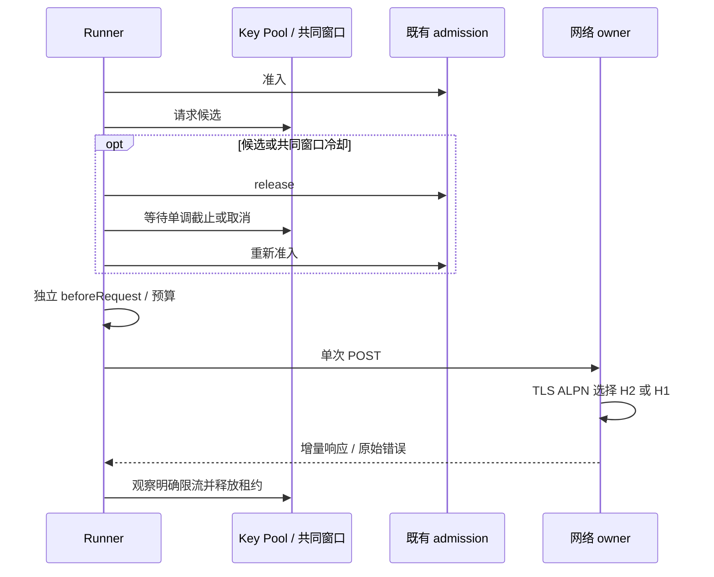
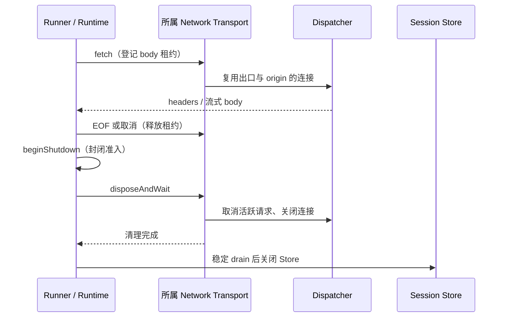
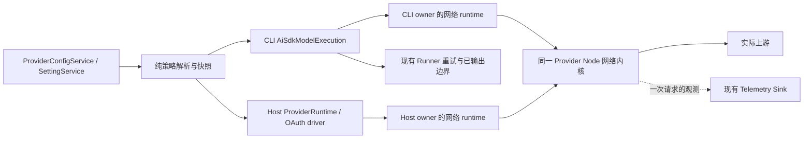
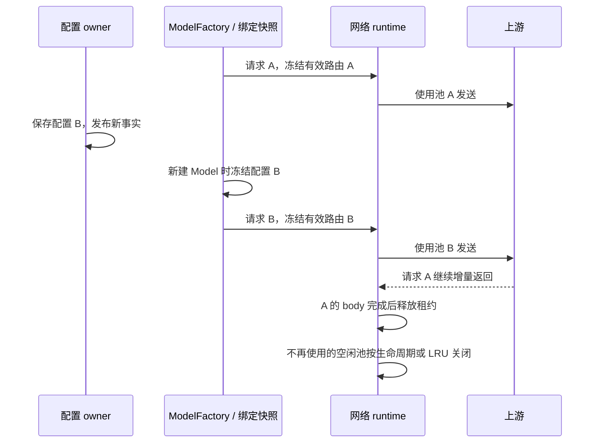
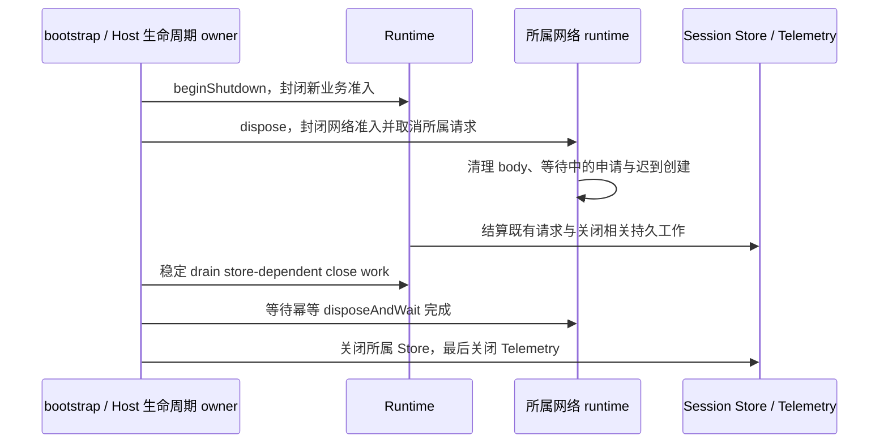
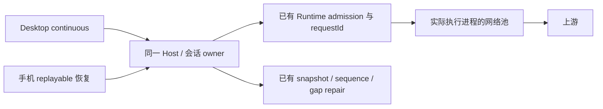

# 模型上游网络增强方案

状态：连接复用、资源生命周期、SSE 兼容已实施。2026-10-15 复核确认现有 HTTP/2 并行流正常完成仍可能导致请求错误、悬挂与后端断言崩溃，不能视为稳定验收完成。后续修复以 [HTTP/2 并发流与后端崩溃系统修复增强方案](http2-concurrency-crash-repair-plan-2026-10-15.md) 为准；下文 2026-10-13 的实现和测试记录保留为历史基线。完整阶段诊断、真实上游对照及跨平台实机验证仍需实际完成。

## 本轮实施范围（2026-10-13）

### 第二轮：SSE 兼容与 HTTP/2

模型业务 fetch 从最终 Option Map capture 的 `stream:true` 派生流式意图；没有 capture 的兼容入口只解析 SDK 提供的 JSON 文本 body。成功响应缺失或误报 Content-Type 时最多观察 4 KiB 前缀，看到完整 SSE 字段标记或心跳立即放行，不等待 EOF/固定字节数。已读字节全部原样回放，取消贯通原 reader；JSON、HTML、普通文本和 NDJSON 不误判。业务错误 clone 分支超过上限时不等待另一个 tee 分支取消，保留原错误分类和工具提交边界。

公共网络接口增加内部 `http2: disabled|negotiate`，Host/MCP 默认 disabled，普通 CLI model-api 默认 negotiate，可在执行配置关闭；OAuth loopback 与固定 driver 保留原策略。HTTP/2 仅经 HTTPS ALPN 在 POST 前协商，目标选择 H1 时使用原 H1；不引入失败后 H2→H1 重放。代理到 CONNECT 服务仍用 H1，隧道内目标 TLS 和 SOCKS TLS 同时设置目标 ALPN。策略纳入 dispatcher 身份，保留 CA、SNI、认证和关闭隔离；连接上限 8、H2 单连接 stream 上限 8。

使用锁定的 Undici 6.29.0，不升级依赖。新增本地真实 TLS fixture 覆盖直接 H2、H1 协商回落、认证 HTTP/HTTPS CONNECT、SOCKS5、并发流、取消、GOAWAY/半关闭、无额外 POST、关闭及策略切换；其错误仍进入原 Runner 预算。HTTP/2 是此版本库的实验能力，交付记录须保留实际验证范围。

H2 故障连接必须在 disconnect 后退休，禁止内部 resume 重连或同一 physical attempt 第二次 onConnect；此连接的在飞租约一起失败，其他连接不受影响。取消单个流只终止该流，不能退休健康连接。关闭等待必须能完成，不用清理超时掩盖库的队列状态。

回归追加：固定 OAuth worker 的 pending call 必须保有原始 Request 直至 body EOF/取消结算；仅保留 Request.signal 不能保证 Node 内部弱引用的取消 controller 存活。临时 Request 被垃圾回收后，caller 取消也不能丢失。此修复留在现有 worker transport owner 内，仍按 operation id 取消，不能关闭同账号的其他请求。

公共网络 transport 的在飞目录同样持有输入 Request 与最终 Request，body EOF/取消时同时删除。Key 鉴权仅修改私有 Request 的 headers，避免新增没有 owner 的临时 clone 取消链；不修改 caller Request。



### 第一轮：连接复用与生命周期

P0 已实现：公开网络子入口复用现有 Host dispatcher 内核；CLI 模型 adapter 拥有其网络资源并在异常启动、会话退出时取消和等待清理。外部注入 adapter 不被调用者关闭。注入的终端 fetch 同样经过策略校验和取消门，不能被默认 direct 绕过。

第一轮验收覆盖连续 POST 连接复用、独立 owner 隔离、未消费 SSE 的 dispose、创建中的迟到 dispatcher、预取消、配置切换与注入 fetch。MCP 保持原装配入口，并接入其自身关闭 owner；不迁移 WebFetch 的公网限制。H2 和 SSE 嗅探已在第二轮补齐；用途重定向和完整分阶段诊断仍待后续，不用连接池测试代替这些验收。

会话关闭顺序为 beginShutdown → 启动所属模型网络取消并登记 store-dependent 清理 → 原资源关闭与稳定 drain → 所属 Store 关闭 → Telemetry 关闭。连接、body 和 Key 租约由各自 owner 管理，不依赖定时延迟确认同步完成。

owner 关闭导致的在飞或后续请求失败使用明确取消结果，不作为瞬态网络错误交给无上限 workflow 重试。验收须覆盖关闭后调用只进入一次准入，且不发送新的 HTTP。

### 已落地的边界与证据

- `@lcode/provider-node/network` 是 CLI 与 Host 共用的公开网络入口。连接使用 owner 内的 Undici Agent / ProxyAgent / SOCKS5 Agent，不创建全局 dispatcher，也不按 Key 创建连接池。
- 每条请求持有网络租约到 body EOF、取消或错误；dispose 封闭新请求，取消未消费 SSE，再清理创建中及已就绪的 dispatcher。CLI model、MCP 与独立 Host 各自拥有关闭权限。
- CLI 模型出口缓存与每个 Host transport 的 dispatcher 缓存各保留最多 32 项空闲资源；活跃请求和尚在初始化的资源不被空闲淘汰。旧绑定再次调用按原冻结策略重建。每 origin 最大 8 条连接，keep-alive 30 秒、最大 120 秒；SSE idle timeout 继续由原 Runner 管理。
- 保留 CLI 的 HTTP forward proxy 与 Host 的 CONNECT 行为；认证 HTTP/HTTPS/SOCKS5、Node Request、直连与代理配置切换均有实际本地服务器回归。自定义 CA 使用异步读取，保留默认根证书。
- 本地服务器连续 5 次 POST 实测使用同一条 TCP 连接。未消费长 SSE 能在 owner 关闭时取消；迟到 dispatcher 只关闭一次；独立 owner 关闭不影响另一个 owner。
- 会话关闭测试确认模型网络清理完成前不会关闭 Store；Agent CJS bundle 与 Desktop ESM 的公开网络入口执行测试已覆盖。
- 流式响应缺少 Content-Type、误报 JSON/plain text 时，在最多 4 KiB 前缀内识别 SSE 并立即增量回放。OpenAI/Anthropic 的 UTF-8 文本、碎片工具参数、CRLF、心跳、gzip/deflate/Brotli 均有实际测试，首帧不等待 EOF。
- CLI 普通 model-api 默认协商 H2，执行配置可关闭；Host/MCP/OAuth loopback 保留 H1。仅 ALPN 确认 H2 后开放单连接 8 个并发 stream；认证 HTTP/HTTPS CONNECT 与 SOCKS5 隧道内 TLS 已覆盖。
- 锁定 Undici 的 H2 GOAWAY 与半关闭曾导致多路 POST 悬挂及关闭等待不结束；故障 Client 先退休，再结束所属在飞请求，每次 physical attempt 禁止内部重发。真实 H2 fixture 验证无额外 POST，并分别覆盖取消队首/后续流而保留其他健康流。
- 强制 GC 验收曾稳定复现 caller 取消链丢失；公共 transport 与固定 OAuth worker 在现有在飞目录保有 Request 到 body EOF/取消结算，释放时一并删除。修复后响应头前后的取消与同账号并发/后续请求均通过。



上述是本地 fixture 的复用与生命周期证据；尚未取得真实慢上游和 magpie 的同参数对照数据，不据此宣称所有延迟问题已经解决。

### 本轮验证结果

在 Windows、Node 24.21.0 下实际执行：

- 根目录 `pnpm typecheck`、`pnpm lint` 均通过；`pnpm --dir apps/lcode-cli typecheck`、`pnpm --dir apps/lcode-cli lint` 均通过。
- `pnpm architecture:check --changed`：0 违规、0 baseline、0 new。涉及 `provider`、`provider-node`、`services` 与 `lcode-cli`；公开限流接口与网络子入口遵循现有依赖方向，状态所有者及事件顺序见上文。
- 使用 `node --expose-gc --import tsx --test --test-concurrency=8` 实际执行模型 / MCP / 网络 / Provider Node / 会话关闭、公共限流解析及批量 Key 服务回归：441 项全部通过、无跳过。包含 429 HTTP/200 JSON/200 SSE、共享冷却等待与独立记账、十万冷却索引、错误隔离及真实 H2/SSE fixture。
- `pnpm test:remote-control`：76 项通过。`pnpm test:release`：70 项通过、1 项 Chromium 测试跳过；NOTICE 已按当前依赖声明刷新。
- `pnpm --filter @lcode/cli build` 成功；最新 CJS bundle 的 `--version` 实际返回 `0.16.9`。新增公共网络 CJS 与现有 Desktop ESM 执行测试均通过。
- 全仓 `pnpm fmt:check` 未通过，报告大量既有/无关文件的格式问题；本轮根目录与 CLI 修改文件的定向格式检查均通过，没有批量格式化无关文件。
- 两轮实现、测试、接线配置和既有 Key 规则补充相对当前 HEAD 累计净增 3044 行（新增 3583、删除 539，含 23 个新增文件；不含两份方案文档、NOTICE 清单和原有 UI 改动）。

验证日志保存在 `.artifacts/provider-runtime-tests.log`、`.artifacts/provider-root-typecheck.log`、`.artifacts/provider-root-lint.log`、`.artifacts/provider-cli-typecheck.log`、`.artifacts/provider-cli-lint.log`、`.artifacts/provider-cli-build.log`、`.artifacts/provider-remote-tests.log` 和 `.artifacts/provider-release-tests.log`。未进行真实上游对照测速及 macOS/Linux 实机运行；锁定 Undici 6.29.0 仍会报告 H2 实验能力警告。

本文以当前检出的 zcode-full 3.18.3 源码、包依赖和架构策略为依据。目标是降低直连上游时的重复建连成本，补齐流式网络兼容性，并使延迟能够按阶段定位。先收敛传输实现和资源生命周期，再评估 HTTP/2 等优化。

## 1. 目标与边界

### 1.1 预期行为

1. 同一执行环境、供应商、网络策略和目标 origin 的后续模型请求，在连接仍可用时复用连接；工具执行结束后的下一轮请求不再必然重新进行 DNS、TCP 和 TLS 建连。
2. gzip、deflate、br 响应在传输层解压后进入 SDK；流式解压和协议兼容转换保持增量处理。
3. 按请求用途处理重定向，保留方法与请求体，不将模型请求悄悄改成 GET，也不把 OAuth 本地票据发到外部地址。
4. 对明确请求流式输出的模型调用，上游遗漏流式 Content-Type 时仍可及时识别 SSE；首段输出不等待完整响应结束。
5. 取消、关闭、配置变更、远端重连和失败重试均保持现有业务边界。优化连接资源不能增加一条模型业务请求队列或第二套重试预算。
6. 区分连接建立、等待响应头、等待首字节、SDK 首事件、首内容与首文本；能用证据解释慢在哪一段。

### 1.2 首期范围

| 范围                                              | 处理方式                                                                        |
| ------------------------------------------------- | ------------------------------------------------------------------------------- |
| CLI 正式 API 模型请求                             | 首期迁移到复用连接的公共网络实现                                                |
| CLI 到 OAuth Host 的回环请求                      | 首期纳入资源管理，始终直连，保持票据边界                                        |
| Host API 目录、OAuth 的公共网络出口               | 复用现有 Provider Node 实现；兼容现有调用入口                                   |
| HTTP/HTTPS/SOCKS5、认证代理、自定义 CA            | 首期回归，不能因直连优化破坏已有代理行为                                        |
| MCP HTTP 请求                                     | 使用同一底层实现，但由 MCP owner 持有独立资源作用域；分步迁移                   |
| Desktop、手机远控、Web/远程执行环境               | 使用实际发起上游请求的进程资源，不在客户端另建池                                |
| HTTP/2                                            | 后续按出口能力启用，首期保持 H1，单独验收                                       |
| 自定义 OAuth driver / 固定插件内部网络            | 先核验调用路径；仅覆盖注入公共 fetch 的部分，不强行替换其 WebSocket/H2 专用传输 |
| WebFetch 公网出口限制、浏览器网络、工具子进程环境 | 保持现有专门策略；不顺带统一为模型出口策略                                      |
| UI 新增开关、代理默认规则、模型参数和供应商路由   | 首期不调整；需要新交互时另补 spec 与 E2E                                        |

不新增代理服务进程，不引入 magpie 运行时依赖，不复制其路由、账号池、协议转换和业务重试。

## 2. 实施前调查基线与证据限度

本节保留调查时的缺口，已落地项以本文开头的实施记录和当前源码为准。

| 发现                                   | 当前证据                                                                                                                                                              | 判断                                     |
| -------------------------------------- | --------------------------------------------------------------------------------------------------------------------------------------------------------------------- | ---------------------------------------- |
| CLI 每次请求新建 Agent                 | `apps/lcode-cli/packages/adapters/src/network/proxy-fetch.ts` 的 `fetchWithAgent` 调用 `createRequestAgent`；本地连续 4 次请求建立 4 条 TCP，发送 `Connection: close` | 已确认的连接复用缺陷                     |
| 默认直连也进入该实现                   | `AiSdkModelExecution.resolveProviderTransport` 先派生默认 direct，再设置 `forceDirect`                                                                                | 影响常规直连，不能只修代理分支           |
| CLI gzip 不解压                        | 同一 gzip SSE fixture：CLI 返回压缩正文，Host Undici 出口返回解压正文                                                                                                 | 已确认的传输兼容缺陷                     |
| CLI 默认不跟随 307                     | 同一重定向 fixture：CLI 返回 307，Host 返回终点 200                                                                                                                   | 已确认；修复时须补用途约束               |
| SSE 错误 Content-Type 会拖住 Responses | `createOpenAIResponsesJsonCompatFetch` 对非 event-stream 执行 `response.clone().text()`；fixture 首段已到达，但兼容层在约 350 ms 的响应结束后才返回                   | 已确认的条件性首字延迟                   |
| 连接复用能降低当前网络成本             | 同一真实端点，无鉴权 GET `/models` 均返回 401；CLI 三次约 1.36～1.62 s，池化 H1 首次约 1.40 s、后续约 0.50 s；连接数为 3 与 1                                         | 证明传输成本，不等于模型 TTFT 或生成吞吐 |
| H2 探测没有明显超过池化 H1             | 同类无鉴权探测，启用 H2 后续约 0.49～0.51 s；当前 Undici 6.29.0 将 H2 标为实验能力                                                                                    | 连接复用优先，H2 独立评估                |
| 取消能终止请求并释放 TCP               | 预取消没有请求到达服务端；SSE 中途取消使读取失败并关闭连接                                                                                                            | 现有有效行为必须保留                     |
| 历史日志含大量测试端点                 | 真实端点与保留测试域名分别统计，测试重试不得算成用户重试                                                                                                              | 历史日志不能直接构成直连/magpie 对照     |

以上复现发生在当前机器的 Node 24.14.1；仓库 `mise.toml` 与 CLI engines 指定 Node 24.21.0。正式实现验收必须使用指定版本复验，不能把这次探测当成指定版本、所有平台和所有供应商均已通过。

目前未完成同模型、同输入、同参数、同上游账号的直连与 magpie 完整生成对照。不能宣称已找出所有慢速的唯一原因，也不能承诺固定比例的 TTFT 改善。方案不保存真实端点、账号、密钥、提示词或响应正文作为示例。

## 3. 已确认的源码边界

### 3.1 必须阅读的实现

| 优先级         | 文件 / 符号                                                                                                | 对本方案的作用                                                 |
| -------------- | ---------------------------------------------------------------------------------------------------------- | -------------------------------------------------------------- |
| must-inspect   | `packages/provider/src/network-config.ts` / `resolveProviderNetworkConfig`                                 | 供应商默认 direct、profile 解析的规则来源                      |
| must-inspect   | `packages/provider-node/src/network-transport.ts` / `createHostApiNetworkTransport`                        | 已有 dispatcher 单飞缓存、CA 与关闭实现，可作为公共内核起点    |
| must-inspect   | `packages/provider-node/src/provider-network.ts` / `resolveProviderNetworkOptions`                         | Host 侧供应商策略与默认设置的投影                              |
| must-inspect   | `apps/lcode-cli/packages/adapters/src/network/proxy-fetch.ts` / `createNetworkProxyFetch`                  | CLI 当前独立传输及 MCP 的直接依赖                              |
| must-inspect   | `apps/lcode-cli/packages/adapters/src/model/model-execution.ts` / `AiSdkModelExecution`                    | 模型绑定快照、网络包装、Key failover 的装配边界                |
| must-inspect   | `apps/lcode-cli/packages/adapters/src/model/runner.ts` / `AiSdkModelAdapter`                               | 执行上下文与传输资源的上层 owner；目前未提供关闭入口           |
| must-inspect   | `apps/lcode-cli/packages/bootstrap/src/app/create-app.ts`、`app-facade.ts`、`session-resource-close.ts`    | adapter 创建、注入 ownership、会话关闭与 store 关闭顺序        |
| must-inspect   | `apps/lcode-cli/packages/bootstrap/src/app/provider-registry-model-runtime.ts` / `ApiProviderModelRuntime` | 新 Model 从 Registry 读取并冻结配置；其 dispose 不等于关闭网络 |
| must-inspect   | `apps/lcode-cli/packages/adapters/src/model/openai-responses-json-compat.ts`                               | Responses 的完整正文读取问题                                   |
| should-inspect | `apps/lcode-cli/packages/adapters/src/model/anthropic-stream-compat.ts`、`model-option-map-fetch.ts`       | 流式转换及最终请求体，判断流式意图的来源                       |
| should-inspect | `packages/services/src/model-provider/providerAccountTransport.ts`、`providerRuntime.ts`                   | OAuth 本地票据、中断传播、Host 目录池及释放                    |
| should-inspect | `packages/provider-node/src/socks-network-dispatcher.ts`                                                   | SOCKS 远端 DNS、TLS 身份校验与认证                             |
| should-inspect | `apps/lcode-cli/packages/adapters/src/mcp/network.ts`                                                      | 共用 helper 的另一调用方，避免迁移后漏掉资源 owner             |
| invariant-only | `specs/model-provider-failover.md`、`specs/provider-api-key-probe-isolation.md`                            | 保留业务切换、探测隔离和迟到结果保护                           |
| evidence-only  | magpie 的常规网络出口实现                                                                                  | 比较连接复用与 H2，不能据此推断所有插件实际使用的传输          |

### 3.2 架构决定

公共 Node 网络内核放在已有 `provider-node` 模块，由 CLI adapter、Host 和业务服务通过公开入口调用。`provider` 模块继续只承担纯配置与规则解析；不引入 Node IO。网络内核不 import CLI Runtime、UI、Services Repo 或模型 SDK。

目前 `provider-node` 和 `lcode-cli` 在 `architecture-policy.yaml` 中均为 legacy 模块，受控上下文没有完整 module manifest。不能把 `managed: false` 当作跨包深导入授权。新增公开能力需有接口示例与依赖声明；本任务不顺带迁移整包为 managed 模块。

拟新增 `@lcode/provider-node/network` 公开子入口，导出窄的传输接口，避免 CLI 为网络功能加载整个 OAuth/插件目录。该入口尚不存在；实施时须同步 `packages/provider-node/package.json` exports、CLI adapter 的 workspace 依赖，以及 `resolveBuildAliases` 的精确映射和构建回归。

`createHostApiNetworkTransport` 保留为兼容包装，内部调用同一内核。`createNetworkProxyFetch` 在迁移期仅做既有参数到公共网络选项的投影；连接创建、压缩和重定向不能继续留两份实现。其剩余调用迁完后，先核验引用再决定是否移除包装。

## 4. 产品规则与不变量

1. 未配置供应商 network，包括 null，仍显式直连并屏蔽环境代理；显式 default 才继承应用默认出口。保持 direct/default/custom/profile 现有语义与配置格式。
2. 代理列表仍由 ProviderConfigService 持有，默认代理由 SettingService 持有。专用代理不继承全局绕过列表；无效代理、认证失败不回退直连。
3. 网络内核只消费派生的有效策略；不保存第二份供应商配置，不自动读取 Windows/macOS 系统代理，不修改 global fetch 或 global dispatcher。
4. 对一次物理请求，派生并冻结有效路由后再申请 dispatcher；响应期间不更换出口。重定向仍使用此次冻结策略，按目标 URL 重新判定绕过规则。
5. Model 的 provider/config/auth 快照继续以既有绑定规则为准。保存配置后新建的 Model 读取新事实；网络池不能让旧绑定拿到新的 endpoint、headers、Key 或 providerSaveGeneration。
6. OAuth 本地票据通道始终走同一执行环境的回环地址；上游网络策略只应用于 Host 真正的厂商出口。
7. 不改模型、reasoningLevel、speed、service_tier、最大输出预算、prompt cache、工具 schema 或协议选择。网络实验中的这些变量必须保持一致。
8. Runtime/Runner 继续拥有逻辑调用、admission、物理请求记账和重试预算。传输层不自动重发模型 POST，不创建业务 failover，不在 HTTP 出流后恢复重放。
9. identity 隔离继续采用 `workspaceIdentity?.trim() || workspacePath`；远程业务关联保留 workspaceIdentity、remoteSessionId、owner/lease 与 stale run 防护。
10. 同一进程内连接资源与 workspace 业务身份是不同概念。本期按已有 owner 隔离池，不引入跨窗口、跨 Host 或跨独立 CLI 执行上下文的全局池。

CLI 与 Host 的 NO_PROXY 匹配当前也各有一份。迁移时收敛为同一个出口解析实现，保留已有域名/子域名、前导点、通配符和端口规则，并对逗号、空白、大小写、方括号 IPv6 与端口边界补测试。不得因为改用新库而悄悄解释成另一套绕过规则；当前产品未明确的 CIDR 等语法需要先补规则，不能在本期宣称已支持。普通 loopback/LAN 是否绕过代理仍依原供应商选择，不能复制 magpie 的自动 LAN 绕过；仅 OAuth 票据回环具有强制直连规则。

## 5. 状态所有者与接口草案

### 5.1 唯一所有者

| 状态 / 资源                                    | 唯一 owner                                               | 其他层职责                                                   |
| ---------------------------------------------- | -------------------------------------------------------- | ------------------------------------------------------------ |
| 供应商 network、proxyProfiles                  | ProviderConfigService                                    | 读取、派生有效策略，不复制持久化                             |
| 应用默认代理与证书路径                         | SettingService / 现有 CLI 配置来源                       | 按现有执行环境同步与解析                                     |
| CLI 模型池、dispatcher、连接创建单飞、资源代次 | AiSdkModelExecution 持有的网络 runtime                   | AiSdkModelAdapter 提供生命周期接口，bootstrap 管理 ownership |
| Host API/OAuth 公共 fetch 的连接资源           | 所属 Host 或 ProviderRuntime 的网络 runtime              | 原服务生命周期注册负责关闭                                   |
| OAuth 本地票据与上游账号 lease                 | ProviderAccounts / ProviderAccountTransport 的既有 owner | 网络池不保存业务票据或接管账号路由                           |
| MCP HTTP 连接资源                              | 既有 MCP adapter/port owner                              | 可用同一内核，不能借用模型 owner 的关闭权限                  |
| 物理请求的 abort、响应 body 租约               | 网络 runtime 的该次请求记录                              | Runner 的外部 AbortSignal 能取消该记录                       |
| 重试预算、已输出边界、failover                 | 现有 Runtime / Runner                                    | 网络错误提供结构化事实，不执行第二次重试                     |
| 网络阶段观测                                   | 该次传输产生，现有 Telemetry Sink 消费                   | UI 只读投影；不落成第二份任务业务状态                        |

### 5.2 拟定接口

以下名称与字段为拟新增接口，不能当作当前已经可用的 API：

```ts
interface ProviderNetworkRuntime {
  createFetch(input: {
    scopeKey: string;
    purpose: "model-api" | "oauth-loopback" | "oauth-upstream" | "catalog" | "probe" | "mcp";
    resolveOptions: () => Promise<ProviderNetworkOptions>;
    observe?: (observation: ProviderNetworkObservation) => void;
  }): typeof globalThis.fetch;
  dispose(): void;
  disposeAndWait(): Promise<void>;
}

interface ProviderNetworkOptions {
  httpProxy?: string;
  noProxy?: string;
  caCertPath?: string;
  forceDirect?: boolean;
}
```

运行时构造参数另持有连接资源限制和 H2 策略；这些参数先保持内部配置，不扩展供应商持久化 schema。模型协议的 stream 意图和 SSE 兼容转换留在 CLI model 层，不进入这个 Node 网络契约。

scopeKey 由可信 owner 分配，表示供应商/账号渠道与用途的隔离范围，不从请求头、UI 草稿或原始密钥派生。HTTP origin 仍由 dispatcher 内部进一步分池。跨作用域不能因为 URL 相同而复用。

兼容入口和 MCP fetch 必须接入明确的 owner。测试注入或外部注入的 adapter/transport 不由使用者擅自 dispose；新增 `ownsModelAdapter` 等 ownership 事实由创建处确定，不用“是否有 close 方法”推断所有权。

### 5.3 依赖与事件路径



“同一内核”指代码与契约共享；CLI 和 Host 进程各自持有资源实例，不跨进程共享 socket。

## 6. 连接池、配置变化与关闭

### 6.1 池键与资源边界

池分组键包含 owner scope、有效代理路由身份、CA 内容身份和传输策略版本；目标 origin 在 dispatcher 内隔离。代理路由身份需要区分认证变化，使用内部不透明指纹，不输出带 userinfo 的 URL。

Key/票据仍按每个请求注入，不能捕获在长生命周期的公共 dispatcher headers 中。账号渠道需要隔离时使用现有 channel/connection 标识构造 owner scope；不以 token 内容作为可观测池键。

拟定初始资源参数如下，属于实施验收时可调整的内部参数，不是性能承诺：

| 参数                       | 初值  | 约束                                                    |
| -------------------------- | ----- | ------------------------------------------------------- |
| H1 每 origin 最大连接数    | 8     | 请求取消应能终止 dispatcher 内等待；不能产生无限 socket |
| 空闲 keep-alive            | 30 s  | 不影响进行中的 SSE；遵守更短的服务端提示                |
| keep-alive 最大值          | 120 s | 避免服务端提示无限保活                                  |
| 到服务端空闲期限的安全余量 | 2 s   | 降低重用已过期 socket 的概率                            |
| 每 owner 缓存的池分组      | 32 个 | 空闲项 LRU 淘汰；活跃项不能被容量策略强杀               |

32 是缓存目标，不是供应商数量上限。活跃项超过目标时暂时保留，停止再缓存多余的空闲项；最后一个 body 租约释放后收口。不得为了达到固定容量强行中断模型流，也不能让旧绑定持有失效的固定 dispatcher。

连接创建使用现有 Promise 单飞与 generation 防护。缓存 rejected Promise 必须清除，允许下一次合法调用重新创建；失败的当前请求仍失败，不因清缓存自动再发一次。

请求租约从入站 fetch 开始，持续到响应 body EOF、取消或错误。不能在收到响应头时就将连接池项视作空闲。重定向的中间响应也须释放 body 和资源。

### 6.2 配置更新



配置更新不重播 A，不把 A 的迟到错误改写为 B 的错误。新配置不能复用旧路由的 CONNECT 隧道或旧 CA 建立的 TLS 连接。

CA 使用异步文件 IO，并合并 Node 默认根证书。相同路径的证书内容更新须在明确的策略重载/owner 重建边界重新读取并生成内容身份。首期不宣称支持证书文件自动监视；若需要热更新另定义事件来源，不能用轮询定时器推断配置已提交。

### 6.3 生命周期



新增网络关闭回调须接入 `session-resource-close.ts` 的现有资源收口协调，并保持 store-dependent drain 不变量。不能仅在 `app-facade.ts` 的 `closeSession()` 返回后补一句关闭池：届时 store 可能已关闭，迟到的请求终态可能仍需发布。

正常退出需要主动取消属于已关闭会话的长流，再等待实际资源清理；不能对永不结束的 body 单独无限 `dispatcher.close()`。重复 dispose 共享一个完成 Promise；同步退出允许 destroy，不能吞掉未清理资源并宣称关闭完成。

窗口/Host 重建由原注册处关闭所属网络 runtime；手机断线本身不会销毁桌面会话池。外部注入 adapter 的关闭权始终由其创建者持有。

## 7. Fetch 兼容性补齐

### 7.1 压缩与响应形状

- 由公共 Undici fetch 增量解压；SDK 和 SSE transform 读取解压后的正文。SSE 心跳和首个文本 frame 不等待压缩流结束。
- 转换后的响应移除不再描述正文的 Content-Encoding、Content-Length。未转换的响应保留真实 headers；禁止只删压缩标记却转发压缩字节。
- 保留业务错误状态、Retry-After 和 request-id；保持 `Node Request` 与独立 Undici 构造器之间的公共字段投影兼容。
- HEAD、204、205、304 使用合法的空 body Response，不能为禁止正文的状态构造非空流。
- 读取、取消和 backpressure 在解压层与原始 socket 间贯通；body 未完整读取时，owner dispose 仍能释放连接。
- 保留现有请求体限制。首次只支持当前模型链路已使用的 JSON 文本/字节体；不得新增无界读取上传流的行为。

### 7.2 重定向规则

不能直接依赖通用 fetch 的默认跨 origin 跟随规则来转发带 Key 的模型请求。公共内核采用 manual 获取中间响应，并按 purpose 执行如下策略：

| 请求用途                           | 允许行为                                                  | 拒绝行为                                             |
| ---------------------------------- | --------------------------------------------------------- | ---------------------------------------------------- |
| model-api / oauth-upstream 的 POST | 最多 3 次同 origin 的 307/308，保留方法和完全相同的请求体 | 301/302/303 自动改 GET、跨 origin、HTTPS 降级到 HTTP |
| oauth-loopback                     | 首期拒绝重定向                                            | 转发本地票据到其他端口、origin 或外部地址            |
| catalog / probe 的 GET、HEAD       | 最多 3 次同 origin 的标准重定向，保持既有信号和截止时间   | 未显式授权的跨 origin；跨设备解释 localhost          |
| MCP                                | 按现有 MCP 认证与 transport 契约决定；迁移前单独补验收    | 套用模型规则导致 OAuth discovery 或已授权流程变化    |

尊重调用者 `redirect: "manual"`，返回中间响应；`redirect: "error"` 立即失败；默认 follow 仍受用途约束。URL 相对引用、循环、缺少 Location、不可重放请求体与超出次数需要明确错误。

跨 origin 供应商迁移通过既有配置保存完成。本期不新增自动信任域名名单。重定向策略拒绝属于确定的请求/配置错误，不在 Runner 中按瞬时网络异常反复重试。

## 8. 流式识别与兼容层

这部分位于 CLI model adapter；公共网络层不认识 Responses、Anthropic 或 Chat Completions 的业务结构。

1. 从实际发给 SDK 出口的最终 JSON 请求派生 stream 意图，不能从“用户当前模型通常流式”推断；`stream: true` 与非流式请求分别处理。复用已有请求体解析，不为识别意图额外复制大段 prompt。
2. Content-Type 已是 event-stream 的成功响应直接进入现有增量兼容链，不能完整读取。
3. 明确请求 stream、且 header 缺失或为兼容性的 text/plain 时，进行有界前缀识别；前缀能够确认 `data:`、`event:` 或 SSE 心跳即放行，并将已消费字节原样交回流。
4. 前缀判断最多缓存 4 KiB，不等待固定大小填满；不能用新固定等待时间代替分类。超出预算仍无法判断时结束识别，交回原响应或按已明确的协议错误处理，不能继续积累完整正文。
5. 对 header 为 application/json、但请求明确 stream 的异常响应，同样先判别正文前缀；JSON 业务错误走原业务错误分类。合法 JSON 响应的兼容规则只处理 JSON，不再对未确认的 SSE 执行 `clone().text()`。
6. 错误正文读取继续保持当前有界策略，并避免 tee 分支取消相互等待；超出错误体预算需要释放资源并返回可诊断错误，不能占着连接槽等待未消费的另一分支。
7. 不把 HTML、空响应、普通文本或每行一个 JSON 的其他协议猜成 SSE；这些情况不新加模型协议兜底。
8. SSE UTF-8 分片、CRLF、frame 边界与末尾不完整 frame 按现有兼容语义处理；新增前缀回放不能丢字节、重复 frame 或改变工具调用提交边界。

首期应先记录实际 content-type 与识别结果，再用 fixture 验证条件性问题。不能因这个缺陷已复现就认定用户上游一定漏写 header。

## 9. 重试、超时、HTTP/2 与 IPv6

### 9.1 一次请求的边界

同一次已获得明确 307/308 的重定向属于一个逻辑 attempt 的后续 HTTP hop，应单独记录 hop；连接失败后的第二次模型 POST 属于新的物理尝试，必须经过现有 Runner admission、beforeRequest 记账和重试预算。

为避免 SDK、Undici 及 Runner 叠加重试，实施时核验当前 Undici 在失效 keep-alive socket 上的内部重发行为。无法证明 POST 未发出的故障一律返回 Runner；不能增加带 POST 重发的 RetryAgent，也不能让一个 requestId 隐藏重复模型执行。

保留当前默认 10 次重试、最大退避 60 s、stream idle 默认 600 s，以及 off-peak 等已有专门规则。首期只增强分类与观测，不直接缩短这些业务时间或扩大豁免预算。

网络内核可补连接建立阶段的独立边界，30 s 为拟定上限；它覆盖 DNS、代理握手与 TLS，失败交给原错误分类。最终数值需在指定 Node 版本和代理环境验证。不能另加比现有首事件等待更短的响应头/body 超时，尤其不能将 Undici 默认超时无说明地变成新的产品规则。

### 9.2 HTTP/2

- 第一轮公共出口采用池化 H1；第二轮已实现内部 `disabled / negotiate` 策略，启用范围见开头实施记录。
- negotiate 通过 ALPN 在发送请求前选择协议；服务端选择 H1 时正常使用 H1，不能在 H2 请求已发送后偷偷再发一次 H1 POST。
- HTTP CONNECT、自定义 CA、SNI、连接取消、并发 stream、GOAWAY、远端半关闭及池隔离全部通过后才扩大启用范围。当前 Undici 6.29.0 的实验状态是交付风险，不默认升级依赖来绕过。
- SOCKS 自定义 TLS connector 已设置目标 ALPN，并通过认证 SOCKS5 的真实 H2 回归。
- 已有 Cursor/固定 driver 的 H2、WebSocket 与协议翻译不由通用 fetch 接管。

### 9.3 DNS 与 IPv6

先观测当前 Node 的地址族选择与连接失败阶段；保留系统正常解析，不强制所有供应商 IPv4，不自建长期 DNS 缓存。

只有证实“IPv6 的 TCP 被接受但 TLS 在发送 HTTP 前失败”后，才另补短期能力缓存与 IPv4 建连策略。策略选择必须发生在 HTTP 请求发出前，缓存按实际连接目标隔离；代理与 SOCKS 远端 DNS 不复用本地厂商域名的判断。证据不充分时只报告错误，不重放 POST。

## 10. 可观测性与性能验收

### 10.1 数据与口径

扩展已有 Model Call/Attempt Telemetry，不建立新的终态记录库。复用 `logicalCallId`、`requestId`、attempt、provider/model、调用用途和现有 trace 关联。

| 阶段 / 字段                                     | 定义                         | 缺失处理                                     |
| ----------------------------------------------- | ---------------------------- | -------------------------------------------- |
| routeResolveMs                                  | 读取并冻结本次网络策略的耗时 | 不可测时不写                                 |
| connectionReused / negotiatedProtocol           | 实际连接复用与 ALPN 结果     | 不能按配置推测实际结果                       |
| dnsMs / connectMs / tlsMs                       | 此次新连接的阶段耗时         | 复用连接通常不存在这些阶段，记缺失而非伪造 0 |
| headersMs                                       | 请求出口开始到响应头可用     | 包含上游等待，不能解释为纯网络 RTT           |
| firstBodyByteMs                                 | 第一段解压后正文可用         | 与第一枚 token 严格区分                      |
| timeToFirstProviderEventMs / ContentMs / TextMs | 既有 Runner/SDK 语义         | 保留现有字段定义                             |
| redirectCount / decodeKind / streamSniffResult  | 此次响应处理事实             | 原样转发与未判别分别表达                     |
| retryWaitMs / streamMaxIdleMs                   | 原重试和流停顿观测           | 不在网络层重新计算第二份预算                 |

先采用 owner 内的观察回调/绑定过的诊断订阅，严格匹配实际 request 与 socket，不能把 H2 共享 session 的新建耗时分摊成每个请求的 TLS 耗时。不能准确归属的阶段保持缺失。

观测回调不得 await 网络/文件 IO 或阻断 chunk。生产 info 每 attempt 一条有界汇总；原始 headers、chunk、逐帧事件只使用 debug。异常 sink 必须旁路，不改变请求结果。

endpoint 使用既有脱敏观测身份，不记录 query、userinfo、Key、票据、cookie、真实 prompt/body 或内部服务地址。日志说明 fixture / benchmark / 正常请求来源；统计时排除保留测试域名和 fixture 标记。禁止把新字段塞进未知 `_meta` 后绕过严格类型。

首期网络阶段观测只进入进程 Telemetry。若以后要展示在任务网络调试 UI，需单独更新 CLI contracts、`packages/shared/src/lcode-protocol/index.ts` 与对应 shared 事件 schema，验证新旧消费者兼容，补 UI/E2E；不能将观测里程碑自动变成 SessionEvent 或 replay 数据。

### 10.2 受控基准

1. 本地 HTTP/TLS fixture：可控首段与终段 release gate、连接数、握手数、正确/缺失/错误 Content-Type、压缩与重定向；以事件和实际连接断言为主，不用睡眠证明顺序正确。
2. 同策略连续 10 次完整消费的 H1 请求，在服务端保持连接且逐次释放后，预期复用一条连接；并发请求按设定容量验证，不将并发产生多连接判为失败。
3. 工具调用式间隔：使用可控时钟模拟短于与长于空闲期限的间隔。短间隔复用；长间隔可新建连接，不能把自然过期误报性能回退。
4. 真实无鉴权 GET 只测传输，不能以其 401 响应耗时代替生成性能；HEAD 与 GET 单独统计，HEAD 不作为连接复用达标的唯一证据。
5. 完整模型 A/B 使用同上游、账号、模型、协议、输入、reasoning、speed、输出预算和 cache 条件。每组先预热再交错执行，首轮、温连接和跨工具等待分别报告；建议各至少 20 个有效样本。
6. 报告 p50/p95 的首内容、首文本、总耗时、连接数、失败率和重试次数。上游限流、模型排队、缓存命中等单独说明，不从结果中任意剔除。
7. 确定性 fixture 的验收目标是连接/字节/事件正确；真实 A/B 目标是连接开销下降且失败率不增加。整体 TTFT 收益以测量值交付，不提前写百分比承诺。

## 11. 平台、远控与用户入口

| 场景                         | 请求资源 owner                                           | 需要证明的边界                                                         |
| ---------------------------- | -------------------------------------------------------- | ---------------------------------------------------------------------- |
| Desktop 本地会话             | CLI 模型上下文与 window-scoped Local Host 各自持有所属池 | 同窗口多个 workspace 不因 UI 改动创建新 Host；不同窗口不会互相 dispose |
| Desktop 远程 workspace       | 实际远端 Agent/Host                                      | 所属窗口连接注册表继续负责路由；不新增 Desktop Remote Host             |
| 手机远控                     | 桌面已有 Host attachment 和复用的会话 Runtime            | 手机断线不另起 Agent/池，恢复不重新提交已接受模型请求                  |
| Web + Server                 | 服务端实际执行上下文                                     | 浏览器只接收产品流，不持有厂商 Key 或 Node dispatcher                  |
| 独立 CLI / workflow 子运行时 | 当前 CLI adapter owner；同一 adapter 的子执行复用        | 外部注入或独立创建的 adapter 不被父上下文误关                          |
| 设置目录刷新、Key/模型探测   | 现有 Provider Settings 和临时探测 owner                  | 不改共享 ModelFactory，不发布临时模型，不影响活动会话绑定              |



上游池化不改变 Desktop `desktop-continuous` 与手机 `web-remote-replayable` 的交付语义。Main/Relay 保持鉴权、转发和 attachment 调度职责，不保存网络重试队列或业务快照。

首期 UI 入口及提交动作不变：模型设置仍通过原 hooks 保存 network；会话 Stop 继续发原取消命令；网络状态仍由既有服务投影。若后续增加诊断展示，先读 DESIGN.md，兼顾桌面/手机、主题和国际化。

### 单 Key 与批量 Key 的配套增强

普通 API 单 Key 和批量 Key 都使用本方案的公共网络能力。对同一供应商出口，多 Key 按请求注入鉴权并复用连接资源，不按每把 Key 创建连接池。批量请求的 catalog 复用、并发候选分配、失败/限流隔离和逐次物理请求记账见 [API Key 与批量 Key 运行时增强方案](provider-api-key-runtime-enhancement.md)。其 Key pool 由 AiSdkModelExecution 持有，与网络资源 owner、设置页批量检测 owner 明确区分。

当前 API Key 内部 fetch 会在一次 SDK 调用中轮换多个候选；第 4、9 节的“一次物理请求一次记账”是增强目标，需要配套 Key 方案的 K1 阶段完成，不能描述为目前已全部满足。

## 12. 验收场景

以下为计划用例，均不能因已有测试文件存在而写成已覆盖。

| ID  | 状态      | 设置与动作                                                     | 必须断言 / 证据                                                        |
| --- | --------- | -------------------------------------------------------------- | ---------------------------------------------------------------------- |
| N01 | accepted  | 同一 Model 连续请求，服务端允许 keep-alive                     | 完整读 body 后连接复用；工具间隔内无多余握手；模型参数不变             |
| N02 | accepted  | 两个模型/供应商同 origin，不同 scope；两个独立 owner           | 按隔离规则分池；关闭一个 owner 不影响另一个                            |
| N03 | accepted  | A 正在 SSE，保存不同代理/CA/endpoint 的 B，创建新 Model        | A 使用原冻结策略结束；B 使用新策略；迟到 A 不覆盖 B                    |
| N04 | accepted  | direct/default/custom/profile，配置与 captured 环境代理组合    | 未配置仍 direct；显式 default 才继承；profile 缺失与认证失败不直连     |
| N05 | accepted  | HTTP/HTTPS/SOCKS5 认证、特殊字符、绕过命中                     | CONNECT/认证真实发生；目标无代理凭据；SOCKS 使用远端 DNS               |
| N06 | accepted  | gzip/deflate/br SSE，在终段 release 前消费首段                 | 首段已可读、字节正确；取消和 backpressure 贯通                         |
| N07 | accepted  | 同 origin 307/308 POST、301/302/303、循环和跨 origin           | 保留允许的 body/method；拒绝规则正确；中间 body 已释放；无票据外发     |
| N08 | accepted  | 正确/缺失/text/plain/错误 JSON Content-Type 的 stream 响应     | SSE 前缀可确认后即输出；不完整读取；JSON 错误仍有业务码                |
| N09 | accepted  | UTF-8/SSE frame 分片、心跳、空响应、HTML、普通文本             | 无重复或丢失字节；不会猜成新协议；工具提交与失败边界不变               |
| N10 | accepted  | 预取消、等待 socket 时取消、收到 headers 后取消、owner dispose | 不多发请求；读取失败；资源最终释放；取消不变成自动重试                 |
| N11 | accepted  | 并发创建同一 dispatcher、创建失败、创建中 dispose              | 单飞；失败可清缓存；迟到创建被关闭；dispose 幂等                       |
| N12 | accepted  | 多次切换路由、缓存容量超过目标、活跃长流                       | 只淘汰空闲项；关闭仍可等待实际完成；无无限空闲池增长                   |
| N13 | accepted  | 失效 keep-alive、网络失败、429、已提交文本后断流               | 无隐式 POST 重发；Runner 记账、Key failover、预算、已输出边界保持一致  |
| N14 | accepted  | OAuth 模型经 Host 回环票据，再由 Host 请求上游                 | 回环始终 direct；ticket/Key 逐请求有效；上游策略由对应 Host owner 应用 |
| N15 | accepted  | session close、异常启动、注入 adapter、Host/窗口重建           | 仅关闭所属池；终态/drain 先于 store close；观测最后收口                |
| N16 | accepted  | Desktop 运行中手机断线重连，并切换 Host attachment             | 同 Runtime；恢复不重发已接受请求；identity、lease 和 stale 防护有效    |
| N17 | accepted  | CLI、Desktop Agent、SEA 与 Desktop ESM 实际打包运行            | 公共子入口精确解析；网络依赖闭包完整；无动态 require 启动错误          |
| N18 | accepted  | 慢/抛错 Telemetry Sink、真实记录与 fixture 混合                | 不拖慢首 chunk、不改变业务结果；测试数据可排除；无凭据或正文           |
| N19 | accepted  | HEAD 与 204/205/304，以及 Node Request 输入                    | 合法 Response；不因构造器或空 body 产生异常；取消仍生效                |
| N20 | accepted  | H2 的直连/认证 CONNECT/SOCKS/GOAWAY/并发与取消                 | 本地 TLS fixture 已验证；无隐式 POST 重发，单流取消与故障关闭隔离      |
| N21 | undefined | IPv6 被 TUN 接受但 TLS 失败                                    | 需先证明失败阶段及无 HTTP 发出，再定义地址族策略与缓存期限             |

裁剪：不枚举所有模型 × 所有 UI × 所有代理的笛卡尔积。以三种模型协议、三种代理协议、回环 OAuth 和两种客户端交付语义的代表场景覆盖。支持相同底层行为的模型不逐个做联网调用；专用 driver 只有实际走公共 fetch 时才纳入。Windows/macOS/Linux 的证书、DNS 与打包差异不能由其中一个平台替代。

## 13. 实施顺序与变更清单

### P0：连接复用与生命周期

先写 N01～N05、N10～N12、N15、N19 的失败测试，再实现窄公共入口与网络 runtime。保留池化 H1，接入 AiSdkModelExecution 和 bootstrap 的 owned adapter 收口。MCP 的直接调用方必须明确处理，即使首批迁移只覆盖模型。

交付要求：正常直连和认证代理复用成立，单飞/取消/关闭成立，新旧 Model 配置隔离成立，实际构建可运行。不能以“给每个新 Agent 加 keepAlive”作为完成，因为每请求新建池仍缺共享和释放 owner。

### P1：Fetch 与流式兼容

利用 P0 内核补齐压缩、空 body、用途重定向；在 CLI model 层修复 SSE 分类与 Responses 的完整读取。完成 N06～N09、N13～N14 的回归。每个缺陷修复用中文注释说明复现依据和边界。

### P2：诊断与平台验收

在 P0 基础观测之上补完整阶段归属与脱敏汇总，完成 N16～N18；加入受控基准并复验指定 Node 版本。首期不改任务产品事件 schema，不新增网络设置 UI。

### P3：可选 H2 / 地址族策略

本轮按用户指定顺序提前实现 H2 及其本地协议验收；启用范围和验证限度见开头实施记录。H2 与 IPv6 独立推进，不可回放的 POST 失败仍交原 Runner。真实上游的收益需后续同参数对照取得，完整阶段诊断与地址族策略未在本轮实施。

| 当前文件 / 目录                                                                                            | 计划改动                                              |
| ---------------------------------------------------------------------------------------------------------- | ----------------------------------------------------- |
| `packages/provider-node/src/network-transport.ts`、`provider-network.ts`、`socks-network-dispatcher.ts`    | 公共内核、兼容包装、单飞/生命周期、代理与 CA          |
| `packages/provider-node/package.json`                                                                      | 新增公开 network 子入口；版本和依赖升级另评估         |
| `apps/lcode-cli/packages/adapters/package.json`                                                            | 声明公开网络入口所属 workspace 包依赖                 |
| `apps/lcode-cli/packages/adapters/src/network/proxy-fetch.ts`、`http-config.ts`                            | 去除重复传输；保留工具/模型策略分界，CA 读取改异步    |
| `apps/lcode-cli/packages/adapters/src/model/model-execution.ts`、`runner.ts`                               | 网络 runtime ownership、冻结策略的 fetch、关闭接口    |
| `apps/lcode-cli/packages/bootstrap/src/app/`                                                               | 创建/注入 ownership、失败启动清理、会话资源关闭顺序   |
| `apps/lcode-cli/packages/adapters/src/model/openai-responses-json-compat.ts`、`anthropic-stream-compat.ts` | 有界 SSE 识别及 JSON/流式兼容                         |
| `apps/lcode-cli/packages/adapters/src/mcp/network.ts` 与其 adapter owner                                   | 迁移共享 helper 的资源 ownership，不删除 MCP 网络规则 |
| `apps/lcode-cli/packages/contracts/src/model/network-status.ts`、telemetry                                 | 仅在需要扩展类型时增加可选观测字段，不污染 replay     |
| `packages/services/src/model-provider/` 与既有 Host dispose 注册                                           | 复用同一内核，避免兼容入口改变原策略和关闭行为        |
| `apps/lcode-cli/packages/cli/scripts/build.mjs`、网络构建回归                                              | 精确子入口别名、CJS/ESM 与 SEA/Agent 验证             |

新增内部文件名在实现时按职责确定；不得继续堆入已有超长 model-execution 文件。公共 API 要提供契约示例，避免把实现细节透给 Services/UI。

## 14. 验证入口与退出条件

现有定向入口如下；新增测试文件需要明确标记为新增并接入实际命令，不假定统一单测脚本存在：

```powershell
node --import tsx --test packages/provider-node/src/provider-network.test.ts packages/provider-node/src/proxy-auth.test.ts apps/lcode-cli/packages/adapters/src/model/model-provider-proxy.test.ts apps/lcode-cli/packages/adapters/src/model/anthropic-stream-compat.test.ts
node --import tsx --test apps/lcode-cli/packages/adapters/src/model/model-execution-api-key-failover.test.ts apps/lcode-cli/packages/adapters/src/model/runner-runtime-headers.test.ts apps/lcode-cli/packages/adapters/src/model/runner-failover-yield.test.ts
node --import tsx --test apps/lcode-cli/packages/bootstrap/src/lcode-protocol/connectivity-network.test.ts apps/lcode-cli/packages/bootstrap/src/app/session-facade-close.test.ts
pnpm typecheck
pnpm lint
pnpm --dir apps/lcode-cli typecheck
pnpm --dir apps/lcode-cli lint
pnpm architecture:check --changed
pnpm test:release
```

根 typecheck 不包含完整 CLI 项目引用，因此不能省略 CLI 自身检查。若修改代理设置交互，再执行现有 `packages/web/test/provider-proxy-settings.test.mjs` 场景；若修改远控交付，使用根 `pnpm test:remote-control` 入口，并核验当前入口具体覆盖范围。相关测试存在不等于已验证新的池化与断线场景。

交付前必须满足：无新架构违反；公开入口的真实打包回归通过；取消/关闭/冻结快照/业务重试没有退化；fixture 无丢字节或隐式 POST 重发；性能结果可区分冷热连接与上游排队；所有未执行平台和真实上游场景明确记录。回退以代码提交和运行时传输策略为单位，不改写用户配置，也不保留两份长期网络实现作为隐藏兜底。

## 15. 相关规格、索引缺口与本轮记录

- [代理与模型设置联动](provider-proxy-and-settings-layout.md)：本方案保留其默认直连、代理/CA owner、回环票据和打包边界。
- [运行中模型故障切换](model-provider-failover.md)：保留请求安全边界、模型绑定来源、原 admission/预算与关闭 drain。
- [供应商 API Key 探测隔离](provider-api-key-probe-isolation.md)：临时探测迟到结果和 supplier scope 不变。
- [API Key 与批量 Key 运行时增强](provider-api-key-runtime-enhancement.md)：普通/批量 Key 共享网络池，另补 catalog、并发分配、失败隔离与物理请求预算。
- 当前 feature graph 的模型设置、连通性与 failover 节点已用于定位；网络资源 ownership 尚缺专门 seed。记录为 graph-drift-candidate，实施时以新增公共契约的真实符号补索引。graph 头部引用的 `docs/skills/feature-boundary-graph.md` 在当前检出中不存在，本轮不恢复已移除文档。
- `pnpm dep:refs --scope 'apps/lcode-cli/packages/adapters/src/**/*.ts' ...:createNetworkProxyFetch` 本轮未加载 CLI 嵌套源码；直接调用方已用源码 import 检索确认，不能据此次查询判断导出未使用。
- 本轮只编写方案，没有实现接口、池化、H2、协议字段或新增验收测试。前一轮执行的 6 项定向测试和探测仅证明第 2 节的当前行为，不算增强后的验收结果。

本轮文档检查：基线新鲜度检查通过；架构检查 baseline 0 / new 0；根 `pnpm typecheck` 与 `pnpm lint` 通过；源码文件引用与相对 spec 链接均存在。新增文档完成定向格式检查。本轮未执行 CLI 全量检查、平台 E2E、安装包构建或增强后的验收用例，不能据此视为方案已实现。

正式实施仍需核验：指定 Node 版本下的 Undici 行为、真实上游完整生成 A/B、SOCKS/H2 自定义 connector、专用 driver 实际出口，以及新资源关闭接口如何与外部注入 adapter 协作。这些项目均有明确后续验收路径，不以未经验证的兜底分支提前实现。
