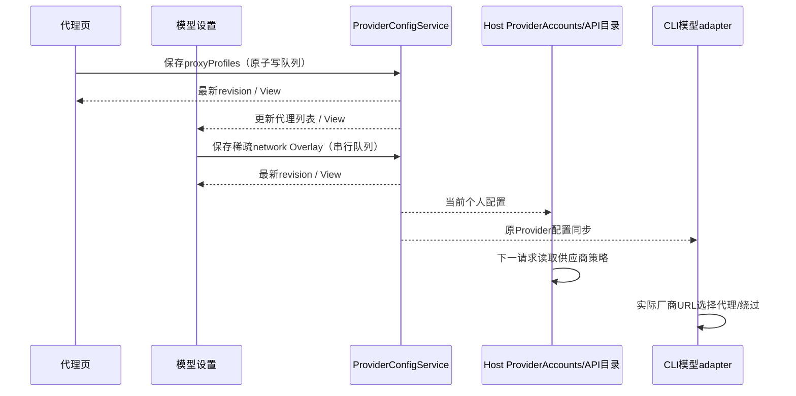

# 代理与模型设置联动

## 产品规则

- 设置新增「代理」分区，基础设置中的 HTTP 代理、不使用代理的地址、自定义证书整体迁入。原 AppSettings 字段及默认代理语义保持兼容。
- 代理页提供代理列表，支持每行一个 HTTP/HTTPS/SOCKS5 URL 的批量粘贴，允许编码的账号密码；空行忽略，逐行报告无效行号，同 URI 去重，不在错误文案显示原始凭据。最多 1000 条、256 KiB。可命名、编辑、删除和检测单条或全部代理。
- 代理页只管理默认代理、绕过地址、自定义证书、代理列表和连通性检测，不展示供应商列表或代理分配控件。导入后的代理统一在模型设置内分配给供应商，OAuth 与 API 使用同一供应商级代理编辑器。支持「默认代理」「不使用代理」「代理列表中的条目」「专用代理」。供应商保存稳定 profileId 引用；编辑列表条目影响后续请求，被引用条目删除时拒绝并提示在模型设置中先解除分配，不静默改直连。
- 代理页默认展示「代理列表」页签，通过页签切换「代理列表 / 单个 HTTP 代理」。这是纯 UI 展示状态，不写设置、不改变默认出口或供应商分配；两组控件保持挂载，切换保留未保存草稿与检测结果。单个代理视图继续编辑现有全局默认 HTTP/HTTPS/SOCKS5 配置；供应商的「使用默认代理」选项保留。
- 连通性检测由当前 Host 使用选定代理向固定公开 HTTPS 测试端点 `https://example.com/` 发送 GET（10秒取消边界），实际完成 TLS、代理认证和响应头后显示成功/失败及耗时。批量检测最多 3 个并发，提供「取消检测」；operationId 在原服务内路由取消，取消项不标成连接失败。结果属于请求投影，不持久化为代理长期有效事实；明确不等同于目标供应商可访问。错误内容不回传 secrets；Host dispose 取消检测。
- HTTP、HTTPS、SOCKS5 代理都支持可选用户名/密码，包括 URL 内的编码凭据与独立表单输入。密码遮蔽显示；特殊字符按 URL userinfo 编码，认证只发给代理，不进入厂商请求头或日志。SOCKS5 使用远端 DNS，认证失败不回退直连。
- 供应商未设置 network（包括 null）时默认「不使用代理」，UI 与 Host/API/CLI 实际请求均显式直连并屏蔽环境代理（包含 LCODE 显式代理与 captured shell 代理），继续继承应用证书。只有显式选择「使用默认代理」才继承应用默认出口；已有显式 default/profile/custom/direct 选择保持原语义，不改写旧文件。专用代理不继承全局绕过地址，空 CA 路径仍继承应用证书。无效专用代理拒绝保存/调用，不静默直连。OAuth Host 本地票据通道始终直连，代理仅用于真正的厂商出口。Cursor 使用已有的出流前 H1 路径承接代理，保留直连时的 H2 路径。
- OAuth 内容顺序为「登录授权」「模型配置」「已登录账号」。登录授权只承载授权方法、文件导入、本机登录与授权状态；模型配置承载模型编辑/刷新；已登录账号只展示该渠道的账号、状态、启停、额度、目录与删除。切换页签保留进行中的授权，关闭仍先取消原 attempt；不额外登录或扫描本机。
- OAuth 三个页签靠左排列，总宽最多 24rem（默认根字号下约 384px、每项约 128px），不随大屏面板拉长；小屏按可用宽度等分。中英文标签及较大 UI 字号允许换行，完整显示文字，保留选中态、键盘导航和原页签状态语义。
- 模型设置中的「管理默认代理」按钮在窄屏与较大 UI 字号下允许换行，仍通过原设置导航跳到代理页。
- 模型设置分栏按外层滚动容器与面板实际位置的剩余高度伸缩，取消 36rem 上限；标题换行、界面字号和视口变化用 ResizeObserver 测量，不用固定延时。左右仍独立滚动。OAuth 与模型编辑弹窗随屏幕大小调整宽高，正文独立滚动，标题、关闭、保存始终可达。手机不横向溢出。

## 状态所有者与接口

- SettingService 是默认代理的唯一 owner；ProviderConfigService 的个人配置文件是代理列表 `proxyProfiles` 与供应商 `network` 的唯一 owner，严格 schema 接受 default/direct/custom/profile 四种选择。列表 ID 在原子写队列生成，供应商只保存 profileId；执行 Registry、Host 与 API 目录通过同一个纯解析函数派生实际地址，不存第二份代理事实。旧文件无 proxyProfiles 时按空列表读取；原字段/模型/Key 更新不得清除列表。
- UI 通过 hooks 读取服务，只拥有未提交草稿；保存重新读取当前 provider Overlay，保留 API Key、headers、模型和 metadata。代理页与模型页订阅同一权威 View：代理页只修改代理定义并读取分配关系来阻止删除被引用条目，供应商 network 的 UI 写入入口只在模型设置。移除代理页列表组件不改变状态 owner、持久化、服务接口或事件顺序。
- Provider Node 网络 adapter 复用既有 Host dispatcher/CA/释放逻辑；原 Services API 网络入口保持兼容。Native 与固定插件 driver 使用显式注入的网络策略，插件按 operation 获取策略，不改全局 Host fetch。API 目录、Key 检测和 CLI 正式模型请求使用同一 provider.network 优先级。
- 文件 Repository 的写入规范化与读取快照均保留 proxyProfiles；模型、名称和默认选择修改后，重建 Runtime 仍能读回列表及 profileId。现有 Provider Provisioning 信封在 shared/provider-provisioning.ts 严格校验并传输完整列表，继续使用原 RPC 通道与文件 codec，不新增 Agent stdio 命令。
- 网络地址和 CA 路径以实际发起厂商请求的设备为准；localhost 指该设备，手机沿用所连接 Host。检测只确认当前 Host 的网络事实，不能代表另一个远程执行设备的出口。
- Agent 构建沿用 CLI 的 `resolveBuildAliases` 单一映射；新增公开入口 `@lcode/shared/network-proxy` 必须精确映射到 shared 的网络协议源码，不能被通用 `@lcode/shared` 前缀拼到 `index.ts` 后面。普通 CLI、Desktop Agent 与 SEA 复用此映射，不改网络状态所有者或增加运行时加载路径。
- Desktop 的 main/host/scheduler 为 ESM：网络 adapter 所需 CommonJS 依赖 `undici`、`socks` 保留为外部运行时包，不内联其 `require` 调用。构建 external、afterPack 闭包注入和最终包校验共用桌面网络运行时依赖清单，包含 SOCKS5 的 `smart-buffer`、`ip-address` 传递依赖；CLI 与插件的 CJS 构建保留现有内联方式。安装包必须能加载代理 adapter，不能只验证编译成功。
- OAuth ProviderAccounts 与原 generation/owner/lease 不变；仅网络 adapter 按 channel 对应 provider 读取网络配置。Desktop continuous 和手机 replayable 都在同一 Host 出口应用策略，手机不创建新 driver。

已开始的请求保持原 dispatcher；新请求读取已保存策略，不重播请求。默认代理对内置浏览器/工具进程的重启边界保持原行为；供应商选择适用于后续模型请求。

## 验收

1. 默认代理旧配置可读取；代理页初始只展示列表页签，切到单个代理页签后可保存/清空全局配置。仅切换页签不写任何设置，来回切换保留两边草稿；代理页无供应商列表或分配控件，保留批量导入、编辑和检测。
2. 未配置的 API/OAuth 默认直连；明确选择使用默认代理才走全局出口。在代理页导入，进入模型设置后可分别为 API A 分配列表条目、API B 使用默认代理/OAuth C 直连；返回代理页仍保留被引用条目的删除保护，编辑条目后模型设置中的选择保持相同 profileId 并显示新名称。编辑名称、Key、模型不丢失 network，编辑 network 不丢失其他 Overlay。
3. API `/models`、Key检测、正式请求及 OAuth 授权/续期/目录/额度/fetch 使用选择的出口；覆盖带密码 HTTP/HTTPS/SOCKS5、特殊字符凭据、认证失败、绕过命中直连、非法代理失败、显式直连不使用进程代理；本地 OAuth 票据不外发。
4. OAuth 三页签顺序与职责正确，进行中换页签再返回不重启授权；关闭取消失败可重试，迟到结果和换 Host 原防护保留。
5. 1920×1080/1280×600/390×844/320×568、中英文、明暗主题下分栏随高度变化，正文可滚到尾部、按钮可达、无横向溢出。OAuth 页签总宽不超过 24rem，大屏每项不超过约 128px；小屏和较大 UI 字号下标签不溢出，三项均可切换。
6. 使用实际 esbuild 与 Agent 构建别名打包网络协议入口并执行其校验；Windows x64 桌面打包不再出现 `index.ts/network-proxy` 解析错误。
7. 按 Desktop external 清单编译并执行 ESM 代理 adapter，HTTP/HTTPS/SOCKS5 认证请求仍通过既有网络测试；最终 app.asar 包含外部代理库及完整闭包，不再出现 `Dynamic require of "events" is not supported` 主进程错误。

Agent 子入口与 Desktop ESM 运行时回归均纳入根目录 `pnpm test:release`。

## 验证记录（2026-10-12）

- 代理协议、配置、真实文件冷启动、认证代理、批量检测、固定插件及 CLI 请求的本轮定向测试：41 项通过；Web 代理交互 3 项、模型分栏多视口场景均已通过。
- `pnpm typecheck`、`pnpm lint`、修改文件格式检查通过；架构检查 baseline 0 / new 0。
- 工作区全量 `git diff --check` 命中任务开始时已有的 Anthropic/OpenAI Compatible 缓存用量补丁中的空白行；本任务未改写这些补丁。代理功能与构建修复文件的定向检查通过。
- `pnpm test:release`：69 项通过，1 项因未设置测试浏览器路径跳过。新增 Agent 子入口与 Desktop ESM 回归纳入该入口。
- Windows x64 Agent、桌面生产构建与安装包生成通过；最终 app.asar 的代理库闭包完整。使用隔离数据目录启动真实 win-unpacked 应用，主窗口为 `text/html`，React 正常挂载，能进入设置→代理，未捕获页面异常；测试进程已关闭。
- 构建修复涉及 CLI、Desktop 及根测试入口，不改变任何业务状态 owner 或事件顺序；8 个构建/测试文件增加 98 行、删除 11 行，净增加 87 行。
- 当前机器为 Windows，未在 macOS 实机验证。用户反馈的 Mac 启动后显示渲染器源码尚未复现；需要对应安装包版本或 app.asar 进一步确认，不能将上述 Windows 结果当作 Mac 已修复的证据。未使用真实供应商账号或公网代理验证连接。

### 代理页职责与页签宽度收敛

- 删除代理页供应商列表及其独占组件/文案，模型设置保留原供应商代理编辑器；中英文提示改为在模型设置中分配或解除分配。
- OAuth 页签总宽限制为 24rem，窄屏等分、长标签换行；同时修复英文「管理默认代理」按钮在 320px 视口、20px UI 字号下的溢出。
- 4 项浏览器回归通过，覆盖代理页职责、导入→模型设置分配→代理页编辑/删除保护、API/OAuth 独立选择，以及中英文/明暗主题、1920/390/320px 视口和 14/20px UI 字号的页签宽度、文字完整显示和切换。
- 根 `pnpm typecheck`、`pnpm lint`、10 个本轮文件格式检查通过；架构 baseline 0 / new 0。修改前全量 `pnpm knip` 已因 209 个未使用文件、614 个未使用导出及既有配置提示失败，未扩大本轮范围修复。导出引用分析与文本检索均已执行，列表组件的唯一直接调用已删除。
- 变更仅涉及 UI、Web 测试桩和规格；业务 owner、服务接口和事件顺序不变。5 个生产 UI 文件相对本轮修改前的构建源码净减少 43 行。本轮未重新生成安装包。

### 展示切换、JSON 输入与供应商默认直连

- 代理页显示方式仅由组件局部状态持有，两组控件保持挂载；默认代理仍由 SettingService 持有，供应商 network 仍由 ProviderConfigService 持有。显隐与换视图不提交设置或创建授权 attempt，JSON 原文经原授权表单、hook 与 Host 命令提交。
- 本轮涉及 UI、Shared、Provider、Provider Node、CLI adapter 和 Web 测试；14 个生产源码文件净增加 136 行。未新增业务状态所有者、持久化入口或 Agent 命令；供应商未配置 network 的读取派生规则改为直连，明确保存的 default/profile/custom/direct 保留。
- 后端定向测试 17 项、浏览器交互 5 项通过，覆盖真实 HTTP 请求默认直连/显式默认代理、认证代理、视图切换草稿保留、API/OAuth 独立策略、JSON 固定高度/换行/显隐/原文提交。另核验 Codex、ChatGPT API、Claude、Gemini、Antigravity 的真实方法目录均声明 JSON 格式；未读取真实账号或代理。
- 根目录与 CLI 的 typecheck、lint 通过；本轮修改文件格式检查、git diff --check 通过；架构 baseline 0 / new 0。本轮未重新生成安装包。
