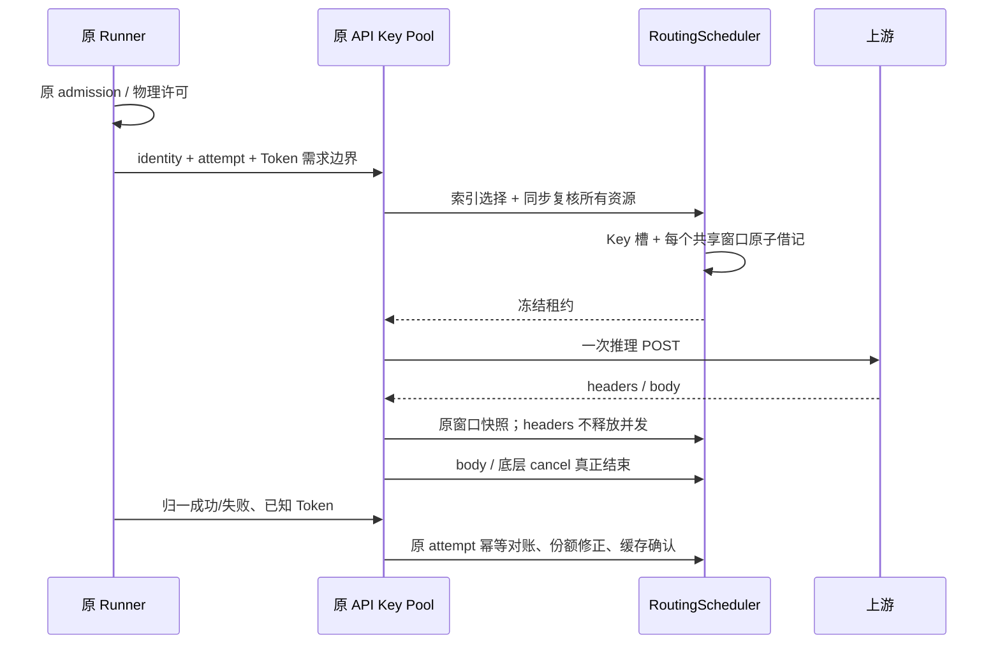
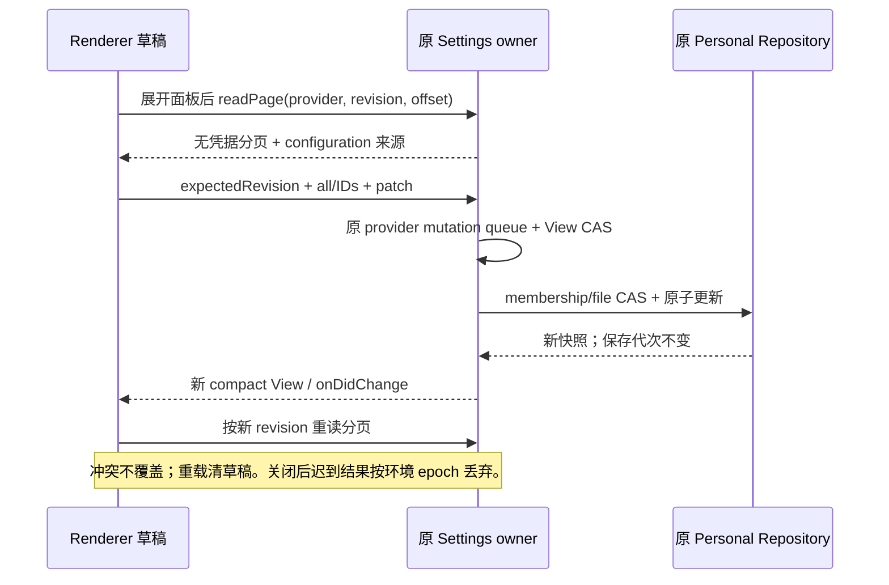

# 批量 API Key 五策略执行规格

本规格补充 `provider-routing-strategies.md`，保留五策略名称和优先级。实施顺序：契约与失败测试 → Token/共享资源预留 → 十万 Key 索引 → 缓存与批量诊断 → 实际回归。缺省 `routing` 或 null 继续原路径，不改变 Key 轮换、失败隔离与保存代次。

后续跨进程共享 owner 与高度分散目录增强见 [补充规格](provider-routing-cross-process.md)；仅在其明确的注入/数据目录边界下替代本文的进程内共享限制。

## 状态与接口

- `ApiKeyPoolRegistry/ApiKeyPool` 仍是当前执行器的唯一 owner；不承诺独立 CLI 之间的全局额度锁。原 Runner 持有物理请求许可，租约不能自发重试。
- `RoutingScheduler` 继续唯一拥有 Ledger、Bindings、History、在途和份额；新增目录索引只是这些状态的派生投影，不能另写一套余额或已接受队列。
- Key 的可选 `routing` 元数据包含 `quotaPoolId`、`cacheGroupId`、可证明的 `cacheTtlMs`。省略 pool 表示独立资源；相同标签或相同 API 地址不能证明共享。相同 pool 在同一 Provider/Key 目录代次中共享全部相关窗口。元数据变化不能解除旧凭据的鉴权隔离。
- `RoutingRequest.tokens` 携带 input/output/total 与 `quality: bound | estimated`，数值有限非负；缺失仍是 unknown。Runner 优先使用受信的请求 Token 上界；缺少计数时使用模型 contextWindow 与明确输出上限的保守边界，不能把固定工作量子当 Token。
- `ApiKeyPool.observeRoutingQuota` 是私有 adapter 入口，接收严格校验的 Key/pool 快照与窗口，支持单位、类型、实例、修订、重置模式和覆盖水位。不注册为 UI 写额度接口。原 HTTP 限流头经同一入口投影，支持 requests/tokens 两个独立窗口；其它厂商窗口只有真实适配数据才接入。
- `ApiKeyPool.readRoutingDiagnostics` 为只读分页（1–100），返回 Key ID、启用/鉴权/冷却/在途状态、当前需求的单 Key 策略预览、fallback、排除原因、窗口读数及估计标志、索引统计；明确标记 executor-preview，不冒充最后一次实际执行决策；不返回 Key、Authorization、请求内容。预览不推进游标、不预留、不触发 HTTP；版本过期返回冲突，不能重复/跳页。

## Token 和共享池规则

1. total tokens 窗口使用 total；input/output 窗口分别使用对应量；requests 每次为 1。不把推理 Token 或 cache read/write 再加到已经包含它们的总量中。
2. 短窗、长窗、Token、请求次数和共享池全部取交集，预留全成或全不成。bound 可用于严格保留；estimated/unknown 不能证明严格保留。
3. 取消未派发的租约全额回滚；已经派发且实际用量未知的保守借记保留。收到响应头或调用方 release 不代表物理结束。
4. actual 可以早于或晚于 body 完成，同一量只对账一次；部分已知量不能把其它未知量退成零。只有可信 `coversThroughSeq` 退休已覆盖的终态增量，在途不能退休。
5. Key A 与 B 的同一 pool/窗口/实例只保留一份 Ledger 资源；A 的预留必须立即影响 B。窗口更新不以查询完成时间或普通 reset duration 伪造新账期。
6. 改策略、份额、pool/cache 元数据不推进 Key 凭据保存代次；更换凭据才按原机制处理。旧租约仍按原冻结资源结算，迟到结果不能借新目录结算。关闭增强策略使未派发租约失效，但不清空原 owner 的在途和借记；重新启用继续复核原资源。关闭期间的新请求保持原 legacy 行为，不宣称补算这段请求的 Token。
7. 份额轮转的补充轮次基于同一最佳 soft tier 中所有合格候选的最早可用轮次，不能从展示用前 32 条 routes 推断全目录都欠债。

## 五策略与大目录索引

纯 planner 的规则继续适用：硬绑定、资格和全部资源限制优先，随后 soft tier，再按可靠优选/主备接管/份额轮转/余量均衡/到期优先排序。到期策略只依据真实 expiring-balance 和足够同单位样本预测，无证据时明确回退。

新增按需求轮廓（input/output/total/quality、模型作用域）缓存的目录索引，最多保留 8 个轮廓。同一 attempt 的模型与需求不可变；更换模型必须报告 attempt-conflict，不能复用原预留。首次目录或新轮廓建立允许 O(N)；热选择不能重新构造/排序十万候选。窗口、借记、终态、用量修正只更新受影响 Key；明确共享池作为共同资源复核，不因一个共享池借记重建十万叶子。

索引将**在当前轮廓下决策等价**的 Key 归为 cohort：资格/soft tier、读数质量、压力档、在途、健康/可靠性档、到期收益档、份额可用轮次及真实共享资源关系一致。目录顺序索引负责找 cohort 中的顺序首位/轮转后继；核心 planner 比较代表候选，保留全目录 order/cursor 语义。当前绑定必须单独进入比较。不能用随便截取前 32 个 Key 代替全目录决策。

复杂度按 N（目录）、G（不同决策 cohort）和受影响 Key/池分别记录；不把最坏 G=N 写成恒定 O(1)。验收同时报告未知读数、有限不同窗口、共享池三类十万目录；要求冷建索引与热选择分开计量，热路径无全目录扫描/全量候选创建，普通单 Key 更新有界。若信号高度分散，应在诊断显示实际 G 与扫描工作，不能靠 wall-clock 测试掩盖算法退化。

## 缓存与批量管理

- 缓存只使用显式 group 与 TTL。相同 group 的 Key 切换可复用同一缓存域，不人为制造跨 Key 的缓存损失；不同 group 保留原收益/新读数门槛。没有事实就不生成缓存命中或默认 TTL。
- `turn-only` 不保留跨轮软偏好；主备和份额不被跨轮缓存抢占。硬工具/会话归属不因缓存组或设置开关解除。
- 批量设置沿原 Provider Settings owner、View revision 与文件 CAS。使用 ID/分页读取，修改路由元数据不要求将十万明文 Key 回传 Renderer；保存旧表单也不能清掉新增字段。
- 批量配置命令 `setApiKeyRoutingMetadata` 只接收 Provider、expectedRevision、明确的 all 或 keyIds 目标和元数据 patch。patch 中 null 清除相应字段；未提供字段保持。Key 元数据可设置 1–100 份额和整数优先级（小值在先，同值保留目录顺序），显式策略 order/weights 仍优先。`readApiKeyRoutingPage` 只返回分页 ID、启用与这些配置字段，以及共享池/缓存配置检查；不读取真实用量来冒充配置摘要。
- 配置诊断与运行诊断分别标明来源：Settings owner 返回声明的池/缓存/份额及配置问题；执行器 `readApiKeyRoutingDiagnostics` 返回当前 Key 池的实际排除原因、预留/读数和索引工作。设置页不能把静态声明显示成真实额度或健康，也不能通过查询签发模型请求。
- UI 复用现有 Key 管理、hooks、分页和主题，补 pool/cache/份额配置、批量修改与安全诊断。运行态只展示原执行器返回的事实，配置检查不能冒充真实余量或运行健康。
- 批量面板默认折叠，展开后才读取分页与配置摘要；供应商列表不能为每张卡片提前拉取全部 Key。关闭丢弃未提交草稿，已接受的保存仍由原 owner 完成；旧环境/关闭后的结果不回写当前面板。

批量配置的提交顺序沿原 Settings 服务与对应 Environment 传输，Renderer 只持有未提交草稿：

## 必须先失败再实现的场景

| ID      | 设置/动作                                    | 断言                                                                      |
| ------- | -------------------------------------------- | ------------------------------------------------------------------------- |
| AKB-001 | 单 Key 100 Token，并发两份 60                | 只成功一份；未派发取消后才可重取。                                        |
| AKB-002 | A/B 共享 pool 100，各取 60                   | 第二份拒绝；换 Key 不扩大资源。                                           |
| AKB-003 | requests 充足，tokens 不足；或短窗空、长窗足 | 所有窗口交集，失败无部分借记。                                            |
| AKB-004 | 预留 60，actual 30 早/晚到、重复到           | 一次修正；释放槽与对账独立。                                              |
| AKB-005 | actual 缺失/只知输入/取消已派发              | 未知分量保持估计，不退零。                                                |
| AKB-006 | 新/同修订读数无覆盖水位、滚动 reset 变化     | 不洗掉旧借记；相同或更旧修订不能改写余额，不补造余额。                    |
| AKB-007 | 同代次换策略/pool 元数据，Key 曾 401         | 隔离保留；旧租约结算原资源。                                              |
| AKB-008 | 五策略各十万 Key，冷建后热取/终态/更新       | 报告耗时、索引构建和被检查候选数；热路径无 N 扫描；原 legacy 回归仍通过。 |
| AKB-009 | 同 cohort 顺序/不等份额/大请求债务           | 全局顺序和份额一致；目录预览不影响调度。                                  |
| AKB-010 | 共享池十万成员耗尽                           | 不遍历十万成员才发现不可用。                                              |
| AKB-011 | 同/异缓存 group、新读数、小/大收益           | 只在规则允许时保留或切换，无 TTL 不保留。                                 |
| AKB-012 | 分页诊断、过期 cursor、并发保存和旧表单      | 无秘密、无副作用、冲突可恢复、元数据保留。                                |
| AKB-013 | 真实 SDK generate/stream + HTTP fixture      | 每次物理 POST 对应原许可；无隐藏重发；归一 usage 确认原预留。             |
| AKB-014 | 桌面/手机，中英文，批量管理操作              | 输入/保存/冲突/错误可达，无横向溢出。                                     |

本表是计划验收项，不预先标记通过。实际执行记录补充至 verification 文档；不请求真实厂商推理、不读取真实凭据。
