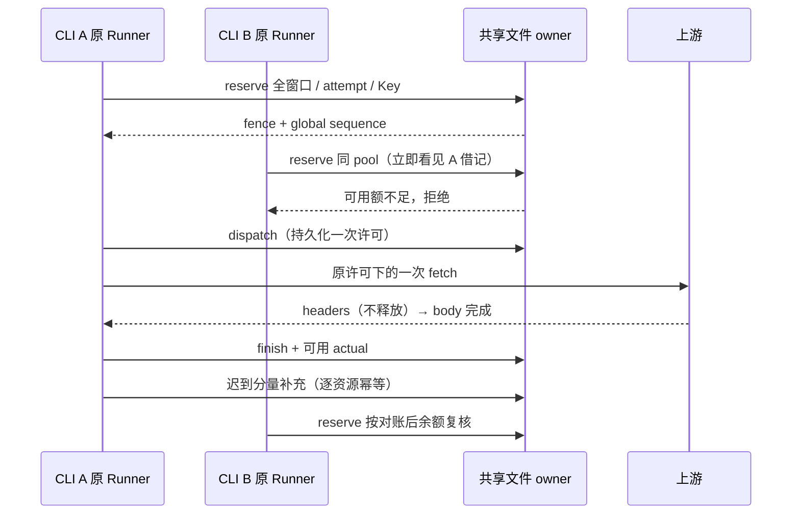

# 跨进程共享池与分散目录路由

基线：96f6463b。补充批量 Key 规格；先补失败测试再实现。五策略与 legacy 的选择语义不变。本文件涉及本机进程间协调，不将不同主机、网络盘或不共享数据目录的进程算作同一个 owner。

## 权威与配置边界

- 共享池余额的唯一 owner 是数据目录中、按 providerId + 明确 quotaPoolId 隔离的版本化文件记录。原文件锁和原子私有文件替换串行提交；锁不覆盖推理 HTTP。文件不含 API Key、Authorization、请求正文或 workspace/session 明文。
- CLI/Desktop 原 bootstrap 将现有凭据数据目录旁的 routing-quotas-v1 注入 ModelExecution；沿现有 LCODE_DATA_BASE_DIR 及旧名 fallback 隔离，不新增环境变量。SDK 显式 executionConfig.routingQuotaDirectory 可注入隔离目录；未注入的嵌入调用仍为原进程内行为，诊断明确 local-only。
- 额度强约束只覆盖注入共享 owner 的新版增强执行器。旧版本、legacy 和外部客户端不能由本地文件锁约束，其消费仍需供应商事实补充。
- 仅显式启用 routing 且 Key 声明 quotaPoolId 的请求进入协调；缺省/null routing、独立 Key 和 OAuth 保持原行为。legacy 不创建共享额度文件。关闭策略、更换 Key 保存代次或重启进程不删除共享池记录。
- Scheduler 仍拥有本地候选、绑定、份额、历史及在途；这些排序/缓存状态不宣称跨进程公平或实时全局排序。共享 owner 拒绝当前 attempt 时派发前失败，不在底层隐藏换 Key/重发。coordinated 窗口的本地读数只用于排序/预览，不再重复记共享借记；最终 admission 必须经过文件 owner，任何锁/IO/校验失败不得回退 legacy 派发。
- 私有 observeSharedApiKeyQuota / readSharedApiKeyQuota 接入真实执行器；前者独立接收共享 owner 的全局 coversThroughSeq，不能把普通本地水位当成全局证明。scoped 资源 ID 在内部允许 4096 字符以容纳合法外部身份；Key 身份只保存摘要。
- 每个共享池记录有 schemaVersion、全局 sequence、窗口实例、租约和修订。池 namespace 不随 workspace 或凭据代次重置。文件名使用身份摘要；句柄由池 ID、lease ID、随机 fence 和全局序号组成，只经私有 adapter 传递。

## 原子预留、派发与对账

1. reserve 同时验证全部共享窗口、Token 边界、共享 hard 保留线及该 Key 的共享在途上限。新进程的空/残缺快照不能漏掉 owner 的窗口；响应头首次揭示窗口时，补入原在途需求和已知 actual，不能把盲窗请求当成零消费。成功一次性保存所有借记和 reserved 租约；任一不足，整笔拒绝且不消耗物理 POST 许可。输入/输出/总 Token 分开约束，未知量不伪造为零。
2. 幂等键为池身份 + scope/attempt 摘要。模型、Key、需求和资源身份不可变；冲突拒绝。不同 client 不能冒领旧租约；同句柄重复 dispatch 只能有一次返回 true。fence 不匹配的 cancel/finish/usage 拒绝；已过期 cancel 为无状态 ack，不授予派发权限。
3. 未派发预留有 30 秒有效期；dispatch 在锁内复核状态/期限、当前窗口和 hard 保留线。预留后读数降低或窗口过期时不得继续派发。到期只退 reserved 借记，迟到 dispatch 被拒绝。已派发不能因 TTL、PID 失联或客户端退出退款。
4. dispatch 的持久化先于唯一 fetch；取得全局许可后若本地 epoch/取消检查失败，adapter 能证明尚未调用 fetch，按零消费收尾。不能把第二次 fetch 的重复 dispatch 当作首次的零消费。
5. 响应头与调用方 release 不释放全局在途；body 完成/底层 cancel 完成才 finish。已派发实际未知时保留估计借记，允许释放在途。usage 可以早到/晚到；每种实际量分别只接收第一次，未完成的请求仍保留预留，结束后只修正已知分量。
6. 可信 coversThroughSeq 必须属于该共享 owner 的全局序号，且只退休已终态借记；本地 Scheduler 水位不能冒充全局水位。普通 HTTP 头没有覆盖证明，同实例仅接受更保守余额；不能通过进程内 revision 碰撞、到达时间或滚动 reset 时间洗掉借记。新固定窗口需明确新 instanceId。
7. 已派发进程崩溃后，其借记和不确定在途保持保守；重新打开文件能看到它们。需要实际反馈/明确覆盖事实才解除未知消费，不用定时器假定上游已停。未派发到期退款不依赖进程存活判断。
8. 文件损坏/未知版本明确失败并保留证据；不重建空账本。每次 admission 携带原本地租约冻结的 createdAt，30 秒后不能用旧输入重新预留。每池最多 4096 条活跃/未过期/未知租约；达到容量明确拒绝。已过 admission 有效期且消费已知（或明确覆盖）的终态可压缩为资源累计借记，旧输入与旧 fence 均不能重新派发。压缩累计只在覆盖达到该批最高全局序号时整体退休，部分覆盖保持保守。未揭示窗口的已知消费按单位累计，窗口首次出现时仍计入；任何未知分量不当作零。只读诊断展示容量与借记，不展示 fence。

desktop-continuous 与 web-remote-replayable 继续连接原 Host/Agent，均复用执行器的协调端口；Main、relay 和 Renderer 不持有第二份余额。

## 高度分散目录

- 每次同步调度固定一个逻辑 now 贯穿目录选择、到期失效和最终 planner；冷建耗时不能让同一决策内部使用不同的时间快照。
- 保留现有少量 cohort 的路径；新增按需求轮廓维护的有序胜者索引，冷建 O(N)，普通单叶更新 O(log N)。G 接近 N 时热选择不能重建 N 个 Candidate 或对 N 个代表重新排序。
- 索引派生资格、soft tier、质量/可靠性、价格可比性、到期单位/收益、份额可用轮次及目录位置；五策略继续调用同一 planner 作最终复核。全局 fallback/价格/到期可比性不能仅从少数胜者推断。
- 缓存的新读数门槛采用 Ledger 的全目录观测序号作为基线；未进入上次胜者/前 32 条展示的旧窗口，不能因此被误认为新读数。冻结基线 O(1)，资源新修订在同一个 Ledger 增量标记。
- 硬绑定候选、软缓存候选和受限探索必须进入决策；轮转游标、权重债务、同 tier 全局最早恢复轮次保持完整目录语义。索引预览不得推进状态。
- 共享池变化按池成员失效；高扇出池不得静默冒用旧索引。分别记录候选比较数、失效成员数和重建次数。高分散且每池成员有界时要求热路径有界；大量共享成员同时跨档或大量窗口同拍到期时允许实际受影响规模的工作，明确计量，不承诺任何批量状态变化都 O(log N)。
- 到期预测随时间连续变化时按实际到期/预测变化的叶子刷新；大批派生预测同拍变化可能需要 O(受影响 N) 工作，诊断不可隐藏。静态供应商窗口/到期事实之间的热路径不重新扫描全目录。
- 旧完整 planner 是语义对照。使用包含十万独立池、不同可靠性/余量/到期信号的测试，报告冷建/热 p95/工作计数；用小规模随机变化作五策略逐次差分。

## 验收

| ID     | 场景                                          | 必须断言                                                       |
| ------ | --------------------------------------------- | -------------------------------------------------------------- |
| XQP-01 | 两个真实子进程、同池 100、各预留 60           | 仅一份成功，重启仍保留借记，拒绝无 POST。                      |
| XQP-02 | 多窗口一足一不足                              | 原子拒绝，无部分借记/在途。                                    |
| XQP-03 | reserved 过期/取消，重复 dispatch，错误 fence | 只退未派发；迟到/重复/冒领不能产生第二次许可。                 |
| XQP-04 | 已派发进程退出/崩溃                           | 不按 TTL 退款，不重置池或新凭据代次。                          |
| XQP-05 | actual 早到、迟到、重复、部分缺失             | 全进程一致；已知只修正一次，未知分量保留。                     |
| XQP-06 | 同/旧快照、无全局覆盖、明确覆盖               | 不洗掉借记；覆盖不能退休在途，不能混用本地水位。               |
| XQP-07 | 损坏文件/锁超时/未知版本/容量                 | 明确失败，证据保留，无 legacy 派发。                           |
| XQP-08 | 两个真实 SDK 执行器 + HTTP generate/stream    | admission 在 fetch 前、usage 持久化完成后可重取；无隐藏 POST。 |
| XQP-09 | 五策略、十万高度分散目录                      | 冷/热分测；热路径不遍历 N，单叶/小池更新有界。                 |
| XQP-10 | 五策略差分、缓存、探索、欠债/跨轮             | 每次选择与完整 planner 一致，旧用例继续通过。                  |
| XQP-11 | legacy/独立 Key/未注入 SDK                    | 原行为，无共享文件；注入默认目录路径实际验证。                 |

实际完成度和命令写入 verification；不请求真实厂商，不读取真实凭据。跨主机协调、网络文件系统、整机断电/存储回滚和已派发未知消费的人工清账不在本批保证内。
