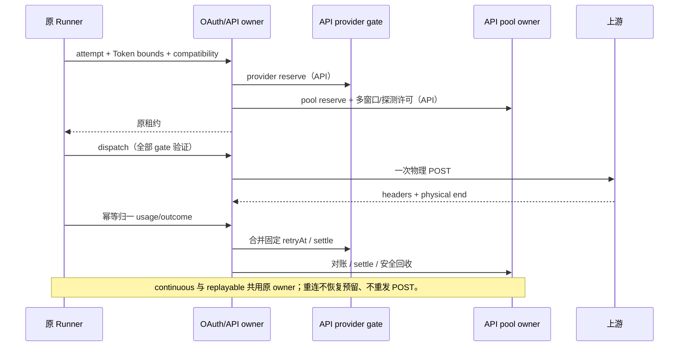

# OAuth 与 API 调度加固

2026-10-16，基线 d8b440dc。承接审计，先 spec、失败测试，再实现和实测。本规格优先于旧规格的 legacy 与隐藏高级配置兼容承诺。

## 产品与迁移

五种策略仍为可靠优选、主备接管、份额轮转、余量均衡、到期优先。设置只提交 version 与 strategy；删除 legacy 选项，缺省/null 使用可靠优选。旧策略保留其合法 strategy，隐藏调度参数不再由设置保存延续。已有额度身份与未确认借记属于事实，不能随策略迁移清空；明确的池身份仍可由受信配置/快照提供，不能按 URL、标签或批量导入猜测。无 single-attempt 能力的 OAuth 驱动明确拒绝，不能退回隐式多次请求。

UI 保持当前紧凑、展开/折叠与问号帮助；不增加手工配置或诊断面板。缓存 TTL、价格、跨 Key 缓存组未知时明确 unknown，不承诺可以自动发现厂商未提供的事实。

## 唯一所有者与协议

- 原 Runner 创建不可变 attempt、Token 上界与兼容上下文。OAuth RoutingInvocation 增加严格校验的 tokens（input/output/total、quality）与 compatibilityKey，沿原鉴权票据和远程协议传递。无可验证 Token 边界时不能伪造零；未知额度最多一个探索请求。
- 原 ProviderAccountScheduler 持有 OAuth 预留、恢复及反馈句柄；活跃物理流和未确认归一反馈不按五分钟 TTL 删除。只有双终态确认后才进入有界终态缓存。容量满明确拒绝新 admission，不驱逐未知消费。Transport 票据在物理流期间及终态反馈宽限期内有效；过期票据不允许再发模型 POST。
- 原 RoutingRecovery 持有恢复事实。同一健康代次并发失败合并最大 retryAt；新 probe 开始后旧失败不能覆盖。每 permit/资源的失败时间首次冻结，重复反馈不顺延。恢复后的健康记录只有无旧 permit 可引用时才能回收；通过 permit 退休标记与无活跃引用检查防止删除后 revision=0 复活旧回调；文件租约还校验原 sequence/fence。
- 原 FileSharedQuotaCoordinator 持有同机 API 跨进程额度与恢复。provider 限流使用 provider 文件 gate，pool/key/model 使用池文件；锁顺序固定 provider → pool，HTTP 不持锁。provider gate 只持恢复许可与活跃引用，不复制额度账本。调用必须在共享 dispatch 前验证所有 gate，不允许 IO 不确定时重发 POST。

## 决策规则

1. 资格与硬绑定 → 多窗口安全 admission → 策略排名 → 缓存判定 → 最终探索决策。缓存诊断必须描述最终选择，不能显示 keep 却选另一组。
2. 请求、输入、输出、总 Token 窗口分别使用同一次请求对应的上界借记；共享窗口只扣一次。部分实际 usage 只替换已确认分量，不能将未知消费归零。Token bound 同时参与 OAuth 与 API。
3. 429 显式 key/account、model、pool/shared、provider 各自隔离；缺失/不识别作用域为 provider。明确 pool 才允许其它池继续；provider 限流不能靠换 Key/池绕过。5xx 默认 model，显式更广作用域仍有效。route-cooling 返回 scope/phase/retryAt/dispatch 的可验证安全字段。
4. 旧窗口 resetAt 已过只降为过期事实，不自动补满、不重置借记。同资源只允许一个受控探索，未知/陈旧窗口同样受限；探测派发后一直占用到新读数确认，失败/取消按物理确定性处理。硬保留线、真正余额 expiresAt 到期与已确认新窗口耗尽仍拒绝。跨进程 reserve 与 dispatch 使用同一探测许可；其它进程不能同时探索。
5. 记录回收只处理已确认终态：保留活跃/未知租约、未覆盖借记和恢复许可；健康 tombstone 无引用后回收。完成 attempt 缓存设上限，过期原句柄失效，不能作为新 POST 重放。只读诊断有界，不能扫描无限恢复历史。
6. 到期策略必须有本请求可归属的正收益，否则退到余量均衡；无可信 TTL 只有同轮绑定。可信缓存事实由模型/驱动声明及实际反馈传入，不能从旧 UI 元数据臆造。未知成本明确降级。
7. 十万 Key 固定与超过八个 profile 的高分散长跑分别记录冷/热时延、profile 构建/淘汰、事件循环延迟、内存与状态容量；不能仅用短跑均值宣称长期性能。

## 验收与证据

| ID    | 场景                                               | 必须断言                                               |
| ----- | -------------------------------------------------- | ------------------------------------------------------ |
| HD-01 | OAuth requests/input/output/total 共享及私有多窗口 | 并发预留不超额、未知不扣零、实际分量准确对账           |
| HD-02 | OAuth 长流跨五分钟、另一次 reserve、迟到及重复反馈 | 原归因仍有效，物理+归一成功恢复，终态记录有界          |
| HD-03 | 同代并发 Retry-After、重复回放、probe 后旧失败     | 最大截止；重复不延长；旧代不能覆盖新 probe             |
| HD-04 | 两 Key、两池、两个真实进程，各限流 scope           | provider 跨池阻断；key/model/pool 不扩大；安全错误详情 |
| HD-05 | 超过 4096 个恢复循环与长跑已完成请求               | 健康记录/attempt 有界；旧 permit 不能重新修改新事实    |
| HD-06 | 过期零余额、陈旧非空窗口、并发取消与新读数         | 唯一探测、不补满、不误退未知消费；文件 owner 同规则    |
| HD-07 | 缓存事实有/无、探索覆盖软缓存、到期收益为零        | 最终选择和诊断一致；未知事实安全降级                   |
| HD-08 | 十万 Key 固定/分散/多 profile 长跑                 | 给出实际测量与容量断言；高成本冷构建单独报告           |
| HD-09 | 五策略 UI、缺省/null、旧隐藏参数                   | 只有五选项，可靠优选缺省，保存只写策略，无批量配置     |
| HD-10 | SDK generate/stream、三 OAuth 协议、反馈失败重试   | 物理 POST 不重放；反馈有界重试且失败可观察             |

所有测试记录红灯→绿灯与执行命令。真实厂商缓存价格、其它 OS、跨主机与网络文件系统未实际验证时必须列明；合成测试不替代厂商事实。

## 具体边界与容量

- 上游缓存事实使用明确契约头 x-lcode-cache-ttl-ms（1–86400000）、x-lcode-cache-group、x-lcode-cache-portability，以及成对的 x-lcode-cache-switch-cost/unit。事实从响应头收到时起计时，记录 upstream-contract 来源；缺失、非法或过期不制造事实。现有厂商未提供这些头时走未知分支。
- Retry-After 最大保留一天；HTTP 日期按接收时钟解析。OAuth 票据只允许一次模型 POST，物理流期间保留反馈能力，物理结束后保留五分钟反馈宽限。票据和归因索引各最多 4096，未确认时达到容量则拒绝新的 admission。
- 原 Scheduler 已确认终态缓存最多 4096，含活跃/未确认记录的总容量为 8192；过期句柄明确失败。已结束借记可折叠保留总额与覆盖水位，不能归零。生产 invocation 带 createdAt，五分钟后拒绝再次 admission。统计投影的 route/model 与 resource 各最多 8192 桶。
- 目录最多八个 profile，且 profile 总成员预算为 200000；十万 Key 最多两个 profile。2026-10-17 已由 [完成规格](provider-completion-2026-10-17.md) 接续分块准备与紧凑替代索引，并明确多窗向量、归一负载、近期工作和等待时间评分；实际测量见验证记录。低层同步接口仍保留确定性，生产 acquire 通过原 adapter 让出执行权。
- API 文件版本为 3，v1/v2 在锁内迁移并保留全部借记、租约及恢复状态；未知版本拒绝。provider gate 独立版本为 1，所有 API Key（包括未声明共享池）均经过同一供应商 gate；独立 Key 不因此被猜成共用额度池。
- 每次诊断最多 100 个 pool，每次最多 4 个并行文件读取。恢复条目有界输出，并报告总数/截断；失败反馈记录带安全 provider/pool 与哈希 lease 身份以便定位。读诊断不改状态。

- provider 反馈事实不能随 pool 写入失败一起回滚；原 gate 在锁内持久化已接收的冷却，再返回待确认反馈。reserve 下游失败时取消未派发 gate 许可；dispatch 的明确未派发拒绝回滚 gate，IO 不确定保留占用。跨文件借记仍各由原 owner 持有，幂等重试不再扩展截止时间。

- 未知数量不登记成零消费；诊断单独显示 exploration=reserved/dispatched，available 保持未知。恢复信息的健康记录回收依赖所有引用退休，不能仅按时间删除。

- 文件 dispatch 必须携带原 provider gate handle，不能删除该字段绕过 provider 限流。迁移记录中的旧 handle 可用于保守对账，不能获得新的派发授权。

- provider 与 pool 两个 handle 以 poolKey/leaseId 哈希绑定，不能拼接两个合法句柄取得另一预留的派发授权；所有新句柄反馈也先验证绑定。
