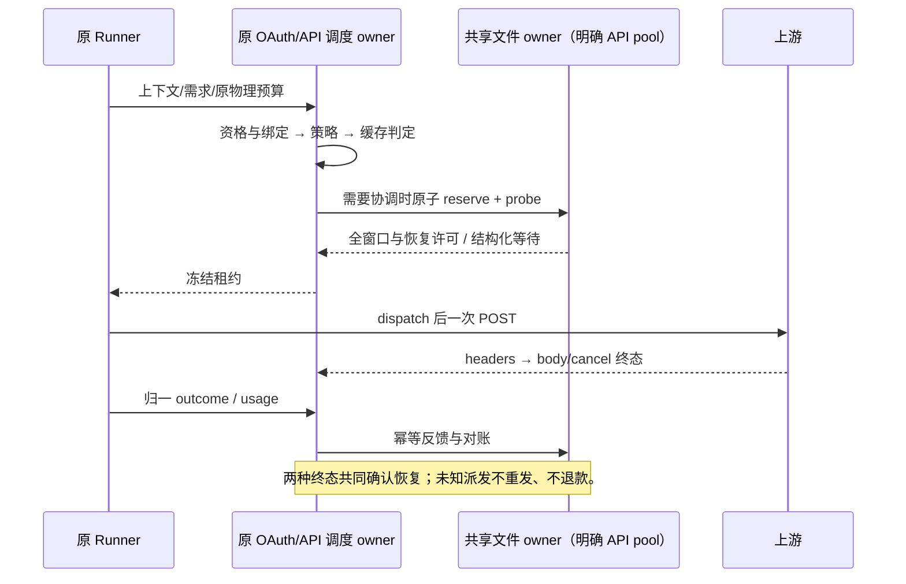

# OAuth 与 API 调度：缓存、恢复与共享额度诊断

基线 92a65ba6，2026-10-16。按用户授权继续实现前轮审计中的缓存切换、异常恢复和共享额度池诊断。先规格、失败测试，再实现与实际验证。

## 产品边界

- 连接调度 UI 永久保持简洁策略选择、展开/折叠与问号帮助；不恢复批量 Key 面板，不增加权重、共享池、并发、缓存或诊断手动配置表单。
- OAuth 与 API 共用纯规则，沿各自原执行 owner、鉴权代次和 Runner 物理预算运行。无 routing/null 继续 legacy；旧策略与 Key 元数据保持兼容。
- 自动决策只用真实驱动、已保存兼容配置和实际反馈。共享关系、TTL、价格、额度账期未知时明确降级，不根据域名或标签推断。

## 缓存与统计

1. 同轮及不可移植绑定先于策略；主备与份额的新轮次不受软缓存改写。跨轮软缓存只在已知 TTL 内有效。
2. 可靠优选的缓存判定复用策略的健康/失败率档，不允许缓存压过更好的可靠性档。完成时间、可信同币种总边际费用改善达到既有 20% 门槛时可切换；缺失币种不比较费用。
3. 余量仍要求至少 5 个百分点改善与新有效读数。相同缓存组可按策略选择，不制造跨 Key 重建损失。
4. 到期切换必须比较本请求收益与显式缓存切换成本：只有同可比单位且净收益为正才打破有效跨组软绑定。未知成本保持绑定并给出 cache-cost-unverifiable；不能把钱和 Token 相减，也不重复扣已包含在总边际费用中的缓存成本。无有效软绑定时沿原冷启动/到期规则。
5. 目录读取使用各自 profile 的模型上下文，回调刷新不能把当前模型的冷却投影写进另一模型；只共享原资源额度与债务。统计按候选身份/授权代次 + 模型/协议/操作分桶；不能通过拆开 Scheduler 或 Ledger 来隔离统计。取消、权限/输入/工具错误不计线路失败。API 与 OAuth 都必须传入统计作用域。
6. API 绑定作用域使用规范 workspaceIdentity fallback，并包含 remoteSessionId、session/execution/actor、provider/model/protocol 与影响缓存兼容的请求选项；无会话上下文按 invocation 隔离。OAuth 沿原 invocation 与模型协议边界。
7. 份额离线/禁用恢复最多带入一轮信用，保留已有负债，不能按停用期间轮数累计无限信用。大目录保持增量更新。

## 恢复所有者与顺序

- 原 API Pool/OAuth Scheduler owner 持有各自 key/account/model 的恢复事实。显式协调的 API 共享 pool 由原文件 owner 持有跨进程恢复许可；不能同时维护第二份权威共享熔断状态。
- 对真实 429/可恢复上游故障保留 retryAt 与准确 scope。认证故障仍按原凭据代次隔离；未知 scope 保守标明 provider 范围，不猜具体池。
- 大目录索引必须登记恢复截止时间，并在 probe 占用、取消和归一反馈时同步刷新受影响成员；不能让过期缓存把连接长期留在不可用档，或把已占用 probe 继续列作赢家。
- cooling 到期只进入 probe-eligible；同资源只有一个租约可占半开许可。其余请求使用别的合格连接或返回结构化 route-cooling。探测成功必须同时有物理终态及归一成功反馈；响应头和普通 release 不确认恢复。
- 未派发取消退回探测许可；已派发取消/未知完成保持不确定，不能因 TTL/PID 清空未知消费或放出第二次探测。可证明的物理失败关闭该探测并重新冷却。迟到/重复反馈只作用于原 probe 代次。
- File owner 新恢复字段采用版本化状态迁移，原 v1 记录在锁内读取并保留全部借记；未知版本拒绝且不重置。旧版增强执行器遇到新文件必须明确失败；legacy 配置仍可运行。
- dispatch 及 HTTP 不能在 IO 不确定时自动重放。finish/usage/cancel/observe 的相同不可变输入可在有界次数内幂等重试；失败公开为待确认，不吞掉。反馈错误保持有界，不用历史错误无限累积阻止已确认恢复。

## 错误契约

- RoutingError 保留固定 code，以及 scope、phase、retryAt、dispatch 确定性等安全字段。Runner 对固定路由原因先分类，再处理 TLS/网络错误；不能把 dispatch-uncertain 当作 CERT 错误。
- OAuth 受信 HTTP/relay 的已有 routing reason 也必须还原同一分类。模型失败外层协议继续兼容，附加安全路由原因；不得把原始错误正文、文件路径、fence、API Key 或用户上下文放入通用诊断。
- route-cooling 可携带可验证恢复时间；dispatch-uncertain 不可自动重试。不能为路由重试另建业务预算或 accepted 队列。

## 只读诊断

- 诊断按原 owner 读取；不在 Renderer 增加状态、写入口或请求推理。API 保留同步 executor-preview 兼容端口，但其窗口 available 明确来自 local-preview。
- API 新增有界异步运行诊断，按本页实际 pool 去重读取共享 owner，并返回 localPreview、sharedPools、最近真实决策及待确认反馈。不能为一个页面扫描十万个 pool 文件；独立/legacy 不创建额度记录。
- OAuth 从同一个 ProviderAccounts 实例提供只读运行诊断，包含请求/实际策略、fallback、缓存理由、当前额度投影、预留、恢复状态及最近选择。共享资源只投影一份，不把多个账号读数相加。
- 共享窗口区分 readingRemaining、limit/unit/quality、current instance、reserved、dispatched、ended actual、ended estimated、folded/unknown、held、安全 available 与全局覆盖水位。available 是基于已知事实的安全下界，不冒充上游余额。
- 最近选择明确标出 reserved/dispatched/cancelled/ended 及归一 outcome；本地预留被全局拒绝只能显示未派发取消，不能冒充真实 POST。
- 诊断包含 asOf、owner 来源、容量与恢复状态；错误按安全原因返回，状态未知不得显示为健康。最近决策有界且可丢弃，诊断读取不推进 cursor、sequence、借记或半开状态。
- Desktop continuous 与手机 replayable 继续读取原 owner；重连仅恢复投影，不恢复预留或重发 POST。此批不增加任何诊断设置面板。

## 本轮接口与容量

以下为原执行 owner 的受信只读端口，不注册新 Renderer RPC 或通用配置入口。读取失败保留固定错误码，不返回磁盘路径或原错误正文。

| 接口                                                               | 语义                                                                                                                                             |
| ------------------------------------------------------------------ | ------------------------------------------------------------------------------------------------------------------------------------------------ |
| RoutingScheduler.readDiagnostics()                                 | 最近一次预留的实际策略、fallback、缓存理由及派发阶段；本地 Ledger 分解；最多 100 个窗口并标示截断与总数。                                        |
| ProviderAccounts.readRoutingDiagnostics(channelId)                 | 读取同一 OAuth Scheduler 的状态，过滤其它渠道的恢复记录；不刷新上游额度。                                                                        |
| AiSdkModelExecution.readApiKeyRoutingDiagnostics(providerId, page) | 保留原同步 executor-preview；availableSource 明确为 local-preview。                                                                              |
| AiSdkModelExecution.readApiKeyRoutingState(providerId, page)       | 异步合并原页预览、local owner 与本页去重 sharedPools；页大小 1–100，stale revision 在 IO 前拒绝。各 pool 可能有不同 asOf，不能声称跨池原子快照。 |
| SharedQuotaCoordinator.inspect(providerId, poolId)                 | 文件锁下的同池权威投影、全局 sequence/覆盖水位、恢复许可及窗口分解；最多 100 个窗口并标示截断。                                                  |
| SharedQuotaCoordinator.usage(handle, actual, tokens?, feedback?)   | 使用原 handle/fence 幂等对账，并接收 outcome/status/retry-after/scope。                                                                          |

反馈每项 IO 最多重试 3 次，每租约最多保留 64 项操作，最多追踪 256 个失败租约。超过容量明确报告 quota-owner-capacity；未知状态不自动清账。共享文件版本升级为 2；原保留租约上限 4096 和文件容量上限继续生效。默认物理失败探测退避为 1 秒，不改变业务 POST 预算。

## 验收矩阵

| ID     | 场景                                                        | 断言/证据                                                          |
| ------ | ----------------------------------------------------------- | ------------------------------------------------------------------ |
| RCD-01 | 热缓存 10% 对 6% 失败率、健康档变化                         | 独立规则断言选择更优档；OAuth/API 共用规则。                       |
| RCD-02 | 到期收益与同单位成本、未知成本/币种、同组、TTL、turn-only   | 正净收益才软切；未知不估零；主备/轮转保持语义。                    |
| RCD-03 | 两模型/协议/远端 session、兼容选项及空白 workspace identity | 样本和绑定隔离，额度资源仍共享。                                   |
| RCD-04 | 停用 40 轮后恢复                                            | 不连续抢占，信用最多一轮，债务不消失。                             |
| RCD-05 | OAuth/API 冷却到期并发预留                                  | 同资源一个半开许可，其他连接仍可用；成功/失败/取消/迟到分别验证。  |
| RCD-06 | 两真实进程同 API pool 竞争 probe                            | 只有一个，body 未终结和未知消费不按 TTL 放行；不同池隔离。         |
| RCD-07 | routing 固定错误经 SDK/HTTP/relay                           | 原因不变；dispatch-uncertain 不变 TLS；额外 POST=0。               |
| RCD-08 | 短暂 IO 错误、重复 usage/finish、永久错误                   | 可幂等确认；重复不退款；永久失败可诊断且记录有界。                 |
| RCD-09 | 同池 100 已预留 60                                          | 异步权威诊断 available=40；本地 100 标明来源；细项求和与账本一致。 |
| RCD-10 | OAuth 共享窗、stale/unknown/冷却、恢复中、反馈未知          | 权威 owner 读取；预览/实际决策与来源明确；无秘密和副作用。         |
| RCD-11 | v1 文件、坏文件、未知版本及已派发崩溃                       | 迁移保留借记；坏文件不重置；未知不自动退款/重发。                  |
| RCD-12 | 真实 SDK generate/stream 与三种 OAuth 协议                  | POST/预算、真实归因、工具绑定、取消和反馈均实际验证。              |
| RCD-13 | 十万 Key 高分散、分页诊断及长期反馈                         | 不回退全量热扫描；读取文件数受本页去重池数约束；反馈记录有界。     |
| RCD-14 | 原策略界面、legacy 与旧高级配置                             | UI 无新增项/批量面板；原 E2E、类型、lint、架构及路由回归执行。     |

真实厂商价格/缓存命中、跨主机协调、人工强制清账及完整业务经济回放不由合成测试替代。缺少厂商事实时按上述未知分支运行，不新增人工配置来填补。
