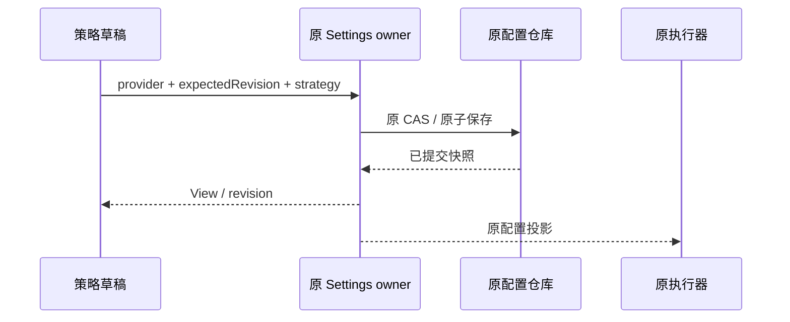

# 连接调度的简洁策略设置

2026-10-16。本页按本轮加固更新，替代旧 legacy/隐藏参数兼容规则；执行细节见 [OAuth 与 API 调度加固](provider-routing-hardening.md)。

## 产品规则

- API Key、Coding Plan Key 与 OAuth 共用原入口，只有可靠优选、主备接管、份额轮转、余量均衡、到期优先五种策略。缺省/null 显示并执行可靠优选；不再提供 legacy 选项或恢复旧路径。
- 宽屏标题、适中固定宽度的下拉框、问号帮助与保存按钮水平排列；窄屏自然换行，不能横向溢出。
- 标题行显示箭头和“展开/折叠”文字，支持键盘及 aria-expanded/aria-controls，默认展开。折叠只隐藏内容，保留草稿且不改变后台调度；不用启用开关。
- 问号随当前草稿提供说明，支持悬停、聚焦与手机点按；折叠关闭浮层，浮层不超出视口。
- 永久不提供批量 Key 路由面板、并发、权重、优先级、保留线、缓存组/TTL、共享池或诊断的手工配置项。
- 保存只提交 version=1 与 strategy，不透传旧隐藏调度参数。原服务 CAS 和凭据保存代次保持独立；更换策略不能清除在途借记、未知消费或已确认额度身份。
- 未知额度、缓存、价格与共享关系由执行器明确降级；不能按 URL、标签、批量导入猜测。无 single-attempt 能力的 OAuth 驱动明确失败，不恢复隐式重试。

## 状态与接口

Renderer 仅拥有草稿、base revision、保存中、错误和局部展开状态。唯一写入口仍为 useProviderRouting → 原 ProviderSettings.setProviderRouting → 原文件 CAS。服务端也把 null 规范为可靠优选，仅保存所选策略。发生 revision 冲突时先重载权威值，再由用户保存；相同策略重复保存采用最新已提交 revision。

设置不请求 Key 分页、密钥正文或批量元数据写入。0、1 或十万 Key 的控件数量固定。Desktop continuous 和手机 replayable 都读同一原 owner，重连不恢复预留或重发模型请求。

## 验收

| ID     | 场景                    | 断言                                                                                  |
| ------ | ----------------------- | ------------------------------------------------------------------------------------- |
| SRS-01 | 桌面中文/手机英文       | 一个策略选择器、五个选项；无 legacy/批量面板/高级控件；零分页、密钥读取及元数据写入。 |
| SRS-02 | 宽屏/窄屏/长英文名称    | 桌面控件水平居中对齐；选择器宽度有界；手机无横向溢出。                                |
| SRS-03 | 五策略及重复保存        | 只保存 version/strategy，revision 正确，无额外推理。                                  |
| SRS-04 | 旧隐藏参数及 Key 元数据 | 新保存不透传隐藏策略参数；凭据、已有额度身份及未确认借记不清空。                      |
| SRS-05 | 其它窗口推进 revision   | 冲突不写；重载后按最新 revision 保存。                                                |
| SRS-06 | 缺省/null/零 Key        | 默认可靠优选，不出现空批量表单，不恢复 legacy。                                       |
| SRS-07 | 鼠标/键盘折叠，存在草稿 | 保存数不变；展开恢复草稿；aria 状态与可见性一致。                                     |
| SRS-08 | 五策略问号帮助          | 内容跟随草稿；悬停、聚焦、点按均可查看；浮层不溢出且不保存。                          |

本轮实际 E2E：1280 中文暗色与 390 英文亮色均通过；详见 [验证记录](provider-routing-verification.md)。
