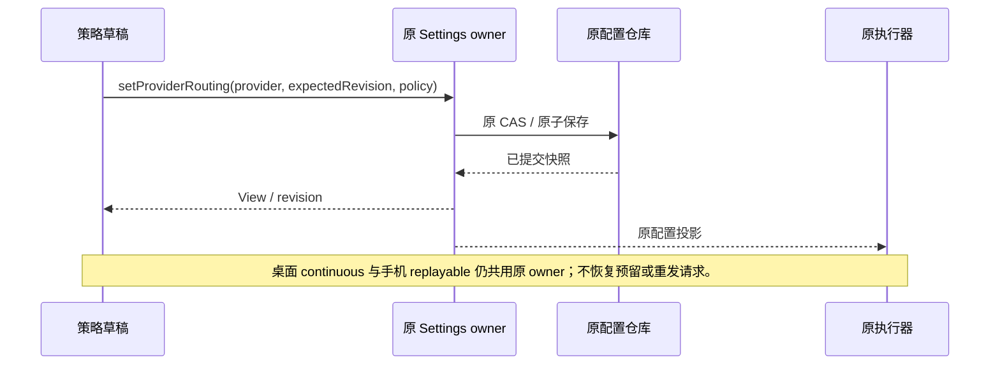

# 连接调度的简洁策略设置

2026-10-16，按用户截图反馈调整：移除批量 Key 路由编辑面板，仅选择调度策略；标题、紧凑选择器和保存按钮在宽屏水平排列。本规格替代旧规格中要求在设置页编辑 pool、缓存、份额及并发的 UI 规则。执行器规则和兼容配置仍以原路由规格及跨进程补充规格为准。

缓存、异常恢复和诊断的后续实现遵守 [OAuth 与 API 恢复规格](provider-routing-recovery-diagnostics.md)；批量 Key 路由面板永久不再提供，后台能力继续由执行器自动使用。

## 产品规则

- API Key、Coding Plan Key 与 OAuth 共用原连接调度入口，只展示策略选择、简短说明、保存及冲突重载。不展示批量 Key 面板、共享池、权重、优先级、缓存组/TTL、并发或缓存偏好控件。
- 宽屏的标题、固定适中宽度的下拉框和短保存按钮在同一行；选择器不得铺满供应商卡片。窄屏按可用宽度自然换行，选择器不超过容器宽度。策略说明放在问号帮助中，错误在操作行下方。
- 标题行提供箭头及可见的“展开/折叠”文字操作，支持键盘，带 aria-expanded 与 aria-controls，默认展开；不增加启用开关。折叠仅隐藏设置，不关闭调度、不保存、不丢弃草稿；保存后的重渲染不能意外展开已折叠面板。展开状态属于面板局部 UI，不写服务端配置。
- 策略选择器旁提供带可访问名称的“？”说明按钮，说明随当前草稿策略变化。鼠标悬停、键盘聚焦和手机点按可查看；内容使用原五策略及 legacy 的本地化说明，解释用途与可确认的降级，不能要求填写高级字段。帮助浮层宽度受视口约束，不额外占满一行；折叠关闭浮层。
- 保留可靠优选、主备接管、份额轮转、余量均衡、到期优先，以及明确恢复 legacy 的选项。选择后按原保存命令提交，不增加自动保存或额外确认。
- 新启用时仅写 version=1 与 strategy。并发和缓存使用现有执行器默认规则；Key 默认权重和目录顺序沿现有行为。
- 已有策略的隐藏字段完整保留；改变 strategy 不补写默认值、不删除 order/weights/reserveRules/maxInFlightPerCandidate/cacheMode。已有 Key 路由元数据和凭据保存代次也不改变。明确选择 legacy 才删除策略配置。
- 智能调度使用原执行器已经获得的可用状态、额度和请求结果。未知额度按现有安全降级处理；不从相同地址、标签或批量导入猜测共享池，不生成缓存 TTL、厂商余额或价格。
- 取消旧元数据 UI 的代码和文案，不保留隐藏组件。兼容服务命令和 schema 保留，供旧配置/受信调用使用。

## 状态与接口

- Renderer 仅持有策略草稿、base revision、保存中和错误；唯一写入口仍为 useProviderRouting → 原 ProviderSettings.setProviderRouting → 原文件 CAS。
- 简洁设置不会请求 Key 分页、密钥全文或批量元数据写入。打开 0、1 或十万 Key 的供应商，设置控件数量均保持固定。
- 原执行器继续拥有 Key 选择、缓存绑定、并发预留和共享池对账。移除设置表单不建立第二个自动配置 owner。
- 发生 revision 冲突时不写入，重载到最新权威策略；重新保存保留该策略的隐藏字段。相同策略重复保存使用已提交 revision。

## 验收

| ID     | 场景                                          | 必须断言                                                                              |
| ------ | --------------------------------------------- | ------------------------------------------------------------------------------------- |
| SRS-01 | 桌面中文/手机英文，API 旧环境仍提供 batch API | 批量面板、并发和缓存控件不存在；仅一个策略选择器；零分页、密钥读取、元数据写入。      |
| SRS-02 | 宽屏布局、窄屏及长英文策略名                  | 桌面标题/选择器/保存处于同一水平行；选择器宽度有界；手机无横向溢出，键盘可选择。      |
| SRS-03 | 五种策略、相同策略重复保存                    | 只写所选策略及版本；使用正确 revision，无自冲突；无模拟推理请求。                     |
| SRS-04 | 已有完整高级策略、Key 元数据，修改策略        | 所有隐藏策略字段和 Key 元数据保持；不存在新默认值覆盖旧配置。                         |
| SRS-05 | 保存前其它窗口更新 revision，重载后重试       | 首次冲突不写；重载恢复权威值；重试成功并保留隐藏字段。                                |
| SRS-06 | 零 Key、选择 legacy                           | 零 Key 不出现空批量表单；legacy 保存 null，Key 配置不改变。                           |
| SRS-07 | 点击或键盘切换显示/隐藏，存在未保存策略       | 收起后只见标题；保存调用数不变，后台策略不变；展开恢复草稿，aria 状态与可见内容一致。 |
| SRS-08 | 五种策略的问号帮助，宽屏悬停/聚焦、手机点按   | 展示当前策略对应的本地化用途说明；切换后无旧说明；浮层不溢出且不触发保存。            |

本次只调整设置入口及保存投影；前轮审计发现的缓存经济模型、半开恢复、统计隔离与权威运行诊断仍为后续工作，不宣称随本次 UI 精简完成。
