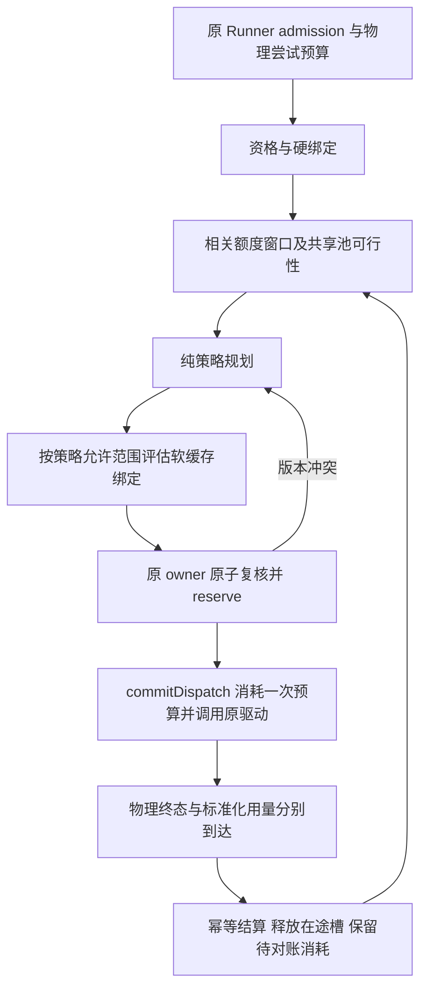
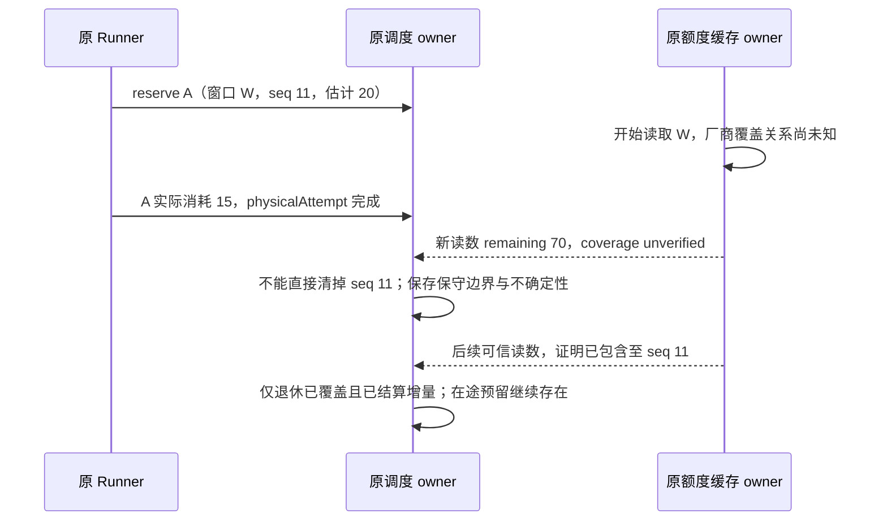
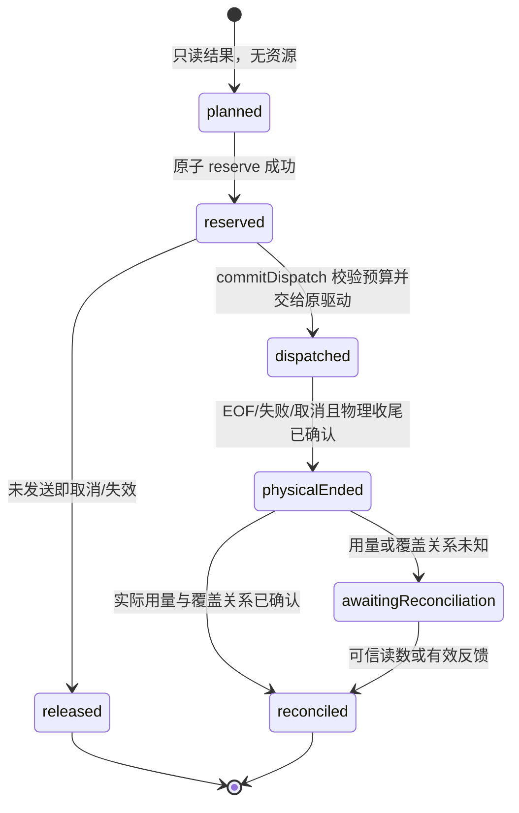
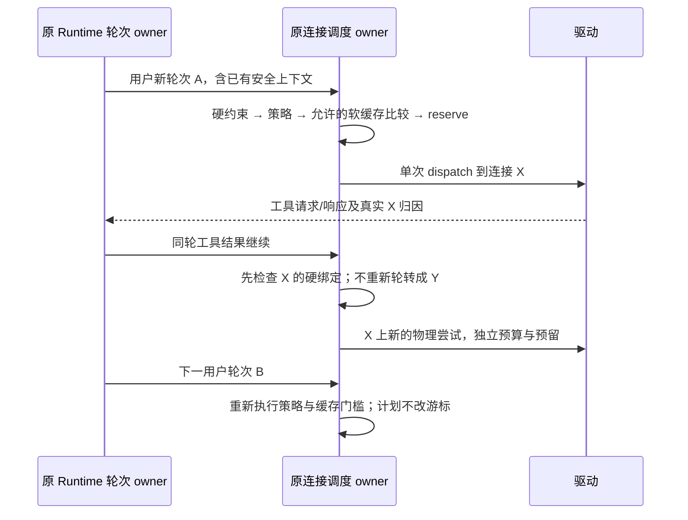

# 供应商连接调度策略

状态：2026-10-16 用户授权按本规格实施，测试先行。源码基线：`05c9d6e3`。实现与实际验证见 [本轮记录](./provider-routing-verification.md)；未完成的字段、协议能力和场景不得宣称已提供。

本规格定义同一供应商内多个 OAuth 连接或多个 API Key 如何承接已经获准执行的模型请求。目标是在保持工具连续性、用户预算和既有执行边界的前提下，提高完成可靠性、均衡资源占用并减少可确认的额度浪费。五种策略共享资格检查、原子预留、额度对账与故障处理，只改变可行候选之间的选择目标。

配套验收见 [供应商连接调度验收](./provider-routing-acceptance.md)。现有账号接入、额度、API Key、远程桥和运行中模型接管规则分别以 [OAuth 接入](./oauth-provider-integration.md)、[额度查询](./oauth-account-quotas.md)、[Key 故障游标](./provider-api-key-failover-reset.md)、[Key 运行时](./provider-api-key-runtime-enhancement.md)、[远程调用桥](./remote-provider-account-relay.md)、[模型接管](./model-provider-failover.md) 为准。增强路由启用后的差异在本文明确列出；缺少增强配置时继续执行这些规格的现有规则。

## 1. 范围与名称

### 1.1 五种策略

| 原分析用名   | 新中文名     | 英文名             | 稳定协议值         | 用户说明                                                           |
| ------------ | ------------ | ------------------ | ------------------ | ------------------------------------------------------------------ |
| 智能         | **可靠优选** | Reliable selection | `reliable-first`   | 优先选择当前更有把握完成请求的连接，再兼顾等待、费用和资源压力。   |
| 按顺序       | **主备接管** | Primary and backup | `primary-backup`   | 按指定顺序使用主连接；主连接不可承接时由备用连接接管。             |
| 轮流         | **份额轮转** | Share rotation     | `share-rotation`   | 按连接份额轮转，并按工作量结算，避免大请求与小请求被视作相同负载。 |
| 用量少的优先 | **余量均衡** | Headroom balance   | `headroom-balance` | 优先使用预计压力较低的连接，让相关额度窗口保持更均衡的余量。       |
| 重置前用完   | **到期优先** | Expiry priority    | `expiry-first`     | 在可靠性和预算允许时，优先消耗预计会到期浪费的额度。               |

名称表达目标而非承诺：可靠优选不保证请求成功，到期优先不保证额度用完。到期优先只调度实际业务请求，不生成额外推理、预热或刷量请求。

份额轮转比较“已分配的工作份额”；余量均衡比较“各相关额度窗口的预计消耗压力”。两者不能实现为同一个最少请求数排序器。

### 1.2 首期范围

- OAuth：同一 `channelId` 下，当前模型和协议可用的多个连接。
- API Key：同一 `providerId` 下现有多 Key 池；额度未知时也可使用明确的降级规则。
- 文本、推理、图片输入和工具调用沿用当前模型能力与驱动，不改变请求的模型、推理档位或速度选项。
- 桌面、本地工作区、已有远程 attachment、独立 Server/CLI、手机远控均保持原执行与鉴权 owner。
- 不增加跨供应商模型组、嵌套路由组、自动换模型、策略插件执行器、重置券兑换或自动追加费用。跨供应商模型接管继续归原 Runtime policy。
- 不增加服务端 accepted 队列，不改变 `CommandInbox` 的串行 admission。调度等待由现有 Runner/admission 端口承担。
- 不增加数据库或第二份用量账本；近期调度指标、份额和预留为 owner 内存态。

## 2. 当前证据与改动边界

| 当前文件与符号                                                                                                | 已确认行为                                                                     | 待实现职责                                                                     |
| ------------------------------------------------------------------------------------------------------------- | ------------------------------------------------------------------------------ | ------------------------------------------------------------------------------ |
| `packages/services/src/model-provider/providerAccountRouting.ts` / `resolveProviderAccountRoutes`             | 本机票据签发、实际池执行、远端适配共用模型/协议资格规则。                      | 保留为资格来源；不能在 UI 或远端新增另一套资格判断。                           |
| `packages/services/src/model-provider/providerAccountPool.ts` / `executeProviderAccountPool`                  | 列表尝试；会话成功账号优先；响应头带实际连接；输出后流失败不拼接其他账号答案。 | 用 owner 调度租约替换无条件 preferred 排序；增强模式下一物理尝试对应一个租约。 |
| `packages/services/src/model-provider/providerAccounts.ts` / `ProviderAccounts`                               | 账号生命周期、驱动、原 transport 和额度查询装配。                              | 持有 OAuth 调度状态，注入只读策略与请求预算端口；不导入 CLI Runtime 实现。     |
| `packages/services/src/model-provider/providerAccountQuotas.ts` / `ProviderAccountQuotas`                     | 60 秒缓存、并发读取合并、错误回显、账号代次守卫。                              | 仍唯一持有上游额度缓存；向调度器投影完整窗口与可信度。                         |
| `apps/lcode-cli/packages/adapters/src/model/api-key-pool.ts` / `ApiKeyPool`                                   | 发送前 reserve、轮换、401/403 隔离、429 冷却和共享限流。                       | 在原 owner 扩展策略、工作份额和配额预留，保留默认路径的大 Key 集合性能。       |
| `packages/provider/src/config/provider-data-schema.ts` / `providerConfigDataSchema`                           | Provider personal overlay 与严格 schema。                                      | 可选 `routing` 配置及标准化验证。                                              |
| `packages/services/src/model-provider/providerFacadeServices.ts` / `IProviderSettingsService`                 | Provider Settings 的公开写入口和 View。                                        | 增加路由专用 mutation，复用原写队列与配置发布。                                |
| `packages/shared/src/provider-account-quota.ts`                                                               | 展示 DTO 有比例、数量、reset/expire、单模型及 pool。                           | 兼容增加稳定窗口语义；展示字符串不作为算法输入。                               |
| `packages/shared/src/provider-account-relay.ts`、`providerAccountRelaySource.ts`、`remoteProviderAccounts.ts` | 原受信物理连接的 open/read/cancel；请求回到原 OAuth owner。                    | 协商路由上下文、单次派发与反馈能力；远端不独立挑选 OAuth 账号。                |
| `packages/ui/src/hooks/useModelProviders.ts`、`useProviderAccounts.ts`                                        | 消费原服务、安全 View 与 revision。                                            | 新 UI 通过 hooks 提交配置和读取派生诊断。                                      |
| `apps/lcode-cli/packages/core/src/runtime/methods/usage-model-attribution.ts`                                 | 归因读取当前 invocation 的真实响应连接。                                       | 保留账本归因；新增调度反馈不得从当前选择猜历史连接。                           |

静态引用已用 `pnpm dep:refs` 核对：资格函数直接进入 `providerAccounts`、`providerAccountPool`、`remoteProviderAccounts`；池执行直接由 `ProviderAccounts` transport 调用。当前尚不存在本文的新策略接口和用例。

架构依赖遵守当前 `architecture-policy.yaml`：共享契约在 shared，配置与纯决策规则经 provider 公开入口导出，平台/驱动 IO 在 provider-node 或原 adapter，OAuth 装配在 services，API 调度在原 CLI adapter，UI 只访问 hooks/services。Main、外部 relay 不保存调度业务状态。

## 3. 固定决策优先级

所有策略执行以下顺序，后级不得突破前级约束：

1. **原执行准入**：确认请求未取消、原 execution/owner/lease 仍有效，具有本次物理尝试预算；策略不授予执行权限。
2. **身份与模型资格**：校验供应商、connection/key、协议、模型范围、工具/输入能力、已知上下文硬限制及授权状态。
3. **不可移植绑定**：存在驱动声明的账号/供应商会话绑定时，只能选择该绑定；绑定不可承接则返回明确原因，交原恢复 owner 处理。
4. **明确硬限制**：用户严格保留线、禁止额外收费、可靠窗口耗尽、共享限流、冷却和并发容量。高置信度的本次需求可用于预留；低置信度估计不得冒充上游硬限制。
5. **保留偏好与策略目标**：先应用用户显式配置的 soft 保留分层，再对同层可承接候选按第 7 节选择；未知数据不替代为零。soft 规则不会形成硬拒绝。
6. **跨轮缓存收益**：仅按第 8 节调整软绑定，不覆盖硬绑定或硬限制，也不覆盖用户明确选择的主备/轮转语义。
7. **原子复核与预留**：在真实发送之前重新检查 policy/账号/窗口/健康版本和可用容量，一次性预留所有资源。失败则重新规划，不能按旧列表直接发送。

单个维度比较必须形成稳定全序。禁止用“仅两者都已知时才比较，否则相等”的非传递比较器。每次规划先固定可比指标集合、可信度档和分桶边界；不同单位不能排序相加；最终以用户顺序和稳定 route ID 决胜。

无可用候选时返回结构化 `unavailable` 或 `wait`。等待包含原因、可验证的最早重试时间或 owner 变化信号；不在调度器中建立另一条业务队列。请求 deadline/取消优先于等待。所有候选耗尽不允许每个请求各自无限探测。

## 4. 状态归属与隔离

| 状态                                       | 唯一所有者                                                         | 持久化与投影                                  |
| ------------------------------------------ | ------------------------------------------------------------------ | --------------------------------------------- |
| 策略、顺序、份额、用户保留线、并发上限     | 原 Provider Settings personal overlay owner                        | 原配置文件与写队列；UI 仅草稿。               |
| OAuth 连接、凭据、代次、授权来源           | 原 `ProviderAccounts`/Credential Store                             | 沿现有加密存储、文件锁、CAS；无凭据进入策略。 |
| 上游额度读数/flight                        | 原 `ProviderAccountQuotas`；API 有真实来源时经原运行时注入只读快照 | 不复制到 UI store 或第二个缓存。              |
| OAuth 预留、份额、健康、绑定、待对账增量   | 当前 `ProviderAccounts` 调度 owner                                 | 有界内存态，关闭后失效。                      |
| API Key 预留、份额、健康与共享限流         | 原 CLI `ApiKeyPoolRegistry`/`ApiKeyPool`                           | 当前执行 owner 内存态；沿原保存代次隔离。     |
| 物理尝试预算、排队、执行恢复、用户模型接管 | 原 Runner/Runtime 与 admission owner                               | 不由 ProviderAccounts 或策略另建预算。        |
| 已结算调用用量/真实归因                    | CLI 原 UsageStore                                                  | 唯一用量账本；路由状态不是财务事实。          |
| 调度诊断                                   | 原调度 owner                                                       | 有界安全投影；可丢失诊断不能影响事实结算。    |
| UI 草稿、折叠、请求中状态                  | Renderer hook/局部状态                                             | 不作为服务端配置或已接受队列。                |

### 4.1 身份 key

- workspace 隔离统一使用 `workspaceIdentity?.trim() || workspacePath`，文件执行仍使用 `workspacePath`。
- owner 为已有执行实例，含不可复用的 `ownerEpoch`；OAuth 池范围为 owner + channel，API 池范围为原 runtime + provider + Key 配置代次。
- 额度资源 key 为 owner + 真实 quota pool + 稳定窗口定义 + 窗口实例；同共享池、不同模型只维护一份资源。
- 调用关联为 ownerEpoch + workspace key + remoteSessionId（远端）+ sessionId + executionId + turnId + actorId + invocationId + physicalAttemptId。
- 首期新增请求字段必须沿已有上下文传播，不允许在中途为了补字段随机造新的业务 ID。缺少 turn/execution 的探测等调用显式属于 `non-turn`，以独立 invocation 隔离，不能全部落入一个空 session 绑定。
- 内部 route ID 使用稳定 connectionId/keyId；原始 token、Key、邮箱、URL 和短期 endpoint 不能作身份 key。

凭据刷新代次与账号身份变更语义分离：原 `generation` 继续负责凭据 CAS；新增账号元数据 `authorizationEpoch` 仅由原账号 mutation owner 在重新授权替换、主体变化、禁用/重新启用时推进，旧账号缺失时解释为 0。正常同身份 token 续期不推进此 epoch，不破坏同轮工具绑定；它不授权旧 generation 写回。API 继续沿原 Key 保存代次。上述存储元数据扩展属于后续实现，不新增独立账号 owner。

### 4.2 跨环境保证的边界

同一 OAuth owner 下的本地/远端请求共享预留；手机复用原 attachment。独立 Server、其他桌面窗口和其他 CLI runtime 仍各有原 owner。首期只保证 **同一 owner 内** 原子分配，不能宣称跨 owner 或厂商官方客户端的全局原子配额。

跨 owner 的凭据刷新继续由原文件锁/CAS 保护；不能把刷新锁扩大成持有整个模型流的全局调度锁。原流输出完成前依然保留取消和物理资源收尾句柄。

## 5. 多窗口额度与读数语义

### 5.1 完整窗口

在现有额度 DTO 上增加可选安全事实，旧生产者仍可被读取；启用新能力时必须验证相应字段，不能补造数据：

| 字段族                                                   | 设计语义                                                                                                               |
| -------------------------------------------------------- | ---------------------------------------------------------------------------------------------------------------------- |
| `windowKey` / `windowInstanceId`                         | 厂商定义/适配器确认的稳定窗口及账期实例；不能使用显示名称或数组索引作持久策略引用。                                    |
| `quotaPoolId` / `scope`                                  | account、organization、model 或共享池的真实资源边界；未知共享关系显式标记 unknown，不能据同名合并。                    |
| `kind`                                                   | `rate`、`budget`、`expiring-balance`、`informational`、`unknown`；由厂商契约决定，不按小于一天/大于一天猜测。          |
| `resetMode`                                              | `fixed`、`rolling`、`none`、`unknown`；滚动窗口不是整窗同时归零。                                                      |
| `startsAt` / `durationSeconds` / `resetAt` / `expiresAt` | 开始、时长、重置预测、不可结转到期分别表达；不默认未知账期为一周。                                                     |
| `includedModelIds` / `excludedModelIds`                  | 规范化模型身份集合；作用域排除优先；沿当前渠道别名工具处理，不用任意子串匹配。                                         |
| `measurement` / `comparisonKey`                          | 数量、单位、比例、模型消耗倍率及可比组；只有适配器证明一致才转换或比较。                                               |
| `readingRevision` / `readStartedAt` / `observedAt`       | 原额度 owner 生成的读数版本、请求开始与接收时间；不代表厂商已经计入某次本地消耗。                                      |
| `coverage`                                               | 厂商确认的对账水位，或明确 `unverified`；定义见 5.3。                                                                  |
| `quality`                                                | fresh、stale、partial、unknown、unsupported、error 的事实及原因，沿现有 checkedAt/attemptedAt 区分成功读数与失败读取。 |

展示用 `balance`/`display` 不参与计算。只有百分比、没有容量分母时，可以比较压力，不能把请求 Token 换成百分比做精确扣款。套餐到期不等于余额失效；只有明确不可结转时才成为到期优先信号。重置券数量只展示，不参与自动兑换或假设其会自动使用。

### 5.2 相关窗口的交集

1. 先选出对当前规范化模型生效的窗口；排除 informational、不适用模型及明确免费模型不消耗的收费窗口。
2. 确认一次请求会同时扣减的窗口集合。五小时、周、月、组织共享池分别约束同一次请求，不相加成一个总余额。
3. 每个可计量窗口独立计算本次需求和预留；必须全部可满足才判定高置信度可承接。组织池在同 owner 下跨账号共用，锁定一次，不重复预留。
4. 多窗口压力为相关有效窗口的最大预计消耗比例；输出同时保留瓶颈窗口和其余窗口，不能只保留一个 max 后丢掉期限与账期。
5. 缺失窗口不是无限额。partial 快照只能声明已知部分；未知维度按 5.4 降级。真实 unlimited 只解除该窗口，不解除并发、速率、预算或其他窗口。
6. 403/429 等明确耗尽反馈优先于旧的充足读数；一个模型耗尽不扩大为整个账号故障。

用户保留百分比统一指 `minRemainingPercent`，例如 20 表示至少留下容量的 20%，不是“最多使用 20%”。窗口引用指向稳定定义，新账期沿用规则但不沿用旧消耗。soft 规则按预计请求后余量分成“可确认保留”和“其余候选”两层；未知不能算满足保留线，同层再执行用户策略及 5.4 的未知限制。全部进入保留区时仍可承接，不能宣称强制保留。主备接管也尊重这项用户显式偏好，因此界面须说明“保留规则先于主备顺序”；没有保留规则时不增加隐式 80%/90% 门槛。有界探索可使用真实请求补充未知事实，但必须标明 soft 保留无法确认，且主备接管不为探索越序。

例如 A 的周余量 80%、五小时余量 0，B 的周余量 30%、五小时余量 50%：A 当前不能承接受该五小时窗口约束的请求；三个策略分值都不能越过这个结论。A 的免费模型若明确不消耗该窗口，则不受此限制。

### 5.3 刷新与本地消耗对账

额度 owner 保存读数，调度 owner 保存本地 sequence 对应的预留/消费增量；后者是待对账调度数据，不修改厂商读数。

- dispatch 时分配递增 `localConsumptionSeq`；每个增量绑定窗口实例、attempt、模型、单位和估计/实际来源。
- `coverage: verified` 只有在适配器能证明厂商读数已包含某个连续消费前缀时，才携带 `coversThroughSeq`。服务端时间戳、checkedAt、读取完成或 token 刷新都不自动构成此证明。
- 快照只退休“已证明包含”的已结算增量；在途、读取期间发生、无法确认是否入账的消费不能因为刷新返回就清空。
- 覆盖关系未知时保留上下界。保守下界可扣除所有可能尚未反映的实际消耗及未结算预留；它可能重复扣除已被厂商包含的消费，因此必须标记 conservative，不能展示成真实余额。
- 软策略可使用 conservative 压力分桶；严格保留仅在可靠边界足以证明本次请求仍高于保留线时准入。无法证明时返回 `reserve-unverifiable`，而非默认为有额度。
- 流已物理结束但用量未知时，释放并发槽；保留有标记的未知消费估计，触发合并刷新。没有水位时不能凭等待超时把估计清零。长时间无法对账时降为 unknown、限制探索并解释原因。
- 新窗口实例单独建账，旧结果只结算旧实例。厂商实际计费跨越重置、且扣减账期无法确认时，记录不确定性，不能把旧扣款盲目认定只属于旧窗或直接减成新窗真实余额。

### 5.4 未知、过期和重置

- 仍复用当前 60 秒额度缓存与读取合并；失败保留原成功时间和 stale 标记。路由请求不能逐个强刷账号。
- snapshot 超过有效期限、跨越窗口重置或收到耗尽反馈后，不能继续作为 fresh 事实。后台刷新与业务取消沿原 owner 处理，不能阻塞所有账号。
- 重置时间到达只触发复核，不能将 100% 已用直接写成 0%。由新读数或该资源唯一半开探测确认恢复；滚动窗口按厂商恢复契约处理。
- 未知账号最多一个探索请求在途；每个池最多一个额度/健康探索请求在途，真实请求兼任探测，仍消耗原预算。
- 有健康且已知候选时，可靠优选/余量均衡/到期优先最多每 32 次实际新分配给未知候选一次探索机会，按未知候选稳定轮转。计数仅在原子分配成功时推进；硬绑定、严格保留和预算不能被探索绕过。
- 主备接管只在更早候选不可承接时触及未知备用；份额轮转按份额给未知连接机会，但未知连接同样只有一个在途槽。
- 全部未知时以份额轮转和并发槽分配，诊断明确 `quota-unknown`；不能宣称正在优化真实余量或到期浪费。

## 6. 并发预留与结算

### 6.1 预留的资源

一次租约同时包含：一个候选的在途槽、相关共享池槽、所有可计量相关窗口的需求估计、工作份额借记和可能的唯一探测权。Token/钱/请求次数/厂商 Credits 之间仅使用明确转换。输入 Token 含缓存拆分，输出含推理拆分，不能重复相加。

默认每个已知健康候选最多 2 个实际在途请求，未知/半开候选为 1；可配置上限 1–64，已知厂商更低上限优先。共享池另有明确上限时也需满足。旧配置未启用增强路由时保持现有并发行为。

运行中调低并发上限不取消已发送请求；停止新准入，直到在途数低于新上限。此时上限以下的其它连接仍可承接。账号禁用/owner 关闭的取消继续按原生命周期规则执行，不能与配置调低混为一谈。

真实发送前，在同一 owner 串行 mutation 中执行：读取当前版本 → 验证候选与硬绑定 → 检查全部资源 → 一次性写入 reservation 与份额借记。不得持有该 mutation 等待网络、凭据文件锁、quota IO 或流读取。多资源要么全部预留，要么全部不变。

### 6.2 生命周期与幂等

- `decisionId` 只标识只读计划；`reservationId` 为 owner 签发的不可伪造运行时句柄，绑定 ownerEpoch、attempt、policy 和资源版本。
- 同 attempt 的 reserve 重发返回同一租约；相同 ID 不同内容报冲突。dispatch 幂等重发只查询原尝试，不再发送第二次 POST。
- 只有原网络 adapter 能确认 commitDispatch；它与一次物理预算许可绑定。外部调用方和 UI 不能提交“已发送”。
- 预取消不改变游标、份额或预留；已 reserve 未发送取消时精确返还本次份额/资源，不回拨被后续请求推进的全局游标。
- 已发送失败也可能耗费额度：有实际值按实际记，无实际值标未知。仅确定零发送可全额取消扣减。
- stream 尚未终结，HTTP 200/响应头不能释放并发槽、宣称成功或建立完整缓存命中事实。
- 业务调用者先结束、物理资源尚在收尾时，保留原 cleanup completion；不得靠租约 TTL 释放仍在发送的并发槽。TTL 只用于撤销尚未 dispatch 的票据。
- finish/release、用量反馈和 quota 覆盖可以乱序；每个 attempt 的状态机和每笔增量只结算一次。旧 owner/账号 epoch 反馈无权更新新预留、份额或绑定。
- 当前令牌轮换的原锁/CAS 与有限收尾规则继续适用；调度结束不提前释放 credential refresh completion。

### 6.3 估计与修正

估计优先采用已知输入规模、请求输出上限、相同模型/操作的可用历史范围；返回 estimated/upper-bound/unknown，而非一个伪精确值。unknown 可按工作量单位 1 做“请求份额”降级，但不能写成实际 Token=1，也不能当作严格配额扣款依据。

实际数据到达时对本 reservation 作差额修正，差额可正可负且只能应用一次；不能用“响应最后到达者”覆盖游标或累计值。多个并发借记独立可交换。估计显著偏小导致压力超标时停止继续准入、合并刷新，保留本次真实结果，不补发另一账号重做任务。

## 7. 五种策略的确定规则

### 7.1 可靠优选

目标顺序：先降低可确认的失败风险，再减少完成等待，再降低已知额外费用，最后降低额度压力。它不调用模型给请求分类，不擅自更换模型。

1. 正常且可承接的候选优先于已有可恢复异常的候选；取消、权限拒绝、工具失败、用户内容错误不得训练成线路不健康。
2. 同模型、协议、操作类别的最近 15 分钟物理尝试中至少 8 个有效样本，才启用统计维度；样本不足是 unknown，不是 0 失败率/0 延迟。
3. 在该轮可比较候选上，先按可恢复失败率档排序（每 5 个百分点一档）；样本维度不完整时，该维度对该比较组整体停用，不进行非传递的两两比较。
4. 同可靠性档比较预计完成等待（现有排队 + 响应/生成，不只首字）；差异不足 15% 视为同档。冷样本或跨模型速度不能直接比较。
5. 同等待档，所有候选都有可信同币种价格和同请求成本估计时，比较预计边际费用（缓存影响已经计入，不重复加罚）；否则该比较组跳过费用维度。
6. 再比较相关窗口压力档、按上限归一的在途负载、用户顺序、稳定 route ID。压力差小于 5 个百分点视为同档，防止读数噪声反复切换。
7. 受控未知探索按 5.4；它是有记录的探索选择，不伪装成统计最优。

阈值是 `algorithmVersion=1` 的初始稳定性参数，不是厂商限制或性能证明。不得把不同单位塞入任意加权总分。样本与缓存条件不变时，重复 plan 必须得到同一结果。

### 7.2 主备接管

1. 用户顺序是首要选择依据；先取第一个通过全部硬约束的候选。不因另一账号 Token 更少、便宜或重置更早而改选。
2. 首位账号达到并发/严格配额限制或处于冷却时，可由下一候选接管；本策略不是“必须无限等第一账号”。驱动硬绑定例外按第 8 节返回 blocked。
3. 主连接恢复后，由资源唯一半开探测或可信事实确认，才恢复新轮次的主位；不能仅冷却计时到期就让所有请求同时回主连接。
4. 当前轮工具绑定继续使用承接该轮的连接；到下一轮再按主备顺序计算，软缓存不得永久把备用提升为主连接。
5. 严格保留线不会因为全部主备不可用而突破。全部不可承接时返回原错误/等待及最早已知恢复时间。

### 7.3 份额轮转

1. 默认所有连接份额为 1；用户可设整数 1–100。份额是分配权重，不从套餐名称或价格猜测。未知连接也有份额，但受单在途限制。
2. owner 维护按用户顺序的环、候选工作信用、轮次和每笔借记。每个逻辑轮为可参与候选增加 `4096 × weight` 工作单位信用；离线/禁用候选不累计无限信用，恢复最多带入一轮。
3. 从当前环位置选择有正信用、且可承接的下一个候选。大请求可一次借记至负值，随后先偿还工作债务，避免因“大于一个量子”永久无法选中。
4. 没有正信用候选时，按所需轮数直接推进逻辑轮；不逐轮空转、不发送探测填轮。信用按轮次惰性计算，不每次遍历十万 Key 更新全部状态。
5. reserve 同步扣除本轮预计工作，dispatch 前取消精确返还该借记；实际用量差额按 reservation 结算。缺失实际用量只保留 estimate 标签，后续不能冒充已知消耗。
6. OAuth 以新用户轮次分配；同轮工具请求作为同一承接连接的继续工作，仍逐物理请求扣工作份额。没有 turn 上下文的调用按独立 invocation 分配。API 增强模式使用相同显式轮次；legacy 保持原逐物理请求轮换。
7. 新轮分配后软缓存不能重写轮转结果；用户选择该策略即选择份额公平性。硬绑定仍优先，超出的工作债务由后续可移植轮次偿还。

工作单位优先用当前规范化模型的输入+输出工作估计，厂商配额成本另记。不同操作单位不能混在同一份额环；缺少可比工作量时整个分配组退为按请求份额，并说明原因。份额衡量同 owner 长期分配量，不承诺每两个请求就精确满足比例。

### 7.4 余量均衡

目标是让连接的预计额度压力均衡，不追求历史总 Token 最少，也不优先消耗快到期账号。

1. 对每条候选计算每个相关窗口在本次请求加入后的压力 `projectedUsed / limit`。projectedUsed 含同 owner 未覆盖增量和在途预留；单位转换和边界必须满足第 5 节。
2. 先将候选按完整可比较、部分可比较、不可比较分组；已确认其它硬窗耗尽的候选此前已排除。对完整组按最大窗口压力（瓶颈）升序，再按其余压力从大到小的向量升序比较；窗口维度以 kind/适用资源语义组成固定序列，读数未知的维度不能补零。缺少公共可比维度时不比较长度不同的向量，按本节降级；partial 组只在明确降级或有界探索中承接，不冒充完整低压力。
3. 压力以 5 个百分点分档；同档比较归一在途负载、近期归一工作量、用户顺序。近期工作半衰期初始为 1 小时，仅作调度估计，不作为账本统计口径。
4. 只有比例而无数量时，不将请求 Token 强行换算为 quota；使用已知压力作粗档，靠并发/工作预留防止瞬时集中，并标记 `pressure-estimated`。
5. 有可信压力候选时未知候选仅走有界探索；全部未知或不存在可比较窗口时，回退为份额轮转，显示 effective strategy 和 fallback reason。
6. 大套餐 50% 与小套餐 10% 不直接根据绝对余量比较；本策略明确追求消耗比例均衡。若用户追求工作份额，选择份额轮转；若追求到期利用，选择到期优先。

### 7.5 到期优先

目标是减少未来不可结转额度的浪费；不是无条件优先最早 reset，也不是单看剩余比例/小时。

1. 只选择已知对当前模型适用、到期后不可结转且扣减归属可确认的 budget/expiring-balance。rate、rolling 恢复、informational、未知失效语义不计入到期收益。
2. 读取真实可用余量边界和有效 deadline，先扣用户保留与在途预留。组织共享池同一次业务只算一次，周/月多窗约束不能把同一次消耗算作多份收益。
3. 预测需求仅来自原 owner 已观察的同类业务到达率及原队列的只读投影；不新增 accepted 队列。初始使用最近 15 分钟同类工作速率，至少 8 个样本；预测器必须返回有效预测范围，首版最长前推 1 小时，不能将短期速率直接外推到整周。deadline 超出可信范围时，该窗口不提供正预测收益，仍可展示真实期限。未来需求按可参与连接份额分配，合计不超过该比较组预测需求，受每条连接真实速率/并发限制约束。
4. 每条候选计算 `predictedWaste = max(0, 可用到期余量 - 到期前预计能消费的分配量)`，同时给出预测范围与数据质量。冷启动、突发变化或缺少可信窗口时，不用默认一周和假需求填空。
5. 本请求的收益为能实际减少的 predictedWaste，最多为本次可归属消费。所有收益按同一可比单位表示；对相关重叠窗口只计同一消费一次。不能证明在哪个余额包扣减时，不宣称将消耗最先到期包。
6. 优先级：本请求有正的可确认浪费减少量 → 减少量更大 → 收益相同时不可结转 deadline 更近 → 相关窗口压力更低 → 归一在途负载 → 用户顺序。不能跨不可比币种/厂商 Credits 比数值大小；分组不可比时整体回退余量均衡。
7. 缓存重建和允许的额外费用必须计入本请求收益边界。需要额外收费才能消耗额度时，仍受禁止额外收费/费用上限约束；不得为了更低“浪费率”增加未授权开支。
8. 没有可信预测、到期事实或正收益时回退余量均衡；再缺数据时回退份额轮转，分别解释原因。只分配用户真实工作，低需求时允许额度自然到期。

## 8. 工具绑定与缓存切换

### 8.1 绑定分类

驱动通过公开 capability 声明 `historyPortability: portable | account-bound | provider-session-bound | unknown` 和可证明的缓存事实。unknown 按不能证明可移植处理，不靠模型名称推断。

- 同一用户轮的工具结果、私有签名、远端服务端会话若依赖账号，形成硬绑定；不可由缓存收益或策略分数打破。
- 可移植历史允许在原模型请求安全边界由既有恢复 owner 换账号；已经输出的同一次响应不得混入另一账号内容，已经执行的工具不得为了换账号重跑。
- 用户运行中改模型继续走原 failover/provenance/安全边界，不被连接策略覆盖。主任务与子代理的独立 actor/lineage 按原规则处理。
- 绑定 key 含原 owner/身份/actor/turn/模型协议及影响兼容性的选项。跨工作区同 session 文本、不同 remoteSessionId、不同 actor 不能复用绑定。

### 8.2 跨轮缓存是软收益

缓存仅在同账号、模型、协议、兼容选项及有效厂商会话范围内推定。成功响应头不是成功完整回答，账本实际归因也不能因为软绑定被改写。

| 策略     | 新轮是否允许缓存改变推荐                                                                                                                |
| -------- | --------------------------------------------------------------------------------------------------------------------------------------- |
| 可靠优选 | 可在同可靠性档且没有实质收益差时保持；健康等级明显更好、预计等待或可信总费用改善至少 20% 时允许切换。                                   |
| 主备接管 | 不能覆盖首个可用主连接；同轮继续关系不受影响。                                                                                          |
| 份额轮转 | 不能覆盖本轮份额分配；缓存收益只展示，债务照实际承接者结算。                                                                            |
| 余量均衡 | 同压力档保持；新候选改善至少 5 个百分点，且相对上次绑定判断至少有一份更新的有效读数时重新选择；当前连接触达硬限制则立即重新判定可行性。 |
| 到期优先 | 仅在本请求的到期收益经过缓存成本比较后仍为正时切换；不可比较时保持软绑定或按明确降级策略选择，并标记无法估值。                          |

自动软切换的相对收益阈值为稳定性参数，不是同步等待：不 sleep、不要求固定延迟、不用旧快照重复计“连续改善”。同一轮保持已冻结选择；后续新轮只使用新鲜可验证的差异。硬失败/禁用/明确耗尽不受软门槛阻挡；硬绑定不可移植时返回 blocked 而非强行切换。

费用比较必须用同币种预计总边际费用，缓存 miss 已计入输入成本时不得再加一次“重建罚款”；缓存节省、费用、时间和 quota 百分比不混加。没有可信价格时，不默认免费。

## 9. 故障恢复和唯一尝试预算

API 复用原池与共享限流 owner；OAuth 当前没有持久的池故障冷却表，后续在原 ProviderAccounts 调度 owner 内增加唯一健康状态。它们分别记录 candidate、model 或真实 shared pool 级原因，策略只读取，不再叠加另一套熔断表。凭据失效、套餐耗尽、短时速率限制、服务异常、模型不支持分开；明确 Retry-After/厂商 reset 优先于无依据的固定等待。

恢复采用该资源唯一半开 permit。同 owner 任何入口共享该 permit；其余请求等待或尝试其他可行连接。恢复确认与额度重置不依赖 UI 刷新。不同物理尝试不能因网络错误把凭据删除，也不能因同一个 403 一概永久隔离：原 Key 鉴权失败仍沿旧代次规则；新增可结构化识别的 quota 错误才使用可恢复窗口。

增强模式下 OAuth 原 Host 内部多账号 fetch 循环必须改为 **一次物理预算许可 → 一个 reservation → 最多一次上游 POST**。可恢复错误返回原 Runner，由它决定下一 attempt，重新通过 admission/预算/路由。Host 不在一个表面请求背后再套重试。CLI SDK 自身 retries 也必须收敛到可观察物理尝试；不能只计外层逻辑请求。

请求鉴权 ticket 只绑定原调用上下文和路由能力，不在签票或预览时选择账号/占资源。物理请求到达 owner 后再 reserve。对真实网络派发有疑义时保留 `dispatch-uncertain`，查询原 attempt，不自动重发相同 POST。所有候选已尝试或无剩余预算时返回原结构化错误及已知诊断，不降级到任意跨供应商模型。

## 10. 配置与接口契约

以下为新增契约的设计名称和语义；实现时必须提供严格运行时 schema、通过原公开入口和依赖注入装配。禁止直接照此新增运行时代码而跳过规格用例。

### 10.1 配置写入口

`ProviderConfig.routing` 为可选、版本化 personal 字段：

| 字段                      | 约束                                                                                                                                                       |
| ------------------------- | ---------------------------------------------------------------------------------------------------------------------------------------------------------- |
| `version`                 | 首期 1。未知主版本不静默解释为其他策略。                                                                                                                   |
| `strategy`                | 1.1 的五个稳定值。旧 Magpie 名仅作分析映射，当前仓库没有这些旧保存值，不虚构迁移。                                                                         |
| `order`                   | 同供应商稳定 connectionId/keyId 列表，去重；不能含凭据；新连接按原目录顺序追加，删除引用在同 owner mutation 中清理。                                       |
| `weights`                 | route ID → 1–100 整数；默认 1；失效 ID 不赋给新账号。                                                                                                      |
| `maxInFlightPerCandidate` | 1–64，默认 2；未知/探测仍限制 1。                                                                                                                          |
| `reserveRules`            | 稳定窗口资源引用 + `soft`/`hard` + `minRemainingPercent`（0–100）；默认空。soft 只改变分层优先级，hard 不可突破。无稳定窗口/可靠数量时不能新建 hard 规则。 |
| `cacheMode`               | `auto`（按 8.2）或 `turn-only`（不因跨轮缓存改变选择），默认 auto；驱动硬绑定不受此开关解除。                                                              |

新增 `setProviderRouting({ providerId, expectedRevision, routing: policy | null })`，归原 `IProviderSettingsService` → `ProviderSettingsFacade` mutation → Personal repository 单写队列。返回已提交权威 View；revision 冲突不覆盖新配置。路由专用保存不得改 Key、重置鉴权失败代次、清空模型 overlay、触发重登或改 active model。

`policyRevision` 从原配置 revision 与标准化 routing 内容导出，只读；不再维护另一套可写 revision。新配置在下一未 reserve 的请求生效；已 dispatch 的请求继续原冻结策略，未 dispatch 租约提交时发现版本变化则撤销本租约并重算。

### 10.2 纯规划与调度端口

| 契约                                               | 输入/输出与限制                                                                                                                                   |
| -------------------------------------------------- | ------------------------------------------------------------------------------------------------------------------------------------------------- |
| `RoutingRequestContext`                            | 原 workspace/session/execution/turn/actor/invocation/physicalAttempt、协议模型选项、操作类别、deadline、可移植性；不含 prompt、token 或任意 URL。 |
| `RoutingWorkEstimate`                              | 工作单位及区间、每个可转换 quota 窗口的消费区间、估计来源/可信度；unknown 不能省略成 0。                                                          |
| `RoutingSnapshot`                                  | policyRevision、account/authorization epoch、目录 revision、窗口读数与资源版本、在途/债务、健康、绑定。一个 owner 原子视图。                      |
| `planRouting(input)`                               | 纯函数；返回有界候选顺序、排除摘要、策略指标、effective strategy 和计划依赖版本；无 IO、无探测、无游标/份额/预留变化。                            |
| `reserveRouting({ plan, attemptContext })`         | 原 owner mutation；返回 reserved / conflict / wait / unavailable。网络发送前复核全部资源；conflict 不是上游失败，不消耗物理尝试预算。             |
| `commitRoutingDispatch({ reservationId, permit })` | 原 adapter 私有；一次性验证原 Runner 的物理预算许可，返回派发句柄或原尝试状态；不得由 UI 调用。                                                   |
| `finishRoutingAttempt(input)`                      | 原网络 owner 提交物理终态、结构化失败、已知用量/未知标记及实际 connection；幂等释放在途槽，保留待对账消费。                                       |
| `observeRoutingUsage(input)`                       | SDK/Runtime 已有归一用量经受信端口反馈；可晚于 physicalEnded；绑定原 attempt/owner/epoch，不可随意指定另一个账号。                                |
| `readRoutingView(providerId)`                      | 安全只读诊断；能用于设置预览但不签发租约、不触发真实推理。                                                                                        |

计划候选首批最多 32 项，并受原剩余尝试预算约束；返回总数、截断标记及绑定目录/资源版本的只读 continuation。它不占资源，版本失效即重新规划。候选读取沿原索引按需进行，不能为了预览或一次请求 materialize 十万 Key。目录/窗口变化时允许 O(N) 建索引，稳定选择与单资源更新应使用原索引或增量索引，不每次全量排序；legacy 保留已有选择性能。visited 与最终尝试预算仍属于原 Runner，continuation 不能清掉 visited 或制造隐藏 POST。

### 10.3 跨进程与远端

- `packages/shared/src/lcode-protocol/index.ts` 增加可协商的连接调度能力；正式协议字段与 schema 同步。请求上下文经已有 request-auth/模型 adapter 通路传播，不把内部关联头原样送厂商。
- `provider-account-relay` 的 open/head、原 loopback ticket 和受信回传端口需要传播原 workspaceIdentity、remoteSessionId、execution/turn/actor/attempt、能力版本与 opaque routing handle。远端仍只发模型意图，不接受调用方指定 grant、任意 URL、账号或伪造预算许可。
- 反馈端口绑定原物理 attachment。重复调用查询原租约；换连接不能接管未知旧请求重发。owner 关闭或 attachment 撤销时取消原请求并等待原清理句柄。
- 老 peer 不支持 `single-attempt-routing-v1` 时，已显式启用增强配置的请求返回 `routing-capability-required`，提示更新；不能显示新策略却按旧 Host 隐藏多次尝试。未启用增强配置仍走 legacy。
- Host 内部的 `AuthDriver.routingSingleAttempt: true` 同样是准入条件；通过审核的驱动在 `AuthDriverContext.routingSingleAttempt: true` 下最多发送一次推理 POST。授权刷新、目录、policy、Auto 分配是独立的控制请求，不得重放推理。OpenAI/Copilot 的 401 重发、Copilot Auto 的模型重选在该模式下关闭，失败交回原 Runner 下一份许可；缺省上下文保留旧逻辑。owned-driver 包装必须保留能力。Claude CLI 与未声明能力的插件暂不满足此门禁，增强请求在派发前拒绝并撤销预留，旧配置继续运行；不得靠 URL 猜测或调用一次 `fetch` 就宣称只有一次推理。
- 单次推理模式仍可在 401 后刷新授权，但必须返回原失败，不自动重放。鉴权隔离绑定原凭据 generation；成功换凭据后可以重新准入。额度、工具绑定和 429 冷却归 routingEpoch/资源实例，不能被普通 token 刷新清掉；账号与模型的阻断分别复核，失效的旧鉴权隔离不能遮住仍有效的模型冷却。
- UI 只能获得 policy 和安全诊断。物理租约、派发预算 permit、原始错误正文、凭据及完整请求内容不注册为 Renderer/HTTP 通用服务。
- desktop-continuous 继续实时投影；web-remote-replayable 继续原快照/恢复。恢复的是策略显示与 owner 当前派生状态，不恢复已发送 POST、预留或第二份 accepted 队列。

### 10.4 错误与诊断

固定原因包括 `no-compatible-route`、`binding-blocked`、`quota-exhausted`、`shared-rate-limited`、`concurrency-full`、`reserve-unverifiable`、`policy-conflict`、`routing-capability-required`、`attempt-budget-exhausted`、`owner-stale`、`dispatch-uncertain`。每个原因携带 scope、retryability、可验证 retryAt 和有界安全说明；不得依赖任意上游文本决定策略。

诊断记录 requested/effective strategy、owner scope、算法版本、配置 revision、实际 route ID、绑定理由、瓶颈窗口、读数质量、预留与用量是否估计、fallback reason、物理尝试数及切换原因。UI 显示“为何选择/为何没选/等待什么”，不用实现类名或内部句柄解释用户决策。

## 11. UI 表面与兼容

| 表面                       | 操作/读取                                                    | 原写入/执行 owner                                   | 必须隔离                                       |
| -------------------------- | ------------------------------------------------------------ | --------------------------------------------------- | ---------------------------------------------- |
| OAuth 供应商详情的账号区域 | 五种策略、账号顺序/份额、额度保留、最近选择原因              | 原 Local Host 设置 owner；执行归原 ProviderAccounts | 登录 attempt、模型编辑、应用登录。             |
| API 供应商详情/Key 管理    | 同一策略入口；列表按需加载，份额与顺序操作不回传全部秘密 Key | 原 Provider Settings；目标 CLI 执行投影             | 原 Key 密文、探测结果、其它 Provider overlay。 |
| 使用统计当前额度           | 读数与调度保守估计分别标记                                   | 原额度/UsageStats 服务                              | 历史账本，不按当前路由回填归因。               |
| 桌面/手机                  | 策略草稿、保存结果、只读诊断                                 | 当前服务 scope；原 attachment/runtime               | 换环境后的迟到 View、session/remote identity。 |
| Composer/运行中模型选择    | 继续已有 ModelSelection 与接管                               | 原 Runtime                                          | 连接策略不得改用户模型或 workflow provenance。 |

遵守 `DESIGN.md`，复用原表单、选择器、按钮和账号列表，支持键盘排序、移动端单列、深浅主题和中英文。策略主入口不增加新弹窗链。显示新名称与一句话目标；数据不足时显示实际回退，不假装仍按预测到期调度。

保存冲突后的“重新载入”丢弃完整本地草稿，策略、并发和缓存模式均恢复到最新 View；不得只替换 revision 再提交其余过期字段。

无 `routing` 字段时，OAuth 列表+会话成功账号优先、API 原轮换/冷却继续工作；不能把缺省字段解释为可靠优选并改变老用户行为。未来新建供应商表单可默认选可靠优选，但仅提交后写入显式配置。删除 routing 配置恢复 legacy；未知版本/非法字段保留可修复的配置错误，不静默吞掉。

严格保留是本 owner 基于可证明额度边界的准入规则，不承诺控制官方客户端或其他 owner 消耗。全部达到 soft 线时可以继续使用并说明；全部达到 hard 线时必须停止/等待，不能把 soft 与 hard 合并成一个开关。

owner 冷启动不恢复旧在途租约、不推断旧物理请求成功，不把丢失近期样本解释为零失败率。新增调度状态只持久化策略配置；账号 authorizationEpoch 等必要身份元数据仍归原账号存储。硬状态的远端服务端会话若没有原机制可恢复，则明确不可继续自动换账号。

## 12. 实施分段与门禁

| 阶段              | 实施内容                                                | 进入下一阶段的证据                                       |
| ----------------- | ------------------------------------------------------- | -------------------------------------------------------- |
| S0 规格           | 本文、验收目录、名称、接口和优先级                      | 当前只完成文档；核心设计供评审。                         |
| S1 契约与只读规划 | schema、完整窗口、策略发布、纯 plan、降级诊断           | 无 side effect 的规划用例；旧配置和未知版本用例。        |
| S2 资源与对账     | 单 owner 原子预留、共享池、幂等终态、刷新水位、唯一探测 | 可控并发/乱序/取消/关闭测试；不得以延时 sleep 证明同步。 |
| S3 执行接入       | API 原池、OAuth 一许可一 POST、预算与反馈、远端协商     | 真实本地协议 fixture、三协议、预算与原网络取消回归。     |
| S4 五策略与 UI    | 全部策略、缓存比较、设置表面和诊断                      | 桌面/手机 E2E；公平、稳定、到期回放与性能门禁。          |

实现代码前使用 architecture-governance，运行架构检查并读取目标受控上下文；跨包使用公开入口。当前文档阶段不创建新运行模块，不改 vendor 或构建 worker。未来若移植第三方源码，单独遵守现有固定来源、许可、hash 和 notices 流程。

本轮已在 feature graph 登记真实存在的 `capability.provider-routing-strategies`、调度与设置入口及其 owner 关系；图只用于源码定位，不代表完整验收通过。尚未实现的高级 UI 与大规模增强索引不登记为已有能力。

## 13. 评审关注点与验收状态

本规格选择首期同供应商路由、单 owner 原子性、显式启用、原 owner 分离和五个新名称。跨供应商自动组、跨窗口全局配额协调、重置券兑换、第三方策略运行器均裁剪；不应在实现时顺手加入。

初始样本数、15 分钟观测、最长 1 小时预测范围、5 个百分点压力档、15% 等待同档、20% 软切换收益、32 次一次未知探索、4096 工作量子和并发 2 均需用同一算法版本记录。它们不改变硬额度事实；后续调整必须更新 spec 与确定性场景。需求预测无可靠数据时必须降级，不能为了上线到期优先而制造可信度。

首期不声称全局最优、跨 owner 严格公平或真实供应商额度绝对准确。上线判据是配套验收中的硬不变量全部通过，且回放对比不以更多未授权花费、工具重放或错误归因为代价。完整验收目录保留 planned；已执行的定向用例、回归结果和未完成门禁在本轮记录分别登记，不以测试总数代替 96 个计划场景逐项验收。
