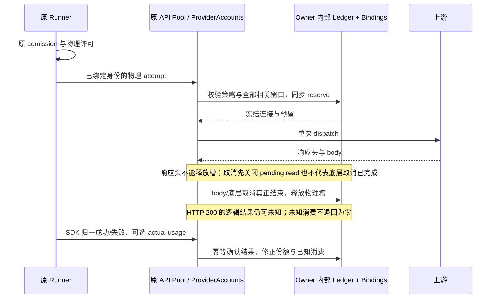

# 连接调度首批实现与验证

> 最新结果见本文末“2026-10-16 OAuth/API 加固交付”；旧 legacy/隐藏参数兼容描述仅记录历史，当前规则以 [加固 spec](provider-routing-hardening.md) 为准。

日期：2026-10-16。基线：`05c9d6e3`。本文件区分已落地功能、实际执行证据和仍未完成的完整 spec 门禁；不把目录里的 96 个计划场景整体标记为通过。

## 已落地的执行边界

| 部分     | 当前实现                                                                                                                                                            |
| -------- | ------------------------------------------------------------------------------------------------------------------------------------------------------------------- |
| 五种策略 | 可靠优选、主备接管、份额轮转、余量均衡、到期优先；显式 `routing.version: 1` 启用。                                                                                  |
| 兼容     | 缺省或 `routing: null` 继续原 OAuth 成功账号偏好与 API Key 轮换、冷却；策略保存不推进 Key 保存代次。                                                                |
| 配置     | 原 `ProviderSettingsFacade.setProviderRouting` → personal repository；View revision 与文件 membership CAS；全量旧表单保留独立保存的 routing。                       |
| 调度     | `RoutingScheduler.plan/reserve/setPolicy`；只读规划，同步多资源预留；`RoutingReservation.dispatch/cancel/finish/observeUsage`。                                     |
| 状态     | `RoutingLedger`、`RoutingBindings`、`RoutingHistory` 是原 owner 内部的派生状态；没有新增 accepted 队列或持久化用量账本。                                            |
| OAuth    | 原 `ProviderAccounts` 内持有渠道调度器；经能力审核的驱动在增强模式下一次 ticket attempt 至多一个推理 POST，三种协议沿原 loopback/relay 执行；未审核驱动派发前拒绝。 |
| API Key  | 原 `ApiKeyPool` 持有调度器；沿原 Runner admission、物理预算与 SDK 单次 fetch。修改策略继续共用同一 Key 代次的鉴权隔离状态。                                         |
| 用量反馈 | 原票据鉴权的私有 `/v1/routing/usage`；远端反馈绑定原物理 relay request，不能指定其他连接或 grant。                                                                  |
| 协商     | `interaction/providerRoutingCapabilities` 与私有 relay 的 `single-attempt-routing-v1`；旧 Host 收到原形状的 legacy auth 请求，增强配置遇到旧 peer 明确拒绝。        |
| 设置     | OAuth 与 API 详情复用 `ProviderRoutingEditor`；五策略、恢复旧行为、并发上限和缓存模式；中英文、宽屏与手机单列。                                                     |
| 诊断     | 纯计划返回实际策略、排除原因和 fallback；OAuth 响应提供安全策略/原因头；`RoutingError.code` 提供固定原因，不传播上游正文。                                          |



## 关键规则的实际实现

- 额度按 resource 与 instance 计量，所有相关窗口取交集；只有明确组织/共享资源 ID 才跨账号共用。显示名称 `pool` 不作为共享身份。
- 支持模型 include/exclude、窗口 kind、稳定 ID、reset mode 和 instance；排除优先。滚动重置提示不生成新账期；重置时间经过不补造 100% 余额。
- 新读数的时间不代表覆盖证明。只有 `coversThroughSeq` 能退休已确认包含的终态增量，在途预留不能被清掉。SDK 用量可先于或晚于物理结束到达，均只结算一次。
- token 轮换与授权身份代次分开：`routingEpoch` 由账号 owner 管理；重新授权或启停推进代次，普通 refresh 保留代次，不能借 token 轮换洗掉旧额度或硬绑定。
- 不可移植轮次从 reserve 起就有临时绑定；所有未派发引用取消后回滚。明确的首次无输出拒绝可以撤销临时绑定，已经形成的工具归属不会因此被清掉。服务端会话绑定跨用户轮保持；旧轮迟到结果不覆盖新轮。
- 没有可证明的 TTL，不假设五分钟或一小时缓存。`AuthModel.routingCacheTtlMs`、`routingPortability` 是驱动可选事实；缓存模式不解除硬绑定。
- 可靠优选无额度/近期样本时回退份额轮转，避免冷启动只使用第一连接；已知坏结果不优先于未探索候选。未知候选的有界探索不会被只读预览推进。
- 份额按工作量借记并接受实际用量修正；大请求产生债务，不成为永久不可分配。缺失用量保持估计，不把工作量子写为 actual Token。
- 到期预测只使用明确 `expiring-balance`、同单位实测消费和足够观测；窗口为 15 分钟、至少 8 个样本、至少 60 秒跨度，预测最长 1 小时。可用余量先扣除已有预留，无正收益时明确回退。
- 用户取消不计入上游失败率。物理 HTTP 完成与 SDK 逻辑结果分开；HTTP 200 JSON/SSE 业务错误不会提前生成成功样本或热缓存。
- 鉴权隔离绑定凭据 generation，额度、工具绑定和模型冷却绑定 routingEpoch/资源；刷新授权不得清洗其它状态。相关反例先失败，再修复通过。
- `AuthDriver.routingSingleAttempt` 与上下文标志共同约束真实驱动。OpenAI/Copilot 的增强请求关闭 401 重发，Copilot Auto 关闭拒绝后隐藏重选，owned-driver 保留能力；legacy 继续原恢复行为。Google 原推理出口只有一次 POST。Claude CLI 与未认证插件不冒充单次尝试支持。

## 测试先行证据

本轮先运行新增测试得到失败，再实现相应路径。除初始导出/配置失败外，实际反例包括：

| 反例                                   | 修复后断言                                          |
| -------------------------------------- | --------------------------------------------------- |
| 两次并发各取 60，余额只有 100          | 只允许一份预留；取消前不允许重复分配。              |
| 不同账号使用同一组织池                 | 不能绕过同一窗口余额。                              |
| 周窗充足、短窗为零                     | 短窗阻止准入，不能由周窗抵消。                      |
| 只有替代连接有新读数                   | 可在明确收益达到阈值后离开旧缓存。                  |
| 同一轮并发预留、旧轮迟到完成           | 不拆散硬绑定，不覆盖新轮缓存。                      |
| 保存策略、Key 曾经鉴权失败             | 保留失败隔离和原 Key 保存代次。                     |
| 同一个策略连续保存                     | 第二次使用已提交 revision，不制造自冲突。           |
| 其他窗口更新配置后提交旧草稿           | 显示冲突，未写入；重新载入后可保存。                |
| 取消与响应头同拍 / pending read 先关闭 | 仍等底层 cancel 完成后才归还槽。                    |
| HTTP 200 结束但 SDK 结果未知           | 不生成成功率或热缓存；晚到失败可确认原尝试。        |
| OAuth 驱动内部 401/Auto 重选重发       | 增强模式一份许可只有一次推理，legacy 恢复行为仍在。 |
| 冲突重载还留着旧并发与缓存字段         | 重载完整权威配置，防止新 revision 覆盖旧草稿。      |

可复现入口：

```text
pnpm test:provider-routing
pnpm test:provider-routing-ui
pnpm typecheck
pnpm lint
pnpm --dir apps/lcode-cli typecheck
pnpm --dir apps/lcode-cli lint
pnpm architecture:check --changed
```

实际结果以收尾记录为准，不读取真实凭据，不请求真实厂商推理。Node 测试包括真实 SDK generate/stream、真实 loopback HTTP、双向 RPC、quota/身份/取消回归以及原十万 Key 选择、Settings RPC 与冷启动回归。浏览器在 1280 中文暗色、390 英文亮色下验证五种策略、重复保存、冲突恢复和恢复 legacy；检查无横向溢出，截图保存在 `.tmp/provider-routing-ui/`，可由测试重建。

### 本轮执行结果

| 命令/检查                             | 本轮最近一次结果                                                                                                                                                                                                                                                                                                                                                                        |
| ------------------------------------- | --------------------------------------------------------------------------------------------------------------------------------------------------------------------------------------------------------------------------------------------------------------------------------------------------------------------------------------------------------------------------------------- |
| `pnpm test:provider-routing`          | **269/269 通过**，包含策略/配置、真实 SDK 与 HTTP 请求计数、双向 RPC、原生驱动单次推理、额度、取消和原十万 Key 回归。                                                                                                                                                                                                                                                                   |
| `pnpm test:provider-routing-ui`       | **2/2 通过**，各场景实际操作五种策略、重复保存、revision 冲突与 legacy 恢复；截图已查看。                                                                                                                                                                                                                                                                                               |
| `pnpm lint`                           | **通过**；任务外的额外格式化已按 HEAD 的精确 formatter 输出比对撤销，保留并行代码改动。                                                                                                                                                                                                                                                                                                 |
| `pnpm --dir apps/lcode-cli lint`      | **通过**，14 个任务成功。                                                                                                                                                                                                                                                                                                                                                               |
| 路由改动文件的 root/CLI 格式检查      | **通过**，分别使用各自配置与 formatter。                                                                                                                                                                                                                                                                                                                                                |
| feature graph                         | **通过**，节点 ID 唯一、149 条边端点/rank 有效、5 个路由种子文件与符号存在。                                                                                                                                                                                                                                                                                                            |
| `pnpm typecheck`                      | **未通过**：并行 sidebar/project/worktree 代码的 executionSet 联合类型、i18n key 和可空 task ID 错误（`useSidebarOrganizationCatalog.ts`、`SidebarProjectEntry.tsx`、`SidebarUnavailableEntry.tsx`、`useUnifiedSidebarProjection.tsx`、`WorktreeSettingsProject.tsx`、`DraftWorktreePreparation.tsx`、`ProjectWorktreeList.tsx`）；详见当前日志。较早 archive.ts 错误已由后续改动消除。 |
| `pnpm --dir apps/lcode-cli typecheck` | **未通过**：并行新增 `admission-project-context.test.ts` 从 core 实现目录导入而越出 bootstrap rootDir；`protocol-execution-set.ts:32` 的协议方法尚未被类型接纳；`worktree-execution.test.ts:45/57` 的可空 binding owner。此前较早检查曾通过，不据此覆盖本次失败。                                                                                                                       |
| `pnpm architecture:check --changed`   | **通过**：violations 0、baseline 0、new 0；此前并行 worktree 循环边已由后续改动消除。                                                                                                                                                                                                                                                                                                   |

仓库级类型失败来自当前并行改动，保持原样；不能写成整仓全部检查通过。上述 TypeScript 错误路径及对应改动不属于本次路由提交。`provider-node` 与 CLI adapters 另行实际执行 `tsc --noEmit` 均通过。检查日志位于 `.tmp/provider-routing-*.log`。

浏览器回归在移动端曾有一次等待冲突提示超时；加入 fixture 调用记录诊断后，连续两次宽屏/手机回归均通过。未增加固定 sleep 或放宽原超时，保留诊断用于再次复现。

## 批量 API Key 增强与验证（基线 88c68903）

后续批次按 [批量规格](provider-routing-api-key-batch.md) 先补失败测试，再实现；保留以上首批历史记录。以下为本批最新结果，不能将首批类型失败沿用为本批结果。

- Token 预留按 input/output/total 单位分别处理；所有私有/共享窗口原子取交集。实际用量分资源幂等对账，允许输入先到、总量后到；未知部分不退零。
- Key 共享池使用明确 pool ID，同一执行 owner 内不能通过换 Key 绕过借记。相同/旧修订不能重写已确认读数；切换策略、元数据或关闭后重开不清掉在途借记，未派发旧租约按 epoch 拒绝。关闭期间新请求保持 legacy，不宣称补算其 Token。
- RoutingScheduler 仍唯一拥有 Ledger、Bindings、History、份额与在途；ReservationOwner 只是该 owner 的租约实现部分。目录、整数顺序树和期限堆都是派生索引，无新业务队列。
- 五策略使用按需求/模型轮廓缓存的 cohort 目录（最多 8 个），热路径比较等价类代表与绑定候选；单 Key 更新和期限到期只刷新受影响条目。份额补充轮次检查最佳 tier 的全部候选，不能依赖前 32 条展示结果。
- 明确缓存 group/TTL 支持同组切 Key；异组保留收益/新读数门槛。共享到期资源的用量样本按物理请求合并，不因轮流使用 Key 分散样本或重复计数。
- 原 Settings owner 新增安全分页和带 revision CAS 的目标批量命令，支持 selected/all、共享池、份额、优先级、缓存组/期限及清除；旧表单保存与 Key 导入保留元数据，不推进凭据保存代次。
- 批量面板默认折叠，展开才读分页，手机单列、中英文本地化；配置检查与执行器预览明确区分。执行器只读端口返回来源、在途、排除原因、窗口、Token 估计及索引工作量，不能指定凭据或发起模型请求。

### 本批实际验证

| 检查                                 | 结果                                                                                                                                                          |
| ------------------------------------ | ------------------------------------------------------------------------------------------------------------------------------------------------------------- |
| pnpm test:provider-routing           | **330/330 通过**；含原 OAuth/legacy 回归、全部新增 Token/共享池、目录差分、批量设置与导入测试。                                                               |
| pnpm test:provider-routing-ui        | **2/2 通过**；1280 中文暗色 / 390 英文亮色；五策略和 legacy、按需加载、选中/全量修改、分页、冲突重载、草稿清理、清除与无横向溢出。截图实际查看。              |
| 真实 SDK + loopback HTTP             | generate / stream **2/2 通过**；60 Token 预留竞争共享 100，第二 Key 在 POST 前拒绝且物理许可数为 0；第一份归一 actual=15 后下一份可执行，实际 POST 总数为 2。 |
| 根仓库 pnpm typecheck / pnpm lint    | **通过**。此前一轮并行 worktree 改动曾有 3 个联合类型错误；后续收尾检查已通过，未在本任务中修改该 worktree 文件。                                             |
| Node 24.21.0 下 CLI typecheck / lint | **通过**，分别 27 / 14 个任务成功。命令从根目录通过 volta run --node 24.21.0 pnpm --dir apps/lcode-cli 执行。                                                 |
| pnpm architecture:check --changed    | **通过**，violations / baseline / new 均为 0。                                                                                                                |
| 改动文件格式、feature graph          | 格式通过；本提交 98 个节点 ID 唯一，149 条边端点/rank 有效，8 个路由种子路径与符号存在。                                                                      |

十万 Key 测量来自同一轮实际测试；冷启动包含目录创建，独立窗口场景还包含十万份快照录入。同期执行整仓检查，以下是观测值而非 SLA。

| 十万 Key 场景                         | 冷建         | 热路径                  | 索引证据                                                     |
| ------------------------------------- | ------------ | ----------------------- | ------------------------------------------------------------ |
| 额度未知，可靠优选明确回退份额        | 2320 ms      | 100 次共 15.48 ms       | 1 个 cohort，2 个代表；热路径 scannedKeys/builds 不增加。    |
| 单一共享 Token 池，五策略各测         | 1733–2182 ms | 各策略 p95 0.17–0.73 ms | 1–2 个 cohort，2 个代表；共享池耗尽拒绝也不扫描十万成员。    |
| 独立窗口、16 类余量、十万条逆序 order | 6569 ms      | 100 次共 26.01 ms       | 17 个 cohort，18 个代表；单 Key 更新选择新最优，不重建目录。 |

五策略分别以 80 个混合候选、300 次不同需求/债务/绑定决策，与完整 planner 差分对比通过；另测第 33 个候选先恢复正份额的边界。测试先失败的日志涵盖 Token、延后反馈、索引、缓存组、旧响应头归属、共享预测、批量 CAS、导入与开关状态。可重建证据见当前测试文件；本机日志为 .tmp/api-key-batch-\*.log，截图为 .tmp/provider-routing-ui/。

实际文件 Runtime 另行验证十万 Key 全量元数据保存、末页 25 个 Key 的脱敏读取、过期 revision 拒绝及原子写盘。RPC codec 实测保存响应 39,946 bytes、末页 2,621 bytes；广播继续使用 compact View，不回传十万明文 Key。命令为 node --import tsx --test packages/services/src/model-provider/providerSettingsLargeKeys.test.ts，**1/1 通过**。

## 跨进程共享池与高度分散路由（基线 96f6463b）

按 [跨进程规格](provider-routing-cross-process.md) 先补失败测试，再实现。历史批次记录保留；以下为本批最近一次实际结果。

- 原 bootstrap 注入现有凭据目录旁的共享 owner；新版增强执行器按 provider + 明确 pool 共享全窗口/Token/Key 并发预留。文件锁内提交，HTTP 不持锁；锁或存储失败在 fetch 前失败。SDK 未注入目录、legacy、独立 Key、OAuth 保留原行为。
- 全局 fence/sequence 防止重复派发；派发前重新检查变化的余额、期限和 hard 保留线。未派发 30 秒后可退，已派发崩溃不退款。输入/输出/总 Token 分资源接收一次实际值；仅全局覆盖证明退休已结束消费，本地 revision 和普通响应头不能洗账。
- 已知终态在 admission 有效期后压缩，旧输入不能重开；未知和活跃消费保留。迟到首次窗口/第二个 Token 窗口仍包含历史借记；部分覆盖在压缩批次最高序号前保持保守。4096 条保留租约、资源数量及文件体积都有明确容量错误，不重置账本。
- G=N 的目录使用派生胜者树和同一 planner 评分，热路径比较少量候选；一轮决策冻结同一 now。缓存新读数使用同一 Ledger 的全目录观测水位，未进入上次候选集的旧读数不能触发切换。

### 本批实际验证

| 检查                                 | 结果                                                                                                                                                                                                                                                          |
| ------------------------------------ | ------------------------------------------------------------------------------------------------------------------------------------------------------------------------------------------------------------------------------------------------------------- |
| pnpm test:provider-routing           | **367/367 通过**；包括原 OAuth/legacy、批量设置、Token、全窗口、共享并发、缓存和完整 planner 差分回归。                                                                                                                                                       |
| pnpm test:provider-routing-ui        | **2/2 通过**；1280 中文暗色 / 390 英文亮色；本批未修改 UI。                                                                                                                                                                                                   |
| 真实独立 SDK 子进程 + loopback HTTP  | generate / stream **2/2 通过**：首个子进程占用 60/100，第二个子进程在 POST 前拒绝且物理许可为 0；首份 actual=15 持久化后，第三个子进程成功；每种模式实际 POST 共 2。另有双执行器 HTTP 及私有全局对账端口测试。                                                |
| 原子/故障/容量                       | 多窗口一足一不足无部分借记；错误 fence、重复 dispatch、未发过期、live lock 超时、坏文件/未知版本均覆盖；真实子进程强制退出后借记仍保留。终态压缩、旧输入重放、迟到 usage/窗口、旧账期覆盖均通过；SDK 显式 undefined 的缺失 Token 字段保留未知，NaN 继续拒绝。 |
| 根仓库 pnpm typecheck / pnpm lint    | **通过**。                                                                                                                                                                                                                                                    |
| Node 24.21.0 下 CLI typecheck / lint | **通过**，分别 27 / 14 个任务成功；从根目录用 volta run --node 24.21.0 pnpm --dir apps/lcode-cli 执行。                                                                                                                                                       |
| pnpm architecture:check --changed    | **通过**，violations / baseline / new 均为 0。                                                                                                                                                                                                                |
| 改动文件格式、feature graph          | **通过**；44 个文件分别使用 root/CLI formatter；提交内 98 个节点 ID 唯一、149 条边端点/rank 有效，10 个路由种子路径与符号存在。                                                                                                                               |

本批十万 Key 全部属于不同 pool，并具有分散的额度、质量或到期信号。以下来自最终完整回归，同期运行类型检查；是本机观测而非 SLA。

| 场景                                           | 冷建        | 热 p95       | 索引证据                                                                                      |
| ---------------------------------------------- | ----------- | ------------ | --------------------------------------------------------------------------------------------- |
| 五策略各自 100,000 个不同 pool/cohort          | 3.34–3.74 s | 0.26–0.63 ms | 每轮比较 4–5 个候选；50 次热循环后目录仍只扫描初始 100,000；共刷新 102 个叶子，rankBuilds=1。 |
| API Registry + 实际共享文件 reserve/cancel I/O | 4.92 s      | 11.67 ms     | 比较 2 个候选；只生成被选中 pool 的 1 个文件，热循环不重扫十万 Key。                          |

五策略另以 300 个混合候选、各 350 次变化，与完整 planner 逐次比较选择结果；覆盖全局价格/到期单位可比性、份额债务、探索、绑定和缓存。旧 80 候选 × 300 次差分仍通过。冷建跨时刻、到期边界、低分散升为高分散均有回归。

最终命令和上述测量见 `.tmp/cross-routing-*-delivery.log`；测试失败与修复轨迹位于本机 .tmp/cross-\*.log；均使用虚构 Key 与本地 HTTP，不读取真实凭据，不调用真实厂商。进程退出测试不是整机断电、网络文件系统或跨主机一致性证明。

## 完整 spec 尚未达到的门禁

1. **大规模索引边界**：高度分散 G=N 的 API Key 热路径已补齐胜者树及差分/实测；同拍失效的大共享组或大量连续预测变化仍按实际受影响成员刷新，不保证任意批量变化均为常数时间。OAuth 候选路径未迁移为大目录索引。
2. **现行设置与诊断边界**：批量设置、拖动排序、保留线编辑器和诊断面板的 UI 要求已由简洁策略规格永久替代，不再列为待交付界面。本轮提供原 owner 的只读运行诊断，区分本地预览、预留阶段和共享权威额度，见下方恢复验证。本批共享额度锁仅覆盖本机、相同数据目录且注入协调端口的新版增强执行器；跨主机、外部客户端与旧版本不受此锁约束。
3. **更完整的策略质量模型**：当前余量使用瓶颈压力分档，未完成所有其余窗口向量、近期工作半衰期、预测范围和缓存经济成本的完整回放门禁；本批已验证共享文件 owner 的终态压缩与容量拒绝；更长期压力、未知消费的人工核销，以及本地历史/账本的完整容量治理仍需专门验证。
4. **厂商事实与环境覆盖**：不臆造价格、缓存 TTL、扣减归属和覆盖水位；只有驱动实际提供相应事实时才使用。Claude CLI 与未声明单次推理能力的插件目前只能用 legacy，启用增强配置会明确拒绝。真实供应商与 macOS/Linux 未实测；Windows fixtures 与浏览器验证不能代替这些环境。

本批补齐批量 API Key 的五策略执行、Token/共享池预留、目录性能、缓存组和批量管理验证；上述完整 spec 的其余门禁继续保留，不能据此宣称 S4 全部完工或 96 个计划场景全部验收。

## 简洁策略设置与折叠帮助（基线 dcaec01f）

按 [简洁设置规格](provider-routing-simple-settings.md) 先补 E2E；桌面和手机均在旧批量面板仍存在的断言上实际失败，再修改 UI。此前各批次关于批量编辑面板的截图和结果为历史记录，现行设置入口已由本批替代。

- 移除批量 Key 表单及死组件/文案，hook 不再提供该 UI 的分页和元数据修改回调。原服务 schema、命令、Key 元数据及执行器继续兼容。
- 标题、192px 桌面选择器、问号帮助与短保存按钮同一水平行；手机允许自然换行。标题行提供箭头和展开/折叠文字，没有启用开关；折叠不保存或关闭策略，并保留草稿。
- 问号按当前策略提供中英文解释；桌面 hover、键盘聚焦、手机触摸均实测。新启用只写 version/strategy，已有高级策略字段保持；冲突重载、重复保存和 legacy 恢复均覆盖。

| 检查                              | 本批实际结果                                                                                                                                                                                          |
| --------------------------------- | ----------------------------------------------------------------------------------------------------------------------------------------------------------------------------------------------------- |
| pnpm test:provider-routing-ui     | **2/2 通过**；1280 中文暗色 / 390 英文亮色；覆盖隐藏批量/高级控件、横排宽度、展开折叠、草稿、五策略说明/保存、重复保存、冲突重载、隐藏字段保留、零 Key 与 legacy；零 Key 分页、密钥读取、元数据写入。 |
| pnpm test:provider-routing        | **367/367 通过**，包含原策略、额度与批量兼容服务回归。                                                                                                                                                |
| pnpm typecheck / pnpm lint        | **通过**；本批未修改 CLI 代码。                                                                                                                                                                       |
| pnpm architecture:check --changed | **通过**，violations / baseline / new 均为 0。                                                                                                                                                        |
| 格式与 feature graph              | 使用 root formatter 检查本批文件；图移除已删除组件的种子，保留原路由 owner 与兼容接口。                                                                                                               |

宽屏、手机、折叠及问号帮助截图位于本机 .tmp/simple-routing-ui/，已实际查看展开与折叠布局；可由测试重建。先失败、通过及检查日志位于 .tmp/simple-routing-\*.log。本批不改变调度算法，不将 UI 精简当作此前审计缺口已修复的证据。

## OAuth / API 缓存、恢复与共享池诊断（基线 92a65ba6）

本轮按 [恢复规格](provider-routing-recovery-diagnostics.md) 先写规则与失败测试，再实现。保留当前简洁 UI，永久不恢复批量 Key 路由表单，也不新增手动配置项。

- 缓存判定复用可靠性档；到期跨组切换必须有同单位的已知成本和正净收益，未知成本不估成零。模型/协议统计与远端会话绑定隔离，原资源债务继续共享。离线恢复信用上限为一轮。
- OAuth 和 API 使用原 owner 的单 probe 状态，物理终结及归一成功共同确认恢复；仅 HTTP 200、release 或 TTL 不确认。API 共享 pool 的恢复许可保存在同一文件事务中，v1 到 v2 迁移保留借记。
- 修复半开租约已有用量但缺少 outcome 时被压缩删除的问题；晚于 TTL 的成功仍可对账。目录跟踪冷却截止点，probe/取消及仅 outcome 的反馈也刷新索引；各 profile 使用自己的模型上下文。
- finish/usage/observe 等幂等反馈有界重试，失败容量与溢出可诊断。dispatch 回执丢失明确为 dispatch-uncertain，不重放 dispatch 或 POST；安全路由字段经过 SDK 分类与 adapter 上下文继续保留。
- API 异步诊断按当前页去重读取共享 pool：本地 preview=100、另一 owner 已预留 60 时，全局 available=40。OAuth 直接读同一个 ProviderAccounts；同组织共享窗口只投影一份。诊断明确 reserved/dispatched/ended actual/ended estimated/folded、覆盖水位、质量与来源。未知 owner 保持 unknown，stale 页在 IO 前拒绝。
- 增强 OAuth 的未知 429 scope 按 provider 保守冷却；模型隔离测试改用驱动确认的局部 scope，新增未知 scope 回归。无策略/null 的 legacy 路径保持原行为；旧隐藏策略字段与 Key 元数据继续兼容。

| 验证                              | 实际结果                                                                                                                                                                           |
| --------------------------------- | ---------------------------------------------------------------------------------------------------------------------------------------------------------------------------------- |
| pnpm test:provider-routing        | **399/399 通过**，相对简洁 UI 基线新增 32 个场景；包含五策略、批量 Key、真实双进程、崩溃/坏文件/迁移、归因及原有差分测试。                                                         |
| API generate / stream             | 本地 HTTP + 真实 SDK：共享 Token 预留与实际用量对账、429 后单 probe 成功恢复，物理 POST 数受原预算约束。                                                                           |
| OAuth 三种协议                    | 原 ProviderAccounts 受信本地 HTTP：chat-completions、responses、anthropic-messages 均验证冷却探测、仅 body 结束仍 uncertain、原票据归一反馈才恢复。另有三协议直接 owner 并发测试。 |
| 双进程与 IO 故障                  | 两个真实独立进程只获得一个共享 probe；未知派发不按 TTL/PID 退款；丢失 dispatch 回执实际 POST=0；临时反馈 IO 可恢复；300 个永久失败的追踪保持 256 上限并显式溢出。                  |
| 十万 Key 分页诊断                 | 前两 Key 同池只读取 1 个池；不读取其它 99,998 个池，不改变 cursor/sequence/借记，不暴露虚构密钥或请求作用域。                                                                      |
| pnpm test:provider-routing-ui     | **2/2 通过**：1280 中文暗色 / 390 英文亮色；现有横排、折叠、问号帮助、五策略保存、旧隐藏字段、legacy 及零 Key 行为保持。UI 源码本轮无改动。                                        |
| pnpm typecheck                    | **通过**。                                                                                                                                                                         |
| CLI typecheck / lint              | **27/27 与 14/14 任务通过**；反馈 drain 的快照迭代在最终复检前改为显式命名变量，保留有界重试语义。                                                                                 |
| pnpm lint                         | **最终复检通过**；首轮曾被范围外 sidebar-organization.tsx 的 max-lines 阻塞，最终同命令返回 0。本轮未修改该文件；根目录目标文件单独 oxlint 也通过。                                |
| pnpm architecture:check --changed | **通过**：violations/baseline/new 均为 0。                                                                                                                                         |

最终完整路由回归与类型检查并行时的本机观测：五策略各 100,000 个独立 pool/cohort，冷建约 3.76–4.48 秒，热 p95 约 0.34–1.29 ms；50 次热循环后 scannedKeys 仍为 100,000，rankBuilds=1，刷新 102 个叶子。API Registry 加真实共享文件 IO：冷建 6.84 秒，热 p95 16.78 ms，只生成被选中 pool 的 1 个文件。这些是本机证据，不是跨平台 SLA。

失败和通过轨迹位于本机 .tmp/routing-recovery-\*.log；最终门禁日志使用 delivery 前缀，界面日志为 routing-recovery-ui.log。仅使用虚构凭据与本地 HTTP；未用真实厂商调用替代验证，未实测 macOS/Linux、跨机器或完整经济收益回放。价格、TTL、共享关系与覆盖水位未知时继续安全降级，不添加人工配置填空。

## 2026-10-16 OAuth/API 加固交付

基线 d8b440dc。对应 [加固 spec](provider-routing-hardening.md)，按“规格 → 失败测试 → 实现 → 实测”推进，原有策略数学规则继续共用同一调度 owner。

### 已完成的优先项

- OAuth invocation 沿原 Runner/core/协议/票据传递 input/output/total Token 上界、创建时间和缓存兼容键，三个 Token 窗口独立借记及实际分量对账。未知需求使用独占探测并在诊断标明，不能冒充零消费。
- OAuth 活跃流与未确认归一反馈不按签发五分钟删除。真实 HTTP 长流跨时钟边界后仍可反馈；同票据禁止再次模型 POST；反馈最多三次、payload 不变，永久失败可读，不能重发模型请求。
- 并发同代失败合并最大 Retry-After，重复反馈不延长截止；新 probe 后旧反馈无权覆盖。使用 closed permit 和活跃引用检查回收健康 tombstone，文件原 sequence/fence 仍校验。
- API 明确区分 key/model/pool/provider，未知 429 为 provider；未知 5xx 默认 model。provider 文件 gate 覆盖所有 Key，固定 provider → pool 锁序；独立 Key 不被猜成实际共享额度池。pool 写入失败也不能回滚已接收的 provider 冷却。
- 文件版本 3 在锁内迁移 v1/v2 并保留借记。过期零余额与 stale 窗口只允许同资源一次探索，不补满额度；未知派发不因 TTL/PID 清账。健康记录、已确认 attempt 缓存、借记明细、统计桶和 profile 设容量；未确认状态容量满明确失败。
- 上游显式缓存契约头提供来源、TTL、组、可移植性和同单位切换成本；没有真实声明就保持未知。原手填缓存 TTL/组不再作为运行事实。最终探索覆盖软绑定时，cacheDecision 明确记录 switch。
- 共享诊断每页最多 100 pool、最多 4 个并行文件读取，恢复投影有总数/截断；失败反馈含安全的 provider/pool/哈希 lease 定位。设置仍只有五策略，缺省/null 为可靠优选，不保留 legacy 或隐藏参数透传。

### 红灯与实际验证

首批 core/OAuth 5 个审计复现、API 5 个复现均先失败，再通过；UI 先暴露 6 对 5 选项错误。后续补充了 provider 冷却随下游 IO 失败丢失、未知 Token 探测诊断的失败回归，修复后通过。初次类型检查发现 SDK 夹具自引用推断错误，补显式类型后的最终检查通过；没有把初次失败计作通过。

| 验证                              | 最终真实结果                                                                                                                                                                                                 |
| --------------------------------- | ------------------------------------------------------------------------------------------------------------------------------------------------------------------------------------------------------------ |
| pnpm test:provider-routing        | **430/430 通过**；较基线 399 增加 31 项，包含五策略、原差分回归、真实双进程、坏文件/迁移/崩溃/未知派发及本轮故障注入。                                                                                       |
| pnpm test:provider-routing-ui     | **2/2 通过**；桌面横排与手机布局、五选项、默认可靠优选、保存投影、折叠和帮助均验证。                                                                                                                         |
| OAuth 真实 SDK                    | chat-completions、responses、anthropic-messages，各 generate/stream，共 **6 项通过**。通过子进程真实 Runner/SDK、本地票据 HTTP、原 ProviderAccounts；POST=1，Token 预留=60，实际回填=15，归因 unresolved=0。 |
| OAuth 长流                        | 实际 HTTP 流配合可注入时钟跨五分钟；其它票据签发清理不丢原反馈，旧票据模型重放=403，结束后宽限期到期才拒绝反馈。此处是确定性时钟验证，不是等待五分钟墙钟。                                                   |
| API 跨进程与恢复                  | 两个真实进程无法通过换 pool 绕过 provider 429；并发/重复 Retry-After、独占 probe、下游 pool 反馈失败仍保留 provider 冷却均通过。                                                                             |
| pnpm typecheck / pnpm lint        | **最终均通过**。                                                                                                                                                                                             |
| CLI typecheck / lint              | **27/27 与 14/14 任务通过**；最终规则检查 0 errors / 0 warnings。Turbo 仍提示已有 lockfile 缺 node-repl-host workspace 条目，退出为 0。                                                                      |
| pnpm architecture:check --changed | **通过，violations/baseline/new 均为 0**。                                                                                                                                                                   |
| 格式与领域图                      | 本轮文件使用各包 oxfmt 检查；图 YAML、唯一 ID、边端点/rank、15 个 routing seed 路径/符号校验通过，目标节点以外的本地改动保留。                                                                               |

### 十万 Key 的实际测量及限制

最终完整回归与类型检查并行运行时：五策略各 100000 个不同 cohort，冷建约 3.23–3.55 秒，热 p95 约 0.27–0.62 ms，热循环不再全量扫描。真实共享文件 IO 场景冷建 **4.99 秒**、热 p95 **17.99 ms**；仅创建被选中的 1 个 pool 文件和 1 个 provider gate，没有为其余 99999 个 pool 建文件。

长期状态测试为 **100000 条目录、9 个模型 profile、10000 个已完成请求、约七天虚拟时钟（10000 × 60 秒）**。不是七天真实进程驻留。最终 profile=2、cohort=200000、rankBuilds=9、扫描=900000，热阶段扫描不增长；attempt 和借记明细均为 4096。已确认借记折叠保留总量/覆盖水位，未知借记不退款。

该高分散长跑测得每个新 profile 冷建 **2.33–3.31 秒**，热 p95 **0.701 ms**，峰值 RSS **1452 MiB**、结束 heap **510 MiB**，事件循环最大延迟 **6.34 秒**。profile 预算和提前 LRU 回收避免无限积累，但**同步冷建停顿和较高内存仍是后续性能优化项**；不能据热 p95 宣称全程低延迟。数值是本机并行负载观测，不是跨平台 SLA。

### 仍未由本轮验证替代的事项

- 真实厂商的缓存命中、价格/币种、缓存重建成本及完整经济收益回放；未提供事实时按 unknown 分支运行。
- macOS/Linux、跨机器、网络文件系统与七天真实墙钟浸泡；本轮只实测当前 Windows、本地文件锁、真实独立 Node 进程及本地 HTTP。
- 主规格中更完整的窗口压力向量/归一负载/历史工作衰减、含排队的完成时间预测与共享资源未来需求分配，仍需单独实现/验收；本次没有把这些数学模型算作已完成。
- 无 single-attempt 认证能力的 OAuth 驱动现明确拒绝；不使用 legacy 绕过。该迁移属于用户本轮“不保留旧配置行为”的边界。

详细运行轨迹保存在本机 .tmp/routing-hardening-\*.log；最终路由、类型、lint 使用 final 前缀，交互红/绿轨迹分别为 ui-red/ui，故障与探测红灯为 gate-red/probe-red。日志中的 Key 与供应商均为虚构夹具，未调用真实厂商计费接口。

最后还补了 provider 许可不可删除/跨预留拼接的失败回归，修复并进入 430 项最终回归。一次验证 shell 在系统 oh-my-posh profile 初始化时停滞，该次未启动测试；只停止本任务的相关 shell/helper 后以 NoProfile 重跑，Node 24.21.0、pnpm 10.34.6。没有修改用户 profile。

## 2026-10-17 首次配置、授权与调度优化

基线 af957e78，对应 [完成规格](provider-completion-2026-10-17.md)。本轮先更新规格、记录失败回归，再实现；没有引入批量 Key 面板、手填额度/缓存参数或旧配置回退。

### 已交付行为

- API-only、空可执行模型列表的 temporary 检测走原控制面启动入口，再发送原 CLI 检测命令；正常模型执行门禁保留。原 workspace identity / remoteSessionId、单进程复用和平台网络配置继续传递，不要求 OAuth。
- 授权阶段诊断覆盖工厂/准备、等待、Token 交换、账号查询、持久化和目录工作；公开字段由严格 schema 校验，不透出凭据、URL、响应和原始异常。开始阶段失败也保留原 attempts Map 中的无资源终态。
- 凭据 commit 后即为 completed；清理、目录及发布失败保留安全告警。followupPending 使同一 UI 轮询继续接收迟到告警，完成状态不被旧 pending 回退。全部导入失败不谎称已保存。
- 原生 HTTP 保留原单次模式；插件在原 worker operation 的 fetch/H2 出口强制单次推理许可，已核对的辅助查询和刷新不消耗推理许可。H2 429/503 不落入第二个 H1 模型请求，首个 HTTP/Retry-After 得以保留。Claude CLI 使用随机 loopback capability relay，约束原进程模型出口、等待真实上游 EOF，并在取消时关闭原物理流。
- 冷索引按 128 个候选/2048 个合并节点分块，adapter 在 outsideTicket 中推进；小目录可在一个片段内沿用原 admission。等待者独立取消，策略变化和额度更新不会发布旧结果。
- 等价分组最多 128 个；高分散时释放分组/membership，改用 typed score 列的胜者树，不保留完整候选对象。原账本、绑定、恢复和原 Runner 尝试预算仍是唯一事实。
- 完整可比多窗口使用 5% 压力向量；不同完整维度明确回退轮转。补齐并发能力归一、按模型的一小时半衰期工作量、迟到差额幂等、等待时间及预计完成时间；缓存的延迟判定使用相同完成时间模型。统计桶淘汰会同步失效原目录，避免软分数与全量 planner 分离。

### 失败与修复轨迹

API 首次同步先复现 provider-not-ready 循环依赖；授权 commit 后刷新/发布/清理及保存前失败的五项回归先失败，随后通过。评分首批七项中六项先失败；额外的 8193 桶淘汰反例也先失败。继续验证发现并修复低差异共享池重复全扫描、Cursor 辅助 POST 抢占推理许可、外部流取消过早返回三个问题。首次 UI 验证曾受并行冷编译的导航时间限制，增加独立导航预算并串行运行后通过；断言没有用固定睡眠代替状态等待。

| 验证                              | 最终结果                                                                                                                                                                                                                     |
| --------------------------------- | ---------------------------------------------------------------------------------------------------------------------------------------------------------------------------------------------------------------------------- |
| pnpm test:provider-routing        | **480/480 通过**，含 API 首次检测、OAuth 状态、五策略差分、真实 SDK/HTTP/双进程共享 owner、并发准备、统计淘汰及十万 Key 测试。                                                                                               |
| provider-node 全部测试            | **319/319 通过**：node --import tsx --test --test-concurrency=4 "packages/provider-node/src/\*_/_.test.ts"；与路由集有交集，不相加当成独立场景数。含 HTTP/HTTPS/SOCKS5 代理、取消、刷新、厂商插件、CLI fixture 子进程与 H2。 |
| 策略与授权诊断 UI                 | **4/4 通过**，1280px 中文桌面与 390px 英文手机；五选项、折叠/帮助、账号查询超时、凭据保存后的迟到告警、无横向溢出。使用两个实际 web test 文件并以 test-concurrency=1 执行。                                                  |
| pnpm typecheck / pnpm lint        | **均通过**；早期 H2 fixture 类型和 fixture 400 行限制先失败，修正后最终返回 0。                                                                                                                                              |
| CLI typecheck / lint              | **27/27 与 14/14 任务通过**；0 errors / 0 warnings。Turbo 现有 lockfile workspace 提示仍存在，未改无关依赖。                                                                                                                 |
| pnpm architecture:check --changed | **通过，violations/baseline/new 均为 0**。新增端口仍分属原 provider、provider-node、services、shared、CLI adapter 和 UI；domain 没有 IO/异步队列。                                                                           |
| 格式、领域图与来源                | 本轮代码按所属包 oxfmt 格式检查；图仅修改 OAuth details/routing 两节点，验证 YAML、ID、边 rank/端点及当前代码 seed；固定厂商源码构建校验通过，并只更新受影响 copied-source 哈希。未重写其它本地领域图变更。                  |

### 十万 Key 实测

最终完整回归同时运行类型检查和 provider-node 测试，当前 Windows / Node 24.21.0 / pnpm 10.34.6：

- 单 profile cooperative 冷建 **2.53 秒**、**844** 次让出，最长片段 **27.08 ms**；RSS 采样 **324.20 MiB**、结束 heap **117.24 MiB**。并发 acquire 共享一次准备，取消等待者没有预留，另一个继续成功。
- 五策略高度分散目录低层冷建 **2.08–2.59 秒**，热 p95 **0.285–0.796 ms**，热阶段扫描数不增长。低差异共享额度池也通过五策略热路径断言，没有退化为每请求扫描十万成员。
- **100000 Key、9 个 profile、10000 次已完成请求、约七天虚拟时钟**：profile 最终 2，rankedEntries=200000，扫描 900000；热阶段无全扫描，attempt/借记明细各 4096。冷 profile **1.82–2.39 秒**，热 p95 **0.900 ms**，采样峰值 RSS **485.53 MiB**、结束 heap **189.17 MiB**、事件循环最大 **33.31 ms**。与旧 1452 MiB / 6.34 秒样本相比，内存和停顿明显下降；这是合成负载，热循环每 32 次让出，不是七天墙钟浸泡或跨平台 SLA。
- 真实共享文件 IO 与其它验证并发时冷建 **4.60 秒**、热 p95 **41.57 ms**；为核实该波动，单独复跑该文件得到冷建 **3.17 秒**、热 p95 **18.38 ms**。只建立一个选中 pool 文件和一个 provider gate，未选中的 99999 个池没有建文件。该测量包含配置投影、文件锁和对账，不等同纯排名时间。

### 未由夹具验证替代的范围

本机没有安装实际 Claude CLI；真实 Node fixture 子进程验证了 relay 边界，但没有认证任意 CLI 版本，也没有使用真实供应商账号发起计费调用。用户 Ubuntu 的实际授权重试、Linux/macOS、跨主机/网络文件系统和七天真实墙钟浸泡未执行。真实厂商价格、缓存命中、TTL 和切换成本仍依赖受信事实；未知保持 unknown。主规格更完整的共享资源未来需求分配/经济收益回放不在本次已经完成的评分模型范围内。

本机轨迹为 .tmp/provider-completion-\*.log；最终证据包括 routing-final、auth-all、ui3、typecheck-final、lint-final、cli3-typecheck、cli3-lint、architecture 与 shared-io-isolated。red/green 文件保留实际失败和修复后的结果；没有将初次失败写成通过。
