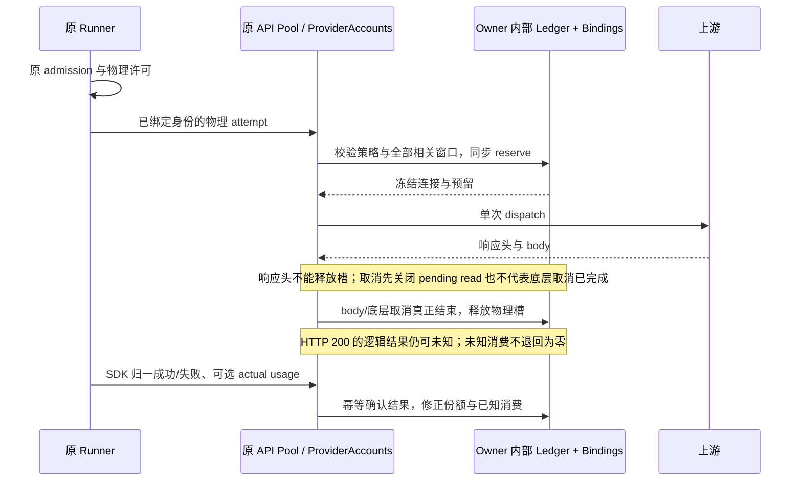

# 连接调度首批实现与验证

日期：2026-10-16。基线：`05c9d6e3`。本文件区分已落地功能、实际执行证据和仍未完成的完整 spec 门禁；不把目录里的 96 个计划场景整体标记为通过。

## 已落地的执行边界

| 部分     | 当前实现                                                                                                                                                            |
| -------- | ------------------------------------------------------------------------------------------------------------------------------------------------------------------- |
| 五种策略 | 可靠优选、主备接管、份额轮转、余量均衡、到期优先；显式 `routing.version: 1` 启用。                                                                                  |
| 兼容     | 缺省或 `routing: null` 继续原 OAuth 成功账号偏好与 API Key 轮换、冷却；策略保存不推进 Key 保存代次。                                                                |
| 配置     | 原 `ProviderSettingsFacade.setProviderRouting` → personal repository；View revision 与文件 membership CAS；全量旧表单保留独立保存的 routing。                       |
| 调度     | `RoutingScheduler.plan/reserve/setPolicy`；只读规划，同步多资源预留；`RoutingReservation.dispatch/cancel/finish/observeUsage`。                                     |
| 状态     | `RoutingLedger`、`RoutingBindings`、`RoutingHistory` 是原 owner 内部的派生状态；没有新增 accepted 队列或持久化用量账本。                                            |
| OAuth    | 原 `ProviderAccounts` 内持有渠道调度器；经能力审核的驱动在增强模式下一次 ticket attempt 至多一个推理 POST，三种协议沿原 loopback/relay 执行；未审核驱动派发前拒绝。 |
| API Key  | 原 `ApiKeyPool` 持有调度器；沿原 Runner admission、物理预算与 SDK 单次 fetch。修改策略继续共用同一 Key 代次的鉴权隔离状态。                                         |
| 用量反馈 | 原票据鉴权的私有 `/v1/routing/usage`；远端反馈绑定原物理 relay request，不能指定其他连接或 grant。                                                                  |
| 协商     | `interaction/providerRoutingCapabilities` 与私有 relay 的 `single-attempt-routing-v1`；旧 Host 收到原形状的 legacy auth 请求，增强配置遇到旧 peer 明确拒绝。        |
| 设置     | OAuth 与 API 详情复用 `ProviderRoutingEditor`；五策略、恢复旧行为、并发上限和缓存模式；中英文、宽屏与手机单列。                                                     |
| 诊断     | 纯计划返回实际策略、排除原因和 fallback；OAuth 响应提供安全策略/原因头；`RoutingError.code` 提供固定原因，不传播上游正文。                                          |



## 关键规则的实际实现

- 额度按 resource 与 instance 计量，所有相关窗口取交集；只有明确组织/共享资源 ID 才跨账号共用。显示名称 `pool` 不作为共享身份。
- 支持模型 include/exclude、窗口 kind、稳定 ID、reset mode 和 instance；排除优先。滚动重置提示不生成新账期；重置时间经过不补造 100% 余额。
- 新读数的时间不代表覆盖证明。只有 `coversThroughSeq` 能退休已确认包含的终态增量，在途预留不能被清掉。SDK 用量可先于或晚于物理结束到达，均只结算一次。
- token 轮换与授权身份代次分开：`routingEpoch` 由账号 owner 管理；重新授权或启停推进代次，普通 refresh 保留代次，不能借 token 轮换洗掉旧额度或硬绑定。
- 不可移植轮次从 reserve 起就有临时绑定；所有未派发引用取消后回滚。明确的首次无输出拒绝可以撤销临时绑定，已经形成的工具归属不会因此被清掉。服务端会话绑定跨用户轮保持；旧轮迟到结果不覆盖新轮。
- 没有可证明的 TTL，不假设五分钟或一小时缓存。`AuthModel.routingCacheTtlMs`、`routingPortability` 是驱动可选事实；缓存模式不解除硬绑定。
- 可靠优选无额度/近期样本时回退份额轮转，避免冷启动只使用第一连接；已知坏结果不优先于未探索候选。未知候选的有界探索不会被只读预览推进。
- 份额按工作量借记并接受实际用量修正；大请求产生债务，不成为永久不可分配。缺失用量保持估计，不把工作量子写为 actual Token。
- 到期预测只使用明确 `expiring-balance`、同单位实测消费和足够观测；窗口为 15 分钟、至少 8 个样本、至少 60 秒跨度，预测最长 1 小时。可用余量先扣除已有预留，无正收益时明确回退。
- 用户取消不计入上游失败率。物理 HTTP 完成与 SDK 逻辑结果分开；HTTP 200 JSON/SSE 业务错误不会提前生成成功样本或热缓存。
- 鉴权隔离绑定凭据 generation，额度、工具绑定和模型冷却绑定 routingEpoch/资源；刷新授权不得清洗其它状态。相关反例先失败，再修复通过。
- `AuthDriver.routingSingleAttempt` 与上下文标志共同约束真实驱动。OpenAI/Copilot 的增强请求关闭 401 重发，Copilot Auto 关闭拒绝后隐藏重选，owned-driver 保留能力；legacy 继续原恢复行为。Google 原推理出口只有一次 POST。Claude CLI 与未认证插件不冒充单次尝试支持。

## 测试先行证据

本轮先运行新增测试得到失败，再实现相应路径。除初始导出/配置失败外，实际反例包括：

| 反例                                   | 修复后断言                                          |
| -------------------------------------- | --------------------------------------------------- |
| 两次并发各取 60，余额只有 100          | 只允许一份预留；取消前不允许重复分配。              |
| 不同账号使用同一组织池                 | 不能绕过同一窗口余额。                              |
| 周窗充足、短窗为零                     | 短窗阻止准入，不能由周窗抵消。                      |
| 只有替代连接有新读数                   | 可在明确收益达到阈值后离开旧缓存。                  |
| 同一轮并发预留、旧轮迟到完成           | 不拆散硬绑定，不覆盖新轮缓存。                      |
| 保存策略、Key 曾经鉴权失败             | 保留失败隔离和原 Key 保存代次。                     |
| 同一个策略连续保存                     | 第二次使用已提交 revision，不制造自冲突。           |
| 其他窗口更新配置后提交旧草稿           | 显示冲突，未写入；重新载入后可保存。                |
| 取消与响应头同拍 / pending read 先关闭 | 仍等底层 cancel 完成后才归还槽。                    |
| HTTP 200 结束但 SDK 结果未知           | 不生成成功率或热缓存；晚到失败可确认原尝试。        |
| OAuth 驱动内部 401/Auto 重选重发       | 增强模式一份许可只有一次推理，legacy 恢复行为仍在。 |
| 冲突重载还留着旧并发与缓存字段         | 重载完整权威配置，防止新 revision 覆盖旧草稿。      |

可复现入口：

```text
pnpm test:provider-routing
pnpm test:provider-routing-ui
pnpm typecheck
pnpm lint
pnpm --dir apps/lcode-cli typecheck
pnpm --dir apps/lcode-cli lint
pnpm architecture:check --changed
```

实际结果以收尾记录为准，不读取真实凭据，不请求真实厂商推理。Node 测试包括真实 SDK generate/stream、真实 loopback HTTP、双向 RPC、quota/身份/取消回归以及原十万 Key 选择、Settings RPC 与冷启动回归。浏览器在 1280 中文暗色、390 英文亮色下验证五种策略、重复保存、冲突恢复和恢复 legacy；检查无横向溢出，截图保存在 `.tmp/provider-routing-ui/`，可由测试重建。

### 本轮执行结果

| 命令/检查                             | 本轮最近一次结果                                                                                                                                                                                                                                                                                                                                                                        |
| ------------------------------------- | --------------------------------------------------------------------------------------------------------------------------------------------------------------------------------------------------------------------------------------------------------------------------------------------------------------------------------------------------------------------------------------- |
| `pnpm test:provider-routing`          | **269/269 通过**，包含策略/配置、真实 SDK 与 HTTP 请求计数、双向 RPC、原生驱动单次推理、额度、取消和原十万 Key 回归。                                                                                                                                                                                                                                                                   |
| `pnpm test:provider-routing-ui`       | **2/2 通过**，各场景实际操作五种策略、重复保存、revision 冲突与 legacy 恢复；截图已查看。                                                                                                                                                                                                                                                                                               |
| `pnpm lint`                           | **通过**；任务外的额外格式化已按 HEAD 的精确 formatter 输出比对撤销，保留并行代码改动。                                                                                                                                                                                                                                                                                                 |
| `pnpm --dir apps/lcode-cli lint`      | **通过**，14 个任务成功。                                                                                                                                                                                                                                                                                                                                                               |
| 路由改动文件的 root/CLI 格式检查      | **通过**，分别使用各自配置与 formatter。                                                                                                                                                                                                                                                                                                                                                |
| feature graph                         | **通过**，节点 ID 唯一、149 条边端点/rank 有效、5 个路由种子文件与符号存在。                                                                                                                                                                                                                                                                                                            |
| `pnpm typecheck`                      | **未通过**：并行 sidebar/project/worktree 代码的 executionSet 联合类型、i18n key 和可空 task ID 错误（`useSidebarOrganizationCatalog.ts`、`SidebarProjectEntry.tsx`、`SidebarUnavailableEntry.tsx`、`useUnifiedSidebarProjection.tsx`、`WorktreeSettingsProject.tsx`、`DraftWorktreePreparation.tsx`、`ProjectWorktreeList.tsx`）；详见当前日志。较早 archive.ts 错误已由后续改动消除。 |
| `pnpm --dir apps/lcode-cli typecheck` | **未通过**：并行新增 `admission-project-context.test.ts` 从 core 实现目录导入而越出 bootstrap rootDir；`protocol-execution-set.ts:32` 的协议方法尚未被类型接纳；`worktree-execution.test.ts:45/57` 的可空 binding owner。此前较早检查曾通过，不据此覆盖本次失败。                                                                                                                       |
| `pnpm architecture:check --changed`   | **通过**：violations 0、baseline 0、new 0；此前并行 worktree 循环边已由后续改动消除。                                                                                                                                                                                                                                                                                                   |

仓库级类型失败来自当前并行改动，保持原样；不能写成整仓全部检查通过。上述 TypeScript 错误路径及对应改动不属于本次路由提交。`provider-node` 与 CLI adapters 另行实际执行 `tsc --noEmit` 均通过。检查日志位于 `.tmp/provider-routing-*.log`。

浏览器回归在移动端曾有一次等待冲突提示超时；加入 fixture 调用记录诊断后，连续两次宽屏/手机回归均通过。未增加固定 sleep 或放宽原超时，保留诊断用于再次复现。

## 批量 API Key 增强与验证（基线 88c68903）

后续批次按 [批量规格](provider-routing-api-key-batch.md) 先补失败测试，再实现；保留以上首批历史记录。以下为本批最新结果，不能将首批类型失败沿用为本批结果。

- Token 预留按 input/output/total 单位分别处理；所有私有/共享窗口原子取交集。实际用量分资源幂等对账，允许输入先到、总量后到；未知部分不退零。
- Key 共享池使用明确 pool ID，同一执行 owner 内不能通过换 Key 绕过借记。相同/旧修订不能重写已确认读数；切换策略、元数据或关闭后重开不清掉在途借记，未派发旧租约按 epoch 拒绝。关闭期间新请求保持 legacy，不宣称补算其 Token。
- RoutingScheduler 仍唯一拥有 Ledger、Bindings、History、份额与在途；ReservationOwner 只是该 owner 的租约实现部分。目录、整数顺序树和期限堆都是派生索引，无新业务队列。
- 五策略使用按需求/模型轮廓缓存的 cohort 目录（最多 8 个），热路径比较等价类代表与绑定候选；单 Key 更新和期限到期只刷新受影响条目。份额补充轮次检查最佳 tier 的全部候选，不能依赖前 32 条展示结果。
- 明确缓存 group/TTL 支持同组切 Key；异组保留收益/新读数门槛。共享到期资源的用量样本按物理请求合并，不因轮流使用 Key 分散样本或重复计数。
- 原 Settings owner 新增安全分页和带 revision CAS 的目标批量命令，支持 selected/all、共享池、份额、优先级、缓存组/期限及清除；旧表单保存与 Key 导入保留元数据，不推进凭据保存代次。
- 批量面板默认折叠，展开才读分页，手机单列、中英文本地化；配置检查与执行器预览明确区分。执行器只读端口返回来源、在途、排除原因、窗口、Token 估计及索引工作量，不能指定凭据或发起模型请求。

### 本批实际验证

| 检查                                 | 结果                                                                                                                                                          |
| ------------------------------------ | ------------------------------------------------------------------------------------------------------------------------------------------------------------- |
| pnpm test:provider-routing           | **330/330 通过**；含原 OAuth/legacy 回归、全部新增 Token/共享池、目录差分、批量设置与导入测试。                                                               |
| pnpm test:provider-routing-ui        | **2/2 通过**；1280 中文暗色 / 390 英文亮色；五策略和 legacy、按需加载、选中/全量修改、分页、冲突重载、草稿清理、清除与无横向溢出。截图实际查看。              |
| 真实 SDK + loopback HTTP             | generate / stream **2/2 通过**；60 Token 预留竞争共享 100，第二 Key 在 POST 前拒绝且物理许可数为 0；第一份归一 actual=15 后下一份可执行，实际 POST 总数为 2。 |
| 根仓库 pnpm typecheck / pnpm lint    | **通过**。此前一轮并行 worktree 改动曾有 3 个联合类型错误；后续收尾检查已通过，未在本任务中修改该 worktree 文件。                                             |
| Node 24.21.0 下 CLI typecheck / lint | **通过**，分别 27 / 14 个任务成功。命令从根目录通过 volta run --node 24.21.0 pnpm --dir apps/lcode-cli 执行。                                                 |
| pnpm architecture:check --changed    | **通过**，violations / baseline / new 均为 0。                                                                                                                |
| 改动文件格式、feature graph          | 格式通过；本提交 98 个节点 ID 唯一，149 条边端点/rank 有效，8 个路由种子路径与符号存在。                                                                      |

十万 Key 测量来自同一轮实际测试；冷启动包含目录创建，独立窗口场景还包含十万份快照录入。同期执行整仓检查，以下是观测值而非 SLA。

| 十万 Key 场景                         | 冷建         | 热路径                  | 索引证据                                                     |
| ------------------------------------- | ------------ | ----------------------- | ------------------------------------------------------------ |
| 额度未知，可靠优选明确回退份额        | 2320 ms      | 100 次共 15.48 ms       | 1 个 cohort，2 个代表；热路径 scannedKeys/builds 不增加。    |
| 单一共享 Token 池，五策略各测         | 1733–2182 ms | 各策略 p95 0.17–0.73 ms | 1–2 个 cohort，2 个代表；共享池耗尽拒绝也不扫描十万成员。    |
| 独立窗口、16 类余量、十万条逆序 order | 6569 ms      | 100 次共 26.01 ms       | 17 个 cohort，18 个代表；单 Key 更新选择新最优，不重建目录。 |

五策略分别以 80 个混合候选、300 次不同需求/债务/绑定决策，与完整 planner 差分对比通过；另测第 33 个候选先恢复正份额的边界。测试先失败的日志涵盖 Token、延后反馈、索引、缓存组、旧响应头归属、共享预测、批量 CAS、导入与开关状态。可重建证据见当前测试文件；本机日志为 .tmp/api-key-batch-\*.log，截图为 .tmp/provider-routing-ui/。

实际文件 Runtime 另行验证十万 Key 全量元数据保存、末页 25 个 Key 的脱敏读取、过期 revision 拒绝及原子写盘。RPC codec 实测保存响应 39,946 bytes、末页 2,621 bytes；广播继续使用 compact View，不回传十万明文 Key。命令为 node --import tsx --test packages/services/src/model-provider/providerSettingsLargeKeys.test.ts，**1/1 通过**。

## 完整 spec 尚未达到的门禁

1. **大规模索引边界**：本批已验证 API Key 的共享池、额度未知和有限不同窗口三类十万目录。复杂度依赖不同决策 cohort 数 G；最坏 G=N 时仍要比较全体代表，不能把这些测量推广为任意十万独特信号的常数时间保证。OAuth 候选路径未在本批迁移为大目录索引。
2. **完整设置与诊断表面**：本批补齐 Key 份额、优先级、共享池和缓存批量设置及配置检查；API 执行器提供单 Key 需求预览端口，不冒充最后执行决策。任意连接拖动排序、soft/hard 保留线编辑器、完整最近决策面板和独立执行器之间的全局额度锁尚未交付。
3. **更完整的策略质量模型**：当前余量使用瓶颈压力分档，未完成所有其余窗口向量、近期工作半衰期、预测范围和缓存经济成本的完整回放门禁；长期未覆盖增量与 attempt tombstone 的容量治理仍需专门验证。
4. **厂商事实与环境覆盖**：不臆造价格、缓存 TTL、扣减归属和覆盖水位；只有驱动实际提供相应事实时才使用。Claude CLI 与未声明单次推理能力的插件目前只能用 legacy，启用增强配置会明确拒绝。真实供应商与 macOS/Linux 未实测；Windows fixtures 与浏览器验证不能代替这些环境。

本批补齐批量 API Key 的五策略执行、Token/共享池预留、目录性能、缓存组和批量管理验证；上述完整 spec 的其余门禁继续保留，不能据此宣称 S4 全部完工或 96 个计划场景全部验收。
