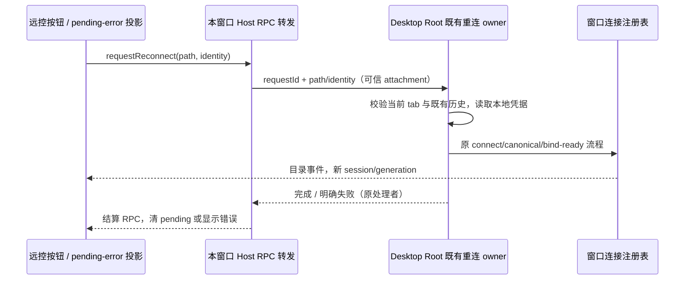
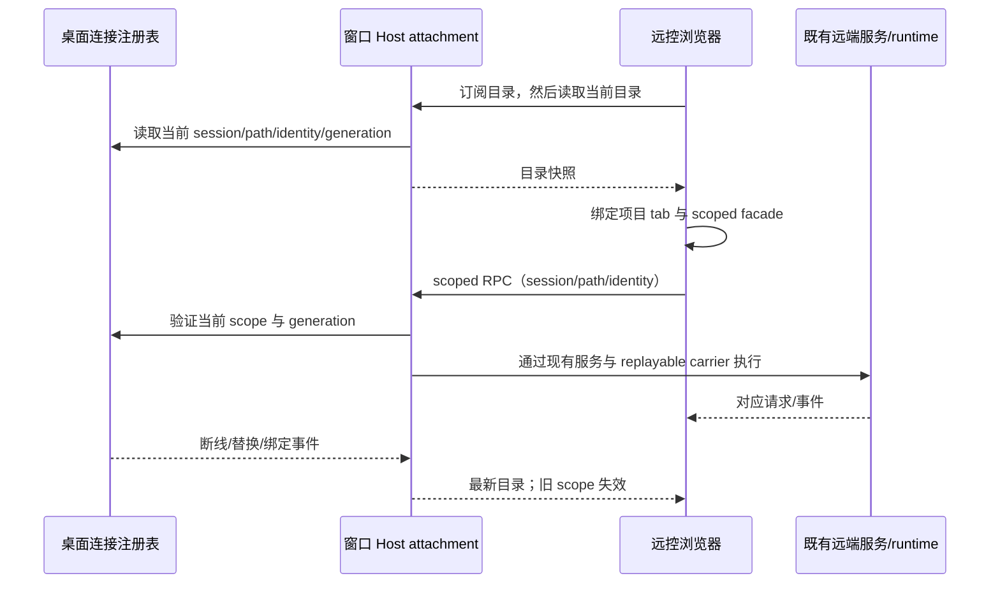

# 远控窗口项目、工作树与分组

## 产品规则

- 已授权远控浏览器展示该桌面窗口已有的本地、SSH、WSL、Docker 项目，复用已有连接和 runtime。浏览器不能自行创建 SSH/WSL/Docker 连接；手动「重新连接」只向该窗口请求恢复已存在的远端项目，由桌面既有重连 owner 执行。
- 项目路径用于 IO，身份使用 `workspaceIdentity?.trim() || workspacePath`。在线远端调用必须携带当前 `remoteSessionId`、路径和 identity，三者匹配窗口连接注册表；旧 session、错窗口、断线和迟到回包明确拒绝，禁止查询同路径本机或其它 endpoint。
- 房间的单条 replayable attachment 提供窗口目录和 scoped RPC；本地服务仍来自本窗口 Local Host。新配对只绑定可信 windowId 对应的 Local Host，不绑定激活项目的路径/session，切换项目或单个远端断线不能拆掉房间。即使从远端项目发起配对，浏览器根服务也必须解析到本地窗口，项目服务按目录分别绑定。Main 原有 remote target 的完整校验保留用于兼容入口。
- 目录从窗口连接注册表派生；连接、绑定、关闭和替换触发同一事实源的变更事件。浏览器先订阅再读取，忽略迟到旧读取；会话代理只有当前目录在线时可用。断开后保留项目占位，重连更新代理和 tab；目录投影本身不新建 Host、Agent、连接或业务队列。
- 工作树列表及操作继续调用对应项目 owner 的 worktreeService。身份相同的执行目录和原项目共用已有 scoped facade，工作树归类不能退回本地路径。
- 分组视图读取所有当前 workspace 的 tasks-index 分组与 Controller task facts。不同 Environment 的组 ID 在 UI 投影中隔离；rename/color/delete/order 发回原 owner，跨 owner 的组成员移动明确拒绝。同一 Environment 多项目合并查询；本地原有 ID 和顺序保持兼容。
- 浏览器位置按 identity 恢复远端项目；远端重连 session 换代时采用目录里的新 session。失效 identity 回默认草稿，不按同路径恢复本地任务。浏览器选择仍不写桌面 lastWorkspaceSession/recentProjects。
- `.artifacts` 为生成产物目录，根 Lint 忽略该目录；不删除用户产物，不关闭源码 max-lines。

### 远控手动重新连接（2026-10-15）

- 根因：Web shell 的 `allowRemoteWorkspace=false` 禁止浏览器建连，但侧栏继续调用桌面 `useRemoteWorkspaceHistory.handleReconnectRemoteWorkspace`；其门禁抛出异常，按钮 fire-and-forget 没有显示失败。不能通过开启 Web 建连绕过平台边界。
- 浏览器从本地 tab 精确解析 path/identity，通过 `IWindowWorkspaceService.requestReconnect` 发送目标；不发送连接参数、凭据、sessionId 或由客户端声明的 owner。Host 严格校验输入，只转交本窗口可信的 local/desktop-continuous attachment 注册的处理者；web-remote-replayable 或远端 attachment 不可注册处理者、不可伪造完成结果。
- Desktop Root 验证相同 path/identity 的远端 tab 仍存在，再调用原 `handleReconnectRemoteWorkspace`（`activateWorkspaceAfterReconnect=false`、`showErrorToast=false`、`throwOnFailure=true`）。历史、凭据、SSH 共享 Host 组重连、canonical path、bind ready、工作树、提交队列和持久化继续沿用既有 owner。手机重连不改变桌面当前项目；浏览器选择也保持原位置。
- Host 仅保存转发中的 RPC 关联，按 identity/path 合并多设备并发请求；完成结果只能由原处理者提交。处理者/端口离开、换代或 Host 关闭立即拒绝挂起请求，旧完成结果不影响新请求；不增加定时重试或业务队列。浏览器仅保存 pending/error 投影，失败可见且允许重试，不静默吞错、不写桌面设置。
- 成功后继续由注册表目录事件恢复当前 session/generation 的 facade；保留错窗口、同路径不同远端、stale run、owner/lease，以及 continuous/replayable 的交付边界。请求不接受新 target；桌面项目已移除时明确拒绝。

## 所有者、接口和交付边界

| 所有者                                 | 状态/接口                                                                                                                      |
| -------------------------------------- | ------------------------------------------------------------------------------------------------------------------------------ |
| WindowRemoteConnectionRegistry         | 既有连接、logical session、generation、availability；目录是其只读投影                                                          |
| Window Host attachment                 | 新增 window-workspace 公共服务：目录读取/事件、严格 scope 的 call/listen；每设备连接级协议 carrier 复用现有 attachment wrapper |
| RemoteServiceAccess                    | 根据 scope 创建 RPC facade，不拥有连接/运行时                                                                                  |
| remoteWorkspaceSessionStore / TabStore | 目录派生的客户端代理和项目 tab，拒绝旧代或本地 fallback                                                                        |
| tasks-index / worktreeService          | 分组及工作树的唯一持久 owner，UI 仅合并投影                                                                                    |

Desktop 继续 desktop-continuous；浏览器各 scoped carrier 使用 web-remote-replayable，沿用 snapshot/gap repair、CommandInbox admission、owner/lease 和 stale-run 校验。

## 验收

1. 同一路径分别有本地、SSH、WSL、Docker 项目；浏览器 390/1280 宽度均展示，选择、刷新及重开保留 identity，不串 Host。
2. 远端工作树列表、分类和文件/任务访问来自远端；断线不调用本机，重连 session 换代后继续读取新代理。
3. 本地/远端同名同 ID 分组共存；读取、rename/color/取消分组、同 owner 排序分别调用对应服务；跨 owner 移动在任何写入前拒绝。
4. 正确 scoped call/listen、非法 scope/内部 channel/过期 generation、迟到回包、独立设备 carrier 及释放均有真实生产 adapter 回归。
5. 既有远控回归、浏览器位置恢复回归、根 typecheck/lint/changed architecture 和修改文件格式检查实际执行。真机和线上部署未执行则明确报告。
6. 390/1280 浏览器实际点击 SSH/WSL/Docker 的重新连接按钮，原本禁用 Web 建连时仍由桌面处理一次；重复点击/两设备同目标不重复建连，失败可见且可重试，目标移除及可信处理者退出不挂起。同路径本地和其它远端、桌面当前项目及设置保持隔离。真实 RPC adapter 验证恶意注册/完成、迟到结果和严格 schema；不以夹具直接替换目录冒充按钮链路通过。

## 本地验证（2026-10-14）

- 修复前新增项目恢复断言实际失败：SSH/WSL/Docker 列表为空；新增窗口 target 断言也复现了项目切换导致 target 变化。
- `pnpm test:remote-control`：106/106。包含目录事件/迟到初读、identity/session 换代、跨 owner 分组拒绝、真实客户端 call/listen、Host 注册表和既有配对/帧泵回归；补跑 connection scope 的 continuous/replayable 与能力门禁 4/4。
- 浏览器执行新的窗口目录场景、既有浏览位置 2 个场景及工作树侧栏 2 个场景，均通过。390/1280 宽度验证四类项目、工作树和同 ID 分组、选择与刷新、WSL 单独断线不拆 SSH/Docker 代理、重连后的分组读取和 SSH 改名路由。Host 数据服务为夹具，运行生产 hooks/stores；未进行真实 SSH/WSL/Docker 联调或手机真机验证。
- 根 typecheck、lint、changed 架构检查通过，架构 baseline/new 为 0。Lint 排除 `.artifacts` 生成目录，源码约束保留；过期配对文案断言改为验证当前 locale。
- `pnpm build:mobile-web` 和桌面 `build:no-runtime-assets` 通过，已装配本地 Worker public。构建仍有已有 chunk 大小/动态导入提示；未部署 Worker 或发布安装包。
- 唯一 owner 仍是窗口连接注册表、tasks-index 和 worktreeService；新增 Web/UI/client/services/shared/desktop 适配器只处理目录投影和服务路由。生产源码净增 792 行，不含测试、文档和配置；35 个本轮文件的格式检查通过。

## 远控按钮重连修复验证（2026-10-15）

- freshness 通过；修改前后架构 total/baseline/new 均为 0，读取 ui、desktop、services、shared 的受控上下文。配置与连接 owner 不变：Host 只关联转发 RPC，Desktop 仍执行既有重连，目录只投影注册表事实。生产源码新增 378 行、删除 3 行，净增 375 行，不含测试、夹具、文档和配置。
- 最终根 `pnpm typecheck`、`pnpm lint` 通过。19 个本轮文件格式检查、diff 空白检查及 feature graph 的 YAML/唯一 ID/关系端点与 rank/6 个远控代码种子验证通过。已有 `.artifacts` 保留，Lint 继续只排除生成目录。
- `pnpm test:remote-control`：111/111；新增 4 个真实 `RemoteServiceAccess → ProxyChannel → Host attachment` 重连转发回归及 1 个 Desktop 目标解析回归。覆盖同窗口多设备合并、同路径 SSH/WSL/Docker 隔离、web 注册/伪造结果拒绝、额外连接字段与本地 identity 拒绝、处理者退出/换代、过期完成结果、错窗口与失败后重试。额外 continuous/replayable connection scope 4/4 通过。
- 浏览器新增 1 项测试，在 390px 英文暗色和 1280px 中文亮色中运行真实 `WorkspaceSidebarItem`、Desktop/Browser 重连 hooks、tab store 与目录投影。实际点击三个远端项目的「重新连接」，验证等待反馈、服务换代、失败提示/重试、与桌面同时发起时复用同一执行结果、桌面项目移除、处理者退出和无横向溢出；本地同路径项目、其它远端、桌面焦点和设置写入均不受影响。浏览器平台建连回调调用次数为 0。服务/连接边界由夹具模拟，未进行真实 SSH/WSL/Docker 或实体手机联调。
- `pnpm build:mobile-web` 和桌面 `build:no-runtime-assets` 均成功；确认 Web dist、Worker public、桌面 renderer 和 Host bundle 都包含重连接口。本地 Worker public 已重新装配；桌面构建沿用默认 test/preview 环境，没有生成安装包。构建仍有已有 chunk 大小、无效动态导入、Vite `__dirname` 和 shell 弃用提示；未部署线上、未重启用户当前窗口，也未提交或推送。
- 原回归覆盖的是桌面已恢复连接后的目录同步，缺少远控按钮发起请求；这次新增实际按钮链路回归，防止再次把目录夹具换代当作重连功能已覆盖。截图在 `.tmp/remote-workspace-reconnect/`。
