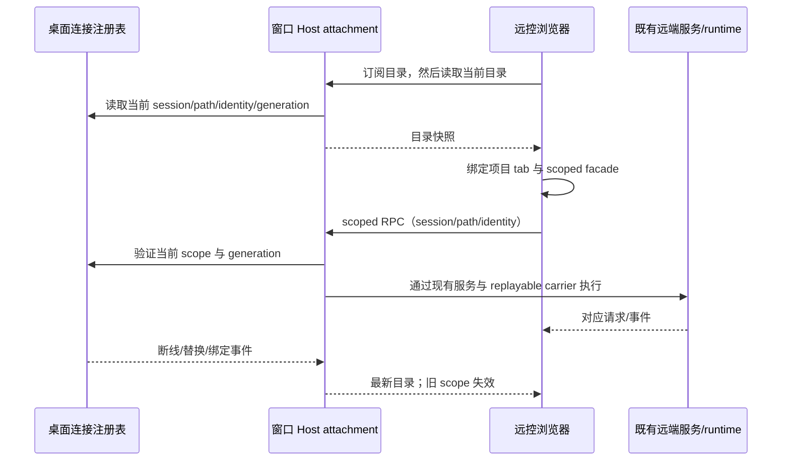

# 远控窗口项目、工作树与分组

## 产品规则

- 已授权远控浏览器展示该桌面窗口已有的本地、SSH、WSL、Docker 项目，复用已有连接和 runtime。浏览器不能创建 SSH/WSL/Docker 连接。
- 项目路径用于 IO，身份使用 `workspaceIdentity?.trim() || workspacePath`。在线远端调用必须携带当前 `remoteSessionId`、路径和 identity，三者匹配窗口连接注册表；旧 session、错窗口、断线和迟到回包明确拒绝，禁止查询同路径本机或其它 endpoint。
- 房间的单条 replayable attachment 提供窗口目录和 scoped RPC；本地服务仍来自本窗口 Local Host。新配对只绑定可信 windowId 对应的 Local Host，不绑定激活项目的路径/session，切换项目或单个远端断线不能拆掉房间。即使从远端项目发起配对，浏览器根服务也必须解析到本地窗口，项目服务按目录分别绑定。Main 原有 remote target 的完整校验保留用于兼容入口。
- 目录从窗口连接注册表派生；连接、绑定、关闭和替换触发同一事实源的变更事件。浏览器先订阅再读取，忽略迟到旧读取；会话代理只有当前目录在线时可用。断开后保留项目占位，重连更新代理和 tab，不新建 Host、Agent、连接或业务队列。
- 工作树列表及操作继续调用对应项目 owner 的 worktreeService。身份相同的执行目录和原项目共用已有 scoped facade，工作树归类不能退回本地路径。
- 分组视图读取所有当前 workspace 的 tasks-index 分组与 Controller task facts。不同 Environment 的组 ID 在 UI 投影中隔离；rename/color/delete/order 发回原 owner，跨 owner 的组成员移动明确拒绝。同一 Environment 多项目合并查询；本地原有 ID 和顺序保持兼容。
- 浏览器位置按 identity 恢复远端项目；远端重连 session 换代时采用目录里的新 session。失效 identity 回默认草稿，不按同路径恢复本地任务。浏览器选择仍不写桌面 lastWorkspaceSession/recentProjects。
- `.artifacts` 为生成产物目录，根 Lint 忽略该目录；不删除用户产物，不关闭源码 max-lines。

## 所有者、接口和交付边界

| 所有者                                 | 状态/接口                                                                                                                      |
| -------------------------------------- | ------------------------------------------------------------------------------------------------------------------------------ |
| WindowRemoteConnectionRegistry         | 既有连接、logical session、generation、availability；目录是其只读投影                                                          |
| Window Host attachment                 | 新增 window-workspace 公共服务：目录读取/事件、严格 scope 的 call/listen；每设备连接级协议 carrier 复用现有 attachment wrapper |
| RemoteServiceAccess                    | 根据 scope 创建 RPC facade，不拥有连接/运行时                                                                                  |
| remoteWorkspaceSessionStore / TabStore | 目录派生的客户端代理和项目 tab，拒绝旧代或本地 fallback                                                                        |
| tasks-index / worktreeService          | 分组及工作树的唯一持久 owner，UI 仅合并投影                                                                                    |

Desktop 继续 desktop-continuous；浏览器各 scoped carrier 使用 web-remote-replayable，沿用 snapshot/gap repair、CommandInbox admission、owner/lease 和 stale-run 校验。

## 验收

1. 同一路径分别有本地、SSH、WSL、Docker 项目；浏览器 390/1280 宽度均展示，选择、刷新及重开保留 identity，不串 Host。
2. 远端工作树列表、分类和文件/任务访问来自远端；断线不调用本机，重连 session 换代后继续读取新代理。
3. 本地/远端同名同 ID 分组共存；读取、rename/color/取消分组、同 owner 排序分别调用对应服务；跨 owner 移动在任何写入前拒绝。
4. 正确 scoped call/listen、非法 scope/内部 channel/过期 generation、迟到回包、独立设备 carrier 及释放均有真实生产 adapter 回归。
5. 既有远控回归、浏览器位置恢复回归、根 typecheck/lint/changed architecture 和修改文件格式检查实际执行。真机和线上部署未执行则明确报告。

## 本地验证（2026-10-14）

- 修复前新增项目恢复断言实际失败：SSH/WSL/Docker 列表为空；新增窗口 target 断言也复现了项目切换导致 target 变化。
- `pnpm test:remote-control`：106/106。包含目录事件/迟到初读、identity/session 换代、跨 owner 分组拒绝、真实客户端 call/listen、Host 注册表和既有配对/帧泵回归；补跑 connection scope 的 continuous/replayable 与能力门禁 4/4。
- 浏览器执行新的窗口目录场景、既有浏览位置 2 个场景及工作树侧栏 2 个场景，均通过。390/1280 宽度验证四类项目、工作树和同 ID 分组、选择与刷新、WSL 单独断线不拆 SSH/Docker 代理、重连后的分组读取和 SSH 改名路由。Host 数据服务为夹具，运行生产 hooks/stores；未进行真实 SSH/WSL/Docker 联调或手机真机验证。
- 根 typecheck、lint、changed 架构检查通过，架构 baseline/new 为 0。Lint 排除 `.artifacts` 生成目录，源码约束保留；过期配对文案断言改为验证当前 locale。
- `pnpm build:mobile-web` 和桌面 `build:no-runtime-assets` 通过，已装配本地 Worker public。构建仍有已有 chunk 大小/动态导入提示；未部署 Worker 或发布安装包。
- 唯一 owner 仍是窗口连接注册表、tasks-index 和 worktreeService；新增 Web/UI/client/services/shared/desktop 适配器只处理目录投影和服务路由。生产源码净增 792 行，不含测试、文档和配置；35 个本轮文件的格式检查通过。
