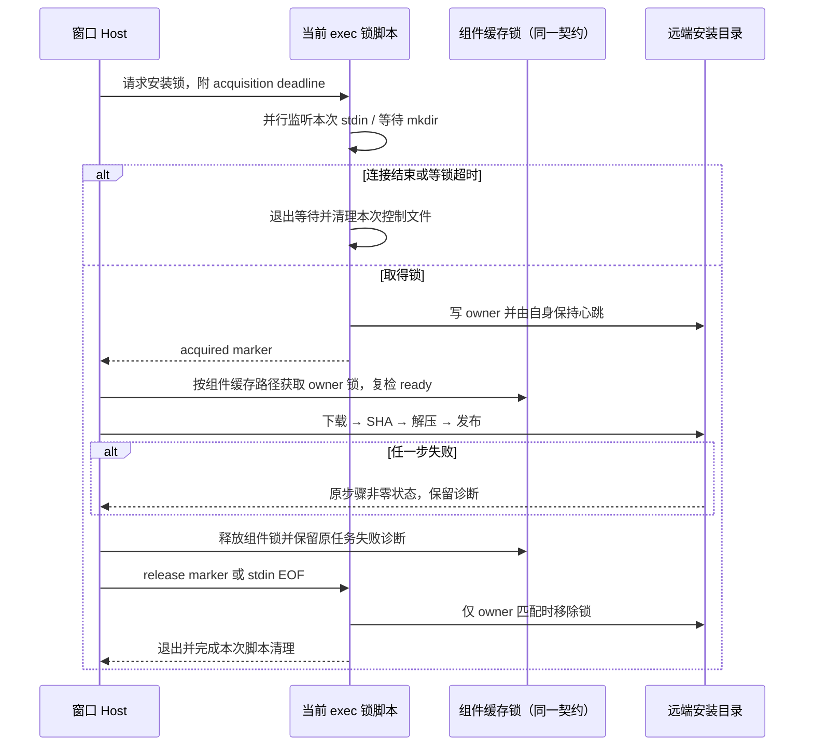

# 远端部署等待与失败收敛

## 产品规则与所有者

- 同一远端用户安装目录继续由 install-root lock 串行部署；不能删除仍被其他部署者持有的锁，也不增加等待时限掩盖失败。
- 锁持有脚本是远端锁的唯一所有者。它从等待阶段开始监听本次 exec 的 stdin；连接结束或客户端超时关闭 stdin 后，等待者退出，持有者只释放匹配自己 owner token 的锁。
- 客户端和远端脚本均执行同一 acquisition deadline。远端按 POSIX 秒级时钟取整，不能在期限过后取得锁，也不能留下无限等待的 holder 脚本。错误中的 owner 是本次请求 token，不应冒充当前占锁者。
- 本次 exec 的控制 marker 使用 owner 专属临时文件及原子发布；清理只涉及自己的脚本、控制文件与已确认 owner 的锁目录。心跳由持有脚本本身执行，不留下独立心跳进程维持假活跃状态。
- RemoteDownloadAssetInstaller 继续负责组件 SHA 校验、缓存与发布。下载、校验、解压任一步失败，必须返回该步骤的非零状态，不执行后续复制、不发布 `.ready`；清理不得把失败改成成功。
- 组件只在下载、SHA 和解压全部成功后发布。使用换行与 `set -e` 表达阶段顺序；具有内部状态捕获的下载片段放在独立子 shell 中，避免分号截断外层 `&&` 链。
- 不改变 mise 的固定制品、版本、必需成员与签名链，不回退远端 PATH。此次范围只修复锁生命周期及失败传播。
- 不改变 workspaceIdentity、remoteSessionId、owner/lease、Desktop continuous 或手机 replayable 的业务语义；这里只处理运行时启动前的部署事务。

## 追加审查规则

- 组件缓存锁复用既有 acquireRemoteDeployLock，同样按 owner、stdin EOF 和 120 秒 acquisition deadline 收敛。不能在 installer 中另留一个无期限 mkdir 循环。锁内复检 `.ready`；失锁后禁止发布缓存，失败只清理本次 staging。
- 进度统计 HEAD 是可选元数据：每次请求最多 5 秒，接收当前连接取消信号；HEAD 失败继续实际下载，连接已取消则不发起下载。
- 目录安装的必需文件先从 release path 映射到组件内路径，包含 mount 下的子目录。新下载也验证当前调用方必需成员，通过后才写 `.ready`；旧缓存不完整可重新下载一次，新制品仍缺文件则直接失败，不靠重复下载隐藏发布缺陷。
- `scripts/cleanup-remote-deploy.sh` 是 Linux 主机的显式维护入口。执行前退出该 SSH 账号的 LCode 客户端；脚本按当前 UID 和固定部署命令路径结束旧 holder / asset-cache 子进程，再清理固定安装目录的锁、辅助文件与平台/组件/cache 三层组件锁。进程尚未退出则保留锁；组件制品、会话和项目文件均保留。
- 维护脚本不登录远端、不读取凭据；不会使用 sudo，不停止正常的 lcode-server / Agent。维护脚本的回归以隔离 HOME 和模拟进程命令验证删除范围与阻断行为，真实进程选择规则另用正反例验证。

## 验收

1. 有正常部署者占锁时，本次请求超时或 stdin EOF 后远端等待脚本退出，其他部署者的 owner 文件保留；共享 backend 不被等待者直接释放。
2. 取得锁后 stdin EOF 释放自己的锁；正常 release 幂等，立即结束 exec，不遗留心跳进程或控制文件。
3. 模拟 SSH 中客户端关闭流未送达时，远端 acquisition deadline 仍能独立结束等待。
4. 实际 POSIX 命令下载得到 HTTP 失败或错误 SHA 时，部署在该步骤失败，不出现后续 `cp: cannot stat`，组件缓存与 `.ready` 不发布。
5. 成功下载真实 fixture 归档后，完整 mise 目录可部署；既有缓存复用与本地上传行为保持一致。
6. 运行锁、mise、资源安装回归、根 typecheck、lint、changed architecture 和格式检查。夹具使用临时 HOME 与本地 HTTP；未连接另一位用户的真实主机时必须说明。
7. 组件已有活跃锁时本次超时退出且保留占锁者；HEAD 半开时进度降级，取消不启动下载；正确 SHA 的不完整归档不发布 ready；组件子目录的完整缓存命中不重复下载。

## 已存在的旧脚本

旧客户端留下的 holder 脚本不会在新客户端启动时被自动终止。恢复必须由该远端用户先停止重连，核对安装目录的 owner 和对应 holder 进程；确认是遗留部署后结束这些确切进程，再清理该安装目录的 `.deploy.lock`。保留服务器资源、会话与项目文件。无法确认占锁者时保留锁，不通过删除活跃锁抢占安装目录。

## 验证记录（2026-10-14）

- 先在真实 POSIX 临时目录复现等待者收到 EOF 后不退出、客户端超时后远端仍等待；修改后验证取消、独立 deadline、EOF 释放、幂等释放和真实并发 owner 顺序。
- 本地 HTTP 回归覆盖 404、SHA 错误、无法解压及成功冷下载；失败直接传播原步骤状态，没有后续复制与 ready 发布。测试执行同一脚本内容；Windows 夹具采用落盘执行，避免 Git Bash 重组长 `-c` 参数。
- `pnpm test:remote-assets`：28/28 通过，新的锁和下载回归已进入既有 tag 发行门禁。
- mise 与安装目录边界定向测试：29/29 通过；随后新增的并发 owner 场景与边界组合：5/5 通过。
- `pnpm typecheck`、`pnpm lint`、本次文件 `oxfmt --check` 和 `git diff --check` 均通过。类型首轮发现新测试中 Readable/Writable 联合类型赋值错误，已修复并重跑通过。
- changed 架构：violations 0 / baseline 0 / new 0。变更属于 legacy server 模块及测试入口，没有新增业务状态所有者；两个部署实现净增 55 行，fixture 与测试门禁入口各净增 4 行，另新增两个回归文件。
- 未构建安装包、未发布 tag、未连接或修改报告问题的用户主机；该主机此前具体下载失败原因仍需其完整前序日志确认。

## 追加审查验证（2026-10-14）

- 新增回归先复现四处缺口：缓存组件锁无 deadline、HEAD 不接收取消、缺必需成员仍继续复制、子目录缓存被误判缺失。修复后 9 个真实 POSIX 下载场景通过，覆盖 HEAD 半开降级与中止。
- `pnpm test:remote-assets` 36/36 通过；mise 与 install-root 边界回归 22/22 通过。随后维护脚本补充查询失败阻断，4/4 清理回归通过，已由同一 tag 门禁入口加载。
- 清理脚本实际执行于隔离 HOME，进程信号使用桩；POSIX 模式正反例匹配使用真实 grep。保留资源/项目、停止不了进程及进程查询失败时保留锁均验证。`bash -n` 通过；未在问题主机执行。
- `pnpm typecheck`、`pnpm lint` 与 changed 架构检查通过，violations / baseline / new 均为 0。状态所有者保持远端锁脚本与现有 installer；组件锁复用既有 owner/EOF/deadline 接口，不新增并行的业务状态或兜底写入路径。三个部署实现相对提交基线共净增 106 行。
- 本次仍未构建安装包、发布 tag 或访问其他用户的 SSH 主机。需由用户发布修复客户端，并在原远端账号下完成一次显式旧部署清理。
