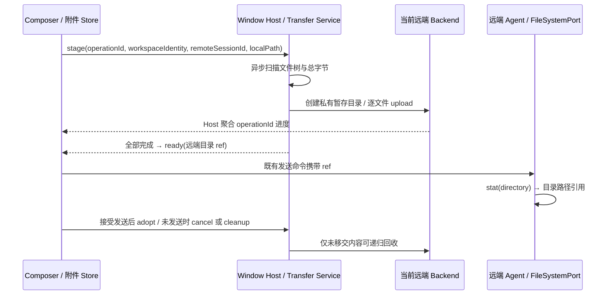

# 远端工作区文件夹附件

## 产品规则与接口

- Desktop 从本机拖入的文件夹沿既有 `prompt-attachment-transfer.stage` 上传到当前 SSH/WSL/Docker workspace；文件夹作为一个附件，保留相对文件名、子目录和空目录，不要求用户预先压缩。
- Host 用异步文件系统 IO 区分文件与目录；`IRemoteBackend.upload` 继续只上传单个文件。目录遍历与聚合进度由 Host 附件物化入口负责，所有后端复用同一实现，不修改任务流或附件引用协议。
- 目录不按名称推断成图片/PDF。交付的 ref 是远端目录路径，Agent 通过 FileSystemPort 的 stat 识别目录，给模型可供目录浏览、文件读取工具使用的路径引用，不产生 `attachment_not_file` 错误，不预读整个目录。
- `PromptAttachmentStageResult` 新增可选 `mime`，Host 对目录返回 `inode/directory`，Composer 使用其覆盖基于文件名推断的 MIME；旧服务缺省时维持原文件语义。AttachmentRef 的既有 mime 字段与运行时 schema 保持不变。
- 保留文件层级与 Unicode/空格/引号名称；目录权限为 700，普通文件为 600，原来可执行的文件保留所有者执行位（700）。不跟随符号链接、junction 或特殊文件；发现时明确失败，避免递归环和上传目录以外的内容。
- 大目录按文件流式传输，不把内容整体读进内存。进度为本次扫描所有普通文件字节之和，每个文件的进度累加到同一 operationId；空文件夹完成后仍进入 ready。

## 所有者、时序与失败语义

- ComposerAttachmentUploadStore 仍为草稿附件唯一 owner，transfer service 的 records 仅拥有本次 operationId 的取消句柄、暂存 ref 和 adopt 生命周期，不新增队列或持久化状态。
- 保留 workspaceIdentity / workspacePath fallback、remoteSessionId、owner/lease 和现有路由。暂存仍位于用户私有根目录下的 trace/随机 nonce；重试使用新 nonce，迟到结果不得覆盖新 operation。
- 先建立本次私有隔离根并扫描，完整校验后创建目录树、上传文件并收紧权限；全部完成且取消信号未触发才返回 ready。失败/取消/删除回收整份目录；删除只接受物化入口生成的三段附件路径，不允许删除附件根、trace、nonce 或穿越路径。adopt 后交由会话持有，清空草稿不得删除已发送内容。
- 历史清理以 nonce 暂存目录的存活时间为边界，避免启动清理误删仍有效的空文件夹。
- Desktop continuous 与手机 replayable 仍共享原 Host owner 和会话语义；本次只扩展 Desktop 本机路径的暂存能力，不改变手机分块上传、snapshot、queue、重连和 replay。
- 附件短命令的 stdout 读取必须同时等待退出码和输出 end，不能假定 SSH exec 的 exit 通知意味着 stdout 已派发完毕。否则读取 HOME 会拿到空值。不改变后端现有长连接完成语义，不引入超时。

## 验收场景

1. 原单文件上传仍只调用一次 backend.upload；进度、权限和内容路径替换不回归。
2. 含嵌套目录、空目录、空文件、中文/空格/引号文件名的目录上传成功，文件内容保持一致，总字节正确，返回远端目录 ref。
3. 上传中取消、其中一个文件失败、权限设置失败均不返回 ready，整个本次暂存目录被清理；重试与另一 operation 的目录不受影响。
4. 同名目录、不同 workspace identity / remoteSessionId 的暂存互不覆盖；adopt 后清空草稿不删除已发送 ref。
5. 根目录/trace/nonce/越界 ref 的 cleanup 无副作用；符号链接不被跟随。
6. Agent 目录附件输出目录浏览提示，无 `attachment_not_file`；普通文件与不支持的节点保持原语义。
7. 浏览器场景走真实 Composer 的拖拽 → stage → 进度/ready → 发送，发送仅携带远端 ref；失败可见、未完成时不可发送，移除调用取消。
8. 本地回环 SSH 服务通过真实 SSHBackend/SFTP 上传中文/引号子路径、空文件，校验接收到的字节；短命令同时发 stdout 与 exit 时仍能读到 HOME。

## 本次验证

- `node --import tsx --test packages/desktop/src/host/remotePromptAttachments.test.ts apps/lcode-cli/packages/core/src/runtime/helpers/attachments-directory.test.ts scripts/remote-directory-attachments.ssh.test.mjs`：10 项通过。
- `node --import tsx --test packages/web/test/remote-directory-attachments.test.mjs`：真实 Composer、Host 暂存、宽屏/窄屏、取消及失败门禁通过。
- 根目录 `pnpm typecheck`、`pnpm lint`、`pnpm architecture:check --changed`，以及 CLI 的 typecheck、lint 通过。架构新增违规为 0。
- 扩大的 conversation-send 浏览器回归有 4 个工作树准备完成后定位按钮超时（父测试也报告失败）；使用 HEAD 版 Composer 夹具单独复现同样缺失，不属于本次附件变更。没有将该套件记为全通过。
- 本次运行于 Windows；SSH 为本地回环服务，未操作用户远端主机，也未替换已安装的客户端。
