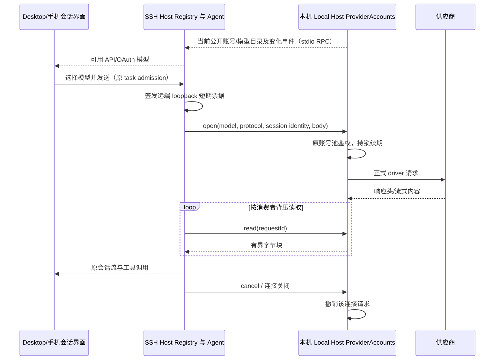

# SSH 会话使用本机 API 与 OAuth 供应商

## 产品规则与边界

- Desktop 远程工作区的 API Key Provider 沿用已有 Personal Config provisioning；目标 Registry 仍是会话模型选择的事实来源。
- Desktop 已登录的 OAuth 账号（全部正式注册渠道，包含账号式 API 授权）通过当前 SSH/WSL/Docker stdio 连接使用。连接完成前，远端 Registry 必须已读取本机账号目录；不再只显示 API Provider。
- OAuth 授权、模型目录、账号启停/删除、账号池、续期及供应商网络出口由本机 window-scoped Local Host 的 ProviderAccounts 唯一负责。远端不复制 grant、refresh token、主机标识或整个 Credential Store，不另建登录 owner。
- 远端只持有公开账号/模型投影和当前连接的请求通路。Agent 使用远端 loopback 短期票据，模型请求通过受信 stdio RPC 回到本机；本机再通过原 ProviderAccounts 的受控 transport 调用正式 driver。请求地址、认证与账号池不能由远端随意指定。
- API 请求沿现有路径从 SSH 主机访问供应商；OAuth 请求从本机 Host 访问供应商。文件、Shell、技能、工作树和任务运行时仍在目标 SSH 主机。手机 attachment 沿用同一远端会话 owner 与通路。
- 本机账号新增、删除、禁用及模型目录刷新事件更新远端 Registry/选择器；无须重连。不凭借菜单可见声明授权永久有效；上游真实错误仍由现有 driver 处理。

## 接口与事件顺序

- shared 定义私有 relay channel 名称、启动标志、能力协商、严格模型请求/响应头/分块 schema。Services Node 提供本机 relay source 与远端 relay adapter；两者通过进程内 side table 管理，不把 relay methods 注册到 Renderer 或 HTTP 服务集合。
- Server stdio 复用同一 SocketProtocol 的双向 ChannelClient/ChannelServer。客户端收到服务端 Initialize 后才发送反向 Initialize，防止服务端初始化期间丢失握手帧。
- 每条物理连接创建独立 relay source，requestId 为 UUID，只可在该连接内 open/read/cancel。open 先登记 AbortController，再等待本机鉴权和响应头；read 最多返回 64 KiB，逐块 pull 实现背压；请求最多 32 MiB。只转发模型协议允许的头，临时票据不进入远端 RPC、日志或厂商网络。
- 会话归属沿用请求中的 workspace identity key 与 sessionId；请求 ticket 沿用原 Pool/generation/file lock。远端请求取消、transport 关闭或 Host dispose 会撤销本连接所有请求和票据；迟到 open/read 不能复活已撤销请求。模型流不在 reconnect 后重播。
- Desktop continuous 和手机 replayable 的会话事件语义保持原有差异；relay 只承接模型 HTTP 字节流，不拥有 CommandInbox、会话快照或 accepted 队列。
- 启动标志只由可信 Desktop Host 注入。旧 server 不支持 relay 时明确拒绝发布远程 attachment，提示更新远端资源；普通不启用 relay 的 Server/CLI 继续使用其自身账号。

## 验收与测试

1. 本机 API Key 与所有注册 OAuth 渠道在远端 Registry 中可选择；三种模型协议均实际穿过双向序列化 RPC、远端票据与原本机账号池执行，流式工具调用和 usage 字节保持一致。
2. 本机账号禁用/删除立即影响远端目录与调用；新增/重新授权/目录刷新传播事件，原账号池的代际与并发刷新锁保留。
3. 多连接使用同一本机 ProviderAccounts，关闭一条连接只取消自己的请求；取消在响应头前、流式中及迟到返回均不泄漏请求或重放。
4. 接受严格的 channel/model/protocol/session/requestId/body schema；拒绝未知请求、重复请求、超限体积、额外认证头与不匹配模型。共享 RPC 返回及公开 View 不含 OAuth grant 或 refresh token。
5. 初始化顺序、能力协商与启动标志覆盖实际 remote connect/stdio 装配，原不启用 relay 的路径保持兼容。执行定向回归、typecheck、lint、架构检查；不使用真实账号或改写用户配置进行测试。

## 验证记录（2026-10-13）

- `pnpm test:remote-providers` 13 项通过：真实双向序列化 RPC、25 个注册 OAuth 渠道与 API 同目录、三种模型协议、原 owner 的授权/删除/禁用及手动模型、迟到取消、连接隔离、64 KiB 分块、上游状态与旧 Server 能力协商。
- 原账号池、跨窗口凭据刷新/模型目录、Host 作用域与 SSH Shell/环境 owner 回归 19 项通过；CLI 正式 OAuth binding、runtime headers 与账号同步 5 项通过；`pnpm test:remote-control` 76 项通过。
- 浏览器：中英文 × 1280/390 px × 首发/已有会话，共 8 组，每组切换并发送全部六个供应商；既有速度菜单 8 组同时通过，两文件合计 18 个 Node test 结果通过。
- `pnpm typecheck`、`pnpm lint`、`pnpm architecture:check --changed` 通过，架构 0 violations / 0 baseline / 0 new。
- tag 构建与发行资源门禁 39 项通过；增加测试脚本后使用仓库生成器刷新 NOTICE inventory 输入摘要，许可正文与依赖清单未变化。
- 自动化使用独立目录、虚拟上游与隔离浏览器，未改写用户账号。未构建安装包、发布 tag 或用真实 SSH 主机/厂商账号验收；用户重建 Desktop 与同版本远端资源后断开重连应用新链路。
