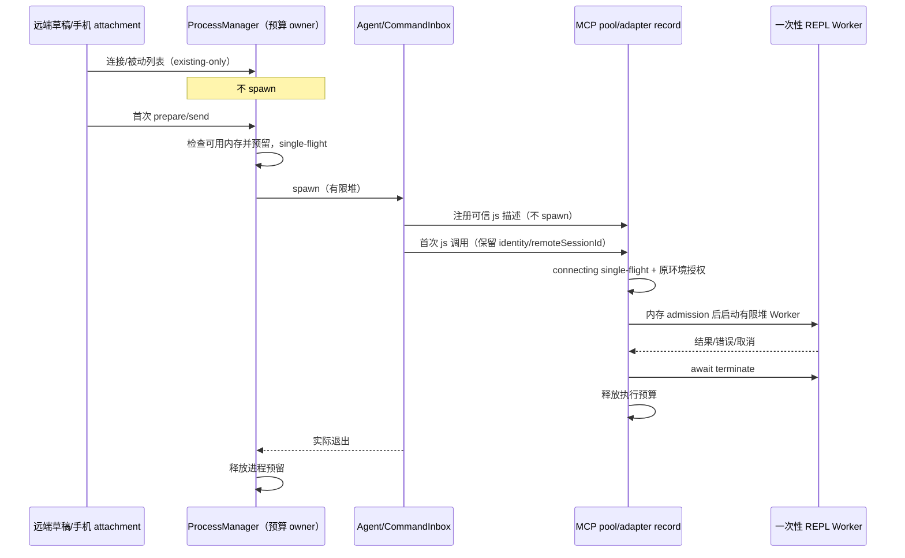

# 远端运行时按需启动与内存预算

## 产品规则与边界

- 连接 SSH、打开远端项目或空白草稿不创建执行会话。远端草稿不做后台 Agent 预热；首次提交沿用现有 prepare/send 与 CommandInbox admission。显式打开历史、配置探测或工具调用属于真实需求。
- 远端草稿的命令目录不在连接时水合；用户输入 `/` 请求命令候选时，沿用已有 workspace presentation RPC 按需水合，不创建草稿会话或启动 REPL。
- 启用 Browser Use / Computer Use 仅注册内置 node_repl 的可信工具描述，不启动 MCP 子进程。首次 js 调用通过原 MCP adapter/pool 建连；并发首次调用共享同一 connecting promise，保持 workspace isolation、environment 授权与 generation 防护。用户配置不能注入宿主工具描述。
- 本地草稿预热保持原行为。桌面 continuous 和手机 replayable 复用相同 runtime owner；手机 attachment 不新建 Agent。
- 全部能力开启时仍按实际使用加载。Node REPL 控制进程不加载执行器；执行器仅在一次性 Worker 内加载。低内存环境下，同一工作区共享 REPL 宿主的跨会话调用只允许一个执行 Worker，超出预算返回明确可重试的资源错误，不额外保存已接受任务队列。
- 调用成功、异常、取消、超时、Worker 堆耗尽都须等待 Worker 真正退出后释放预算。失败不能击穿 MCP 控制进程，下一次调用可恢复。未执行的 js 不产生 Worker。

## 所有者与接口

- Agent 创建/复用/退出：现有 LCodeAgentProcessManager；预算预留属于该进程所有者，启动失败或实际退出才释放，不按超时猜测退出。
- SSH 的物理连接缓存不代表工作区仍持有执行进程。复用现有窗口连接注册表的 workspace generation/owner 与 running-task 门禁：最后一个逻辑所有者释放且任务数为零时，SSH 与 WSL 都通过原 releaseWorkspacePreparation 回收该工作区 Agent；共享所有者、运行任务、正在回收时重新挂载均须受原代际屏障保护。Docker 仍由独占连接释放整棵进程树。
- 内置工具描述：contracts 的 node_repl tool contract；bootstrap 只给可信 builtin config 附加 `onDemandTools`。adapter record 是连接和工具状态唯一所有者，pool 保持原 lease 机制。
- `onDemandTools` 是宿主内存字段，不持久化；公共 MCP 配置严格 schema 继续拒绝。已注册但未连接的服务状态为 disconnected，toolCount 为可信描述数量，不能伪报 connected。显式 connect/刷新仍可真实建连。
- 首次启动失败后保留真实 failed 状态；新会话发现时仍可读取可信静态目录，下一次显式工具调用重试建连，不在后台循环重启。
- 资源探测与预算规则：shared 的独立 Node 入口，读取物理/受限内存及可用内存。常量集中声明；可用内存必须保留系统余量。小于等于 2 GiB 的主机使用低内存配置；Node 堆限额是防护上限，不冒充 RSS 硬限制。生产无需 root/cgroup 权限。
- 当前预算：保留 128 MiB 系统余量，每个 Agent 预留 512 MiB，执行 Worker 预留 192 MiB；低内存时 Agent old-space 上限 256 MiB，REPL 宿主/Worker 上限 96 MiB，单个共享宿主只允许一个 Worker。堆外内存每 100 ms 监测可用量并中止执行；这是主动保护，任意瞬时原生大分配的硬隔离仍由操作系统 cgroup 提供，不能把采样说成 RSS 硬上限。
- Host 内多个工作区的并发启动共享预算预留，不能各自看到相同空闲量后同时启动。已有运行任务不因资源压力被随意杀死；不足时在 spawn 前拒绝，释放后可重试。
- spawn/stdio 写入失败时，请求的发送与响应等待必须同时被观察；transport close 不能在 send 仍未完成时制造 unhandled rejection，导致 Host 本身退出。预算拒绝和进程启动失败都不发布假 runtime-ready。
- Node REPL Worker 同时受并发、可用内存与 V8 resourceLimits 约束。控制进程的轻量依赖与执行依赖分离，保持现有 fresh-kernel、工具 schema、CUA capability 和浏览器 broker 安全边界。
- REPL 发布目录包含固定的 server.js、executor.js、executor-worker.js 三个独立产物，执行器保持真实动态导入，不把动态执行依赖重新内联进控制进程。seed、SEA、Desktop 与远端部署同时要求这三个文件，禁止只更新 server.js。旧单文件 seed 会因缺少必需文件重新生成。
- 普通 Node/Electron Node 模式直接运行可信 bootstrap 选出的内置 REPL server.js，避免每个 MCP 先解析完整 CLI bundle。SEA 没有独立 Node 解释器，保留既有 plugin-host。直接入口在捕获 CUA broker tuple 后立即清除进程环境中的原始凭据，Worker 只接收二次私有 bridge，不能继承原始 Helper 凭据；第三方 MCP 启动方式不变。

## 验收与回归

1. 远端空白草稿不预热；本地草稿仍预热；首次发送、取消及重连 generation 仍正确。
2. 内置工具在发现阶段可见但进程数为零；首次并发调用只启动一个 MCP；禁用、配置变化、close 后旧 completion 不覆盖新 owner。显式第三方 MCP 兼容。
3. 全部官方能力启用后只注册一个共享 node_repl；重复/跨会话 js 调用不会叠加 Worker；取消后无残留，堆耗尽后可再用。真实 browser/CUA 操作以环境实际提供的 broker 为界，不能用普通 JS 冒充设备回归。
4. 预算不足、并发启动、启动失败、退出、再次启动均有测试；不可把业务已接受队列迁移到 Renderer 或预算层。
5. 在局域网机器建立独立测试目录和 systemd cgroup，MemoryMax=1 GiB、MemorySwapMax=0、CPUQuota=200%，不修改现有会话或服务。运行真实构建产物，记录 cgroup memory.current/peak/events、进程树和反复调用结果。验证资源不足时明确拒绝且 SSH/Host 存活；测试后清理测试所有者。
6. 执行根目录与 CLI 的 typecheck/lint、相关单测/集成/E2E及 architecture changed 检查，记录真实结果和未覆盖项。
7. 发送回归沿用当前工作树管理入口（打开设置并选择 binding）；旧夹具中的弹窗定位断言应更新为现有按钮和导航 owner，不恢复已删除的 UI。
