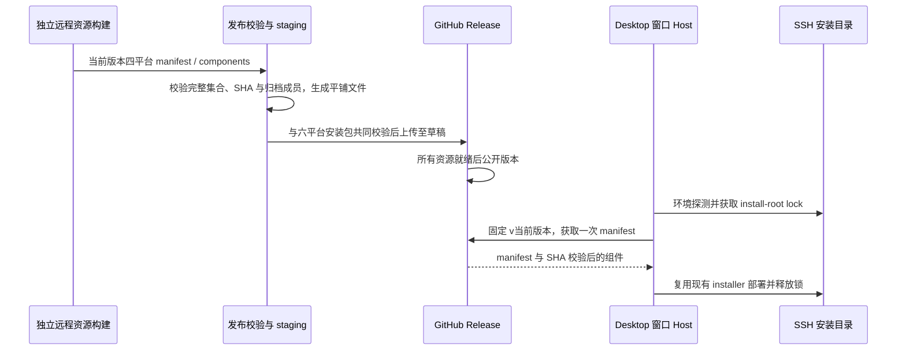

# 安装版远程运行资源发布

## 产品规则

- SSH 已完成环境探测后，安装版必须能下载当前桌面版本的远程 manifest 与其全部组件。
  默认复用 `LCODE_UPDATE_SERVICE_ORIGIN` 的 `/api/v1/releases/download/v<version>/`
  固定版本入口，资源随桌面 GitHub Release 发布。不得读取 latest 或其他版本资源。
- 显式 `LCODE_REMOTE_ASSET_CDN_BASE_URL` 继续优先；显式 `LCODE_CDN_BASE_URL`
  仍使用原 CDN 的 `/lcode/electron/releases/<version>` 布局。开发态继续优先已有 mock-cdn。
- 桌面打包只准备本机目标资源。远程资源独立构建，不塞入安装包，不要求每个桌面目标
  重复构建四个平台的远端二进制。用户自行构建，当前修复不执行安装包构建或发布。
  本地 `$env:LCODE_ENV = 'production'` 后运行
  `pnpm bundle:desktop -- --os win --arch x64` 保持可用，安装包按自身版本使用同一下载入口。
- `pnpm build:remote-release` 复用 `prepare:remote-assets` 构建四个已支持的远端平台，
  再 staging 到 `packages/desktop/dist/remote-release-assets/`。
- GitHub Release 的资源名必须为单段文件名。staging 使用包含平台、组件和完整 SHA-256
  的 `.tar.gz` 文件名，仅改写 manifest 的 artifactPath，保留版本、mount、内容与 SHA。
- staging 和最终发布都校验 schema、应用版本、平台、完整组件集合、mount、文件存在性、
  归档 SHA 和必需成员。缺失、重复组件、路径越界、摘要错误、缺少必需文件均失败；
  不发布只有安装包或只有 manifest 的半成品版本。
- 旧版本 CDN 缺失不通过跳过 SHA、复制旧 manifest 或重新请求不同制品绕过。

## 所有者与接口

| 状态/职责                    | 唯一所有者                      | 接口                                                                |
| ---------------------------- | ------------------------------- | ------------------------------------------------------------------- |
| 桌面版本                     | 根 package.json                 | version                                                             |
| 组件定义、必需成员和源归档   | prepare-prebuilds.mjs           | buildRemoteComponentDefinitions / buildRemoteComponentRequiredPaths |
| 发布 manifest 与归档 staging | stage-remote-release-assets.mjs | stageRemoteReleaseAssets / verifyRemoteReleaseAssets                |
| 已发布固定版本文件           | GitHub Release                  | 现有更新服务只转发下载，不保存业务状态                              |
| 下载源选择                   | Desktop remoteCdn               | 显式覆盖 > 显式 CDN > 固定版本更新服务                              |
| 组件 SHA、缓存、安装目录互斥 | 现有 Host / remote deploy       | 继续使用 pinned manifest、组件缓存和 install-root lock              |

不改变 workspaceIdentity、remoteSessionId、owner/lease、CommandInbox 或业务同步语义。
Desktop `desktop-continuous` 与手机 `web-remote-replayable` 仍由既有运行时交付，
本次只修改它们启动之前的资源分发。

## 验收

1. 未设置覆盖时，安装版按自身版本从现有更新服务读取 manifest 与平铺组件。
   `v<version>` 下载根不重复追加版本；其他版本的固定根在请求前被拒绝。
2. 自定义 CDN 保持原目录规则及跨版本 components 根；固定 tag 的平铺组件只访问该 tag。
3. 四平台完整夹具 staging 后，所有 manifest 引用均可从同一个固定版本根直接获取。
   将该目录作为 HTTP 资源源，实际 manifest parser/cache 完成 Linux x64 资源下载与物化。
4. 缺 manifest、缺组件、重复组件、版本/platform/mount 错误、越界路径、缺归档、
   SHA 不符或归档缺必需成员阻断 staging / collected 校验。
5. Actions 独立构建远端资源，release 必须等待桌面和远端 job，最终上传前验证两者。
   本地桌面 bundle 不隐式构建远端资源。
6. 执行发布回归、下载与 cache 夹具、typecheck、lint、changed 架构检查和改动文件格式检查。
   原生打包、真实 GitHub 发布与 SSH 主机验收由用户后续构建验证，单独注明未执行。

## 本地构建与验证记录（2026-10-13）

本地 Windows 安装包和 tag 构建使用同一下载源选择，不将构建命令与远端分发绑定。
本地新版本也必须先具有对应版本的 Release 资源；未发布的版本不退回旧版本组件。
已有本地资源可以通过 `stage:remote-release` 生成待发布资产，自定义 HTTP 下载根仍可覆盖。

使用 Node 24.21.0 / pnpm 10.34.6 完成以下实际验证：

| 检查                                | 结果                                                                                   |
| ----------------------------------- | -------------------------------------------------------------------------------------- |
| `pnpm test:remote-assets`           | 18 / 18 通过；包含固定 tag HTTP 重定向、全部 Linux x64 组件下载、实际 cache 物化及复用 |
| `pnpm test:release`                 | 85 项，84 通过，1 项 Chromium 场景按平台跳过                                           |
| Desktop mise / 本地打包边界回归     | 9 / 9 通过，保留原桌面打包入口及独立远程资源准备规则                                   |
| `pnpm typecheck` / `pnpm lint`      | 通过                                                                                   |
| `pnpm architecture:check --changed` | 0 违规，baseline 0，new 0                                                              |
| 改动文件格式检查                    | 通过                                                                                   |
| 发行输入新鲜度                      | 已运行 `node scripts/licenses.mjs notices`；完整发布回归确认原材料债务基线未改变       |

先复现默认 CDN 和重复 tag 路径失败，再实现修复。最终检查过程中曾遇到格式化工具的
Windows 写入失败和源文件截断，已恢复对应源文件及本次改动，定向测试和类型检查重新通过。
发行回归首轮因新增命令使 package.json 输入哈希过期失败，刷新 inventory 后通过。

运行代码净增 201 行，测试及夹具净增 475 行，workflow / 命令注册净增 51 行；
不计文档和工作区其他改动。改动涉及 legacy desktop / server 及非 managed 构建脚本，
没有新增运行时状态所有者；发布 staging 是资源输出的唯一写入方，事件顺序见上图。
未构建安装包、未触发 tag Actions、未修改或部署 Worker、未连接真实 SSH 主机。
