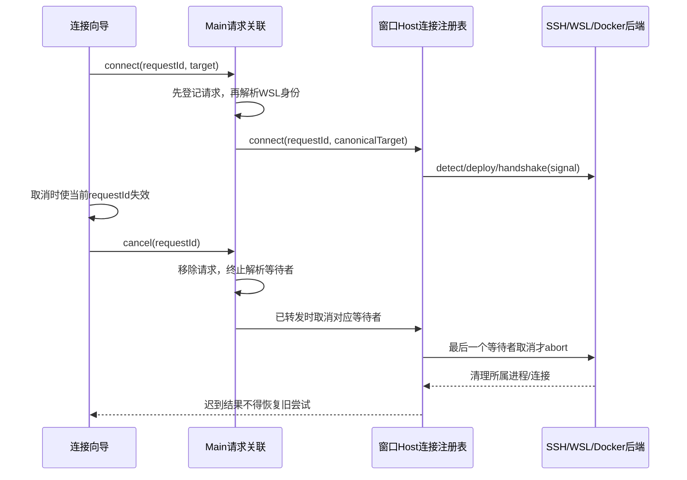

# SSH、WSL、Docker 连接及远程作业修复

## 产品规则与范围

三种连接方式均支持显式取消；取消结果立即结束当前请求，迟到成功必须释放，迟到失败不得重新打开向导或覆盖下一次连接。只收起向导但保留连接的行为不变。

连接请求直到 provider 同步和 Renderer attachment 就绪才完成；中间阶段取消仍能定位并释放已建立的 logical session。用户停留在关闭确认框时若连接完成，确认关闭必须释放最新 session。

- SSH IPv6 工作区身份必须能还原真实路径，支持创建会话、历史读取和工作树身份替换。保留当前已持久化身份格式，包括普通主机、IPv4、裸 IPv6 和带方括号 IPv6；本地路径 fallback 不变。
- Docker 手动输入支持容器名、完整 ID 和唯一 ID 前缀；歧义前缀明确拒绝。仅允许连接运行中的容器。
- 每个窗口的 Host 继续持有远端连接；共享 SSH/WSL 的一个等待者取消不能中断其他等待者。最后一个连接中等待者取消才中止该连接，重试获得新 entry。Docker 保持独立 logical session。
- 所有 transport 部署都使用远端安装目录锁。窗口内 single-flight 不能替代跨窗口、跨客户端的远端互斥。
- 远程作业的 Shell 在执行机器解析；Desktop 的本机 Shell 路径不得经 runtime-preferences 传到远端，见 `remote-workspace-shell-selection.md`。
- API Provider 沿原 provisioning 进入目标 Registry；Desktop 已登录 OAuth 通过当前 stdio 连接复用本机账号 owner，详见 [远端供应商调用桥](./remote-provider-account-relay.md)。远程 attachment 发布前须完成能力协商与目录读取，断连撤销本连接的调用流。
- Docker backend 释放必须关闭并等待自己的 CLI 子进程，拒绝后续命令；不得停止容器、Docker daemon 或其他连接的子进程。WSL 同样只释放自己的命令，不 terminate distro。

## 状态与接口所有者

| 状态                                       | 唯一所有者                     | 接口与边界                                                                                            |
| ------------------------------------------ | ------------------------------ | ----------------------------------------------------------------------------------------------------- |
| 表单、当前尝试、loading                    | RemoteConnectionDialog         | IPlatformService.cancelPendingRemoteConnection；当前请求 ID 校验异步结果                              |
| 尚未完成的请求及 WSL 身份解析取消          | Main pendingByRequestKey       | createRemoteWorkspaceSession；resolveWslTarget(target, signal)；取消先移除请求再中止/转发             |
| WSL 身份探测缓存与共享等待者               | desktopWslTargetResolver       | 每个调用的 AbortSignal 只释放自己的等待者；最后一个等待者取消才 dispose backend                       |
| 物理连接、logical session、workspace scope | windowRemoteConnectionRegistry | connect/cancelConnect/disposeSession；传递 signal 到所有 backend；保留 owner/generation 与 scope 校验 |
| 子进程生命周期                             | backend                        | dispose/disposeAndWait；由创建方记录、关闭、等待、必要时 kill 自己的 child                            |
| 作业、队列、快照和运行状态                 | 远端 Agent/runtime             | 保持 workspaceIdentity 与 remoteSessionId 传递；不在 Main 或 UI 建立业务状态                          |
| 安装目录写入互斥                           | 远端 deploy lock               | 所有连接通过既有 acquireRemoteDeployLock                                                              |

Desktop 保持 `desktop-continuous`，手机 attachment 保持 `web-remote-replayable`；两者继续路由至同一个远端 Agent owner。本次不修改作业 admission、lease、队列及 replay 协议。

## 验收场景

1. SSH/WSL/Docker 各自连接中取消：signal 已中止、logical session 已移除；立即重试使用新连接，旧完成不得删除新 entry。
2. 两个共享 SSH/WSL 等待者：取消一个不影响另一个；窗口关闭及最后一个等待者取消回收连接，迟到 handle 只释放一次。
3. WSL 身份解析中取消/窗口关闭：请求立即失败，解析完成不再向 Host 发 connect；共享解析仍有等待者时不提前释放。
4. Docker 名称、完整 ID、唯一短前缀匹配同一容器；歧义前缀和停止状态拒绝；列表命令读取完整 ID。
5. Docker dispose 在探测/执行期间清理本 backend 的子进程，其他 backend 不受影响；dispose 后不产生新命令。
6. IPv4、主机名、裸/带括号 IPv6、WSL 显式 user、Docker 身份 round-trip；路径含冒号和 `:/` 时仍完整，非法身份拒绝。
7. 向导 E2E：取消后延迟失败不重开；取消后旧成功被释放；返回设置并启动新方式后旧成功/失败不覆盖新尝试；正常成功/失败仍可见。
8. 多窗口连接同一 SSH 安装目录仍经过远端锁；取消锁等待只释放自己的 backend，不删除其他 owner 的锁。
9. 执行现有远端服务路由、工作树、终端、runtime owner 与两种交付语义测试；真实网络/模型作业未验证时单独注明。
10. Host 已连接但 provider/attachment 仍在初始化时取消：立即拒绝请求并释放 session；迟到的初始化完成不派发 attachment。关闭确认期间连接成功后再确认，释放已建立的 session；收起后成功仍恢复目录步骤。

## 兼容与验证

无持久化 schema 或公开远程协议变更，不迁移历史 identity，不改变连接权限、凭据来源或支持平台。测试必须先复现问题，再验证修复；运行根目录 typecheck、lint 与 changed architecture check。真实 SSH/WSL/Docker 环境和 E2E fixture 分开报告。

## 本次验证记录（2026-10-11）

使用 mise.toml 对应的 Node 24.21.0，通过 `volta run --node 24.21.0 pnpm ...` 运行。

| 验证                                                           | 结果                                                                                                                                  |
| -------------------------------------------------------------- | ------------------------------------------------------------------------------------------------------------------------------------- |
| 连接、身份、取消、部署锁、远程作业路由、终端、工作树的定向测试 | 77 / 77 通过，其中本次新增 23 项                                                                                                      |
| `pnpm test:remote-control`                                     | 76 / 76 通过，包含手机 replayable attachment、重连与隔离                                                                              |
| `node --test packages/web/test/remote-connection.test.mjs`     | 6 个浏览器场景通过（runner 计入父测试后为 7 / 7），Docker 使用 390px 窄屏                                                             |
| `pnpm lint`                                                    | 通过                                                                                                                                  |
| 本次 21 个源文件、测试及 spec 的 `oxfmt --check`               | 通过                                                                                                                                  |
| `pnpm typecheck`                                               | 首轮通过；最终复查遇到本次范围外的 worktree 管理接口新增方法尚未由实现补齐，报告 TS2739 / TS2322                                      |
| `pnpm architecture:check --changed`                            | 首轮 0 违规；最终复查 1 个新增违规（baseline 0），来自本次未修改的 `packages/services/src/worktree/contract.ts` 的公开方法数量超过 12 |

受影响模块为 shared、desktop、server、ui、web 测试桩；状态所有者及事件顺序见上文。生产实现净增 160 行、测试与桩新增 822 行、测试入库规则增加 3 行，不含本 spec 与工作区其他改动。移除的 DeployLockMode / deployLockMode 已用 dep-refs 确认调用与导出并同步清理。

本次未连接真实 SSH 主机、WSL 发行版或 Docker 容器执行模型作业；浏览器使用可控制完成顺序的连接 fixture，远程能力使用实际服务代码配合测试 Host / backend 验证。
