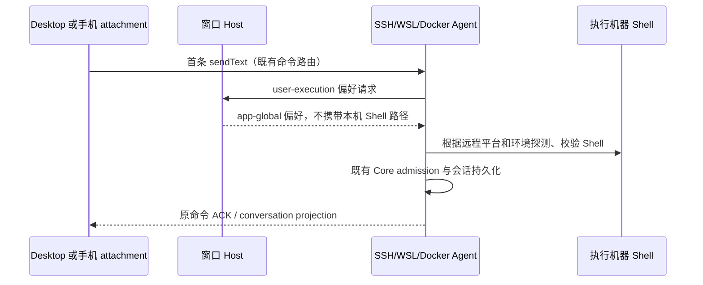

# 远程作业 Shell 选择边界

## 问题与产品规则

2026-10-13 的 SSH 主机日志确认：新会话首条消息返回
`Selected Shell is not executable: <Windows PowerShell path>`，scope 为 `v4.command.execute`。
Desktop Host 的 remote runtime-preferences bridge 将本机 `integratedTerminalShell`
作为 `user-execution` 偏好传给 Debian。预热创建只请求 runtime-materialization，
所以连接及预热成功，首发解析执行 Shell 才失败。

- Shell 可执行文件和平台探测属于实际执行机器。本机的 Shell 路径不能用于 SSH、WSL 或 Docker 的远程作业。
- remote workspace bridge 不发送本机 `integratedTerminalShell`，两个 scope 均保持字段缺席。
  远程 Agent 通过已有 resolver，在自己的 platform、SHELL、PATH 和可执行性检查下选择 Shell。
- 本地 Host 继续在 user-execution 返回用户选中的本机 Shell；不改变本机终端设置。
- app-global 的提问、增强搜索、memoryEnabled、sessionRecall 和模型上下文预算继续由 Desktop Host 提供。
- 不转换 Windows 路径、不跳过可执行性校验、不遇到失败后自动重发 prompt；不以超时或额外 fallback 掩盖错误。
- 不新增远程 Shell 选择 UI、持久化字段或协议版本；现有可选字段和旧 Agent strict schema 兼容。

## 所有者、接口和事件顺序

| 职责                  | 所有者                                                | 接口                                                            |
| --------------------- | ----------------------------------------------------- | --------------------------------------------------------------- |
| 本机终端 Shell 设置   | 本机 SettingService / 本地 runtime-preferences        | buildLocalSessionRuntimePreferences                             |
| 远程偏好字段边界      | Desktop 窗口 Host 的 remoteWorkspaceServiceCollection | respondSessionRuntimePreferences                                |
| 远程 Shell 探测与执行 | 远程 Agent execution resolver                         | resolveEffectiveBashShellSelection                              |
| 输入准入、首发及落盘  | 既有远程 CommandInbox / Core runtime                  | 保留 commandId、owner/lease、workspaceIdentity、remoteSessionId |

Desktop continuous 与手机 replayable 共用同一窗口 Host bridge 和远程 Agent owner；
不修改它们各自的投递、对账和恢复语义。偏好请求与响应继续使用原 requestId，不新增写入路径。

## 验收

1. 通过真实 SettingService 保存 Windows PowerShell、POSIX Shell 和自动模式；remote bridge
   对 runtime-materialization 与 user-execution 都不携带 integratedTerminalShell，app-global 偏好仍正确。
2. 上述回归先复现错误字段传播，再修复实现；本地偏好测试仍传递本机选择。
3. Shell resolver 既有回归确认显式失效可执行文件仍拒绝，支持的本机选择仍保留。
4. 执行根 typecheck、lint、changed architecture 及改动文件格式检查。
5. 真实 SSH 首发重测需要用户重新构建桌面 Host；没有执行时单独说明。

## 验证记录（2026-10-13）

- 先在真实 remote collection 的请求/响应测试中保存本机 PowerShell 选择，复现
  user-execution 携带 integratedTerminalShell 的失败；修正 bridge 后覆盖 Windows、POSIX 和自动模式。
- remote bridge、远端环境 owner 及本地偏好测试 5 / 5 通过。
- CLI Shell 选择和协议转换测试 26 / 26 通过；失效的显式 Shell 仍被拒绝。
- `pnpm test:remote-control`：76 / 76 通过，保留手机 replayable attachment 与恢复边界。
- `pnpm typecheck`、`pnpm lint`、`pnpm architecture:check --changed` 通过，baseline 0、new 0。
- 本次四个改动文件格式检查通过。

改动模块为 legacy desktop：生产代码净减 1 行，测试净增 38 行，不计 spec 或此前资源分发改动。
Host 仅裁剪偏好字段，Shell 探测及校验继续由实际执行 Agent 的既有 resolver 持有。
未构建安装包、未修改用户终端设置、未连接真实 SSH 主机重测首发。
