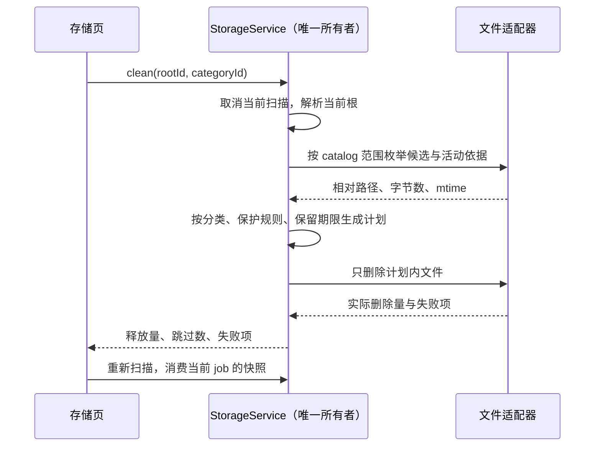
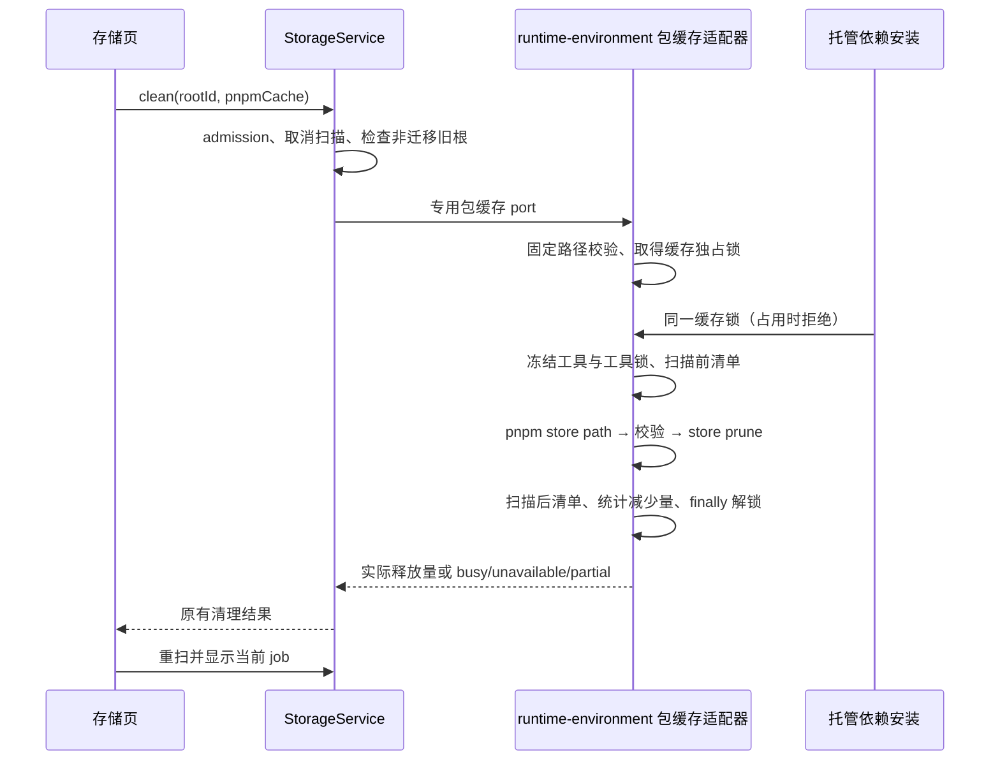

# 资源管理器存储分类与清理

入口为「帮助 → 资源管理器 → 存储」。扫描范围沿用家目录与自定义数据目录下的 `.lcode`，按物理卷展示；本次不扩大到整个用户目录或 Electron 浏览器数据。

## 产品规则

- 将原先混入「其他」的 `v2/worktrees`、`v2/git-review-workspaces`、`git-checkpoint-index` 归入「工作树与 Git 审核数据」，`v2/git-backup` 归入「Git 自动备份」，`v2/runtime-environments` 除 pnpm 包缓存外归入现有运行时分类，`v2/runtime` 归入配置。上述数据由原业务所有者维护，存储页不提供直接清理。
- 自定义数据路径生效时，home 根下的 `v2` 整体归入「迁移与旧版数据」；旧 `agent/` 也归入该类。不推断迁移已完成，不删除旧数据库或凭据。明细按前两层展示，避免只显示一个 `v2`。
- 将 `cli/image-cache`、`cli/pdf-cache`、`cli/video-cache` 拆为「媒体派生缓存」；原始内容仍在 `cli/artifacts`，由现有 `ensureMediaAttachmentPath` 按需重建。清理只处理超过七天未更新的会话缓存；任一媒体缓存或原始产物在七天内更新，整个会话的缓存保留。缓存目录以外的原始产物始终不删。
- `editor-icon` 拆为「编辑器图标缓存」，只清理超过 24 小时未更新的文件，保留可能正在转换的图标。
- `v2/runtime-environments/package-store/pnpm` 从运行时类别拆为「pnpm 包缓存」，显示独立占用和「安全清理」按钮。只按固定路径调用该数据根已安装的托管 pnpm `store prune`，不使用通用文件删除、不传 `--force`、不下载或安装工具。说明清理后未来安装可能重新下载包，Node、pnpm、项目已安装依赖与环境私有数据继续保留。
- 包缓存清理由 runtime-environment 的公开 Node 工厂提供；Desktop Main 注入 StorageService 的专用 port，沿用现有 clean 请求。home/v2 的迁移旧副本仍优先保护；缺少工具返回工具不可用，安装或另一清理正在使用缓存时返回 busy，不接管锁、不用延时重试掩盖占用。
- 包缓存清理与托管依赖安装共用缓存根的跨进程文件锁：安装使用共享 owner，多个安装可并行；prune 使用独占 owner，两者竞争时显式报告 busy，不接管锁。执行前校验固定 store/cache 目录及祖先无重定向，冻结 pnpm/Node 必须位于该根的 tool-store，脚本入口通过冻结 Node 执行，三平台使用现有 managerCommand。命令 cwd/cache-dir/store-dir 都固定在缓存根，避免读取项目配置、切换包管理器版本或清理全局缓存。先以 `store path` 确认实际目标再 prune；失败只返回有界错误码，不把包管理器输出当作释放量或展示原始 stderr。
- 清理前后扫描同一缓存目录，基于消失文件计算逻辑释放量与删除数，保留包管理器留下的内容；空缓存为 no-op，重复清理可安全重入。StorageService 拒绝同实例并发清理，取消扫描同时废止尚在解析根目录的扫描 admission，避免清理后迟到启动旧扫描；进程间互斥由包缓存 lease 保证。工具安装锁在 prune 生命周期内保护所用 Node/pnpm，均在 finally 释放。
- `tmp`、`cache`、`clipboard` 拆为「临时文件与粘贴附件」，其中可能存在草稿或历史引用的唯一原件，不开放整类删除。工具输出类别也继续保留。
- 其余未知文件仍显示为「其他」，明细按前两层路径聚合。无明确可重建依据的目录不添加通用删除按钮。
- 沿用日志、轨迹、开发诊断、导出与备份的既有清理规则、保护文件和二次确认。所有新增类别有中英文名称、说明及图标。
- 窄屏使用有界单列网格，长数据路径截断在卡片内；页面滚动容器不产生横向溢出，类别清理按钮始终在视口内。

## 状态所有者、接口和顺序

`StorageService` 继续唯一持有扫描 job 与最近快照；catalog 是扫描分类、清理范围与可清理性的唯一规则源，clean plan 决定普通类别保留规则。共享 `StorageCategoryId` 增加类别，沿用 `StorageCleanRequest { rootId, categoryId }` 和既有桥；不增加 IPC、Host 或持久状态。pnpm 仅走专用 port，包缓存文件从不进入普通删除计划。UI 只保留选择态，清理后使用现有扫描更新占用。

普通类别删除只限当前根内的普通文件，不跟随目录符号链接；清理前后均保留类别顶层目录。缺失文件、无权限和删除失败沿用现有结构化结果。重复清理已删除文件不重复计入释放量。路径归一化后参与会话分组，Windows 与 POSIX 分隔符保持一致。

pnpm 类别的事件顺序（普通文件清理不变）：

## 验收

1. 活动根下的工作树、Git 自动备份、运行环境、视频缓存不再归入其他；自定义路径下的 home/v2 优先归入旧数据，任何清理请求都不能删除它。
2. 未知 `v2/a` 与 `v2/b` 分开统计；旧数据展示 `v2` 的直接子项；类别总和等于根目录总占用，条目数量沿用既有上限。
3. 旧媒体会话缓存可删，近期同会话的其他格式缓存或原始产物会阻止删除；原始产物、粘贴附件、运行时、配置、凭据与 Git 数据保留。边界时刻和未来 mtime 保留。
4. 图标缓存只删除超过 24 小时的普通文件；目录链接不能让枚举或删除越出根目录。
5. 用临时目录执行真实扫描、清理、重扫和重复清理；生产个人数据不作为测试删除目标。
6. 浏览器运行生产资源管理器入口，验证切换存储、分类、明细、定位路径、清理调用、重新扫描与不可清理项；覆盖中英文、明暗主题和窄屏。
7. 执行相关 Node 测试、浏览器场景、`pnpm typecheck`、`pnpm lint` 与改动架构检查，记录真实结果。
8. pnpm 子路径命中最长前缀独立分类，tool-store 和项目 node_modules 不变；通用 cleanPlan/scopes 无 pnpm 删除目标。覆盖专用 port 路由、迁移根保护、缺工具、并发安装与重复清理。
9. 临时目录用真实子进程模拟 pnpm 命令，验证 target/cwd/cache/env、非零退出、越界 store path 和目录链接拒绝；删除验证保留工具和项目 node_modules。浏览器覆盖包缓存独立占用、列表/明细安全清理、执行中禁用、完成后重扫、中英文与窄屏。

## 执行记录（2026-10-15）

- 涉及 storage、shared 与 UI；Web 仅增加浏览器验收，Desktop 的生产窗口与桥继续复用。状态所有者仍为 StorageService，顺序沿用取消扫描 → 枚举/计划 → 删除 → 重扫，不引入新的同步或持久化所有者。
- `node --import tsx --test packages/services/src/storage/storageCatalog.test.ts packages/services/src/storage/storageCleanup.integration.test.ts`：8/8 通过，包含真实文件删除、重复清理、近期内容保护和 Windows junction 越界保护。
- `node --test packages/web/test/resource-storage.test.mjs`：中文暗色 1100px、英文浅色 390px 两场景通过（含父测试共 3/3）。使用生产独立窗口入口与真实临时文件扫描/删除；未删除用户个人数据。
- `pnpm typecheck`、`pnpm lint`：通过。`pnpm architecture:check --changed`：0 violations / 0 baseline / 0 new。改动的 13 个可格式化文件检查通过；额外检查整个 storage 目录时发现 10 个未修改文件的既有格式差异，本次未批量重写。
- 截图人工检查确认窄屏清理按钮可见；自动断言同时检查存储滚动容器无横向溢出。截图位于 `.lcode/component-quality/resource-storage/`，仅含合成数据与临时目录路径。
- 生产代码与 `.gitignore` 净增 97 行；测试与规格另计。全部清理验证限于测试创建的临时目录，已有无关 `.artifacts/` 保留。

## pnpm 包缓存执行记录（2026-10-15）

- 新增独立 `pnpmCache` 分类及列表/明细「安全清理」，Node/pnpm 与已安装依赖不进入删除计划；只复用 runtime-environment 的专用维护 port。StorageService 仍是扫描/清理 admission 的唯一所有者，pnpm 引用回收交给包管理器；安装共享 lease、清理独占 lease，工具锁保护冻结执行入口。沿用当前 job 投影，迟到的扫描根解析被 generation 废止。
- 定向执行 storage catalog/routing/真实文件清理、runtime package cache、dependency install 与 tool backend command 共 6 个测试文件，33/33 通过；包含真实子进程模拟 pnpm、部分失败与异常后的实际释放量、空缓存、越界、junction、共享安装/独占清理、活进程占用及迟到扫描回归。
- `node --test packages/web/test/resource-storage.test.mjs`：中文暗色 1100px、英文浅色 390px 两场景通过（含父测试 3/3），覆盖独立占用、双语安全清理标签、明细说明、执行中禁用与重扫归零；截图人工检查通过。
- 额外在临时根通过本机托管的 Windows 原生 pnpm 10.34.6 执行生产清理工厂：合成缓存减少 16 bytes / 1 文件，运行工具及项目 node_modules 保留。只读复用工具作为临时硬链接，没有再次清理个人数据；未验证 macOS/Linux 原生 pnpm 实机。
- `pnpm typecheck`、`pnpm lint`、改动文件格式检查均通过；`pnpm architecture:check --changed`：0 violations / 0 baseline / 0 new。
- 涉及 storage、runtime-environment、shared、UI 与 Desktop 组合根，Web 仅测试；不增加跨模块私有导入或新服务实例。当前相关源码相对 HEAD 为 +474/-78，净增 396 行（包含本聊天前次分类细化，不含测试/规格及同时发生的附件目录改动）；其他工作区改动原样保留。
