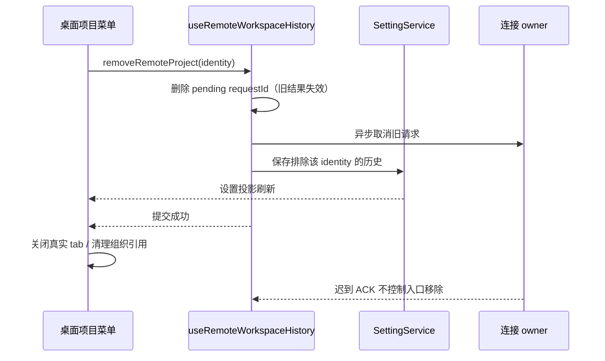
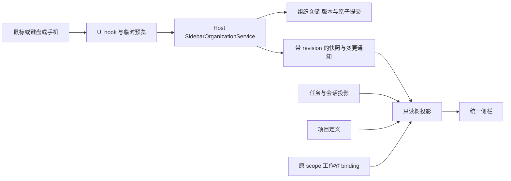
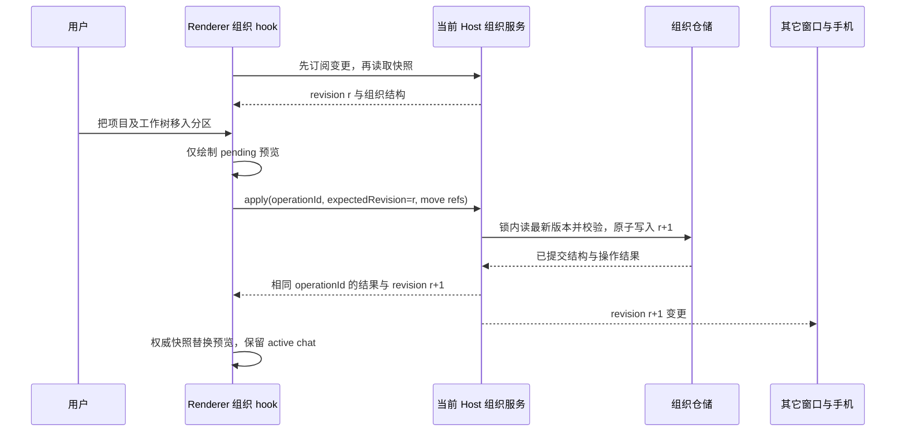

# 左侧栏分区与自由组合设计方案

## 失联远端项目的移除（2026-10-17）

- 项目「移除」清理窗口入口和连接历史，不调用远端目录、工作树或任务删除。失联远端且没有已知工作树、非归档协作任务、独立放置会话引用时，允许显式移除，不要求先恢复连接。
- 已知依赖仍阻止移除，读取失败不能被解释为依赖已删除。连接中的来源或本地来源尚未校验时继续保护；移除判断仅查询当前完整 identity 对应的加载状态，不因另一来源加载而禁用。
- 连接事实来自现有 services lookup，依赖来自已读取的 worktree / execution set / 组织快照；UI 只派生禁用原因，不新增状态副本，不放松 owner/lease 或工作树删除边界。
- 验收：代理字段导致目录失败后断开的无依赖入口仍可点击移除；另一个同路径来源在途读取不阻止该操作；已知依赖的失联项目保持保护，移除不建立远端连接、不调用任务或文件删除。
- 补充：保存的历史项目可以没有打开的 tab，合成的 `sidebar:` 行不是 tab。桌面显式移除必须按完整 identity 调用 `useRemoteWorkspaceHistory` 的同一历史清理命令，再关闭实际 tab；不能仅靠 tab 消失的 observer 触发。旧快照缺少 identity 时，在历史读取边界用既有构造器补齐，不能按 `/` 等路径删除其它主机。
- 事件顺序：先使当前重连 requestId 失效，再提交历史移除；取消上传/连接的网络 ACK 与凭据回收属于后续清理，不能阻塞本地入口消失。迟到的重连结果沿既有 requestId 防护丢弃。保存失败展示现有移除失败提示，并允许重试。
- 手机 `web-remote-replayable` 的导航关闭不获得桌面历史删除或 Host attachment 释放权限；新命令只由桌面历史 owner 提供，既有依赖门禁继续生效。
- 新增回归：有 tab / 只有保存历史、旧快照无 identity、同路径不同主机、取消连接 ACK 挂起、刷新后不复活、保存失败可重试；同时检查菜单右键与更多按钮入口。

```text
连接注册表 / lookup + 已知依赖 + 当前 identity 的读取状态
  → 纯移除策略 → 菜单状态 → 历史 owner 按 identity 清理 → closeTab
  → runtime 释放失败仅记录，不回滚用户移除
```



### 显式移除补充验证（2026-10-17）

- 旧历史身份与迟到重连失败先用测试复现失败，再修改实现；新增两项已纳入 `pnpm test:remote-control` 的 tag 发行门禁。远控 135 项、项目身份投影 3 项、侧栏协作 61 项通过。
- 真实生产侧栏与 `useRemoteWorkspaceHistory` owner 的浏览器场景通过：保存但无 tab、有断连 tab、同路径两台主机与本地目录、保存失败重试、取消 ACK 挂起、迟到失败、页面刷新。右键和更多菜单均验证。来源提示/归档文件最终 4 项通过；远端目录与远端重连两项通过。
- `pnpm typecheck`、`pnpm lint`、`pnpm architecture:check --changed` 通过（架构 baseline 0 / new 0）。浏览器场景使用确定性 IO 桩；没有替换正在运行的安装版，也没有删除真实 VPS 数据。
- 另一次真实下载检查中，当前 Host 网络层 4.1 秒取得本次发布的 Linux x64 清单，返回内容摘要与 GitHub 发行资产一致。此前客户端日志中的十秒超时未复现，不能将移除修复表述成已经根治公网下载超时。

日期：2026-10-16。状态：产品实现及本轮自动化回归已完成；文末记录实现、多轮查漏补缺、实测证据与尚未实机验证的范围。

采用统一树形侧栏：默认让分区、项目、工作树和会话同时出现。用户可以把项目、工作树和会话组合进同一个分区，也可以移出、换组或拆成新的分区。移除旧标签页；通过侧边栏菜单中的「专注」临时收窄内容范围，组织结构始终保持统一。

「三个点图标 + 侧边栏」采用应用内自定义悬停菜单，「专注」和「筛选和排序」是其中的子项。视觉沿用 DESIGN.md 的低干扰、紧凑、可读原则，使用现有组件与主题 token；不使用系统原生右键菜单、浏览器 prompt、原生 select 弹出列表或原生 confirm 承载本流程。

## 实施状态与边界决定

### 2026-10-16 专注范围与空分类修订

工具栏入口改为「三个点图标 + 侧边栏」，仍支持鼠标悬停、点击和键盘打开；归档保持独立按钮。主菜单新增「专注」子菜单，按「全部、项目、工作树、会话」排序，使用应用内单选菜单和勾选状态。桌面子层独立定位，不能推动主菜单；触屏在等宽面板内切层。专注和筛选排序同一时间只打开一个子层，Escape/向左返回刚才的入口，纯悬停保留输入焦点。

全部沿用混合树。项目范围只显示项目入口（包含远程项目），工作树范围只显示真实绑定入口（包含远程工作树），这两个范围隐藏子会话列表，不更改其展开偏好。会话范围平铺全部可读取的活动会话，包括项目与工作树的子会话；按完整 workspace identity + task id 去重，保留真实来源、右键动作和路由。置顶仍单独呈现，只在全部/会话范围显示；归档不参与活动专注筛选。

自定义分区保留原位置，但专注时只呈现匹配成员；会话范围还投影该分区内项目/工作树的自然子会话，独立放置的会话仍以自身位置优先，避免重复。专注后无匹配内容的分区隐藏；全部模式保留用户创建的空分区，便于添加和拖入。系统项目、工作树、会话和置顶分类没有实际成员时不显示标题；折叠后的非空分类仍可见，不能因为折叠而被当作空。不可用的显式引用继续按其种类展示，不因读取失败推断删除。

会话专注的来源行展示项目或工作树名称及本地/远程类别，悬停可查看完整说明；不能仅凭路径末段区分同路径的本地和远程项目。来源文字从完整 catalog 推导，任务身份、请求参数和持久 metadata 不改写。置顶标题与其它分类对齐。

专注偏好由 `useSidebarTreePreferences` 持有，复用 `sidebarTaskPreferences` 唯一持久化入口，缺失或无效旧字段回退全部。投影只读组织快照、来源和任务查询；不提交组织命令，不发起连接，不创建草稿，不改变当前会话、业务归属或目录。完整 catalog 始终不被专注过滤。专注空结果在列表内提示暂无内容并提供「显示全部」；切换范围不会修改原有展开记录。归档打开时调整专注只影响返回后的活动列表。

```text
专注单选 → UI 偏好 owner → 本端偏好持久化
                         └→ 只读筛选现有组织/来源/会话投影 → 左侧显示
归档按钮 → 独立归档面板 → 原归档查询（不读取活动专注范围）
```

验收：四范围及刷新恢复；默认空分类隐藏；项目/工作树不泄露子会话；会话包括本地/远程和工作树来源且不重复；混合分区过滤后位置不变；折叠不丢失、空结果可返回；远端右键继续按 identity 路由；归档往返保留专注；手机/放大字号/主题；两个子菜单独立定位且连续开合不移动主菜单。先添加回归，再实现并记录实际结果。

#### 实现及实测记录

实现仅扩展 UI 展示偏好和只读投影，沿用组织服务、来源 owner 与业务动作。`SidebarOrganizeMenu` 持有唯一活动子菜单，两个子层复用独立锚点和固定宽度；`SidebarOrganizeChoices` 提供四项单选。`projectSidebarFocus` 负责匹配分区和继承会话，原分区对象继续用于右键动作，防止筛选后把部分成员误当作完整分区。`useSidebarSystemActions` 提取原系统分类动作，保持投影文件在仓库行数限制内。

多轮检查修正：项目专注直接卸载子会话内容，避免折叠退场动画短暂泄露；展示偏好直接提交给本端 owner，不等待双浮层的焦点恢复事件；菜单项使用稳定的可访问名称，不让当前选择文案破坏重复进入；键盘导航跳过桌面隐藏的移动端返回按钮。置顶数据在折叠时仍保持查询，空标题由该查询组件自身控制，不通过隐藏父组件阻止查询。

最终浏览器回归 **14/14 通过**，单元回归 **19/19 通过**。浏览器使用实际共享 UI 组件和受控 Host/service fixture，覆盖桌面、390px 触控、七套主题、中英文、放大字号、短窗口、两个子层的主菜单边界不变、键盘环绕与两级 Escape、专注刷新恢复、混合分区、归档往返、错误逐来源重读，以及远程会话右键真实 action 的 identity 参数。操作下一个菜单前等待上一右键层实际退场，未加入固定等待或应用同步定时器。

```powershell
node --test --test-concurrency=1 packages/web/test/sidebar-focus.test.mjs packages/web/test/sidebar-organize-position.test.mjs packages/web/test/sidebar-organization.test.mjs packages/web/test/sidebar-organization-transactions.test.mjs packages/web/test/sidebar-source-errors.test.mjs packages/web/test/sidebar-animation.test.mjs packages/web/test/worktree-sidebar-menus.test.mjs
pnpm exec tsx --tsconfig packages/ui/tsconfig.json --test packages/ui/src/WorkspaceSidebar/sidebarFocusProjection.test.ts packages/ui/src/lib/sidebarTaskPreferences.test.ts packages/ui/src/lib/worktreeSidebar.test.ts packages/ui/src/lib/archivedTaskDeletion.test.ts packages/ui/src/lib/sidebarOrganization.test.ts packages/ui/src/hooks/sidebarOrganizationCommands.test.ts packages/ui/src/hooks/windowWorkspaceReconnect.test.ts
```

`pnpm typecheck`、`pnpm lint`、`pnpm architecture:check --changed` 通过，架构 violations / baseline / new 均为 0；变更文件格式及正常仓库配置下 `git diff --check` 通过。功能图 YAML、97 个唯一 ID、146 条关系端点/等级及本功能 12 个源码种子路径/符号均验证通过。当前工作区累计改动（包含前几轮侧栏实现，不含 `.artifacts`）约新增 8.3k 行、删除 2.3k 行；本轮不新增服务或协议 owner。

界面截图已实际打开检查：`.artifacts/sidebar-organization/focus-menu.png`、`focus-chats.png`。未重建、替换当前安装包；实际 SSH 主机及物理手机不属于本轮 fixture 验证范围。

### 2026-10-16 整理菜单定位修订

桌面整理主菜单和筛选排序子菜单采用独立浮层：主菜单以整理按钮定位并保持固定宽度，子菜单以筛选排序行定位，优先向右，空间不足时只对子菜单执行向左翻转和边界避让。打开、关闭或反复进入子菜单不得改变主菜单的 x/y/width；禁止通过扩大同一个右对齐容器呈现两列。小于 640px 时继续在同一等宽面板内切层。

状态所有者仍为 `SidebarOrganizeMenu` 的 open/sub 和浏览器断点只读快照；不新增业务状态、持久化或服务命令。事件顺序为「按钮悬停 → 主浮层固定定位 → 筛选行悬停 → 子浮层独立定位」。纯悬停保留聊天输入焦点；显式点击/键盘进入将焦点交给排序项，Escape/ArrowLeft 返回筛选行，再次 Escape 关闭主菜单。鼠标在两层之间移动须连续可达。

验收新增：实际指针悬停前后比较主菜单边界；反复开合；主菜单贴近窗口右边时仅子菜单向左；短视口只约束子菜单高度/位置；中文/英文、放大字号、主题、键盘与 390px 触屏不越界。先新增失败回归，再实现并实际重跑。

本次实现结果：主菜单固定宽度，桌面子层使用独立 Popover/Portal，以筛选行作为锚点；空间避让只移动子层。小于 640px 使用浏览器断点快照在同宽面板内切层。关闭子层立即卸载其事件层，避免关闭期间拦住下一次 Escape。显式进入子层的焦点由挂载后的 layout/open 事件交接，纯悬停不转移聊天输入焦点。

新增 `packages/web/test/sidebar-organize-position.test.mjs`，修复前已实际捕获主菜单 x 和 width 改变的失败；修复后覆盖三种窗口/语言/字号组合，每种反复开合三次，断言主菜单 x/y/width/height 均保持不变、子层独立向右或向左、鼠标连续可达、输入焦点不被抢走，以及两级 Escape。位置测量等待真实 CSS 动画完成，不使用固定等待掩盖布局变化。

最终运行以下浏览器回归，9 项全部通过（包含七套主题与触控场景）；`pnpm typecheck`、`pnpm lint`、`pnpm architecture:check --changed`、本次变更文件格式和 `git diff --check` 均通过，架构为 violations 0 / baseline 0 / new 0。功能图路径与符号校验通过。截图为 `.artifacts/sidebar-organization/organize-submenu-fixed.png` 和 `organize-submenu-right.png`。本轮未重建或替换用户当前安装版。

```powershell
node --test --test-concurrency=1 packages/web/test/sidebar-organize-position.test.mjs packages/web/test/sidebar-organization.test.mjs packages/web/test/sidebar-organization-transactions.test.mjs packages/web/test/sidebar-source-errors.test.mjs packages/web/test/sidebar-animation.test.mjs
```

### 2026-10-16 后续修订：来源错误逐项呈现、归档独立入口

本节取代前版的全局「部分来源不可用」提示和树底部展开归档交互。正常未连接的历史远程项目属于 disconnected，不是读取失败；保持项目可见与重新连接入口，不生成全局告警或虚构错误。真实 `worktree.list` 失败按完整 scope key 保存原始原因，项目行和依赖该来源的已知工作树行显示感叹号；鼠标悬停或键盘聚焦能看到项目名称、路径与原因，触屏点击可打开同样的详情。连接失败继续使用现有项目连接错误状态，普通未连接不冒充故障。

重新读取仅查询选定来源的工作树，不建立远程连接；重新连接调用既有连接 owner，不与刷新混用。离线状态仍禁止依赖来源的业务操作，保留已知工作树与组织引用。每个来源的请求有独立序号，迟到结果不能覆盖更新请求；并行刷新不同来源互不丢失结果。失败后恢复成功清除对应错误，不能清除其它项目的错误。

```text
连接注册表 → disconnected → 项目重新连接 → 原连接 owner / attachment
项目重新读取 → 原来源 worktree.list → scope 请求序号校验 → 行内错误或最新绑定
                                     └── 保留已有绑定，禁止以失败推断删除
归档入口 → UI 局部面板状态 → 现有归档查询 / 恢复 / 冻结范围删除
```

「归档」作为「整理侧边栏」旁的独立按钮，点击进入专用归档面板；活动树中不再混排归档。面板保留来源筛选、重新读取、右键恢复/删除和当前范围批量删除。返回工作空间不创建草稿、不切换当前会话，保持活动分区展开、排序与组织位置。归档面板状态仅由侧栏组件持有，不写入组织快照或连接事实。

验收新增：未连接历史项目无全局告警；同路径本地/远程失败互不串行；真实异常的名称/路径/原因可悬停及触控查看；仅重读目标来源、不发重连；并发及迟到响应隔离；断开后清除过期读取错误但保留绑定；恢复成功清除感叹号；归档入口位置、独立列表、返回、筛选/恢复/删除与移动端边界。实现后记录实际运行结果。

实现收口：`useSidebarWorktrees` 保存 `failures[scopeKey]`、不可用 scope 和逐来源 loading/request 序号；正常 disconnected 仅进入不可用集合，只有实际调用失败才进入 failures。工作树读取成功、断开和失败分别合并，不清空其它来源。项目行与真实工作树行复用 `SidebarSourceReadError`，触发器保留在名称旁且错误行操作区宽度稳定；有读取错误时不再叠加普通 SSH tooltip。只读提示的 Popper 外壳不接收指针，关闭的详情不挡住其它项目，避免快速切换时 pointerup 被浮层截获。此处采用事件和布局约束修复，没有增加等待定时器。

归档面板由 `SidebarArchivePanel` 复用既有归档查询、恢复和批量删除命令；选择集继续冻结于当前完整分类投影。顶部按钮旁保留明确返回入口。新增永久浏览器场景位于 `packages/web/test/sidebar-source-errors.test.mjs`，完整侧栏主题场景也加入了七套 palette 下的错误详情触控与归档往返。

2026-10-16：开始实现。新增受控 `sidebar-organization` 模块，公开 `getSnapshot/apply/onDidChange`；状态文件位于当前 profile 配置目录。Host 注册唯一组织服务，Desktop 与 Web/手机通过同一 RPC 契约读取。跨窗口文件锁内校验 revision 和 operationId，提交完成后通知；Renderer 订阅后读取快照，只接受更高 revision。组织冲突显示最新结构并要求重新执行，不盲目重放。

组织操作使用 create/rename/remove/move/reorder/reorderRoot/import/forget 的原子批次，撤销提交反向批次。文件读写或校验失败保持旧文件与已有 UI 快照。离线业务来源不阻止引用移动，组织服务不可用时禁用写入。旧分组只读导入，原业务分组数据保留；新侧栏不再调用旧分组写入口。

UI 分为统一树、组织控制器、共用位置菜单、整理菜单和自定义编辑弹层；项目原有移除、远程同步、重连，工作树生命周期、会话动作继续由原有业务入口负责。项目折叠按完整 scope key，避免远端同路径互相影响。

实现收口：实际持久结构以 `packages/shared/src/sidebarOrganization.ts` 为准，rootOrders 是同一套稳定引用组成的数组，按对象类型投影系统区顺序。`forget` 只清理已确认删除对象的导航引用与排序，不做任何业务删除。用户移动、重排与撤销遇到 revision 冲突时停止；仅幂等导入和明确引用清理允许一次基于新 revision 的重试。ACK 丢失只重发同一个 operationId 与原请求，不创建第二个分区。

移除项目采用明确的依赖门禁：工作树来源尚未校验、有真实工作树、或分区中有独立会话引用时，禁用项目移除并解释原因。用户仍可移动项目入口或解散分区；不会为了移除入口释放仍被引用的 Host。旧分组迁移逐来源读取，最多八个并行成员探测，通过任务 metadata、真实 binding 和源 WorktreeService 检查排除旧普通视图隐藏的工作树成员；探测失败保留旧数据并等待来源恢复。

自动化及闲时任务继续由原有业务服务创建和管理，历史可见分组作为一次性导航快照导入；新会话按真实来源进入自然位置，侧栏不跟随旧 task-group 写入重新覆盖用户手动位置。展开和排序为本端偏好；业务归属与组织引用均不复制到 localStorage。

## 已确定的产品边界

| 内容       | 规则                                                                   |
| ---------- | ---------------------------------------------------------------------- |
| 总体结构   | 默认统一树；可通过专注收窄显示范围，组织结构保持不变                   |
| 分区能力   | 一个分区允许混合项目、工作树和独立会话                                 |
| 自由组合   | 移入已有分区、新建分区并移入、移出、换组、批量移动、拆分分区           |
| 整理入口   | 桌面鼠标移入即展开；筛选排序子菜单同样支持悬停                         |
| 归档       | 顶部独立入口进入归档面板，返回后保留活动分区和项目的原状态             |
| 展示与业务 | 组织侧栏只调整引用的位置，不改变目录、项目定义、Git 关系或会话运行环境 |
| 本次产出   | 详细方案与可交互视觉草案；生产代码留待后续实施                         |

这里的「分区」就是用户所说的「分组」。界面统一用「新建分区」「移入分区」「拆分分区」「解散分区」，避免同时存在两种含义相近的容器。

## 当前左侧栏的实现与问题

| 当前实现                                                 | 源码依据                                                                   | 对本次设计的影响                                                 |
| -------------------------------------------------------- | -------------------------------------------------------------------------- | ---------------------------------------------------------------- |
| 三类一级视图使用 Tabs                                    | `WorkspaceSidebar/SidebarTaskModeTabs.tsx`                                 | 需要撤掉 Tabs 和滑块测量逻辑，不能只是换一套按钮                 |
| 分组、项目、时间线、工作树通过条件分支挂载               | `WorkspaceSidebar.tsx` 的 `resolveSidebarTaskViewMode` 与主体渲染          | 改为同一棵树的多个区块共同渲染                                   |
| `showArchivedTasks` 优先覆盖主体，但标签仍保留其它选中态 | `WorkspaceSidebar.tsx`                                                     | 归档与其它内容存在两套交互语义，应改为独立折叠区                 |
| 归档分类取决于上一次 `taskOrganizeBy`                    | `WorkspaceArchivedTasksFlatSection` 的 `taskFilter` 来源                   | 总归档默认覆盖当前来源内普通及工作树会话，不再隐式继承之前的类型 |
| 分组持久结构只接受会话引用                               | `session/lcodeTaskListTypes.ts` 的 `LCodeGroupedTaskViewOrderInput`        | 无法直接把项目或 binding 塞进旧组成员数组                        |
| 分组会聚合多个 owner，但禁止跨 owner 移动任务成员        | `hooks/groupedWorkspaceService.ts`                                         | 自由组合必须是新的侧栏引用关系，不能伪装成跨 Host 任务迁移       |
| 项目定义与打开状态不同                                   | `local-multi-folder-projects.md`、`tabStore.ts`、`workspaceProjectMenu.ts` | 项目未打开不等于不存在，多文件夹项目仍以主目录关联会话           |
| 工作树按真实 binding 分类                                | `useSidebarWorktrees.ts`、`lib/worktreeSidebar.ts`                         | 移动工作树入口不能改写其原项目、执行目录或生命周期               |
| 分组手动顺序、项目顺序、任务时间排序各有含义             | `useGroupedTaskView.ts`、`tabStore.ts`、`taskListOrdering.ts`              | 新菜单必须说明各项排序作用范围，不能用时间排序覆盖手动组织       |
| 归档删除与当前分类完整投影同源                           | `archived-task-deletion.md`                                                | 继续保留；20 条折叠上限不是批量删除的边界                        |

以上为当前检出源码确认的结构性事实。未对已安装桌面包进行实机截图审计，因此不把布局拥挤、悬停时延或具体像素表现写成已复现故障。

Codex 可以借鉴的核心是同栏组织。官方更新记录确认其支持可折叠分区；官方工作树说明区分聊天关联的托管工作树与作为独立项目出现的永久工作树。LCode 应保留自己的 binding 与同树多会话语义，不照搬 Codex 的 Git 生命周期规则。[Codex 更新记录](https://learn.chatgpt.com/docs/changelog)、[工作树说明](https://learn.chatgpt.com/docs/environments/git-worktrees)。

## 信息结构与默认布局

```text
新建会话
搜索会话                         快捷键
定时任务
插件

工作空间                    ··· 侧边栏     归档

⌄ 置顶
    修复登录后的重定向

⌄ 产品迭代                         ···
    ⌄ 网站项目                     ···
        调整主题颜色
    ⌄ feat/login       工作树      ···
        登录流程回归
    需求拆解            会话       ···

⌄ 发布准备                         ···
    发布检查清单

⌄ 项目
    ⌄ 命令行工具                   ···
        优化启动速度

⌄ 工作树
    ⌄ fix/scroll · 网站项目        ···
        修复滚动定位

⌄ 会话
    一次独立讨论

› 归档                             ···
```

自定义分区与「项目」「工作树」等系统区块使用同一级标题。没有额外的「分组」外壳再包一层自定义分区。置顶区位于上方，归档区默认收起并位于下方；项目和工作树系统区收纳尚未放入自定义分区的对应入口。

将「网站项目」移入「产品迭代」后，项目系统区不再出现第二个相同项目入口。将「feat/login」移入同一分区，也不会自动移动其它工作树。项目与某个工作树可以在不同分区，工作树行通过次级文案保留原项目来源。

### 层级与重复展示

- 分区是组织容器；项目与工作树是可展开的业务入口；会话是叶子项。
- 第一版支持一层自定义分区，不支持分区套分区。项目／工作树展开自己的会话不计为嵌套分区。
- 每个对象只有一个明确的直接放置位置。手动将会话单独移入分区后，该会话不在项目／工作树子列表重复渲染完整行；业务归属保持不变。
- 没有显式位置的会话按真实执行绑定、项目与 conversation workspace 归入自然位置。工作树会话仍归对应 binding，不能因侧栏布局移到普通执行环境。
- 置顶继续复用任务置顶事实。置顶会话在置顶区展示一次，分区放置记录保留；取消置顶后回到原放置位置。
- 项目或工作树存在时，其入口可以没有未归档会话。不能因为会话全部被置顶、移出或归档而丢失管理入口。
- 容器计数表示本容器当前可显示的会话数量；菜单或辅助文案可以说明另有会话已独立放置，避免把局部数量误写成项目总量。

### 行为分离

点击展开箭头仅展开或收起。点击项目／工作树行的标题也以展开为主，不自动创建会话、不切换当前聊天。选择会话才打开对应聊天，仍由现有选择入口处理 workspace identity 与远端路由。

项目和工作树行保留现有新会话、查看文件和管理能力。新建入口的执行目标来自被操作的项目／binding；分区本身不提供 cwd。混合分区的「新建会话」应先选择该分区内可用的项目或工作树；没有唯一目标时，不猜测当前会话的目录。

## 自定义菜单与交互

### 整理侧边栏

```text
··· 侧边栏
  ＋ 新建分区
  ☐ 批量整理
  ─────────────────────
  专注                          ›
        ✓ 全部
          项目
          工作树
          会话
  筛选和排序                    ›
      会话排序
        ✓ 最近更新
          最近创建
      会话排列
        ✓ 紧凑列表
          按日期分段
  ─────────────────────
  展开所有活动区块
  收起所有活动区块
  恢复默认展开状态
```

专注是统一结构上的可恢复显示偏好，选择全部即返回完整混合树。专注不修改分区内容，不建立另一套组织视图或状态；定位具体对象仍通过展开、搜索、会话选择和拖放完成。

会话时间排序作用于项目、工作树、普通会话和归档列表；自定义分区内手动放置的入口继续按用户顺序。日期分段作用于当前可见的自然会话列表；分类标题仅在有对应内容时保留，用户创建的空分区在全部范围中保留。旧 `chronological` 值只恢复日期分段，不冒充一级视图或专注范围。

### 悬停与焦点

| 场景                                 | 行为                                                         |
| ------------------------------------ | ------------------------------------------------------------ |
| 桌面鼠标进入整理触发器               | 立即展开，不需要先点击；不自动聚焦菜单                       |
| 触发器移入菜单，再移入子菜单         | 保持同一菜单链，指针经过连接区域不关闭                       |
| 鼠标离开整条菜单链，且焦点不在菜单内 | 关闭；不改变侧栏组织状态                                     |
| 点击或键盘打开                       | 支持 Enter／Space；键盘打开后焦点进入菜单                    |
| Escape                               | 逐级关闭；键盘打开时归还触发器焦点，悬停打开时保留原编辑焦点 |
| 执行菜单项后指针仍在触发器附近       | 不立即反复重开；下一次真实重新进入再打开                     |
| 手机及触控设备                       | 点击打开；子菜单以同一弹层内下一层面板呈现，保留返回入口     |
| 菜单移交到分区选择弹层               | 先完成菜单关闭，再聚焦新弹层；不能同时保留两个焦点陷阱       |

优先复用现有 DropdownMenu 及其子菜单行为，为此入口增加受控的鼠标开启方式。触发器到根菜单的命中区域必须连续，并验证 portal 边界。不得使用定时重试、延长请求超时来掩盖焦点与展开状态不同步。

### 对象菜单和批量整理

项目、工作树、会话的「···」菜单与应用内右键菜单复用同一操作定义，提供「移入分区…」「移出分区」「新建分区并移入…」。已位于分区内时显示当前位置，并允许直接换组。

「移入分区」使用自定义可搜索弹层，展示分区名、成员数量和当前选中位置，底部提供「新建分区」。不用浏览器选择框。桌面多选支持复选控件及已有平台的组合选择习惯；手机使用清晰的「选择」模式与底部批量操作条。

一次选择可以混合项目、工作树和会话。移动整批引用是一次原子组织操作；一个目标无效时，不能悄悄只移动剩余项。

### 拆分、移出和解散

| 操作                 | 产品效果                                                           |
| -------------------- | ------------------------------------------------------------------ |
| 项目或工作树移出分区 | 返回各自系统区，不关闭入口或聊天                                   |
| 会话移出分区         | 移除显式位置，返回真实项目／binding 或普通会话区                   |
| 拆分分区             | 选择原分区中的若干直接成员，移入新建或已有分区；保留未选成员       |
| 解散分区             | 所有直接成员回自然位置，删除空组织容器；会话、目录和工作树全部保留 |
| 删除空分区           | 只移除空容器；可通过撤销恢复                                       |
| 移动项目             | 只移动项目入口及其自然子列表，不自动移动独立工作树入口             |
| 连同工作树一起整理   | 用户显式多选项目与相关工作树；不按路径猜测包含关系                 |
| 撤销整理             | 对最近一次组织操作提交反向命令，不调用 Git、归档或任务删除         |

这些动作与「移除项目」「归档会话」「删除工作树」分开排列。解散分区不使用代表数据销毁的红色主按钮；真实删除沿现有确认流程执行。

### 拖放

拖入分区中间区域表示加入分区，分区成员之间的细线表示插入位置，拖到系统区明确的落点表示移出分区。三种目标使用不同的轮廓和文字提示，不能仅靠颜色区分。

拖动容器时保持其子项作为整体。多选同时含项目和它的自然子会话时，默认按容器整体移动并去重；用户若要把会话单独拆出，应明确执行单独移动。工作树独立于项目导航节点，不属于这种父子选择去重。

分区收起时也能接收拖放，接收后显示已加入的结果，不依靠长悬停自动展开作为必经步骤。菜单移动与拖放调用同一组织命令。手机不要求精确拖拽即可完成全部组合与拆分。

## 本地和远程的对象分类

远程连接是运行位置和访问方式，不是与项目、工作树并列的新对象类型。用户连上一个远程目录时得到远程项目；只有真实 WorktreeService binding 确认的 checkout 才是远程工作树。不能把所有远程目录都当作工作树，也不能因为路径名字包含 worktrees 就改变类型。

| 对象类型 | 本地实例                                           | 远程实例                                          | 唯一识别与自然位置                                    |
| -------- | -------------------------------------------------- | ------------------------------------------------- | ----------------------------------------------------- | --- | -------------------------------- |
| 项目     | 本地主目录项目，包括多文件夹项目                   | SSH／WSL／Docker 等现有连接能力提供的远程目录项目 | `workspaceIdentity?.trim()                            |     | workspacePath`；未分区时在项目区 |
| 工作树   | 本地项目的真实执行 binding                         | 远程项目所属 Host 创建或确认的真实执行 binding    | 原项目身份 + bindingId；未分区时在工作树区            |
| 会话     | 本地项目／工作树或 conversation workspace 中的会话 | 远程项目／远程工作树中的会话                      | 完整 workspace scope + taskId；自然位置来自真实 owner |
| 分区     | 用户命名的导航容器                                 | 同一个容器可以引用本地和远程对象                  | sectionId；没有 cwd、连接或执行环境                   |

远程工作树使用 GitBranch 主图标和明确的远程来源提示，远程项目使用项目图标加 Cloud 来源提示。来源提示是次级标记，不能靠相近图标猜类型。行及菜单顶端应能读到「远程项目」「远程工作树」与来源名称；真实地址只在已有连接详情中按现有权限展示。

```text
分区：本周开发
  网站项目                    本地项目
  后端服务                    远程项目 · 开发环境
  feat/api · 后端服务          远程工作树 · 开发环境
  需求讨论                    独立会话
```

远程项目及其工作树可以一起移入分区，也可以拆开。移动不重建 remoteSessionId、不创建 attachment、不切换 Host。引用持久化稳定 identity，当前 remoteSessionId、连接 generation 和 service 从既有连接注册表解析。运行位置无法确认时显示「来源待读取」，不能自动降级为本地。

远程离线时，如果当前组织 owner 仍可达，重命名分区与整理这些已知引用仍可用；新建远程会话、远端文件读取、工作树管理中的真实写动作不可用。手机依旧连接桌面已有 Host；桌面组织 owner 本身断连时，只保留结构预览并禁止组织写入。

## 不同位置的右键菜单

菜单根据四个维度生成：**对象类型 × 所在位置 × 本地或远程 × 当前状态**。不能只根据当前聊天或最近选中的行生成。右键和「···」使用同一个 action registry、能力判断与 handler；不同容器不各自复制一份菜单实现。

### 共同约束

右键不打开聊天、不展开容器、不创建草稿。右键未选对象只将它设为本次菜单目标；右键多选集合中的对象保留集合。右键集合外对象切换为单对象菜单，并清楚显示目标名称。

菜单按「打开／创建」「组织位置」「对象管理」「辅助信息」分段。表中顺序就是显示顺序，同段用分号分隔，不在紧凑菜单中为每项再添加标题。仅在含远程或多种执行上下文时加一行不可操作的来源摘要。

不支持的平台能力隐藏；当前对象暂时不可用的能力保留禁用并说明原因。手机不显示桌面分屏和本机文件管理器入口。来源离线只禁用该来源的业务操作，不误禁用本地 owner 能处理的侧栏整理。

### 系统区块和空白位置

| 右键位置                 | 确切菜单与顺序                                                                          | 状态和作用范围                                                       |
| ------------------------ | --------------------------------------------------------------------------------------- | -------------------------------------------------------------------- |
| 侧栏未命中任何对象的空白 | 新建分区；批量整理；分隔；筛选和排序 ›；分隔；展开所有活动区块；收起所有活动区块        | 等价于整理入口；不推断当前聊天为目标                                 |
| 自定义分区内部空白       | 添加已有内容…；在此新建会话…；分隔；重命名分区；拆分分区…；解散分区…                    | 命中该分区；新会话需明确选择其中项目／工作树，不能以分区名推导路径   |
| 项目区标题               | 添加项目…；分隔；展开项目；收起项目                                                     | 添加项目调用已有本地打开／创建项目或远程选择入口；不新建一套连接流程 |
| 工作树区标题             | 工作树管理…；刷新工作树；分隔；展开工作树；收起工作树                                   | 管理先选明确原项目，不能套用当前聊天的项目；不会直接创建新树         |
| 普通会话区标题           | 新建独立会话；分隔；展开会话；收起会话                                                  | 继续使用 conversation workspace；不自动关联当前项目                  |
| 置顶区标题               | 展开置顶；收起置顶                                                                      | 只改变展开态，不提供含义不清的「移出全部」                           |
| 归档面板                 | 归档来源选择器：全部／普通会话／工作树会话；刷新归档列表；分隔；删除当前范围的归档会话… | 最后一项按当前完整投影计数；无可用目标时禁用；不删除工作树           |

### 分区标题

| 顺序         | 菜单项                                    | 显示与结果                                                           |
| ------------ | ----------------------------------------- | -------------------------------------------------------------------- |
| 1            | 添加已有内容…；在此新建会话…              | 选择项目、工作树或会话加入；不复制业务实体                           |
| 2            | 重命名分区；展开／收起分区                | 修改该分区标题或本端展开偏好                                         |
| 3            | 调整位置 › 上移／下移／移到顶部／移到底部 | 首末位置相应选项禁用；只调整分区顺序                                 |
| 4            | 拆分分区…                                 | 非空时显示；选择直接成员移入新分区或已有分区                         |
| 5            | 解散分区…                                 | 非空时显示；弹层明确列出项目／工作树／会话数量，全部保留并回自然位置 |
| 5 的空区替代 | 删除空分区                                | 仅空区显示；不同时显示「解散」；操作可撤销                           |

第一版不在分区菜单提供「归档分区所有内容」或「删除分区所有项目」；其递归作用范围与侧栏组织无关，容易把导航操作变成批量业务写入。

### 项目行

| 位置或状态             | 确切菜单与顺序                                                                                                                         | 关键边界                                                                     |
| ---------------------- | -------------------------------------------------------------------------------------------------------------------------------------- | ---------------------------------------------------------------------------- |
| 本地项目在项目系统区   | 新建会话；查看项目文件；复制项目路径；工作树管理…；分隔；移入分区…；新建分区并移入…；分隔；从项目列表移除…                             | 第一段全部以被右键项目为目标；移除复用已有项目移除规则，并说明不删除磁盘目录 |
| 本地项目已在自定义分区 | 同上，将「移入分区」替换为「移动到其它分区…」，其后增加「移出当前分区」                                                                | 「移出当前分区」返回项目系统区，不能调用项目移除命令                         |
| 远程项目已连接         | 来源摘要；新建远程会话；查看远端项目文件；复制远端项目路径；工作树管理…；同步到远端 ›；分隔；对应位置的分区操作；分隔；从项目列表移除… | 同步子菜单只显示现有权限允许的技能／MCP／插件同步；不能打开本机同名路径      |
| 远程项目连接中         | 来源摘要与连接状态；取消连接；分隔；对应位置的分区操作；分隔；从项目列表移除…                                                          | 创建、文件和管理操作保留禁用理由；重复连接请求不叠加                         |
| 远程项目离线或失败     | 来源摘要；重新连接；查看连接详情；分隔；创建／文件／管理等业务项禁用；分隔；对应位置的分区操作；分隔；从项目列表移除…                  | 重连使用已有 registry 和可信桌面入口；失败不回退本地服务                     |
| 本地项目目录不可用     | 目录不可用摘要；查看项目位置；复制项目路径；分隔；对应位置的分区操作；分隔；从项目列表移除…                                            | 新建与文件能力禁用并说明目录不可用，不自动清理项目定义                       |

「从项目列表移除…」沿现有业务命令处理关联与恢复索引；不自行新增「删除项目文件夹」。未开放的项目改名能力不在本次菜单里凭空添加。「工作树管理…」进入该项目的现有管理入口，取消之前跳到独占工作树视图的行为。

### 会话行所在位置

所有活动会话保留已有分叉、置顶、重命名、归档、未读、调用轨迹、路径／日志与反馈能力。通过子菜单整理层级，而非删除这些已有入口。

| 会话所在位置         | 第一段与组织段                                                                                                                  | 与其它位置不同的行为                                                                                |
| -------------------- | ------------------------------------------------------------------------------------------------------------------------------- | --------------------------------------------------------------------------------------------------- |
| 项目内部的普通会话   | 打开会话；在分屏打开；分叉 ›；分隔；置顶会话；重命名会话；标记未读；分隔；单独移入分区…；新建分区并移入…                        | 从项目子列表单独整理的是会话引用，项目 scope 不变；不显示「移出当前分区」，即使项目父节点位于分区中 |
| 工作树内部会话       | 来源摘要「工作树名 · 原项目」；打开会话；在分屏打开；分叉 ›；分隔；置顶／重命名／标记未读；分隔；单独移入分区…；新建分区并移入… | 分叉子项为同树与新树，基于真实 binding 和能力；不显示把会话移到原项目执行的伪整理操作               |
| 普通独立会话区       | 打开会话；在分屏打开；分叉 ›；分隔；置顶／重命名／标记未读；分隔；移入分区…；新建分区并移入…                                    | 缺少 Git 能力时新工作树分叉禁用；不因 UI 独立展示而假定没有 backing workspace                       |
| 分区内直接放置的会话 | 来源摘要；打开会话；在分屏打开；分叉 ›；分隔；置顶／重命名／标记未读；分隔；移动到其它分区…；移出当前分区；新建分区并移入…      | 「移出」回真实项目／工作树或普通会话区；不会删除、取消关联或变更执行目录                            |
| 置顶区会话           | 来源摘要；打开会话；在分屏打开；分叉 ›；分隔；取消置顶；重命名；标记未读；分隔；整理取消置顶后的归属…                           | 整理原归属不把置顶行移出视野；取消置顶才回保存的位置，避免菜单结果与置顶语义冲突                    |
| 归档区会话           | 来源摘要；打开会话；取消归档；分隔；复制信息 ›；分隔；删除归档会话…                                                             | 不显示置顶、普通归档、分叉或运行操作；删除经过现有归档 guard 与确认                                 |

活动会话在上述主体之后，固定追加：分隔；「归档会话」；分隔；「更多操作 ›」「复制信息 ›」「反馈问题」。活动菜单不提供直接永久删除。归档入口与组织段隔开；确认规则沿现有任务动作，不把“移出”当成归档。

「更多操作」保留当前的「回带到当前会话」「回带并保存摘要」「查看调用轨迹」，适用时提供本机文件管理器入口；“回带”沿现有插入交接提示语义，不能在本次设计中悄悄变成 Git checkout handoff。「复制信息」按能力展示实际执行目录路径、会话文件路径、日志路径和会话 ID；不存在的会话文件不显示可用入口，有已解析日志路径但文件暂未生成时仍可复制。

普通项目会话的分叉子项沿用「在同一本地目录中创建会话分叉／在新工作树中创建会话分叉」的既有语义。远端普通会话使用明确的「在同一远程目录中创建会话分叉」，避免让用户误以为在本地执行；工作树会话显示「在同一工作树中创建会话分叉」。能力由现有 hook 和 owner 返回，不按所在分区推断。

### 工作树行

| 位置或状态                                | 确切菜单与顺序                                                                                                                                       | 关键边界                                                                          |
| ----------------------------------------- | ---------------------------------------------------------------------------------------------------------------------------------------------------- | --------------------------------------------------------------------------------- |
| ready，位于工作树系统区                   | 在此工作树新建会话；从主会话分叉 › 同树／新树；分隔；查看工作树文件；复制工作树路径；定位原项目；分隔；移入分区…；新建分区并移入…；分隔；工作树管理… | 分叉必须有真实可用源会话；复制依赖已知路径；管理沿现有控制器                      |
| ready，位于自定义分区                     | 上述菜单，将移入替换为移动到其它分区，并增加移出当前分区                                                                                             | 移出仅返回工作树系统区；绝不删除 checkout                                         |
| 远程工作树 ready                          | 增加远程来源摘要；其它分段同上，文件与新会话指向远端 scope                                                                                           | 不能误用原项目的本地副本或当前其它远程 session                                    |
| preparing／archiving／restoring／deleting | 状态摘要；查看进度／管理详情；复制已知路径；分隔；对应位置的分区操作                                                                                 | 冲突的新建、分叉和文件动作禁用并标明当前阶段；不在此新增未经 owner 支持的取消命令 |
| binding archived                          | 快照归档摘要；工作树管理…；复制已知路径；定位原项目；分隔；对应位置的分区操作                                                                        | 恢复与删除在管理页沿原流程；新建、分叉和文件读取不能假定 checkout 可用            |
| 远端离线或 binding 未确认                 | 来源不可用／绑定待读取摘要；定位原项目；复制已知路径；分隔；对应位置的分区操作；分隔；工作树管理详情                                                 | 管理详情可以看已有事实，但真实写动作禁用；不得猜测删除范围                        |

常规工作树右键菜单不放裸露的「删除工作树」。统一从「工作树管理…」进入现有精确 discard 确认流程，明确会话、分支和 checkout 范围。此规则避免分区中一个看似组织性的菜单误触真实清理。

### 多选与特殊状态

| 命中集合                 | 菜单                                                                                           |
| ------------------------ | ---------------------------------------------------------------------------------------------- |
| 混合项目、工作树、会话   | 已选择 N 项摘要；移入分区…；新建分区并移入…；移出各自分区；取消选择                            |
| 一个分区内的部分直接成员 | 上述菜单，并提供「拆分到新分区…」                                                              |
| 全部为活动会话           | 上述组织菜单；其后仅在统一任务能力可用时显示批量归档，提交前列明各来源；不把运行中会话强制终止 |
| 全部为归档会话           | 取消归档所选会话…；分隔；删除所选归档会话…；取消选择；数量取自冻结集合                         |
| 同时选择活动与归档会话   | 只提供可共同完成的组织操作或取消选择，不显示含糊的「删除全部」                                 |
| 不同远端混合             | 组织操作可以一次提交引用；业务写操作仍按来源校验与报告，不伪装成跨 Host 原子事务               |
| 某个对象正在执行组织操作 | 当前目标位置显示 pending；相冲突的重复组织动作禁用，其它对象不被整栏锁死                       |

菜单打开后连接或 binding 状态变化，应实时更新能力。提交前按当前 identity、连接 generation 和 owner 再校验，不能把菜单打开时缓存的服务当作永久授权。组织菜单与业务菜单各自保持唯一写路径。

## 归档与筛选范围

归档是「整理侧边栏」旁的独立入口，默认显示活动工作空间，点击进入专用归档面板。点击返回或再次点击归档入口，恢复原活动树。此切换仅属于侧栏 UI，不切换当前聊天或项目；项目、自定义分区、工作树及置顶区保持原展开状态。

归档默认显示当前窗口已有查询来源内的普通与工作树归档会话。「全部」不代表遍历设备所有历史目录或自动连接未连接的远端。归档自身菜单允许明确切换来源范围，并把范围展示在归档标题旁；不继承之前点击过的项目或工作树。

归档会话保留显式侧栏放置引用，活动树暂时不显示其行；取消归档后回原位置。分区已经解散时回自然位置。归档会话与归档工作树 binding 是不同事实，不能因展开归档而归档／恢复一个 checkout。

批量删除使用归档列表当前范围的完整投影集合，折叠在 20 条以外的匹配项仍属于该集合。确认时冻结 taskId、workspace scope、范围与数量；请求期间改变筛选不能扩大已确认集合。远端不可用、归档 guard 跳过与失败分别报告。删除永远不根据分区内项目推导额外会话或 checkout。

## UI 视觉规范

采用紧凑树形行与轻量分区标题，不把每个项目或工作树画成厚重卡片。通过缩进、留白、图标与文本层级表达关系，减少竖线和边框。项目用 Folder，工作树用 GitBranch，分区用可识别的分区图标；来源和分支采用次级文字。

- 字体复用 `text-ui-base`、`text-ui-sm`、`text-ui-xs`，不增加任意 UI 字号；技术路径沿用等宽字体。
- 悬停使用 `bg-hover`，选中使用 `bg-selected`；菜单使用 `bg-menu` 与 `border-popover-border`，当前选中会话的背景在悬停时保持。
- 菜单外壳 `rounded-lg`、菜单项 `rounded-md`；自定义弹窗使用现有 Dialog 体系。复用 Button、DropdownMenu、ContextMenu、Command／搜索选择器、Checkbox 等已有 primitives。
- 行内操作在桌面悬停与键盘聚焦时出现；触屏始终有可见入口，不将菜单能力绑定于 hover。
- 只对展开、菜单与拖放反馈做短促过渡；遵循 reduced-motion，避免分组重排引发整树弹跳。
- 长项目名、长分支与同名对象：主行截断，辅助提示显示完整名称；远端来源与原项目名用于消歧，不依赖真实内部地址。
- 检查中文、英文、全部已支持主题、12–20px UI 字号及 390px 手机布局；窄屏弹层不越界，触控操作具有足够命中区。

视觉草案只演示上述组织交互，使用虚构名称；它不连接用户项目、文件系统或服务。

## 状态模型与唯一所有者

### 为什么需要新的侧栏组织关系

现有 task group 的成员是 `workspace + taskId`，并且跨 owner 移动受事务边界约束。项目与工作树属于不同业务服务。为了让一个分区可以同时包含它们，应建立「侧栏位置」模型，引用真实实体；不能扩充一个假会话字段装项目，也不能在 Renderer 维护独立于 Host 的另一份已提交分组。

建议新增 `sidebar-organization` 受管服务模块。它只拥有分区、放置引用、手动顺序和组织操作的版本，不拥有任何会话、项目定义或工作树生命周期。以下类型与服务均为拟新增接口。

```ts
interface WorkspaceRef {
  workspacePath: string;
  workspaceIdentity?: string;
}

type SidebarEntryRef =
  | { kind: "project"; workspacePath: string; workspaceIdentity?: string; localProjectId?: string }
  | { kind: "worktree"; origin: WorkspaceRef; bindingId: string }
  | { kind: "task"; workspace: WorkspaceRef; taskId: string };

interface SidebarOrganization {
  version: 1;
  revision: number;
  sections: Array<{ id: string; title: string; entries: SidebarEntryRef[] }>;
  // 系统区顺序与未分区对象的显式排序仅保存稳定引用，不复制业务对象。
  systemOrder: Array<"projects" | "worktrees" | "conversations">;
  rootOrders: Partial<Record<"projects" | "worktrees" | "conversations", SidebarEntryRef[]>>;
}
```

`WorkspaceRef` 延续现有 path／identity 语义，身份 key 统一为 `workspaceIdentity?.trim() || workspacePath`。显式本地项目 ID 可用于解析定义与改名，但不能替代会话 scope；多文件夹项目的次要目录不会变成多个项目入口。bindingId 必须与原项目身份一起使用。名称、连接状态、remoteSessionId、活动状态、分支和执行目录都由现有 owner 实时派生，不复制进放置记录。

| 状态或事实                              | 唯一 owner                               | UI 的角色                                        |
| --------------------------------------- | ---------------------------------------- | ------------------------------------------------ |
| 分区、成员引用、手动顺序、组织 revision | 新 SidebarOrganizationService            | 接收快照，发送组织意图                           |
| 组织数据的持久文件                      | 新组织仓储 adapter                       | 使用已有异步 IO、文件锁与原子写机制；不暴露给 UI |
| 项目定义及多文件夹                      | SettingService 的 `localProjects`        | 从已有项目投影读取名称与主目录                   |
| 工作树绑定、生命周期和执行目录          | 原 scope WorktreeService                 | 只引用 binding，所有管理动作仍走原服务           |
| 会话、归档、置顶、未读和活动            | 原 task/session owner 与 Controller 投影 | 渲染与调用原有任务操作                           |
| 当前打开项目与聊天                      | 现有 TabStore、session store             | 组织移动不改 active selection                    |
| UI 展开、密度与排序偏好                 | 本端侧栏偏好 store                       | 不写成 Host 业务事实；持久化仅保存偏好           |
| 菜单、拖拽预览、弹窗草稿、搜索词        | 当前交互组件                             | 关闭后释放，不作为已接受组织状态                 |

组织服务由当前桌面 Local Host 提供，持久化按本地配置档保存并供多个窗口共用；文件锁内读取最新 revision、校验并提交，不能依赖窗口内队列处理跨窗口并发。手机通过已有窗口 attachment 读取和修改同一 owner。纯 Web 使用其现有 server service 装配承载同一接口，不在浏览器另起组织数据库。

建议使用独立的版本化组织文件，而不是让 UI 整体覆盖 AppSettings：当前 `ISettingService.update` 没有通用组织 revision 的条件更新接口，不足以保证并发移动不覆盖。复用其异步锁和原子写机制即可，不增加第二条 settings 写通道或未经校验的 whole-document patch。



### 组织命令与同步

拟提供 `getSnapshot`、`apply`、`onDidChange`。`apply` 接受 `operationId`、`expectedRevision` 与严格区分的操作：创建／改名／移动／重排／拆分／解散。拆分携带完整选择集和新分区草稿，在一次事务内创建并移动，不能先显示新分区再逐条提交成员。

校验包含对象类型、稳定 key 去重、目标分区存在、禁止循环、允许的目标范围和 revision。跨 Host 的实体可以作为引用放入同一个分区；这是本地组织事务，不是跨 Host 的会话成员事务。离线的已知引用仍可整理，实际新建／恢复／删除行为继续受其业务 owner 的在线与权限校验约束。



重复 operationId 返回相同结果；去重记录与提交结果必须一起持久化，以处理已提交但回包丢失。旧 revision 被拒绝并携带当前快照，UI 重建预览，不悄悄以最后写入覆盖。迟到快照不覆盖较新 revision；订阅先于初读，避免初读与事件竞态。UI 断连时保留最后可信结构并停止提交，不把操作改写到手机本地或其它 Host。

组织变更不增加 Agent stdio 命令；新增 Host RPC 服务需严格类型、运行时 schema 和权限装配。若实施中确实触及 Agent 协议，再同步更新 `packages/shared/src/lcode-protocol/index.ts`。Desktop continuous 与手机 replayable 的会话通路保持各自语义，组织数据重新同步不代替会话 gap repair。

## 旧数据迁移与恢复

1. 先读取已有侧栏偏好、项目定义、工作树事实和旧 task group 结构，得到可审查的导入快照。新服务没有完整能力时保持旧数据可读，不能启动空结构并覆盖旧组。
2. 为旧分组保留标题、顺序与可见会话成员，建立旧 source/groupId 到新 sectionId 的稳定导入映射。读取原始结构，不能从仅有当前页的 DOM 行推断完整成员。
3. 迁移完成的来源记录版本与幂等标记。未连接的远端来源保持待导入；以后接通时只导入一次，不重置用户已经整理的位置。
4. 旧工作树会话在普通分组中被隐藏的成员关系不得被清理；导入规则保留旧可见结果，工作树会话的自然位置按 binding 派生。旧数据作为兼容备份保留。
5. 新结构启用后，侧栏所有整理操作只写新组织服务。旧 `applyGroupedTaskViewOrder` 等侧栏写入口停止使用，不能双写两套分组；旧结构仅作为迁移输入和兼容回滚数据。
6. 原 `grouped/project/worktrees` 偏好只影响首次展开位置，不再恢复成模式；`chronological` 映射为自然会话列表的日期分段。旧创建／更新时间偏好保留。
7. 旧组、项目和工作树各自的展开偏好按稳定 ID 迁移到本端偏好；首帧 loading 不是权威删除，不能据此清空分区或 prune 已知引用。
8. 远端断连显示来源不可用；项目未在当前窗口打开显示可打开状态。只有 owner 明确确认实体删除时才标记引用失效，不以一次查询缺失自动删除。

需要同步检查自动化会话等既有特殊分组的创建入口。新组织模型启用后，它们应通过单一组织适配入口建立分区位置，不能继续依赖旧任务分组写入在新版 UI 中生效。实施前确认此调用链，作为迁移验收的一部分。

回滚产品代码不删除新组织文件，旧 task group 备份仍可读取。新版中将项目或工作树放入分区的关系在旧版本中无法表达，应明确保留到重新升级，而非尝试转换成旧会话成员。

## 实施拆分与影响范围

| 阶段       | 工作                                                           | 完成条件                                               |
| ---------- | -------------------------------------------------------------- | ------------------------------------------------------ |
| 设计基线   | 本 spec、交互原型、类型与状态边界                              | 同栏、混合分区、移出与拆分路径一致；无三类切换器       |
| 组织 owner | 新 shared schema、组织服务、仓储与迁移                         | 原子操作、版本冲突、幂等、重启及离线导入测试通过       |
| 通道装配   | Desktop Host、现有 server、service accessor、手机 attachment   | 同一 owner；权限和当前连接代际正确，不新增 Agent／Host |
| 只读树投影 | 统一读取任务、项目、binding 与组织引用                         | 对象稳定去重，未加载／离线／删除三种状态可区分         |
| UI 交互    | 自定义分区行、拖放、悬停菜单、选择弹层、拆分弹窗               | 桌面、手机和键盘均可完成全部主要操作                   |
| 兼容收尾   | 替换旧 Tabs、旧组织写入口及旧夹具，更新 specs 与 feature graph | 不残留双写、过时指令或伪覆盖声明                       |

现有文件应重点评估：`WorkspaceSidebar.tsx`、`WorkspaceGroupedTasksSection.tsx`、`WorkspaceSidebarItem.tsx`、`WorkspaceSidebar/WorkspaceWorktreesSection.tsx`、`WorkspaceSidebar/WorktreeSidebarRow.tsx`、`WorkspaceArchivedTasksFlatSection.tsx`、`WorkspacePinnedTasksSection.tsx`、`hooks/useGroupedTaskView.ts`、`hooks/groupedWorkspaceService.ts`、`hooks/useSidebarWorktrees.ts` 及侧栏偏好 helpers。

拟新增 UI 组件按职责拆分为 `SidebarOrganizeMenu`、`SidebarSection`、`SidebarMoveDialog`、`SidebarSplitSectionDialog` 和只读投影 hook，不继续把状态与菜单堆入根组件。组件仅通过 hooks 访问服务，跨包使用公开入口。

拟新增服务模块应提供 `contract.ts`、`contract.example.ts`、`node.ts`、`module.ts`、`CONTRACT.md`，并登记 `architecture-policy.yaml` 的 roots、依赖与 layers。UI 与服务不能互相导入实现。真实装配入口包括现有 `services/accessor.ts`、公开导出及 Desktop／server 的 service collection；实施时先生成对应模块受控上下文。

现有 [工作树侧栏](worktree-sidebar.md) 关于「工作树视图独占管理入口」的规则，实施后应改为「工作树节点无论位于系统区或分区，都使用同一管理入口」；工作树分类和真实删除 owner 不变。[归档删除](archived-task-deletion.md)、[文件树导航](sidebar-file-tree-navigation.md)、[本地多文件夹项目](local-multi-folder-projects.md) 的不变量继续适用。

## 跨功能边界补充

项目候选来源应合并已有项目注册表、已打开 workspace 和现有远程项目记录／在线目录，再按稳定身份去重。已保存但未在当前窗口打开的项目仍是项目；不能只遍历 TabStore 后宣称它被删除。列表未打开或远端离线时，只呈现明确状态，用户显式打开／重连才使用既有命令。

「从项目列表移除」需要评估该原项目仍被哪些工作树、活动会话和其它窗口使用。仅移除侧栏项目入口，不能顺便释放仍有消费者的 owner/lease 或远端 attachment。实施前必须追踪当前移除链；如果既有链无法维持独立工作树的正确路由，应先修订移除契约，未完成前对该冲突情形禁用业务移除并说明依赖，不能用另起 Host 解决。正常「移出分区」不受这个业务删除约束。

真实任务／工作树删除成功后，组织 owner 通过完整实体 key 幂等清理或标记其失效引用。一次查询为空、离线、准备中、首次迁移未完成不构成删除事实。删除项目定义与删除工作树不是一个级联事务，不能据导航父子关系扩大删除范围。

组织 revision 只决定放置关系的新旧，业务事实仍分别按 task、binding 与连接 generation 更新；不能以组织提交成功证明一个远程目录已经可读。应用启动、组织快照和业务索引可独立到达，树投影需要区分 loading、offline、deleted 和 unavailable，并在数据到齐后幂等收敛。

自定义分区内的项目子会话只是继承父节点的视觉层级，不是分区的直接 entry。右键目标解析与拖放都必须携带实际 entry 类型、直接 placement 和源 scope，禁止通过 DOM 最近的分区祖先判断是否可「移出分区」。同样，归档与置顶只影响会话呈现，不删除其显式 placement。

## 代表性验收场景

以下为计划新增覆盖，不能当作已经存在或通过的测试。

| ID  | 前置与操作                                      | 必须断言                                                   | 证据                                |
| --- | ----------------------------------------------- | ---------------------------------------------------------- | ----------------------------------- |
| S01 | 普通项目、工作树、两个分区同时存在              | 同栏可见，无三类 Tabs 或隐藏的类型切换器                   | 真实 WorkspaceSidebar 浏览器场景    |
| S02 | 鼠标移入整理入口，再进入排序子菜单              | 不点击即展开；经过连接区不关闭；聊天输入焦点不被抢走       | 指针事件、activeElement、截图       |
| S03 | 键盘打开菜单并逐级 Escape                       | 焦点和 aria-expanded 一致；无残留 portal                   | DOM 与键盘场景                      |
| S04 | 项目、工作树、会话一起移入一个分区              | 原子成功且每个入口只有一个直接位置；业务 owner 数据不变    | UI、组织快照、业务 service 调用记录 |
| S05 | 将工作树从分区移出，再换到另一个分区            | 返回工作树区后可重新组合；原项目、bindingId 和执行目录不变 | UI 与 binding 快照                  |
| S06 | 从分区选择项目与工作树拆成新分区                | 原区剩余项保留；新分区一次提交；刷新后顺序相同             | 操作结果、持久文件、重启            |
| S07 | 解散含三类成员的分区                            | 项目／工作树／会话回自然位置；不调用删除、归档或 Git 命令  | service spy 与持久快照              |
| S08 | 项目和其自然子会话同时被选中                    | 容器整体移动且不重复；明确拆出会话时仍保留执行归属         | 投影单测与浏览器                    |
| S09 | 会话独立放入分区、置顶、取消置顶、归档再恢复    | 完整行无重复；每次返回已保存位置；活动聊天不意外切换       | UI 与任务/组织事实                  |
| S10 | 进入归档面板，批量删除当前范围，其中超过20条    | 返回后活动区状态保留；数量同源；折叠外匹配项仍入集合       | 归档投影、确认数据、RPC             |
| S11 | 同路径两个远端、相同 taskId／bindingId          | 引用和操作按完整身份隔离；断连不读写本机同名目录           | 多 source 夹具                      |
| S12 | 两窗口和手机并发整理，旧回包迟到                | revision 冲突可见；不覆盖较新版本；重复操作只生效一次      | 服务并发测试与重连场景              |
| S13 | 首次迁移一个远端离线，之后恢复连接              | 本地先可用；远端只导入一次；不覆盖迁移期间用户整理         | 迁移仓储及 source 夹具              |
| S14 | 已保存多文件夹项目没有打开 tab                  | 项目定义不丢失；主目录 scope 不变；不生成多个目录项目      | 项目注册表场景                      |
| S15 | binding 缺失或 owner 未就绪                     | 保留可理解的未知／离线状态；不能据路径推断删除             | 工作树夹具与错误态                  |
| S16 | 390px、触屏、中文／英文、12–20px、全部主题      | 无裁切或越界；不依赖悬停或拖放完成核心操作                 | 布局断言与视觉复核                  |
| S17 | 打开文件树，执行目录 pending 或读取失败，再返回 | 文件树原有返回与错误能力保持；组织与展开态保留             | 现有真实文件树入口回归              |
| S18 | 撤销移动；期间另一个窗口已修改同一分区          | 反向操作受 revision 校验；不恢复过时整份快照               | 组织命令测试                        |
| S19 | 自动化会话创建、旧特殊分组及旧版回滚再升级      | 不出现新旧分组双写；旧引用不删除，新组织关系可恢复         | 调用链与迁移回归                    |

菜单与跨功能边界另补六个高风险场景：

| ID  | 前置与操作                                     | 必须断言                                                                 | 证据                           |
| --- | ---------------------------------------------- | ------------------------------------------------------------------------ | ------------------------------ |
| S20 | 当前聊天为 A，在另一位置右键 B                 | 全部菜单动作只命中 B；不自动打开 B；父项目 scope 不被当前聊天覆盖        | 菜单上下文与业务请求记录       |
| S21 | 项目位于分区，其子会话没有直接 placement       | 显示「单独移入分区」；不显示「移出当前分区」；移动后项目定义不变         | 位置投影与菜单断言             |
| S22 | 多选项目、工作树、会话后右键所选成员           | 保留选择集合，显示批量组织菜单；不显示单会话归档或删除工作树             | DOM、冻结选择集与调用记录      |
| S23 | 菜单打开期间远端断连、重连并换代               | 能力更新；旧服务请求不能提交；组织动作与远端业务动作分别处理             | registry generation 与菜单场景 |
| S24 | 原项目还有独立展示的工作树时移除项目           | 依赖仍可正确路由，或移除被明确门禁；不能释放仍被使用的 lease／attachment | owner 消费者与移除链回归       |
| S25 | 纯鼠标移入整理入口、跨菜单边界，再在菜单上右键 | 无需点击展开；路径连续；不抢焦点；菜单内右键不变成侧栏空白菜单           | 真实指针轨迹与 activeElement   |

明确裁剪：本轮不提供嵌套自定义分区、把会话迁移到另一个执行目录、合并项目定义、自动移动 Git 工作树或自动连接所有远端。它们不是侧栏引用整理的副作用。

第一版建议包含撤销整理、空分区落点、长名称消歧、当前聊天定位和拖放以外的完整菜单路径。后续可增加命名组织模板、分区颜色和对象快捷引用；快捷引用必须明确区别于唯一的主位置，避免重新引入重复事实。

## 方案阶段三轮查漏补缺记录

### 第一轮 产品对象和菜单覆盖

对照用户最终要求与当前菜单源码重新逐项检查，补入远程项目和远程工作树的正交分类；拆开项目内会话、树内会话、分区直接会话、普通独立会话、置顶会话和归档会话的菜单。新增空白位置、系统标题、多选和来源状态的规则，避免一份通用菜单掩盖实际作用对象。

保留当前 TaskForkMenu、TaskActionMenuContent 和 TaskHandoffMenuItem 已有能力。检查时确认「回带」是向当前会话插入交接提示，已明确与 Git checkout 迁移区分；没有将项目改名、原生终端或其它未确认能力假设为现有入口。

### 第二轮 状态和迁移风险

检查混合分区是否会形成旧 task group 与新放置记录双写，补入新 owner 启用后停止旧侧栏整理写入、按来源幂等导入、自动化特殊组迁移与回滚保留规则。补入 organization revision、连接 generation 与业务事实分别更新的边界。

补入项目移除不能释放仍被工作树／会话使用的来源、项目未打开不等于定义不存在、失效引用不能根据短暂空查询清理，以及分区中的项目子会话不属于分区直接成员的规则。原项目移除链与自动化写入口列为实施前必须追踪的契约，未证明安全时不能以兜底分支上线。

### 第三轮 交互原型与方案一致性

在应用内浏览器实际走通：工作树从混合分区拆到新分区并撤销；远程项目移入与移出；移动后菜单从「移入」变为「移动到其它分区／移出」；项目内会话仅提供单独整理；真实工作树右键出现工作树能力；归档展开保留其它区块；归档菜单不混入活动会话操作。

390px 外层视口下检查主侧栏与排序子菜单边界，未发现横向越界；操作按钮在窄屏可见。键盘 Enter 打开后进入菜单，Escape 逐级关闭并返回整理触发器。浏览器检查时未记录到原型运行错误。

这轮还修正了草案中的四类交互问题：点击已悬停打开的子菜单会反向关闭、菜单内右键冒泡为空白区域菜单、远程来源图标导致标题换行、窄屏仍暴露桌面分屏项；同时补齐空分区菜单和菜单边界约束。

原型不执行真实 Host／Git／远程副作用；这些菜单项以说明弹层表达目标。纯鼠标移动跨浮层、真实触摸手势、安装版焦点行为、全部主题／字号以及跨窗口与远端断连仍需在实施阶段按验收矩阵覆盖。本轮的原型检查不能替代这些测试，也不宣称已经消除所有缺陷。

## 方案阶段验证入口与结果

已存在的测试入口：

- `packages/ui/src/lib/sidebarTaskPreferences.test.ts`、`worktreeSidebar.test.ts`、`archivedTaskDeletion.test.ts`。
- `packages/web/test/worktree-sidebar.test.mjs`、`worktree-sidebar-menus.test.mjs`、`sidebar-file-tree.test.mjs`、`sidebar-animation.test.mjs`。
- `packages/web/test/fixtures/worktree-sidebar.tsx` 组合了真实工作树入口与 section，但不是完整生产 WorkspaceSidebar；新交互测试应使用完整入口，不只替换夹具中的 Tabs。
- `packages/web/test/fixtures/sidebar-file-tree.tsx` 已挂载真实 WorkspaceSidebar，可借鉴其平台、store、service 与错误态装配。

方案阶段按 Node 24.21.0、pnpm 10.34.6 调研。已执行：基线 freshness 检查通过；`pnpm typecheck` 通过；`pnpm lint` 通过；`pnpm architecture:check --changed` 为 violations 0 / baseline 0 / new 0；已读取 ui 架构上下文。

已有三个侧栏 helper 测试文件合计 10 项通过，实际可用命令为：

```powershell
pnpm exec tsx --tsconfig packages/ui/tsconfig.json --test packages/ui/src/lib/sidebarTaskPreferences.test.ts packages/ui/src/lib/worktreeSidebar.test.ts packages/ui/src/lib/archivedTaskDeletion.test.ts
```

直接从根目录运行 `node --import tsx --test ...` 曾因 `@/` 别名未使用 UI tsconfig 导致两个测试文件加载失败，指定上述 tsconfig 后通过；不将这次启动失败误判为产品行为缺陷。

方案阶段未执行安装版桌面实机验收，也未执行新方案 E2E。原型只验证交互表达，不证明 Host、Git 或远端真实副作用。实现阶段的实际验证结果见下一节，不能将这段历史记录理解为当前未运行新方案测试。

方案阶段曾记录混合侧栏组织 owner 缺少功能图节点。实现后已新增 `capability.sidebar-organization`，登记真实源码、服务与投影入口，以及身份隔离、项目定义、工作树 owner 和手机共享 Host 的关系。已验证 YAML、节点 ID 唯一性、关系端点与 rank、该节点引用的路径和符号。技能引用的 `docs/skills/feature-boundary-graph.md` 当前缺失，本轮不重建历史文件。

## 实现阶段多轮查漏补缺与实测

### 实际交付

生产入口 `WorkspaceSidebar` 已切换为统一树。系统分区与自定义分区共同显示项目、真实工作树和会话；去掉旧的三类互斥标签页。支持创建、重命名、增加成员、混合多选、拖放、移动、拆分、解散、系统区排序和受 revision 保护的撤销。项目与自然子会话一起选中时按容器去重；显式拆出子会话只改变导航位置。

整理入口与排序子项使用应用内浮层；桌面悬停展开且不抢聊天输入焦点，窄屏使用点击与触控打开同宽面板。菜单、弹层、搜索候选、确认及禁用说明复用现有组件与主题变量。项目、项目内会话、工作树、树内会话、分区直接会话、置顶、归档、标题和空白区域分别按目标与直接位置提供菜单；右键与省略号复用对应动作。归档现由顶部入口进入独立面板，见后续修订，活动树状态保留。

远程连接仍以项目存在，工作树是其真实 binding 的另一类入口。二者携带各自来源，离线保留引用与组织动作；重连、新建、文件读取、复制路径与工作树生命周期均使用原来源和能力门禁。未打开的已保存项目仍参与投影。项目还有工作树或独立会话依赖、或者来源校验未完成时，禁止释放项目来源；「移出分区」不受此门禁影响。

### 第一轮：状态事务、来源与删除边界

增加严格 schema、跨 owner 文件锁/CAS、请求去重、原子批次回滚、损坏文件保留和跨 Host 提交通知测试。修正原子 rename 后旧 inode 监听失效，改为订阅期间监听父目录；最后一个订阅释放 watcher。重连重新订阅即读取当前快照，即使同 revision 已向其它订阅发送过；客户端过滤迟到和重复 revision。ACK 丢失重试原请求，避免重复创建分区；用户冲突与撤销不自动覆盖新结构。

复查来源读取与迁移，增加真实 binding 查询、失败范围标记和旧数据保留。修正远程 target 未打开时被当作本地就绪的风险、过期 sessionId 的在线判断、临时空结果误删引用，以及 pending/失败来源仍暴露新建工作树操作的问题。只有明确删除事实才清理完整引用。远程重连取消针对当前 requestId，迟到成功不能恢复已取消请求。

### 第二轮：位置菜单、组织与现有能力

核对项目内会话和分区直接会话的差异、多选批量动作、置顶与归档保留 placement、远端断开后的能力，以及工作树准备中的禁止操作。修正子会话拖放被外层项目覆盖、多选父子重复、右键丢失选择、解散错误调用业务删除的风险。归档删除使用同一冻结匹配集合，确认后重新校验来源；只在业务删除成功后清理对应引用。保留会话 fork/回带、项目同步、工作树管理、文件树、归档删除等现有入口。

### 第三轮：浏览器交互、视觉与回归

浏览器挂载真实生产侧栏，实际操作混合移动、拆分、撤销、解散、跨 revision 撤销失效、收起区块拖放、直接/继承位置菜单、置顶恢复与归档恢复。检查全部七套 palette、中文/英文、桌面与 390px 触控视口，以及键盘进入与逐层 Escape。

修正整理浮层抢焦点、子菜单宽度变化引发 ResizeObserver 循环、窄屏悬停提前换层使点击落到另一项、面板切换后焦点未交接，以及重复标题/省略号。窄屏改为点击换层，挂载完成后通过 layout effect 交接焦点，未用固定延时掩盖状态时序。最终浏览器运行无页面错误，全部场景通过。另将动画测试的页面导航等待调整为与其它浏览器夹具一致的 45 秒，交互断言仍为 10 秒；串行跑完整回归以避免多个构建互相争用。

### 验证结果与复现入口

| 检查                                | 实际结果               | 范围                                                                                                    |
| ----------------------------------- | ---------------------- | ------------------------------------------------------------------------------------------------------- |
| 工作区 freshness                    | 通过                   | 开工前基线检查                                                                                          |
| 单元与集成                          | 43 项通过              | 组织事务、RPC/Host、撤销/去重、身份、归档、真实临时 Git 仓库生命周期                                    |
| 浏览器回归                          | 17 项通过              | 完整侧栏、触控、主题/语言、键盘、文件树、工作树菜单、远程重连；计数包含文件树子测试                     |
| `pnpm typecheck`                    | 通过                   | 全仓当前实现                                                                                            |
| `pnpm lint`                         | 通过                   | 全仓当前实现                                                                                            |
| `pnpm architecture:check --changed` | 通过                   | violations 0 / baseline 0 / new 0                                                                       |
| 本次变更文件格式检查                | 通过                   | 只检查本次修改/新增文件，排除运行产物                                                                   |
| `git diff --check`                  | 通过                   | 无 whitespace error                                                                                     |
| `pnpm fmt:check`                    | 失败，存在存量格式问题 | 共检查 10915 个文件，其中 9271 个报格式问题；未改动的 `tsconfig.base.json` 单独检查也失败，未全仓重排版 |

单元与集成：

```powershell
pnpm exec tsx --tsconfig packages/ui/tsconfig.json --test packages/services/src/sidebar-organization/organization.test.ts packages/ui/src/lib/sidebarOrganization.test.ts packages/ui/src/hooks/sidebarOrganizationCommands.test.ts packages/ui/src/lib/sidebarTaskPreferences.test.ts packages/ui/src/lib/worktreeSidebar.test.ts packages/ui/src/lib/archivedTaskDeletion.test.ts packages/ui/src/hooks/windowWorkspaceReconnect.test.ts packages/client/src/remoteServiceAccess.worktree.test.ts packages/desktop/src/host/remoteWorkspaceServiceCollection.runtimeEnvironment.test.ts packages/services/src/worktree/worktreeDiscard.integration.test.ts packages/services/src/worktree/worktreeRuntimeLifecycle.integration.test.ts
```

浏览器：

```powershell
node --test --test-concurrency=1 packages/web/test/sidebar-organization.test.mjs packages/web/test/sidebar-organization-transactions.test.mjs packages/web/test/sidebar-file-tree.test.mjs packages/web/test/sidebar-animation.test.mjs packages/web/test/worktree-sidebar.test.mjs packages/web/test/worktree-sidebar-menus.test.mjs packages/web/test/remote-workspace-reconnect.test.mjs
```

视觉证据位于 `.artifacts/sidebar-organization/desktop.png` 与 `mobile.png`，由最终生产入口夹具截取。它们使用确定性测试数据。真实本地 Git 生命周期已在临时仓库执行；远程和手机通过 Host/RPC/浏览器夹具验证，未连接真实 SSH、WSL、Docker 主机，未执行安装版 Electron 和实体手机实机验收，也未宣称以上 S01–S25 的所有组合均已穷举。字号全范围、操作系统原生焦点与真实网络乱序仍需要发布前设备回归。

## 来源提示与独立归档修订的最终验收

本轮按前文后续修订更新生产入口；已移除全局来源告警，真实错误按项目身份显示，归档改为顶部独立入口。最终代码实测结果如下，取代此前版本对归档同栏展开的验收表述。

| 检查                                            | 结果                                                 |
| ----------------------------------------------- | ---------------------------------------------------- |
| 完整侧栏浏览器回归                              | 20 项通过，0 失败、0 跳过，含文件树子测试            |
| 相关组织、归档、身份与重连 helper/命令测试      | 17 项通过                                            |
| `pnpm typecheck` / `pnpm lint`                  | 通过                                                 |
| `pnpm architecture:check --changed`             | 通过，violations 0 / baseline 0 / new 0              |
| 本次 75 个修改/新增文件格式、`git diff --check` | 通过                                                 |
| 功能图校验                                      | YAML、唯一 ID、关系端点/rank、侧栏源码路径与符号通过 |

新增场景实际覆盖：历史远端断开无全局告警；同路径本地与远端错误隔离；悬停可见名称/路径/原始原因；键盘和触控查看详情；仅重新读取选定来源且不发重连；刷新一个来源不清除其它错误；不同来源并发重读互不取消；迟到失败不覆盖最新结果；断开与成功恢复清除对应旧读取错误。读取失败和离线均保留已知工作树，组织动作不改变业务归属。

归档实测覆盖：按钮位于整理入口旁；专用面板不混入活动树；返回保持项目原折叠状态且不切聊天/创建草稿；普通/工作树范围筛选；确认后仅删除冻结范围中的工作树归档会话，普通归档保留；归档恢复回原显式位置；保留归档行菜单。全部七套 palette 的 390px 英文触控场景验证了错误详情和归档往返。

视觉复核发现并修复了两个实际问题：错误详情与普通 SSH tooltip 叠层；操作区聚焦挂载与 Popper 外壳截获 pointerup 导致点击不完成。最终入口布局稳定，错误场景不叠加 SSH 信息浮层，只读提示和关闭的详情外壳不截获指针。快速从一个项目的错误详情切到另一个项目后，并发重读测试通过；未通过增加延时绕过失败。测试中曾发现确认按钮包含键盘提示的可访问名称及夹具缺少批量删除实现，已修正测试定位和按契约补全夹具，再完整重跑通过。

完整浏览器命令：

```powershell
node --test --test-concurrency=1 packages/web/test/sidebar-source-errors.test.mjs packages/web/test/sidebar-organization.test.mjs packages/web/test/sidebar-organization-transactions.test.mjs packages/web/test/sidebar-file-tree.test.mjs packages/web/test/sidebar-animation.test.mjs packages/web/test/worktree-sidebar.test.mjs packages/web/test/worktree-sidebar-menus.test.mjs packages/web/test/remote-workspace-reconnect.test.mjs packages/web/test/remote-workspace-catalog.test.mjs
```

本轮 helper/命令测试：

```powershell
pnpm exec tsx --tsconfig packages/ui/tsconfig.json --test packages/ui/src/lib/sidebarTaskPreferences.test.ts packages/ui/src/lib/worktreeSidebar.test.ts packages/ui/src/lib/archivedTaskDeletion.test.ts packages/ui/src/lib/sidebarOrganization.test.ts packages/ui/src/hooks/sidebarOrganizationCommands.test.ts packages/ui/src/hooks/windowWorkspaceReconnect.test.ts
```

最终截图为 `.artifacts/sidebar-organization/source-error-1280.png`、`source-error-390.png`、`archive-1280.png`、`archive-390.png`。实测使用真实生产侧栏组件与确定性 Host/RPC 夹具；本轮未重建或替换用户正在运行的安装版，未连接真实 SSH/WSL/Docker 主机。全仓格式的存量失败沿用上一节记录，未批量重排版与任务无关的文件。
