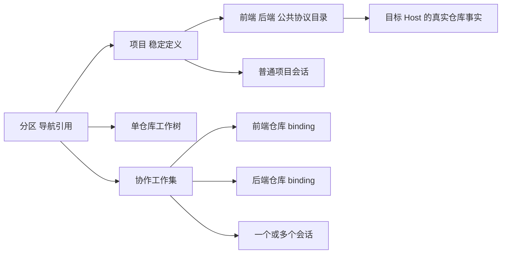
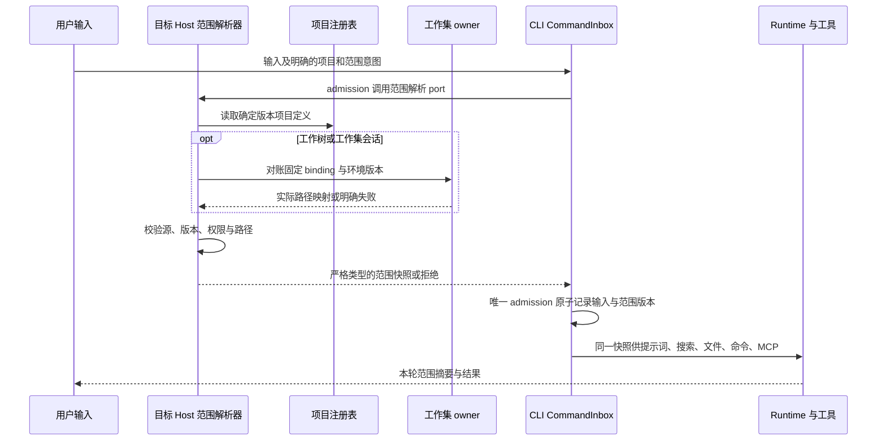
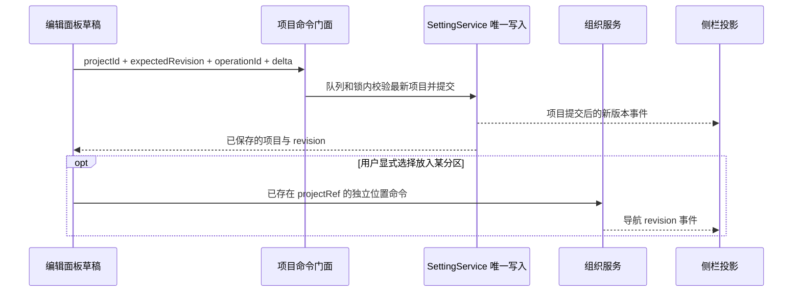

# 侧边栏编辑与多目录项目协作增强方案

日期：2026-10-16。设计基线：`05c9d6e3`，仓库版本 `3.19.1`。状态：S1—S3 主要实现及自动化回归完成；S4 已有身份、离线和协议验证，真实远端／设备验收待环境。逐项放行以[实施验证记录](sidebar-project-collaboration-verification.md)为准。

实施决定：项目修改使用 SettingService 原有队列和文件锁下的逐项目命令，校验 project revision 并持久化 operationId 收据；不在 UI 整数组覆盖项目。分区编辑沿组织服务的同一事务入口，打开时冻结 revision；移动、移出及撤销同时维护默认目标。所有编辑入口共享表单与提交逻辑，专注过滤不改变草稿的真实成员。

目标是让用户在左侧完成分区和项目的创建、编辑与维护，并让一个前后端需求能够持续使用正确的项目目录和工作树。用户配置一次项目成员后，新建或恢复会话能获得明确、可核查的目录关系；分区整理、项目范围和实际执行位置各有独立含义。

## 1 产品决定

1. 新建与编辑成对提供。分区增加统一「编辑分区…」，项目增加统一「编辑项目…」，两个入口都能从对象右键和行尾三个点进入。快捷重命名可以保留，但不能替代完整编辑。
2. 编辑分区管理名称、成员入口、顺序和默认新建目标；编辑项目管理名称、源目录、成员用途及会话默认范围。分区移动不授予文件访问权限，不改变真实目录或连接。
3. 一个项目可以包含多个目录。相同 Git 仓库的多个目录映射到同一工作树；不同仓库需要分别创建工作树，再关联到同一个「协作工作集」。每个仓库仍有自己的分支、提交和发布结果。
4. 目录清单由项目配置持久化，由程序在会话入口解析并传递。项目说明和记忆保存架构约定；它们不代替目录注册、权限或执行绑定。
5. 「全部／项目／工作树／会话」继续是本端显示偏好。编辑、关联、错误和右键动作均针对真实对象，不能以当前过滤后的片段覆盖完整对象。
6. 远程连接的目录仍表现为项目；只有真实 WorktreeService binding 才表现为工作树。连接状态、读取失败和 Git 状态分别展示，重读不发起重连。
7. 先交付分区和项目编辑，再交付会话范围闭环，最后开放多仓库协作工作集。后一个阶段的能力未通过验收时，入口明确禁用并解释原因，不静默退回原目录。

配套文件：[验收场景](sidebar-project-collaboration-acceptance.md)、[三轮审查记录](sidebar-project-collaboration-review.md)。

## 2 设计基线与增强范围

本节记录设计开始时的源码事实；下表的“当前”指上述设计基线。截图提供「名称、源文件夹、主要标识、添加、取消、保存、移除本地项目」的交互参考。实现后的状态、文件与命令见实施验证记录，不以这张历史现状表判断新增能力。

| 领域     | 当前检出源码中的能力                                       | 本方案补齐                                                  |
| -------- | ---------------------------------------------------------- | ----------------------------------------------------------- |
| 分区     | 已有创建、重命名、添加、移动、排序、拆分、解散及撤销       | 在一个编辑草稿中组合修改，原子保存，保留冲突草稿            |
| 项目     | 本地项目保存稳定 id、名称、主目录和最多 20 个源目录        | 统一编辑入口、逐项目并发校验、成员用途、影响说明            |
| 会话范围 | 文件搜索读取源目录；已配置 filesystem MCP 时追加存在的目录 | 明确项目上下文契约，原生工具与 MCP 适配一致，新建和恢复一致 |
| 工作树   | 当前要求所有源目录属于同一 Git 仓库，按绑定映射到 checkout | 多仓库工作集协调器，每库独立工作树和收据                    |
| 项目记忆 | 已有项目说明和 workspace 记忆；工作树有独立执行根          | 自动提供稳定目录关系，保留记忆边界，不混入其它聊天正文      |
| 远程     | 现有 SSH、WSL、Docker 项目及完整 identity 路由             | 同环境成员编辑、逐成员状态、断线后的有界恢复                |
| 侧栏     | 统一树、专注子菜单、独立归档、逐来源错误                   | 编辑后的即时投影、协作工作集投影、完整位置菜单              |

### 2.1 已核实的源码入口

| 文件或接口                                                                                     | 证据及影响                                                       |
| ---------------------------------------------------------------------------------------------- | ---------------------------------------------------------------- |
| [SidebarSectionHeader](../packages/ui/src/WorkspaceSidebar/SidebarSectionHeader.tsx)           | 分区三个点与右键共享动作；现有菜单没有统一编辑项                 |
| [SidebarOrganizationDialog](../packages/ui/src/WorkspaceSidebar/SidebarOrganizationDialog.tsx) | 创建、重命名、移动等有各自草稿；可以演进成编辑模式               |
| [ISidebarOrganizationService](../packages/services/src/sidebar-organization/contract.ts)       | 组织快照、CAS revision、operationId、提交后事件；只保存导航引用  |
| [组织协议](../packages/shared/src/sidebarOrganization.ts)                                      | 严格 schema；当前引用只有 project、worktree、task                |
| [LocalProject](../packages/shared/src/localProjects.ts)                                        | id 稳定，主目录为首个源目录，主目录冲突规则已存在                |
| [项目根级命令](../packages/ui/src/root/useRootWorkspaceActions.ts)                             | 先保存项目事实再打开项目；已有创建和移除，无统一更新命令         |
| [设置写入](../packages/services/src/setting/settingService.ts)                                 | 已有写队列与文件锁；整数组 patch 不等于逐项目 CAS                |
| [文件搜索](../packages/ui/src/mentions/providers/fileMentionProvider.ts)                       | 项目源目录与真实工作树映射目录均参与搜索                         |
| [MCP 范围适配](../packages/services/src/session/mcpWorkspaceScope.ts)                          | 只修改已配置的特定 filesystem MCP；未配置时不产生目录上下文      |
| [工作树能力](../packages/services/src/worktree/app/capability.ts)                              | 显式拒绝仓库外源目录、不同仓库和不支持的 submodule 组合          |
| [工作树执行](worktree-session-execution.md)                                                    | 原项目归属与真实执行路径分开；恢复、lease 和两种交付语义已有约束 |
| [项目会话默认值](project-session-defaults.md)                                                  | 默认值仅初始化合适的新草稿；选择设置项目不连接、不启动 Agent     |
| [项目记忆位置](workspace-memory-storage-location.md)                                           | 多目录项目沿主根隔离；工作树记忆根不能换成原项目根               |

本方案中的新增接口和字段均标为「拟新增」，不是当前已存在的 API。实施时以更新后的严格 schema、模块 contract 和真实测试为准。

## 3 对象关系

| 对象                    | 含义与唯一事实来源                                 | 与其它对象的关系                                                     |
| ----------------------- | -------------------------------------------------- | -------------------------------------------------------------------- |
| 分区 Section            | 导航分区，由组织服务持有                           | 保存项目、工作树、工作集或会话的稳定引用                             |
| 项目 Project            | 一组有明确用途的源目录，由设置中的项目注册表持有   | 一个主目录作为历史兼容锚点，多个稳定 member                          |
| 项目成员 Member         | 一个目录及其用途、来源环境和默认参与状态           | 可以与其它项目引用同一物理目录，不能由此绕过真实 checkout 的并发规则 |
| 仓库 Repository         | 目标 Host 探测出的 Git 事实                        | 多个 member 可以归属于同一 Git 仓库                                  |
| 工作树 Worktree         | 单个仓库的真实 binding，由 WorktreeService 持有    | 保存 checkout、分支、环境、生命周期；不升级为跨仓库 binding          |
| 协作工作集 ExecutionSet | 某次需求冻结的一组仓库绑定，由拟新增工作集服务持有 | 多个会话可以明确加入同一工作集，项目编辑不会重写其中的路径           |
| 会话 Session            | CLI/runtime 持有的对话与执行事实                   | 绑定项目范围快照，或绑定确定的协作工作集                             |



分区没有隐式 AI 工作范围。把两个项目拖进一个分区，不会自动让任一会话访问另一个项目。需要协同时，用户从项目编辑添加源目录，或从分区的显式协作入口选择一个主项目和成员。

首版分区不嵌套分区；项目 member 不再引用另一个项目对象。通过「从已有项目选择目录」导入稳定目录引用，避免项目互相包含、循环展开和来源变化引发隐式扩权。

## 4 用户闭环

### 4.1 编辑已有前端项目并加入后端

1. 右键前端项目，选择「编辑项目…」。面板展示已保存名称、主目录和源目录。
2. 点击「添加目录」，选择后端目录；填写用途「后端」，查看实际来源和 Git 识别结果。
3. 保存前显示本次增加、移除、排序变化及生效范围。没有变化时保存禁用。
4. 成功后项目名称和「2 个目录」摘要立即更新，不打开新聊天、不新建草稿。
5. 新会话自动得到两个目录及用途。进入工作树模式时，按真实 Git 仓库数量决定单树或协作工作集。
6. 重新启动后，目录关系仍由同一个项目定义恢复。

### 4.2 编辑混合分区

1. 右键分区或行尾三个点，进入「编辑分区…」。
2. 修改名称、添加已有项目或工作树、移除入口、拖动顺序、选择默认新建目标。
3. 保存一次提交整组导航变更；从其它分区移来的对象显示原位置。
4. 取消不写组织服务，不影响当前聊天。解散分区仍是单独动作，不等同于编辑时清空成员。

### 4.3 一个需求同时修改两个仓库

1. 项目包含前端和后端两个仓库，点击「新建协作工作集…」。
2. 选择参与目录和各仓库基线，默认显示全部启用成员，不预选不可用成员。
3. 目标 Host 预检环境、Git、权限和路径；同仓库目录合并为一个 binding 计划。
4. 协调器逐库准备并保存进度；全部必需仓库 ready 后才允许提交第一条用户输入。
5. 会话清楚展示前端、后端的实际工作树路径，后续同一工作集会话沿用这些绑定。
6. 提交和集成按仓库展示结果；一个仓库成功不能冒充整个需求已经发布。

## 5 左侧入口与布局

工具栏保留「三个点图标 + 侧边栏」与独立归档按钮。悬停打开菜单，专注和筛选排序使用独立子层，不推动主菜单。右键不打开会话、不创建草稿、不展开容器。

```text
工作空间                       ··· 侧边栏   归档
  产品迭代                         ···
    商城项目                 2 个目录 ···
      登录需求讨论
    登录联调                 协作工作集 ···
      frontend / feat/login
      backend / feat/login
      联调实现会话

  项目
    文档项目                 1 个目录 ···
  工作树
    修复支付回调
```

分区可混合内容。目录成员只在编辑面板、项目详情和会话范围详情中展开，不把项目成员目录、真实工作树与聊天混成同一层。协作工作集的子节点是实际 binding 与会话；各有独立图标和右键目标。

| 专注范围 | 展示规则                                                             |
| -------- | -------------------------------------------------------------------- |
| 全部     | 保留统一混合树，显示用户创建的空分区，隐藏没有内容的系统分类         |
| 项目     | 显示项目入口与目录数量，隐藏项目子会话和工作集                       |
| 工作树   | 显示单仓库工作树与协作工作集，工作集可查看真实 binding，不显示子会话 |
| 会话     | 平铺活动会话，显示项目和实际执行来源，按完整 scope 与 taskId 去重    |

编辑面板始终读取完整对象，专注不截断成员列表或保存范围。新增的匹配入口按当前专注显示；不匹配的内容保存成功后不强制改用户专注，成功提示提供「显示全部」链接。

## 6 分区编辑

### 6.1 面板

```text
编辑分区                                            ×
名称       [产品迭代                              ]

内容                                      添加已有内容
⋮⋮  项目图标 商城项目        本地 · 2 个目录        移出
⋮⋮  工作集图标 登录联调      已就绪 · 2 个仓库      移出
⋮⋮  会话图标 需求拆解        商城项目               移出

默认新建目标 [每次选择                          v]
说明：这里只整理侧栏入口，AI 目录范围在项目中管理。

关联协作   [为已有项目添加协作目录…]

解散分区…                                  取消    保存
```

名称保留当前 80 字上限。成员列表展示名称、对象类型、来源、真实状态和原分区；同名对象必须可区分。鼠标拖动与键盘上移、下移等价，触屏提供行内三个点，不要求长按才能操作。

成员移出只修改草稿，保存后回自然位置。分区内项目的自然子会话不作为独立成员重复列出，可在行内展开只读数量；已经独立放置的会话保留独立行。

添加其它分区的成员时，在确认列表中显示「将从 发布准备 移入」，不复制引用。不允许通过当前搜索结果覆盖整个分区；搜索只过滤编辑草稿的展示。

### 6.2 默认新建目标

默认值为「每次选择」。可选择本分区直接包含的项目、可用工作树或工作集，不能选择一个聊天推断其执行目录。

目标引用只决定新建入口如何选择，不保存连接状态、Git 事实或权限。默认目标离线时保留引用并显示具体原因，点击新建先提示目标不可用，不改用当前活动项目。移除或移动默认目标时，在同一次组织事务中清空默认引用。

### 6.3 保存、冲突与撤销

编辑草稿由弹层持有，打开时冻结 baseRevision。提交给既有组织 owner 的一个原子批次，包含名称、成员变更、排序与默认目标更新；均成功或均不生效。operationId 重试不生成第二个分区。

全局 revision 冲突保留草稿，并展示「原内容／远端最新／我的修改」。用户查看差异后可重新提交新的基线，不能自动覆盖其它窗口的编辑。关闭有修改的弹层使用应用内「继续编辑／放弃修改」提示，不用原生 confirm。

撤销只撤销已接受的组织事务，不回退项目定义、工作树准备或连接。撤销遇到新 revision 冲突同样停止，不覆盖其它窗口的整理。

## 7 项目编辑

### 7.1 视觉与字段

延续截图的结构：紧凑标题，名称输入框，带分隔线的目录列表，底部左侧独立移除入口，右侧取消和保存。额外的角色、来源和状态采用次级文字及按需展开，不在默认面板堆满技术字段。

```text
编辑项目                                            ×
项目名称   [商城项目                              ]

源文件夹                                   添加目录
⋮⋮ frontend   主要    用途：前端
   /workspace/shop/frontend       本地 · Git 仓库 A
⋮⋮ backend            用途：后端                   移除
   /workspace/shop/backend        本地 · Git 仓库 B
⋮⋮ contracts          用途：公共协议               移除
   /workspace/shop/contracts      本地 · Git 仓库 A

项目说明   [前后端共用 contracts，接口改动需同步…  ]
新会话默认范围   前端、后端、公共协议
执行方式         继承项目会话配置       查看配置…

生效说明：新会话使用保存后的范围；当前运行不会中途换目录。
移除本地项目…                              取消    保存
```

项目名保留 100 字上限，源目录保留最多 20 个。成员显示名拟限制 80 字、用途说明拟限制 1000 字、项目说明拟限制 4000 字；实施时在 shared schema 与两端 UI 中同时校验。所有文本支持中文输入法，Enter 不打断组合输入。

用途提供前端、后端、公共协议、测试、文档和自定义；它是目录说明，不是工具权限。不会因用户写了「后端」就运行某条命令或启动服务。

「执行方式」链接到已有项目会话配置及其 owner。模型、审批和提交审核继续复用既有配置入口，本面板不维护第二份默认值。用户已有聊天和手动编辑的草稿不被项目编辑重置。

### 7.2 主目录与顺序

主目录仍是现有路径身份和历史配置的兼容锚点。常规编辑允许名称、附加目录、用途、说明和显示顺序修改；不直接更改主目录，不因拖动排序而把第一个目录换成新主目录。

主目录展示「主要」，其移除按钮禁用并解释原因。空目录列表不能保存。显示顺序拟使用独立 memberOrder；兼容 sourceFolderPaths 始终把 primaryFolderPath 放在首位。不能直接把拖放后的显示数组写回旧源目录数组，也不改变默认命令 cwd。

需要换主目录时，使用单独的「以其它主目录建立项目…」流程：展示历史会话、配置与工作树仍属于原 scope；新建目标项目，原项目保留。首阶段不迁移历史 identity、不移动文件，也不声称这是普通重命名。已存在相同主目录项目时，引导编辑该项目，不能创建第二个冲突定义。

### 7.3 添加和移除

添加支持本端目录选择、能力允许的目录拖放、从已有项目选择源目录。远程项目只能浏览原目标环境；不能打开本机选择器后把本机路径当作远端目录保存。

新增目录先去重和探测：规范化路径、实际路径、Host 身份、是否存在、目录类型、Git 根。路径键仍使用共享规范化工具；探测真实路径用于去重和安全检查，不拿 Git 根替代 workspace identity。

同一仓库多个成员保留各自用途，Git 操作合并为一个仓库计划。同名、不同路径的目录不合并；同路径、不同远端 identity 的目录不合并。重叠目录的搜索结果去重，命令执行不因它们出现两次。

已保存但暂时缺失的目录可保留，行内显示原因，不能静默删掉。新增不可访问目录时阻止提交该新增行；用户可取消该行后保存其它合法变更。设置保存失败保留全部草稿。

移除成员不删除磁盘文件、仓库、聊天或工作树。依赖它的工作集保留冻结绑定，面板列明受影响的工作集。移除主项目定义仍遵守现有依赖门禁；「从项目移除目录」与「删除工作树」分别处理。

### 7.4 生效时机

| 对象状态                   | 保存后的行为                                                       |
| -------------------------- | ------------------------------------------------------------------ |
| 名称、侧栏摘要             | 事件到达后立即更新；稳定 id 不变                                   |
| 新建或冷恢复的普通项目会话 | 在提交本轮输入前解析最新项目版本                                   |
| 空闲的已有普通会话         | 下一轮 admission 前更新目录上下文与默认工具范围                    |
| 已接受或运行中的一轮       | 使用已冻结版本完成本轮，不能中途改 cwd、权限或工具根               |
| 已接受但尚未执行的输入     | admission 记录其解析版本；不得偷偷改成更新后的意图                 |
| 已有工作树或协作工作集     | 绑定成员、实际 checkout 和分支保持原值；新范围需要显式建立新工作集 |
| 手动编辑中的新会话草稿     | 输入正文、模型和本次执行选择保留；提交时展示范围变化并重新预检     |

普通成员移除不是紧急撤权。面板说明当前已接受轮次的生效边界；需要立即终止访问时，沿已有停止会话入口执行，并等待 runtime 停止证明。不能用配置保存成功冒充运行中工具已停止。

## 8 侧栏各位置的右键菜单

以下为新增阶段完成后的目标菜单。原任务分叉、反馈、日志等动作仍复用已有业务内容；这里列出固定组织段与需明确区分的动作。

| 位置                     | 菜单顺序与显示规则                                                                                       | 操作归属                                            |
| ------------------------ | -------------------------------------------------------------------------------------------------------- | --------------------------------------------------- |
| 全局空白                 | 新建分区…；新建项目…；添加远程项目…；批量整理；专注 ›；筛选和排序 ›；展开／收起；撤销整理                | 全局导航入口，不猜当前聊天目标                      |
| 自定义分区标题或内部空白 | 编辑分区…；添加已有内容…；在此新建会话…；为已有项目添加协作目录…；重命名；位置 ›；拆分；解散／删除空分区 | 完整分区事实，不受专注截断                          |
| 本地项目                 | 新建会话；新建协作工作集…；编辑项目…；打开项目文件；移入／移出分区；复制主路径；移除本地项目…            | 项目定义与原来源 owner                              |
| 远程项目在线             | 新建远程会话；新建协作工作集…；编辑项目…；查看远端文件；移入／移出分区；复制远端路径；原有远程管理       | 原 identity 对应的目标连接                          |
| 远程项目未连接           | 编辑已保存信息…；重新连接；组织位置；复制信息；需在线的新增目录／文件／执行动作禁用                      | 离线元数据仍可编辑，不触发 connect                  |
| 项目编辑中的成员行       | 编辑显示名与用途；上移／下移；查看完整路径；重新读取此目录；从项目移除                                   | 不等同于移除整个项目                                |
| 普通项目会话             | 现有会话动作；查看本轮项目范围…；分叉 ›；单独移入／移出分区；归档会话                                    | 保留 task 原 scope                                  |
| 单仓库工作树             | 在同一工作树新建会话；原有分叉动作；查看实际文件；管理此工作树…；组织位置；复制路径                      | 真实 binding，不按所在分区推断                      |
| 协作工作集               | 新建同工作集会话；查看工作集…；分别查看仓库 ›；组织位置；归档工作集…；复制范围摘要                       | 工作集 owner 协调，成员生命周期仍走 WorktreeService |
| 工作集内的单个工作树     | 查看该仓库文件／分支／状态；查看 binding；复制路径；允许的单库管理动作                                   | 活动工作集占用时禁止单独删除或替换 binding          |
| 工作集会话               | 查看实际执行范围；在同工作集新建／分叉会话；创建独立工作集分叉…；会话组织与归档                          | 同工作集会话明确共享文件；独立分叉创建新绑定组      |
| 置顶会话                 | 原置顶菜单；查看项目／执行范围；整理取消置顶后的归属                                                     | 置顶不抹去项目关系或显式位置                        |
| 归档会话                 | 恢复；允许的永久删除；查看来源；复制信息                                                                 | 不因删除聊天而清理工作树或工作集                    |

行尾三个点与右键共用动作定义；触屏可直接使用三个点。平台确实没有的能力隐藏；对象暂时离线、忙碌或版本不支持的能力保留禁用及具体原因。读取错误旁提供「重新读取」，连接错误提供「重新连接」，不再使用含糊的同一个刷新入口。

「归档工作集」是业务动作，需要清楚列出会话、binding 和快照策略；没有实现完整归档合同的阶段不显示可执行入口。分区菜单不增加「删除所有实际项目」或「一键删除所有工作树」。

## 9 会话目录上下文

### 9.1 明确的范围契约

拟新增 `ProjectContextSnapshot`，至少包含 projectId、projectRevision、范围摘要、主目录、成员稳定 id、名称、用途、原 source scope、可用性及本次实际执行映射。敏感连接凭据、其它聊天正文和任意文件内容不进入该快照。

主项目成员名与路径由系统字段格式化。成员说明属于用户数据，不允许通过字符串拼接伪装成系统指令。各目录的 AGENTS 等指令仍按原有作用域和优先级读取，不把一个仓库的规则无条件覆盖另一个仓库。

```text
项目：商城项目  revision 8
本轮范围：前端、后端
前端：/worksets/login/frontend  用途：页面与交互
后端：/worksets/login/backend   用途：API 与数据处理
本轮工作目录：/worksets/login/frontend
其它成员的命令必须指定该成员的实际目录。
```

普通本地会话展示原项目目录；工作集会话展示工作树目录。遇到离线成员，快照明确标为不可访问，不能把原目录或同路径本地目录替代进来。

### 9.2 唯一解析与写入路径



Renderer 只持有未提交草稿和 optimistic overlay，不复制 accepted 输入队列。CLI CommandInbox 在唯一 admission 中调用 Host 解析 port，把输入和确定的范围版本共同持久化后才返回接受收据；失败不产生半份接受记录。Host 只返回事实，不保存第二份 accepted queue。

输入排队期间的项目更新不改写该收据。真正执行前再次核对冻结绑定、来源 generation 与路径有效性；失效时停止并显示原因，不改用最新项目范围来解释一条已经被接受的输入。下一次新的输入按新的 admission 重新解析。

原生文件工具、搜索、终端、Git、checkpoint、rewind 和可选 MCP 适配器都从同一快照取范围。MCP 是适配层，缺少 filesystem MCP 不应再使项目成员从 AI 上下文中消失。

目录选择不是操作系统沙箱。多目录访问继续遵守现有工具审批和进程权限，不把一个 UI 勾选框或静态 shell 路径解析宣称为完整隔离。工作树功能必须证明默认工具实际指向 checkout，不能仅修改提示词。

### 9.3 持久化与恢复

会话保存 projectId、已接受轮次对应的 revision 和范围摘要；工作集会话额外保存 executionSetId 与固定 binding 引用。新会话不靠复制上一聊天的提示词获取目录清单。

恢复时先对账真实 owner，再解析范围。路径缺失、身份不匹配、已归档或 generation 变化时暂停写入并标明成员。项目被移除后，历史会话保留来源与冻结摘要，不能从目录名猜回其它项目。

记忆继续按既有实际执行 scope 隔离。可显式引用项目共同架构说明，但不自动合并两个工作树的历史记忆或敏感聊天内容。

## 10 协作工作集

### 10.1 仓库计划

新建工作集需要需求名称、项目、参与成员、每仓库基线、环境策略。默认复用已有项目执行设置；不在此新增另一套模型或审批设置。

Host 以 authority 与真实 Git common directory 归并仓库。同一仓库下的 frontend 与 contracts 只创建一次工作树，并映射两个子目录；另一个 backend 仓库创建第二个工作树。Git 归并键只用于 Git 计划，不替代会话和缓存的完整 identity。

首版要求所有参与执行的成员位于同一目标环境：本地，或同一个 SSH／WSL／Docker 来源。不同 Host、混合本地与远程、submodule 及当前 owner 不支持的组合明确拒绝。非 Git 目录可以用于普通项目会话，但不能默默留在原路径冒充已隔离的工作集成员。

「同一环境」以目标 Host／attachment 返回的可信 authority 为准，不按相同 hostname、目录前缀或两个 remoteSessionId 猜测。无法证明属于同一执行环境时，保持不支持的具体原因。

### 10.2 准备状态与幂等

拟定状态：`preflighting → preparing → ready`；可转入 `prepare_failed`、`cancelling`、`cancelled`、`unavailable`、`archived`。每个成员仓库分别保存阶段、bindingId、错误和重试条件，状态由 owner 推导而不是 UI 自行计数认定 ready。

所有必需仓库就绪、环境引用有效、实际路径映射完成后，工作集才 ready。若两库中一库失败，显示「已准备 1/2，后端失败」，保留前端绑定，不启动第一轮，不回退成仅前端执行。

准备中的输入正文仍是 Renderer 未提交草稿；ready 后才进入唯一 CommandInbox admission。准备重试只恢复资源，不代替用户再次提交正文，也不重复发送已接受输入。

工作集创建 operationId 与冻结计划摘要绑定。重复请求和回复丢失返回同一工作集；同一 key 携带不同计划拒绝。每库调用原 WorktreeService 的幂等准备请求，重试仅对未完成部分对账，不创建重复分支。

取消先退休执行入口，再由 owner 对账各仓库阶段。存在修改、未知执行进程或快照失败时保留绑定及清理说明；不能把一次取消当作可以删除用户改动的许可。

### 10.3 执行与并发

同工作集的新会话共享同一组实际文件，界面必须明确。写入许可继续由各真实 checkout 的原协调器控制，不按 projectId 新建另一把无法互斥的锁。

用户确认保留并行：普通会话领取共享执行许可，可以同时操作同组文件，修改会彼此可见；合并、归档及目录生命周期操作继续独占。不能将共享许可描述为会话串行，也不能用分区或聊天的视觉位置推断文件隔离。

需要同时持有多个 checkout 许可的操作，按稳定仓库键顺序获取；任一获取失败释放本次已取得许可，并等待真实 owner 变化或返回忙碌，不持有半组锁重试。不要在未取得全部必要许可前执行跨库写入。协作会话在整轮及其后台任务期间持有全部成员的共享许可，Git 管理操作按自身合同申请独占许可。

一个 CLI/runtime 会话可在同一环境中使用多个明确目录，不为每个 member 创建新的 Agent、Local Host 或会话 accepted queue。现有 owner/lease、stale run 和 client generation 防护全部保留。

### 10.4 绑定所有权与会话索引

当前 WorktreeExecutionBinding 以 taskId 持有绑定，同树会话通过 parentBinding 和 alias 关联。多仓库工作集不能把一个聊天 taskId 填进多个旧接口后，就宣称它们具有完整工作集归属；也不能创建伪聊天、隐藏 Agent 或虚构 taskId 来取得 binding。

工作集阶段必须先扩展 WorktreeService 的公开所有权合同，拟新增可区分的 `BindingOwnerRef`：旧 session owner 与新的 executionSet/repository owner。旧绑定缺省按原 session owner 读取，不改写其归属；新工作集绑定通过明确的新版本请求建立，并通过 bindingRef 和消费者引用查询，不借用旧 getBinding(taskId) 猜测。

每个 binding 的持久工作集消费者登记仍由 WorktreeService 自己提交，拟提供 `attachConsumer / detachConsumer` 的幂等能力。创建顺序为工作集持久计划 → 原 owner 准备本库并登记消费者 → 工作集记录收据。两份文件不是假原子事务；中途崩溃按相同 setId、repoKey 和 operationId 对账。无法证明工作集已结束、消费者已停止时保留登记，不执行猜测式垃圾回收。

一条用户会话只生成一条原项目范围内的任务索引，不因有两个仓库变成两条聊天。拟新增显式 executionSet 执行记录，包含 originProjectScope、primaryExecutionScope、每个 member 的实际 execution scope、bindingRef 和版本；不能只把第一棵树塞入旧 executionBindingId 而丢失其它仓库。

普通会话的 workspacePath 与每次工具操作的 workspacePath 仍表示对应实际目录，原项目归属用明确的 origin 字段证明。Git、文件和命令分别使用选定成员的真实 execution scope。工作集索引回写只接受已验证的原项目引用；旧单树 TaskIndexSyncer 路径保留，新增分支以严格协议版本区分。

### 10.5 提交、发布与归档

跨仓库提交不是 Git 原子事务。每库分别冻结源 HEAD、目标 HEAD、验证证据和发布收据；部分成功时明确列出已发布与待处理仓库，下一次只对账未完成操作。

不能为追求「整体回滚」改写已发布仓库历史，不能重复推送一个已确认成功的库。协调器记录整体需求进度，不替代各 WorktreeService integration 的权威状态。

归档和清理复用各 binding 的快照、dirty、ignored 文件与恢复合同。仍有工作集会话或活动进程引用时禁止单独释放成员。删除聊天、移出分区、移除项目引用均不隐式归档工作集。

## 11 远程和多端边界

| 组合                          | 项目编辑                                     | AI 范围与工作集                                 |
| ----------------------------- | -------------------------------------------- | ----------------------------------------------- |
| 本地多个目录                  | 可编辑和选择本机目录                         | 普通会话多目录；按真实仓库决定工作树数量        |
| 同一 SSH 目标多个目录         | 在线浏览，离线改已保存名称及用途             | 需目标 Host 明确支持同环境多根与工作集能力      |
| 同一 WSL 发行版或 Docker 来源 | 复用原来源浏览与路径规则                     | 不能与宿主机同名路径混用                        |
| 本地加远程、两个远程目标      | 分区可混排；首版协作项目保存时拒绝此执行组合 | 明确提示环境不一致，不自动复制文件或创建连接    |
| 未连接的历史远程项目          | 可整理和编辑离线元数据；新增目录需连接       | 状态为未连接，不产生全局读取告警                |
| 真正读取失败                  | 对应项目或成员行显示感叹号与具体原因         | 重新读取只访问该来源，不等于重连                |
| 手机和远控 Web                | 操作桌面已有 attachment；目录浏览取决于能力  | 共享相同 owner、工作集和会话，不在手机新建 Host |
| 不支持新版协议的 Host         | 可保留原有读面                               | 新编辑／范围／工作集动作禁用并说明版本要求      |

`workspaceIdentity?.trim() || workspacePath` 继续用于引用、绑定、缓存、请求和去重。远程请求贯穿 identity 与当前 remoteSessionId；持久 member 不以短生命周期 sessionId 作为唯一来源身份。身份格式由现有构造／解析工具产生。

切换连接 generation 后，旧目录探测、旧错误和旧预检结果失效；只有相同 scope、项目 revision 和请求代际的结果可被接纳。重连不自动重放未确认的创建、发布或执行请求。

Desktop 使用 `desktop-continuous` 实时事件；手机使用 `web-remote-replayable` 的 snapshot、cursor 和 gap 修复。两者读取同一业务 owner 的序列。导航组织快照仍沿自己的 revision 订阅，不塞进会话 token 流。

## 12 状态所有者与接口

### 12.1 所有者

| 状态                         | 唯一事实 owner                                 | UI 与持久化边界                                          |
| ---------------------------- | ---------------------------------------------- | -------------------------------------------------------- |
| 分区及成员位置               | ISidebarOrganizationService                    | 编辑草稿是局部状态；沿既有组织文件 CAS 提交              |
| 项目定义及成员               | SettingService 持有的项目注册表                | 新增项目命令门面，不能在 Renderer 先读整数组再覆盖       |
| 项目会话默认配置             | 现有 SettingService / 项目配置链               | 编辑面板只链接和读投影，不复制设置                       |
| 连接状态和 remote generation | 现有窗口连接注册表及原连接 owner               | 不从分区位置推导连接，不另建 Desktop Remote Host         |
| Git binding 与环境           | 原 WorktreeService / RuntimeEnvironmentService | 工作集只引用结果，不复制 accepted binding                |
| 协作工作集进度               | 拟新增 ProjectExecutionSetService              | 自有 operation journal；每库状态以原 owner 收据对账      |
| 会话范围与输入接受           | CLI/runtime CommandInbox                       | Host 通过 port 提供解析结果；Renderer 只有草稿与 overlay |
| 专注、排序和展开             | 当前 UI 偏好 hook                              | 不写成服务端项目或连接事实                               |

这里的项目注册表属于当前应用 profile 的原 Host：桌面使用窗口已有 Local Host，服务端 Web 使用其原应用 Host。它不随正在浏览的远程 workspace 服务切换。远程目录事实仍向原远端 owner 查询，远程模型配置仍沿既有目标环境设置链。

拟新增的项目定义与工作集服务注入方式复用组织服务的源 Host 注入思路；手机共享桌面 attachment，不在远端 workspace 或手机另建一份项目注册表。范围解析 port 组合本端 profile 定义和目标 Host 事实，二者不能靠裸路径关联。

### 12.2 拟新增的命令合同

以下是能力命名草案，实施时进入正式 contract 和 runtime schema；不得在业务代码中直接假定这些方法已存在。

| 命令                                    | 输入与结果                                                      | 提交及失败规则                                              |
| --------------------------------------- | --------------------------------------------------------------- | ----------------------------------------------------------- |
| 组织 `editSection` mutation             | sectionId、name、entryDelta、order、defaultTargetRef            | 复用 apply 的 expectedRevision 和 operationId，整个批次原子 |
| 项目 `applyProjectMutation`             | projectId、expectedProjectRevision、operationId、字段或成员增量 | SettingService 队列与文件锁内重读、按 id 修改、校验并写入   |
| 项目 `inspectMembers`                   | source scope、member 候选、projectRevision、request generation  | 只读，有界并行；返回逐项事实，不调用 connect 或创建 Agent   |
| 项目 `resolveContext`                   | projectId、revision 约束、显式本次范围                          | 返回完整快照或明确拒绝，不用当前活动项目兜底                |
| 工作集 `prepare`                        | projectId、冻结 revision、参与成员、各库基线、operationId       | 先持久计划，再调用原 owner；可恢复地结算部分结果            |
| 工作集 `getSnapshot/onDidChange`        | executionSetId、已见序列                                        | 快照与单调事件；多端缺口可恢复                              |
| 工作集 `cancel/retry/archive`           | executionSetId、expectedRevision、operationId                   | 原工作集和原计划对账；不把重试变成改换分支                  |
| binding `attachConsumer/detachConsumer` | 明确 bindingRef、持久 ownerRef、operationId 与停止证明          | WorktreeService 唯一写入消费者；没有结束证据不能清理        |

项目提交返回 `applied / conflict / validation_failed` 的结构化结果，包含当前对象或字段错误。相同 operationId 和不同内容拒绝；ACK 丢失重发原 key，不能以新 key 再创建。不能复用当前仅针对账号字段的 expectedAccountSettings 参数实现项目并发校验。

项目改名和成员更新只修改目标项目，保留其它项目及未涉及的全局设置。检查目录可以先异步预检，磁盘和远程事实仍必须在真正执行前重新确认；编辑保存不是后续执行权限的永久证明。

目录探测采用有界并行，拟默认上限 4；按完整 scope、项目版本、候选成员签名和请求代际接纳结果。名称、用途和排序等纯元数据编辑不遍历整个磁盘，不扫描固定工作树根，也不启动 Agent。

### 12.3 跨 owner 事件顺序



项目保存与导航放置不是跨文件假原子事务。若项目已保存而放置冲突，提示「项目已保存，分区位置未更新」，只重试导航；不能回滚已被其它会话使用的项目，也不能再次创建项目。

### 12.4 会话范围实施契约

沿现有 runtime-preferences Host 回调增加显式 `project-admission` 请求，携带版本 1 和实际 workspace 引用。仅该请求返回严格的 projectContext；旧两种偏好请求不增加字段。CLI 的串行命令 admission 在写入 accepted input 前解析范围，将快照与输入事实一起持久化；queue、retry、snapshot 只传递该事实。远端请求原路交由桌面已有设置 owner 解析，远端 Host 校验实际工作树映射并重新检查目录。无注册项目时返回 null。该上下文通过原生 meta user 附件提供，不要求配置 filesystem MCP，也不替代工具权限或审批。

分区中的「为已有项目添加协作目录…」先让用户选择一个已有主项目，再打开项目编辑并预填所选目录。取消不写任何 owner。保存不删除其它项目，不循环引用整个项目，不暗中改变原主项目身份。

## 13 数据演进与兼容

### 13.1 分区

保留 sectionId 和稳定 entryRef。拟增加可空 defaultTargetRef，以及 editSection 增量；工作集阶段再增加 executionSet 引用种类。schema 版本升级必须和服务能力握手一起发布，未知引用不能被旧端解析为「空分区」后写回。

拟新增的工作集引用显式包含 `kind: executionSet`、executionSetId、projectId 和原项目 WorkspaceRef。entry key 从稳定 id 与完整原 scope 计算，不使用名称、当前连接 sessionId 或第一棵树的目录替代工作集身份。默认新建目标只接受本分区直接包含且种类合法的引用。

旧分区迁移只补缺省字段，不改变位置、不复制真实对象。旧单工作树继续是 worktree 引用，不批量包装成工作集，不制造重复列表。

### 13.2 项目

第一阶段沿 `AppSettings.localProjects` 增加逐项目 revision 与成员描述扩展；原 id、primaryFolderPath、sourceFolderPaths 保留，所有创建、编辑和移除进入同一项目命令入口。

历史 recentProjects 或旧 tab 形成的隐式单目录项目同样提供「编辑项目…」。打开时只在草稿中预填目录与名称；首次保存由 owner 原子升级为显式定义，保留原 workspacePath 和历史会话路径。两个窗口同时升级时校验主目录唯一性，后提交者收到已存在对象与冲突，不覆盖其名称和成员。成员稳定 id 由 owner 首次提交分配并持久化，不能每次打开编辑面板重新生成。

后续统一远程项目元数据时，拟引入版本化 `projectDefinitions`，由同一个 SettingService 持有并成为唯一可写事实。旧 localProjects 仅作为该 owner 同次提交生成的兼容投影，客户端不再直接写旧数组；不能允许两个集合独立编辑。远程连接历史和凭据继续由原 owner 持有，项目定义只保存非敏感来源引用。

迁移前保存私有备份，锁内读取最新配置，稳定映射旧项目 id、主路径和成员，原子提交新定义、迁移标记和兼容投影。重复迁移幂等；单条不合法记录保留并报告具体记录，不以空集合覆盖。

旧客户端连新版 Host 时通过能力校验阻止新版不兼容写入。直接运行旧二进制写同一配置目录不是新 RPC 能保证安全的场景；跨版本回退使用迁移前备份及明确的导出流程，不能把兼容读投影宣传为任意版本可双向写入。

### 13.3 会话与工作集

旧会话无 projectId 时按现有完整 scope 回退，不按裸 taskId 关联。新会话显式存 projectId 和范围版本。projectId 不替换 workspaceIdentity，不把不同远端的同路径会话合并。

已有 binding 的路径、task owner、环境策略和恢复语义保持不变。新工作集使用扩展后 WorktreeService 合同创建的 set owner binding；只有显式「加入已有工作树」并通过占用与来源校验后才能复用，不自动收编其它需求正在使用的树。

新工作集创建、消费者登记、执行记录、工具目标及 snapshot 的协议必须一起提供能力版本。旧 binding owner 的 adapter 只能适配旧 session 数据，不能用默认字段把未知工作集降成单树。尚未支持新合同的 Host 不开放工作集按钮。

## 14 模块与实现位置

| 位置         | 当前文件或模块                                                      | 计划变更                                                                  |
| ------------ | ------------------------------------------------------------------- | ------------------------------------------------------------------------- |
| 分区编辑     | SidebarOrganizationDialog、SidebarSectionHeader、组织 shared schema | 新编辑模式、默认目标、动作定义；不在 UI 写 Git 状态                       |
| 项目编辑     | ChatEmptyCreateProjectDialog、useRootWorkspaceActions、LocalProject | 复用表单基础，拟新增编辑面板及项目命令 hook                               |
| 设置项目命令 | services 的 setting 模块                                            | 在原 owner 中增加逐项目原子增量，不新增平行写设置文件的 Repo              |
| 目录上下文   | lcode-session、lcode-agent、bootstrap/core context                  | 严格快照、统一解析与 admission、原生工具和 MCP 一致                       |
| 工作集       | 拟新增 managed project-execution-set 模块                           | contract、domain、app、adapters、module、contract example；先登记架构策略 |
| 生命周期执行 | 现有 worktree、runtime-environment 模块                             | 通过公开 port 调用；不由 UI 或协调器直接修改其存储                        |
| 远程注入     | RemoteServiceAccess、窗口服务注入、原连接注册表                     | 复用 Host owner，完整 identity 与 generation 校验                         |
| 导航读面     | UnifiedSidebarTree、projection、catalog、focus                      | 增加工作集引用和项目成员摘要；专注仍只读投影                              |

接口和跨模块边在实现前更新模块 contract 与架构策略。新增 hooks 中有 JSX 时使用 .tsx；跨包只走公开入口；文件与网络 I/O 异步；日志使用既有 logger，输出不包含凭据和真实用户数据。

## 15 UI 细则与空失败状态

桌面项目编辑建议最大宽度约 680px，分区编辑约 560px，二者均有 viewport max-width 和内容滚动；手机使用同一表单的全屏面板，底部操作栏避让软键盘和安全区。尺寸是设计建议，字体全部使用 DESIGN.md 的 text-ui-\*，不通过修改 html 字号缩放。

面板使用语义 surface、border、menu、warning 和 destructive token，兼容七套主题。正常未连接使用中性状态，不用错误红色；真实错误显示在具体成员旁，悬停、聚焦或点击能看到同样的原因。

| 状态         | 用户看到的内容                         | 可执行动作                                                  |
| ------------ | -------------------------------------- | ----------------------------------------------------------- |
| 初次读取中   | 面板局部骨架，名称和列表不展示伪空数据 | 取消                                                        |
| 读取失败     | 对象名称、来源及原因                   | 重新读取此对象；关闭                                        |
| 尚无修改     | 正常已保存内容                         | 保存禁用，取消                                              |
| 有合法修改   | 修改摘要、影响范围                     | 保存、取消                                                  |
| 保存中       | 保存按钮 loading，防重复提交           | 可关闭视图；不取消已发命令，页面请求控制器继续按原 key 追踪 |
| 校验失败     | 对应字段或成员的错误                   | 原地修正，不清空草稿                                        |
| 并发冲突     | 最新值和本地草稿差异                   | 查看差异后重提、放弃本地草稿                                |
| ACK 不明     | 正在核对保存结果                       | 用同 operationId 对账，不显示虚假的再次创建                 |
| 项目已被移除 | 只读草稿与明确原因                     | 另存为合法新项目或关闭，不复活原 id                         |
| 分区已被解散 | 只读草稿与成员现位置                   | 返回侧栏；显式另建分区                                      |

保存、取消、移除的触达面积、焦点顺序和 loading 语义一致。关闭弹层返回原触发器；原触发器被移除时回到侧栏工具栏。错误后焦点到首个错误字段；不能因为异步列表探测抢走用户正在输入的名称焦点。

项目冲突面板保留上方本地草稿，并列出 owner 返回的最新名称、说明和有序目录清单（路径、用途、说明及默认参与状态）。只显示最新目录数量不足以让用户确认覆盖差异。用户明确查看最新内容后，才允许基于新 revision 重提原草稿。

关闭保存中的视图不等于撤销提交。页面级请求控制器仅保存 pending 请求引用和草稿，不持有第二份业务接受队列；完成后更新对应对象，失败在该对象旁提供重新查看。重开面板复用本页原 operationId 对账。应用重启先读取 owner 最新事实，不自动以新 key 重发一个结果不明的创建；未提交草稿首版不承诺跨应用重启保存。

## 16 交付顺序与放行门槛

| 阶段                  | 用户可用成果                                              | 必须通过的门槛                                                   |
| --------------------- | --------------------------------------------------------- | ---------------------------------------------------------------- |
| S1 分区和本地项目编辑 | 新建／编辑配对；取消和保存；成员和顺序；逐项目 CAS        | 不切聊天、原子保存、冲突保草稿、主目录不漂移、重启恢复           |
| S2 项目会话范围       | 新建与恢复自动获得全部合法目录和用途；UI 展示本轮范围     | 无 MCP、已有 MCP、原生工具、搜索及实际命令一致；版本生效边界明确 |
| S3 同环境多仓库工作集 | 一个需求包含每库工作树；准备、重试、恢复、同工作集会话    | 真 Git 多库隔离、半失败不执行、跨 checkout 许可、ACK 和崩溃恢复  |
| S4 远程和多端完整性   | 远程项目目录编辑、工作集、桌面与手机共享                  | 不串同路径身份，continuous/replayable 分别实测，未连接不误告警   |
| 后续独立能力          | 跨 Host 协作、主目录历史迁移、submodule 和非 Git 混合执行 | 单独定义路由、身份和恢复合同后开放；当前阶段明确不支持           |

各阶段内部先补对应验收用例，再实现。S1 可以独立发布，但只表述为编辑体验增强；要宣称解决「前后端配置一次，新会话持续知道目录」，至少联合放行 S1 与 S2。S1 尚未提供跨仓库工作树，S2 也不能以文件选择器里看见两个目录替代真实 AI 上下文验证。

## 17 验收与审查要求

工作集来源目录必须经过目标 Host 的 realpath 校验。首版拒绝 symlink/junction 形式的来源别名，并提示选择实际目录；避免复制到 checkout 的绝对链接仍指回原仓库。该拒绝发生在创建任一绑定之前，不把词法路径映射当作隔离证明。

资源归档的停止证明必须来自当前目标 Agent 的成功维护 RPC：有 resident record 时等待原 app.close 完成；冷会话或准备后未提交会话由该 Agent 明确返回本 incarnation 中无 resident record。后者只在显式 resource-release 模式使用，普通 close 的缺失会话语义保持。连接断开、超时和 RPC 异常均不构成证明；每个实际 checkout 的跨进程独占锁仍必须取得，不能越过其它 Host 的活动 writer。

停止证明复用原 SessionResidentPool 的协议租约及维护 gate。存在尚未登记 record 的并发 create/fork 时拒绝出具无驻留回执；当前关闭请求只扣除自身租约，不能把其它请求当作已停止。后续按目标 session 恢复的请求等待同一维护 gate。

配套验收清单按 setup、action、assertions、证据层和状态组织，优先覆盖跨窗口并发、路径身份、离线远端、部分准备成功、已接受输入及恢复。保留 98 项产品规则；已经执行的新测试另有命令证据，未逐项签收的规则继续保留 planned，不能把旧回归或代表性测试当成全部验收。

实现阶段必须执行 `pnpm typecheck`、`pnpm lint` 和受影响架构检查；交互覆盖实际浏览器，Git 隔离覆盖临时真仓库，远程交付覆盖 fixture 后再做真实 Host 和手机验证。没有执行的场景保留明确状态。

审查分三轮：对象和产品边界，状态／时序／失败，界面／菜单／迁移／验收。每轮记录具体发现、修订位置和仍受门槛限制的能力，见配套审查记录。方案评审不会保证不存在 bug；发布以逐阶段可重复的证据放行为准。

## 18 补齐与安装验收

2026-10-16 继续实施：逐库基线选择沿现有 Git 只读分支列表展示，按真实 repositoryRoot 聚合项目成员。同库成员使用同一选择，不同库分别选择；未选择时各自使用 HEAD。Renderer 仅保存未提交的 memberId → baseRef 草稿，输入 envelope 冻结该映射，CLI 原准备 RPC 传递给工作集 owner，owner 在创建任何树前将每库引用解析为固定 commit。重试沿原 key 和冻结计划，不重新解释最新 UI 选择；已有工作集不能热改基线。

工作集展开时通过原 bindings 只读接口汇总每库最新 integration 收据。收据仍由 WorktreeService 持有，工作集不新增发布队列或触发批量推送。界面区分待审核、校验失败、已合入目标、待处理和部分完成，逐库进入原审核界面继续；已经成功的仓库不因刷新或处理其它仓库再次执行。Git integration 的 published 表示合入目标分支，不宣称远端 push 成功。

类型与 Lint 阻断按当前源码修复：合并同名重复 import、复用完全相同的 connectivity 请求类型以守住文件边界，并补齐测试运行器明确要求的空闲超时参数。保持 provider 路由语义不变，执行其既有测试。

最终检查中若现有 adapter 的 usage 回调缺少 `RoutingFinish` 类型，沿 `@lcode/provider` 公开入口补齐 type import，不复制类型定义或改变路由状态。

安装使用当前源码重新构建 Windows x64 安装包与内置 Agent，验证产物元数据后更新现有安装目录。先保存并正常关闭旧应用；安装后沿隔离测试数据目录启动同一安装二进制，检查项目／分区保存及重启、专注与菜单、真实临时仓库和工作集、离线远程与来源错误。真实 SSH／WSL／Docker 仅在环境可用时执行；不能把 fixture 或离线错误检查写成实际连接成功。

用户随后要求暂停安装包、待其它任务完成后自行构建。本轮停止自己的打包进程，不停止其它任务，也不替换安装目录。保留构建尝试日志；SSH 验收改用临时目录中的当前源码 owner 与真 Git，明确区分它与安装版 UI／Agent 端到端验收。凭据仅在 SSH 测试连接内存使用，不进入测试文件、报告或命令参数。

SSH 验收新增边界：源目录存在不证明它包含在所选 Git 基线。普通工作集的子目录必须在每库冻结 commit 中是 tree；空目录、仅未跟踪文件形成的目录、基线尚无该目录均在任何 binding 分配前拒绝，并记录具体失败 member。不会为通过验收而在 checkout 中凭空补目录、复制原目录或回退原根。独立分叉仍沿既有父树快照合同处理。

隐式项目并发首次保存：若 owner 返回同源但不同 id 的已有项目，这是重复来源冲突，不是项目被删除。编辑器展示已有项目完整内容，并提供明确的“放弃当前草稿并编辑已有项目”入口；不能把其 revision 用于原新 id 重提，也不能把它显示成已移除。
