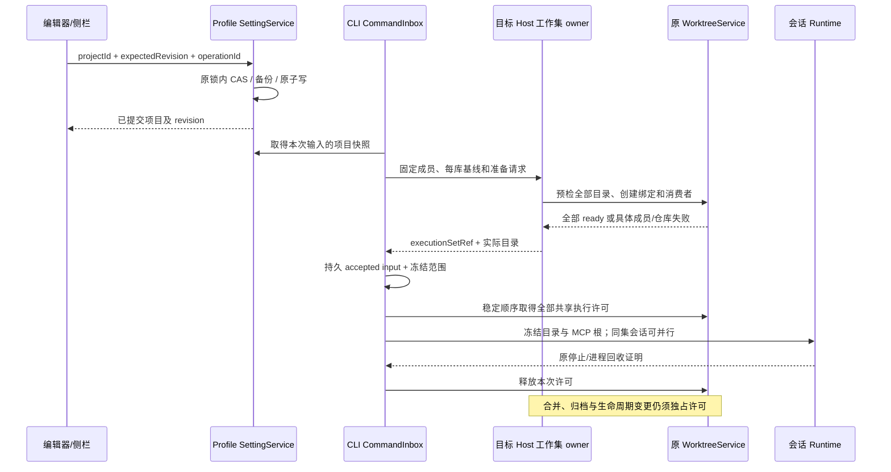

# 侧边栏协作增强实施与验证

日期：2026-10-16。版本 `3.19.1`，设计基线 `05c9d6e3`；最终核对时检出 `96f6463b`。工作区有其它任务并发修改，本记录只描述侧栏、项目范围与工作集，不将其它任务的源码或提交计入本功能。

## 已实现

- 分区编辑一次提交名称、完整成员、顺序与默认目标。专注视图只过滤展示；冲突保留草稿，移动、拆分和撤销维护默认目标。
- 项目编辑支持名称、说明、多目录、成员用途、默认参与开关和显示顺序，兼顾本端目录选择、远程浏览及离线元数据编辑。主目录保持身份锚点，同路径不同远端隔离。
- 项目设置由原 SettingService 在原写队列和文件锁内逐项目 CAS；迁移留备份，损坏配置拒绝写入，旧兼容数组不能覆盖新注册表。隐式项目首次升级冲突显示已有项目完整内容，并允许显式转入编辑。
- CLI 在输入 admission 冻结项目版本与成员，队列、重试和恢复沿原事实；原生上下文与 filesystem MCP 使用同组实际路径。变更范围的 guide 转为下一轮 queue。
- 同一目标 Host 的多个仓库组成一个协作工作集，同库目录共用绑定，各库独立工作树。没有为成员创建伪会话或隐藏 Agent；全部就绪才执行，重试对账原请求和已成功绑定。
- 每库基线通过应用内弹层分别选择，同库成员联动，默认各自 HEAD；选择不切换来源分支。已提交选择与 owner 解析出的 commit 冻结，重试不热改基线。
- 工作集支持同集新会话、同集分叉、独立工作集分叉、重命名、逐库文件和审核管理、整集归档恢复；绑定与会话可见性保留原操作收据。
- **按用户确认保留并行**：同集会话共享实际文件，新会话入口、草稿执行位置及范围查看明确说明。普通执行使用共享许可；合并、归档和生命周期操作独占。需要隔离时使用独立工作集分叉。
- 各仓库最新 integration 状态沿原 WorktreeService 收据展示，工作集显示部分完成。已合入目标与远端推送含义不同，不新增批量发布队列，也不承诺跨库 Git 原子事务。
- 项目、普通会话、工作树会话、工作集、成员仓库和离线入口使用各自菜单。来源错误在具体对象旁显示感叹号，可悬停、聚焦或点击读原因；刷新不会触发重连。归档保持独立入口。
- “查看本轮协作范围…”读取已接受输入的冻结记录，展示版本、用途和实际路径，不用最新项目设置替代历史。

## 所有者与顺序



导航组织、项目定义、输入账本和 Git 绑定分别保持唯一所有者。Desktop continuous 与 Web replayable 沿原 owner/lease 与序列传输相同事实，未另建远程 Host 或手机 Agent。

受影响模块为 setting、sidebar-organization、worktree、lcode-agent、shared、CLI bootstrap/core 及 UI hooks/侧栏；新增受控模块 project-execution-set 当前 19 个文件、1,534 行，包含合同、实现、适配器与测试。它原先不存在，统计仅针对该新增目录，不能代替整个并发工作区的净差异。

## 多轮查漏补缺

| 轮次       | 查出的具体问题                                             | 修复与证据                                                           |
| ---------- | ---------------------------------------------------------- | -------------------------------------------------------------------- |
| 设置与组织 | 过滤丢成员、主目录随排序漂移、旧数组覆盖新注册表           | 完整 editSection、独立 memberOrder、原锁内项目 CAS                   |
| 准备与恢复 | 双库半成功、ACK 丢失重复建树、只许可第一库                 | 不可变计划、持久 journal、原 key 对账和全部 checkout 许可            |
| 生命周期   | close false 误作停止、重命名改变准备参数、恢复丢消费者     | 显式停止证明、不可变 preparationName、原绑定与消费者恢复             |
| 冷会话     | 暂时缺席 record 可能还在创建                               | 原 SessionResidentPool 维护 gate 和协议租约；16 项关闭/驻留回归      |
| 目录与工具 | MCP 仍用原根、guide 热改范围、来源链接指回原库             | 冻结 MCP 根、改范围排队、目标 realpath 拒绝来源别名                  |
| 弹层与冲突 | A 的迟到保存关闭 B、冲突只显示数量、同源不同 id 误报删除   | 原弹层引用校验、完整最新值预览、显式转入已有项目                     |
| 投影与兼容 | 能力派生数组回环、旧连接能力污染、普通树被迫查新 bindingId | 稳定能力投影、服务换代握手、旧树保留 taskId 查询                     |
| 基线与审核 | 每库无法独立选基线、部分合入缺少聚合反馈                   | 按真实 Git 根分组选择、冻结映射、读取每库原审核收据                  |
| 真实 SSH   | 源空目录存在但所选 commit 不含该目录，checkout 无对应成员  | 所有 binding 分配前检查 frozen commit 中的 tree；具体目录行提示原因  |
| 并行语义   | 设计写了排队，与共享 checkout 现状不符                     | 用户确认保留并行；界面共享文件说明、跨服务实例许可与实际文件读写测试 |

## 实际执行的验证

后端最新 `pnpm test:sidebar-collaboration` **57/57 通过**。覆盖临时双 Git 仓库、同库去重、每库不同基线、准备失败/ACK 丢失/重启、停止失败、归档恢复、跨服务共享执行及独占门禁、部分许可释放、独立分叉脏文件、来源链接拒绝、配置 CAS/备份/损坏保护、输入队列与 native/MCP 范围。

完整侧栏浏览器回归 **16/16 通过**；随后针对最终修改分别复跑项目编辑/基线选择 3 个场景与工作集 1 个场景。使用生产 React 组件及明确的测试服务桩，覆盖七主题、20px UI 字号、390px 布局、真实 touch 事件、中英文、保存重载、迟到 ACK、重复来源升级冲突、离线远程元数据、准确错误行、菜单、归档恢复和共享文件说明。测试使用仓库 Playwright；本机无独立 agent-browser 命令，未将浏览器自动化写成人工设备验收。

| 检查                        | 最新实际结果                          | 日志/证据                                                       |
| --------------------------- | ------------------------------------- | --------------------------------------------------------------- |
| 本功能后端                  | 57 通过                               | `.artifacts/sidebar-completion-backend-release.log`             |
| 完整侧栏浏览器              | 16 通过                               | `.artifacts/sidebar-completion-final-regression.log`            |
| 最终编辑与基线控件          | 3 通过                                | `.artifacts/sidebar-completion-final-editor-controls-ui.log`    |
| 最终工作集共享提示与菜单    | 1 通过                                | `.artifacts/sidebar-completion-shared-files-ui.log`             |
| 关闭/工作树 rebind/驻留维护 | 16 通过                               | `.artifacts/sidebar-collaboration-maintenance-final.log`        |
| 根类型检查                  | 通过                                  | `.artifacts/sidebar-completion-typecheck-release.log`           |
| 根 Lint                     | 通过                                  | `.artifacts/sidebar-completion-lint-release.log`                |
| CLI 类型检查                | 27 包通过                             | `.artifacts/sidebar-completion-cli-typecheck-release-fixed.log` |
| CLI Lint                    | 14 包通过                             | `.artifacts/sidebar-completion-cli-lint-release.log`            |
| 架构                        | 通过，violations / baseline / new = 0 | `.artifacts/sidebar-completion-architecture-release.log`        |
| 改动文件格式                | 通过                                  | `.artifacts/sidebar-completion-format-release.log`              |
| 真实 SSH 源码 owner         | 8 项检查通过                          | `.artifacts/sidebar-completion-ssh-result.json`                 |

此前 provider 重复声明、超长 facade 和测试缺失参数在并发任务中已修正；本轮最终 CLI 检查又发现 adapter 缺少 `RoutingFinish`，仅补齐公开 type import 后 27 包通过。历史失败日志保留，不能与最终通过混用；不将并发任务的修复记为本功能作者的修改。

截图和录像位于 `.artifacts/sidebar-collaboration/`；放大字号的弹层、移动端操作按钮和工作集菜单已复核。文档链接、98 个唯一场景、围栏及新增模块统计见 `.artifacts/sidebar-collaboration-doc-check-release.json`。

## 真实远端与安装边界

已通过 SSH 在受控临时目录运行当前源码 Worktree/ExecutionSet owner，使用 Linux、Node 24.21.0 和真 Git，验证两仓库三成员：未跟踪子目录提前拒绝、同库去重、完整远端 identity、实际 checkout 映射、来源 HEAD/文件不变、全部许可、重启幂等、归档恢复保留修改。临时目录已安全清理，测试连接已关闭；凭据未写入源码、命令参数或报告。

这是实际远端源码服务验收，**没有启动模型 Runtime，也不是安装版 UI/Agent 端到端验收**。本机没有可运行的 WSL/Docker，未安装它们；手机实机、Desktop continuous 与手机 replayable 的完整故障恢复、已安装二进制验收仍未执行。fixture 远程 identity/离线证据不替代这些结果。

用户要求暂停安装包并稍后自行构建，已停止本任务自己的打包进程，保留 build-1/build-2 日志；没有结束其它任务，没有替换 `D:\LCode\LCode.exe`。未完成的安装构建不能标为成功产物，版本号未变。未替用户提交或推送当前并发工作区。

首版拒绝跨 Host、混合来源、submodule、非 Git 隔离、来源 symlink/junction 别名和 managed 环境迁移，不回退原目录。98 项是产品规则，尚未逐项全部签收；跨窗口视图全路径与上述设备/交付环境验收仍需对应条件。多库审核继续逐库执行，不承诺跨仓库提交、合入或推送原子事务。

## 复跑

```powershell
pnpm test:sidebar-collaboration
pnpm test:sidebar-collaboration --ui
pnpm typecheck
pnpm lint
pnpm architecture:check --changed
pnpm --dir apps/lcode-cli typecheck
pnpm --dir apps/lcode-cli lint
```

日志均位于本地 `.artifacts/`；旧轮次保留供追踪。安装包构建与安装按用户要求保持暂停。
