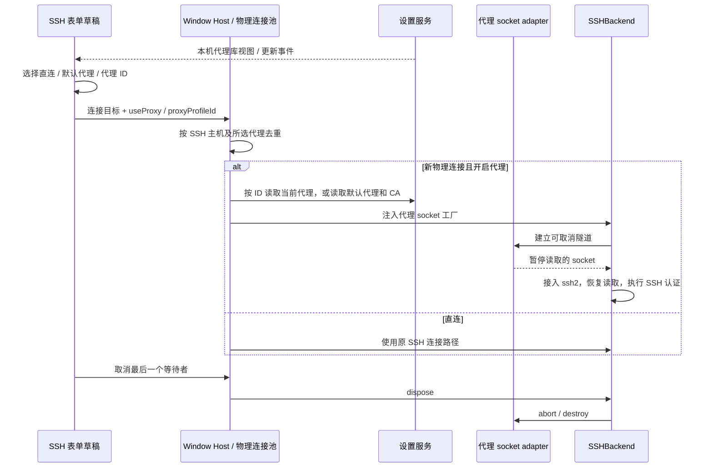
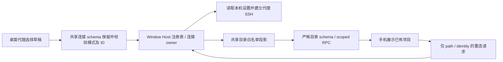

# SSH 复用设置页代理

## 产品规则

- SSH 连接向导使用一个“代理模式”选择器，不再保留独立开关。默认选“直连（不使用代理）”；选择设置中的默认代理或代理库条目，即启用并复用其地址、账号、密码和 CA，无须重复填写。
- 设置页继续唯一拥有代理地址、认证信息和自定义 CA。UI 草稿只有一个选择值（直连、默认代理、代理 ID）；提交后目标和历史仅携带 `useProxy` 与可选 `proxyProfileId`，不复制代理 URL 或凭据。
- 列表通过本机基础服务的 `IProviderSettingsService.getView/onDidChange` 读取代理库，不能随当前远程 workspace 切到远端代理库。选项展示名称及去除 userinfo 的地址；加载、失败重试、空库和所选代理被删除均明确提示，不自动切换到其他代理。
- 支持已有设置中的 `http://`、`https://`、`socks5://`，包括 percent-encoded 账号密码。HTTP(S) 使用 CONNECT 隧道；HTTPS 验证代理证书并复用设置中的自定义 CA；SOCKS5 的目标域名由代理解析。
- 选择直连及旧历史缺省字段均沿用直连。`useProxy: true` 且缺省 ID 的旧历史兼容默认代理；指定 ID 必须精确匹配本机代理库。所选代理已删除、默认代理未配置、协议无效、认证失败或隧道失败均明确失败，不回退默认代理或直连。
- 显式 SSH 代理模式使用所选配置自身的 CA；HTTP 请求的 No Proxy 列表不改变这个显式选择。此选择只控制本机到 SSH 的 TCP 隧道，不修改远端 Agent 的 HTTP 代理环境。
- 新建物理连接时由本地 Window Host 读取最新设置；设置变更不打断已有 SSH 连接。历史恢复保留选择并按 ID 重新读取当前配置，不保存旧代理副本。

## 所有者与接口

- UI 的 `useRemoteConnectionForm` 唯一拥有选择草稿，`buildRemoteTarget` 将其映射成 `SSHConnectOptions.useProxy/proxyProfileId`。组件经 hook 读取本机代理库投影，不维护第二份代理配置。
- `RemoteTargetSnapshot`、设置校验与工作区目录转发保留模式和 ID；workspace identity、remoteSessionId 和既有 SSH 主机身份不变。
- `sshConnectOptionsSchema` 是 Desktop Main、Main → Host 和 Web 连接入口共用的运行时校验；必须保留并校验 `useProxy` 与 `proxyProfileId`，不能静默剥离。缺省字段继续直连，非法类型或空 ID 拒绝。
- `remoteTargetSchema.ts` 唯一声明 SSH/WSL/Docker 连接字段及运行时校验；`remoteTarget.ts` 的连接类型从 schema 推导，`SSHRemoteTargetSnapshot` 从连接类型剔除临时 secret 后扩展凭据引用，设置历史 schema 也通过同一连接 schema 的 `omit/extend` 派生。公开导出路径兼容现有调用方，不再分别维护连接与历史的字段清单。
- 远控项目目录仅是 endpoint 的展示投影，由共享 `createWindowWorkspaceCatalogTarget` 按字段白名单生成；不发送代理模式、代理 ID、认证字段、密钥路径或部署选项。Host 注册表和桌面历史继续持有完整选择；手机通过 identity 请求既有桌面 owner 重连，不能从目录重建连接参数。目录仍用严格 schema 校验，不放宽未知字段。
- Window Host 物理连接注册表区分直连、默认代理及各代理 ID，避免同一 SSH 主机跨代理复用 socket；同选择继续使用现有池、owner 和取消语义。
- `@lcode/provider-node/network` 提供窄的代理 socket adapter：接收目的 host/port、设置中的代理 URL、可选 CA、取消信号与有界握手超时，返回暂停读取的 socket。失败只返回安全错误，不携带 URL、userinfo 或第三方 options/cause。
- Host 将 socket 工厂注入 `createRemoteBackend`，server 的 SSHBackend 只消费工厂，不读取全局设置。单次握手 singleflight，SSH 认证开始后才恢复 socket 读取。
- SSHBackend 拥有隧道 socket 与建连取消控制器。取消/释放时终止在途代理握手及 socket；迟到完成必须销毁，不得继续 SSH 认证或复活已释放 backend。
- 桌面 continuous 与手机 replayable 继续复用桌面既有 attachment 和会话运行时；此功能不增加远程 Host、Agent、任务队列或恢复通道。

## 验收

1. UI 在宽屏和 390px、中英文显示单个选择器；切换直连、默认代理和不同代理后提交目标正确，不出现开关或重复代理地址/密码输入。加载失败可重试，删除所选代理不静默改选。
2. 真实本地 HTTP、HTTPS、SOCKS5 代理隧道可完成 SSH 认证和命令；代理认证正确，包含特殊字符的账号密码正确编码/解码。
3. HTTPS 自定义 CA 生效，不关闭证书验证；错误认证、非成功 CONNECT、缺失/无效配置及超时均失败且不泄露凭据，不访问目的主机的直连路径。
4. 取消在途握手、并发请求与迟到结果不泄漏 socket、不重复认证；原 SSH 直连仍可用。
5. 直连、默认代理和不同代理 ID 不共享物理连接，同一 ID 保持去重；历史、设置 schema 和恢复保留选择，缺省旧记录保持直连。已删除代理 ID 明确失败，代理库更新后新连接读取最新配置。
6. 类型、Lint、架构检查和已有连接取消/恢复回归通过。
7. 代理目标经过真实连接 schema、Host 消息校验后仍使用所选代理完成 SSH 认证。相同目标经过 Host 目录投影与 RPC 后能被手机严格校验接收，既不报 `unrecognized_keys`，也不泄露连接设置；原始 Host 目标不被修改。

## 本轮验证

### 2026-10-17 连接、目录与持久化边界修订

- 原始 `windowWorkspaceCatalogSchema` 对 Host 发出的 target 精确复现 `[0, "target"]` 的两个未知字段；原连接 schema 则复现代理字段被静默剥离。新增边界测试先失败，再统一 schema 与目录投影。
- `pnpm test:remote-control` 133 项、`pnpm test:sidebar-collaboration` 61 项、真实 HTTP/HTTPS/SOCKS5 连接及代理/历史回归 15 项通过；Worker typecheck 与 45 项回归通过。浏览器 5 项覆盖 1280/390px 的目录、重连、错误隔离及失联移除，已知工作树保持禁止移除。
- 根 `pnpm typecheck`、`pnpm lint`、架构检查通过；schema 的现有 Desktop IPC / Web 调用经 `dep:refs` 确认，公开导出保持兼容。修改范围涉及 shared、desktop、ui、测试与现有构建产物，所有者及事件顺序见上图。
- OAuth Worker 和许可证清单通过官方脚本重新生成；`pnpm build:mobile-web` 与 Desktop `build:no-runtime-assets` 成功，网页资源已装配至独立 Worker 仓库。构建保留现有 chunk 大小、无效动态导入及 Vite config 提示，没有将这些警告写成失败。
- 先前发布的 v3.19.3 基于 `110e84e0`，不包含本节修复；本轮没有改写已发布 tag 或替换安装包。

### 此前代理选择验收记录

- Windows / Node 24.21.0：22 项后端与单元回归通过；使用真实本机 HTTP、HTTPS、SOCKS5 代理按所选 ID 完成 SSH 认证与命令，并验证配置更新、已删除 ID 拒绝、连接池隔离、历史及 schema 保留 ID。
- 14 项浏览器回归通过：1280px / 390px、中英文、明暗主题、键盘选择、代理切换、删除条目、空库、加载失败重试及原 SSH / WSL / Docker 取消和迟到结果。测试将页面绑定远端 ServiceProvider，确认代理列表仍来自本机基础服务。
- `pnpm typecheck`、`pnpm lint`、30 个相关文件的格式检查通过；架构检查 baseline / new / total 均为 0，功能图 YAML、ID、关系端点及源码种子检查通过。
- 本次选择修订涉及 UI、shared 和 desktop，沿用现有 server / provider-node 隧道实现。代理配置所有者仍是本机设置服务，草稿由表单唯一持有，事件顺序见上图；未引入第二份配置或改变 attachment 交付语义。
- 已目视检查窄屏中文截图。本轮完成源码与隔离测试，尚未构建或替换安装包。
