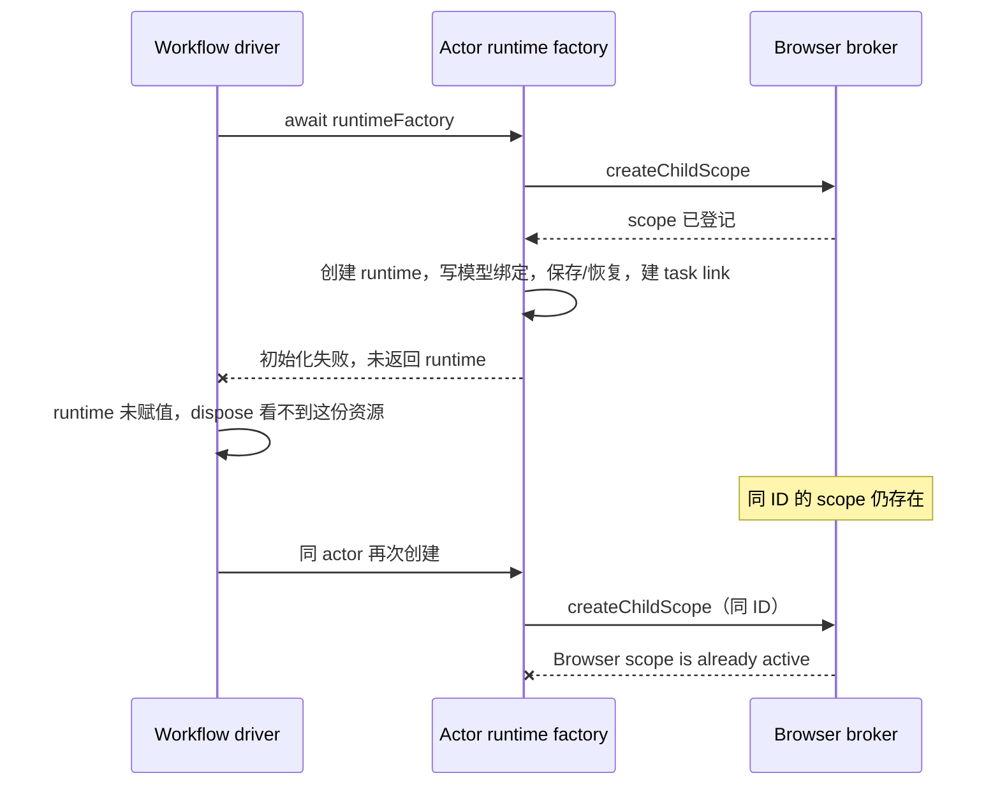

# 子代理与工作流 Browser 生命周期检查记录

当前源码存在 7 处可复现的创建、装配或清理问题，以及 1 处输入只读边界候选。`Browser scope is already active` 可以来自孤立作用域、尚未完成的关闭或同 ID 的协议 record；仅凭这条文案不能唯一定位截图里的首次故障。优先修复创建资源的所有权交接、共享 Browser broker 的装配和冷恢复的执行边界。

## 范围与证据等级

- 日期：2026-10-14；检出基线：`9ec44da6`，根 `package.json` 版本为 3.18.6。该版本是源码版本，截图所用安装包版本尚未确认。
- 本轮是检查与记录，不修改产品规则或运行代码，不创建、恢复或重启真实工作流，不修改历史失败记录。
- 检查范围包括普通 Agent、动态工作流 actor、旧脚本/专家 workflow child、父 runtime 关闭、共享 node_repl Browser bridge、协议作用域、V4 详情订阅与冷恢复、会话常驻池及 Host/Main 浏览器清理边界。
- “隔离复现”使用当前实现，替换模型、持久化或客户端边界以注入故障；“真实 socket”使用当前私有桥接和本机 socket，后端仍为隔离夹具；“候选”表示代码差异已确认，但产品规则或完整影响尚未定案。
- 未取得原截图同一 run 的首次失败日志，也未验证原安装包、真实 Electron 页面、真实手机断连或 macOS/Linux。以下问题证明当前实现存在缺口，不表示截图里 7 个问题同时发生。

## 所有者与现有事件顺序

| 事实/资源                                  | 当前所有者                                  | 需要保持的边界                                                      |
| ------------------------------------------ | ------------------------------------------- | ------------------------------------------------------------------- |
| actor 身份、ask 调度与 journal             | dynamic-workflow engine/scheduler           | 同 run、siteId、ordinal 保持稳定身份；失败不改成随机新 ID           |
| child runtime、turn、dispose 完成          | workflow driver；普通/旧 workflow 的调用方  | 资源一经创建就需要可追踪所有者，失败不丢句柄                        |
| Browser child scope、撤销、ended turn      | ProtocolBrowserControlBroker                | 由可信父 runtime 派生；不可由冷 record 或 transcript 推断授权       |
| 协议根 record 与 workspace/attachment 路由 | protocol context.sessions                   | 身份与文件路径分开，保留 remoteSessionId 与 clientMode              |
| node_repl socket/token 与在途连接          | NodeReplBrowserBroker / protocol entrypoint | 共享桥接与 runtime 必须查询同一作用域事实，关闭能撤销自己拥有的工作 |
| 历史行、详情与 cold publisher              | V4 gateway/projection                       | 观察事实不增加第二个可执行 child runtime                            |
| tab、request、backend generation           | 现有 Host/Main browser manager              | 只释放相同 scope 的资源；不跨父、兄弟、workspace 或 attachment 清理 |

创建失败的当前窗口：



当前共享桥接的装配分歧：

```mermaid
flowchart LR
    E[Protocol entrypoint] --> S[server Browser broker B]
    S --> N[共享 node_repl socket]
    R[协议 record 创建] --> A[record Browser broker A]
    A --> C[child scope 登记]
    C --> T[child runtime]
    T --> N
    N --> S
    A -. 共享 context.sessions，不共享 scopes .-> S
```

## 问题汇总

优先级为本轮修复建议：P1 影响创建、恢复、执行结算或作用域隔离；P2 是异常窗口或资源关闭缺口，需要与主要修复一起收口。编号对应独立诊断脚本。

| 编号 | 优先级 | 结论                                                                               | 证据                                         |
| ---- | ------ | ---------------------------------------------------------------------------------- | -------------------------------------------- |
| BR01 | P1     | 工厂返回前失败，已创建 runtime 和 Browser scope 没有移交关闭 owner                 | 4 个故障窗口隔离复现                         |
| BR02 | P1     | 共享 node_repl 与会话运行时使用不同 Browser broker，child 登记对桥接不可见         | 真实 socket 复现                             |
| BR03 | P1     | 生命周期 RPC 无 deadline/abort；turn 可不结算，runtime 关闭标记与 scope 释放不一致 | 真实 requestClient + broker/runtime 隔离复现 |
| BR04 | P1     | cold child record 阻挡 actor 登记，并使共享端口把旧 child 请求按活跃根重新路由     | 当前冷激活 + broker 隔离复现                 |
| BR05 | P1     | 冷恢复失败后保留半初始化 record；再次恢复直接返回，跳过重水化                      | 当前 activateSessionForResume 隔离复现       |
| BR06 | P2     | scope 在构造器之前分配；构造器异常没有回滚该 scope                                 | 当前 workflow child 构造器故障注入复现       |
| BR07 | P2     | socket broker 关闭不主动取消在途连接，关闭等待依赖对端退出/操作结束                | 真实 socket 复现                             |
| BR08 | 待定   | UI 的 workflow child 详情只读，输入准入只拒绝 subagent_child                       | 来源确认 + sentinel 复现；需要明确产品规则   |

### BR01 工厂初始化失败后资源失去 owner

位置：[workflow-actor-runtime.ts](../apps/lcode-cli/packages/bootstrap/src/app/workflow-actor-runtime.ts) 第 74、110、112 行；[workflow-driver.ts](../apps/lcode-cli/packages/bootstrap/src/app/workflow-driver.ts) 第 265、297 行。

工厂已经创建 runtime 后，还要读取实际模型选择、写模型绑定、保存或恢复会话、创建 task link。这些步骤任意失败都会拒绝整个工厂 promise。driver 的 `runtime = await runtimeFactory(...)` 尚未赋值，其 catch 只会处理已经拿到的 runtime，dispose 因而看不到工厂持有的资源。

复现分别注入模型选择缺失、会话保存失败、重水化失败、task link 失败。首次返回相应原始错误；driver dispose 后 `closeBrowserSession` 调用次数均为 0，scope 仍能路由。相同 run/actor 再创建统一得到 `Browser scope is already active`。

后续修复边界：runtime 创建成功即移交 driver 的现有资源所有权，再进行可能失败的持久化/恢复；异常资源仍保留在同一关闭与重试链，直到释放完成。当前 driver 已处理“工厂成功返回后 seed 失败”和“dispose 期间迟到返回”，这两条保护应保留，不能误认为已经覆盖工厂内部失败。

### BR02 共享桥接与 child scope 的注册表分裂

位置：[server.ts](../apps/lcode-cli/packages/bootstrap/src/lcode-protocol/server.ts) 第 145 行；[lcode-protocol-entrypoint.ts](../apps/lcode-cli/packages/bootstrap/src/lcode-protocol-entrypoint.ts) 第 304、333 行；[server-operations.ts](../apps/lcode-cli/packages/bootstrap/src/lcode-protocol/server-operations.ts) 第 3513 行；[create-app.ts](../apps/lcode-cli/packages/bootstrap/src/app/create-app.ts) 第 62 行。

entrypoint 将共享 NodeReplBrowserBroker 连接到 `server.browserControlPort`。创建每个协议 record 时却重新调用 `createProtocolBrowserControlBroker(context)`，child 从这份 record 端口登记。create-app 复用已注入的共享 socket，socket 查询的是 server broker 的另一张 `scopes` Map。共享 `context.sessions` 不等于共享 child scope；正常 child 原本就只有 detached publisher，没有独立协议 record。

复现创建同 context 的两个真实 broker：record broker 已登记 child，自身 list 成功；共享 socket 的 root 请求成功，child 请求返回 `Session is not active`。原有 bridge 集成测试将 socket 与 child 绑定到同一个 fixture port，因此能通过，却未覆盖生产装配的两个实例。

后续修复边界：scope 注册、共享 MCP 查询、turn 撤销与关闭使用同一个权威 broker 实例。它继续按根 record、workspaceIdentity、remoteSessionId 路由，不把 child 直接加入根会话注册表来绕过问题。

### BR03 生命周期等待与作用域释放不一致

位置：[browser-control-broker.ts](../apps/lcode-cli/packages/bootstrap/src/lcode-protocol/browser-control-broker.ts) 第 107–121、219–263 行；[server-client-requests.ts](../apps/lcode-cli/packages/bootstrap/src/lcode-protocol/server-client-requests.ts) 第 73 行；[turn.ts](../apps/lcode-cli/packages/core/src/runtime/methods/turn.ts) 第 374 行；[agent-runtime-close.ts](../apps/lcode-cli/packages/core/src/runtime/agent-runtime-close.ts) 第 50、68 行。

`sendLifecycle` 发 turnEnded/closeSession 时没有 request options。requestClient 仅在显式提供 timeoutMs 时设 deadline，也没有默认 abort。若客户端仍附着但不回包，生命周期 RPC 可以一直 pending；真实断开连接另有 reject 清理，不能把两者混同。

turn 的 finally 直接 await turnEnded，未回包时 executeTurn promise 不结算，driver 的后继 ask/关闭仍等待它。session close 则在 runtime 的 6000ms Browser deadline 后标记 `browserSessionClosed = true`；broker 的 scope 删除还在等 RPC，名字保持占用，旧 scope 已拒绝调用，新登记仍报 already active。

复现使用真实 requestClient 检查 pending entry：timeout/signal 均为空，ACK 前 turnEnded 不 settle。关闭测试仅把现有 runtime deadline 缩到 1ms以加快诊断；逻辑关闭已返回、scope 仍占用 ID，ACK 后才能再登记。没有以固定 sleep 模拟同步。

后续修复边界：明确“同步撤销执行权”“受控清理请求”“允许同 ID 重挂”的顺序和 owner。生命周期反向请求及 detached cancel 必须可取消并有确定结算语义；不能只延长 runtime timeout，或在 backend 仍可能处理旧清理时抢先复用新 lease。

### BR04 详情冷恢复创建的 record 改变 Browser 身份判定

位置：[v4-gateway-subscriptions.ts](../apps/lcode-cli/packages/bootstrap/src/lcode-protocol-v4/v4-gateway-subscriptions.ts) 第 75–96 行；[v4-bridge.ts](../apps/lcode-cli/packages/bootstrap/src/lcode-protocol/v4-bridge.ts) 第 163 行；[server-operations.ts](../apps/lcode-cli/packages/bootstrap/src/lcode-protocol/server-operations.ts) 第 1573、1588 行；[browser-control-broker.ts](../apps/lcode-cli/packages/bootstrap/src/lcode-protocol/browser-control-broker.ts) 第 45、64、126 行。

cold child 订阅沿当前冷恢复入口物化独立 app/record，并保留 `workflow_child` taskType。broker 的重复检查同时检查 scopes 和 context.sessions，因此即使没有活跃 child scope，这份详情 record 也会阻止后续 actor 登记。

同时，无 scope 的 `sessionId` 被 resolveRoute 当作根 ID 查 context.sessions。ended turn 的拒绝事实原本保存在父 root record 下；child 的独立 cold record 是另一份对象，旧 turn 的拒绝事实不在其中。

复现先结束旧 child turn、关闭 scope，确认共享端口拒绝旧请求；再使用当前 activateSessionForResume 冷激活同 ID。新的 actor 登记被拒绝，旧 wrapper 仍拒绝，但共享端口的旧 turn list 已成功路由，并发送 `sessionContext: live`。这是隔离实现中的授权生命周期变化，没有执行真实网页操作。

后续修复边界：child 历史观察保持 projection-only；driver 持有的 runtime 是执行 owner。冷详情不应创建第二个独立执行身份，也不能因出现同 ID record 改变既有 child 撤销事实。真实活跃重复登记、旧 scope/turn、跨 root/workspace/attachment 的拒绝仍需保持。

### BR05 冷恢复失败残留半初始化 record

位置：[server-operations.ts](../apps/lcode-cli/packages/bootstrap/src/lcode-protocol/server-operations.ts) 第 1508、1588–1592 行。

冷激活先将 record 放入 context.sessions，再 await app.resume；resume 失败没有撤销注册、unsubscribe 或 close。下一次 activateSessionForResume 命中 existing 分支，直接返回这份未完成重水化的 record，不再执行 resume。child record 还会进一步触发 BR04 的重复检查。

复现注入 app.resume 失败：第一次恢复失败后 record 仍在；第二次返回成功形状，但 create/resume 各仅一次、close/unsubscribe 都为 0。

后续修复边界：冷激活失败回滚本次创建的 record 和资源，保留持久历史和原始 cause；按对象身份检查回滚，不能删除并发的新代 record。READY/hydration 单飞仍是既有 owner，不新增另一份恢复状态。

### BR06 构造阶段的 Browser scope 分配没有回滚

位置：[script-workflow-child-runtime.ts](../apps/lcode-cli/packages/bootstrap/src/app/script-workflow-child-runtime.ts) 第 127、146、254 行；[subagent.ts](../apps/lcode-cli/packages/core/src/runtime/methods/subagent.ts) 第 226、260、408 行；[workflow-facade.ts](../apps/lcode-cli/packages/bootstrap/src/app/workflow-facade.ts) 第 108、347 行。

child 端口派生在调用 `new AgentRuntime` 之前执行，createChildScope 已有副作用。普通子代理和旧 workflow 的 try/finally 在构造器之后，构造器抛错时没有 runtime 句柄可关闭。它不同于 BR01：尚未成功构造 runtime，也谈不上向 driver 移交。

在真实 workflow child 构造器的 logger.child 边界注入异常，构造器拒绝后 scope 仍可路由、同 ID 创建被拒绝。该故障注入证明异常回滚缺口，未证明原截图的构造器实际抛过同类异常。普通 Agent 与专家路径的同形窗口由源码确认，本轮未逐条注入。

后续修复边界：端口/lease 分配到构造成功之间也需要资源所有者与异常回收。构造成功后交给现有 runtime 关闭链，借用的 MCP/execution/session store 不跟着销毁。

### BR07 socket broker 关闭不撤销在途连接

位置：[node-repl-browser-broker.ts](../apps/lcode-cli/packages/bootstrap/src/app/node-repl-browser-broker.ts) 第 33–69、234–238 行。

broker close 调用 net.Server.close 等待连接结束，没有登记/销毁已接受的 socket，也没有主动触发其请求的 AbortController。handleSocket 的取消来自 socket 自己关闭，close 因而依赖对端或外部 Browser 请求先结束。

两项真实 socket 复现分别覆盖已授权的 pending list，以及服务端已接收但未读完请求行的连接。前者等待进入受控 port，后者等待 server 的 connection 事件后才发半行数据；broker.close 均未完成，对端结束后才完成关闭。服务端接收水位防止把 client connect 误当作已接受连接。

后续修复边界：close 封闭新准入、取消并释放该 broker 自己拥有的连接/请求，等待可观察的关闭事实。共享 broker 与借用会话的关闭范围分清，不能关闭其他 session 的共享 MCP。

### BR08 workflow child 只读输入边界候选

位置：[SubagentSessionSidePane.tsx](../packages/ui/src/app-shell/SubagentSessionSidePane.tsx) 第 46 行；[v4-bridge.ts](../apps/lcode-cli/packages/bootstrap/src/lcode-protocol/v4-bridge.ts) 第 218 行；[server-operations.ts](../apps/lcode-cli/packages/bootstrap/src/lcode-protocol/server-operations.ts) 第 2042 行。

详情 UI 使用 readOnly，但 V4 与 legacy 输入准入只明确拒绝 `subagent_child`，不包含 `workflow_child`。诊断在后续 revision 读取处放 sentinel：ordinary child 在只读门拒绝，workflow child 越过该门。未发送真实 prompt，不能把此结果写成已执行了第二个 actor turn。

需要明确产品规则：workflow child 是否一律只能通过既有 workflow owner 的 supplement/retry/revision 命令接受输入。如果是只读观察面，服务端准入应与 UI 一致；如果保留其他交互用途，应明确 taskType/owner 和可执行入口，不能由同 ID cold record 隐式获得权限。

## 已核对并应保留的保护

- scheduler 持有同 actor 的 sessionPromise，常规 ensureActorSession 不会因多个 ask 正常并发而反复创建；它无法回收工厂内部已分配且未返回的资源。
- actor ID 由 run/siteId/ordinal 确定，journaled/minted 不一致在构造前拒绝。修复不应换随机 ID 掩盖资源冲突。
- 同 broker 中真实重复活跃登记、伪造 parent、访问兄弟/父 scope 都被拒绝；关闭一个 child 不关闭 sibling，旧 wrapper 重复 close 不关闭新代 scope。
- root record 替换、ended turn、在途 abort 与迟到结果防护在既有测试中通过。BR04 说明 cold record 改变 root 对象后存在另一条路径，不能据此删除原防护。
- driver 正常 dispose 保留失败关闭项并重试，等待 seed、完整 turn 收尾和迟到工厂；run lineage release 与 session-store-dependent stable drain 也有现有保护。BR01/BR06 位于 owner 交接之前。
- 现有 workspaceIdentity fallback、remoteSessionId、backend generation 和 desktop-continuous/web-remote-replayable 路由保留。Host/Main closeSession 只匹配同 scope，释放控制权并取消对应在途动作；本轮没有确认 Main 把父或兄弟 tab 一并清理的问题。
- feature-boundary seed graph 有 subagents/conversation/model 节点，但缺少 Browser scope、共享 socket 与 actor 创建事务的直接 owner 节点，记为 graph-drift-candidate；impact-only 检查没有修改图或产品 spec。

## 验证记录与复现入口

独立诊断：[audit.test.mjs](../.artifacts/subagent-browser-audit-20261014/audit.test.mjs)。验证输出：[validation-results.txt](../.artifacts/subagent-browser-audit-20261014/validation-results.txt)。二者位于本地 `.artifacts` 检查目录，不是新增生产模块或正式产品测试入口；诊断用当前内部实现作证据，不建立跨包生产依赖。

诊断单独运行的仓库根命令：

```text
node --import tsx --test --test-reporter=spec .artifacts/subagent-browser-audit-20261014/audit.test.mjs
```

Node 使用 mise.toml 的 24.21.0，pnpm 为 10.34.6。Windows 本轮使用已安装的固定版本 Node，pnpm 通过 `volta run --node 24.21.0 pnpm ...` 保持嵌套运行时一致。

| 验证                  | 结果                     | 说明                                                                                                     |
| --------------------- | ------------------------ | -------------------------------------------------------------------------------------------------------- |
| 定向现有测试          | 43/43，0 skip            | 12 个实际文件：作用域、driver、模型绑定、lineage、父关闭、普通 child、技能与桥接、两种交付模式的审批模型 |
| 独立诊断              | 13/13，0 skip            | BR01 四项、BR03/BR07 各两项、其余五项；通过表示缺陷或候选行为被准确复现，不表示已修复                    |
| 最终合跑              | 56/56，0 fail/skip       | 输出保存在上方 validation-results.txt                                                                    |
| 根 typecheck          | 通过                     | 当前工作区增量检查，未修改相关运行代码                                                                   |
| CLI typecheck         | 27/27 任务成功           | Turbo 全部缓存命中；依赖 build/typecheck 按当前图复用，没有将它写成重新编译了所有包                      |
| 根 lint、CLI lint     | 通过；CLI 14/14          | CLI 同样缓存命中                                                                                         |
| verify:pre-push、架构 | 通过                     | violations/baseline/new 均为 0；没有新增生产依赖或 state owner                                           |
| 格式/文件检查         | 报告检查通过，诊断已实跑 | 独立诊断不是 production typecheck/lint 的覆盖对象                                                        |

CLI 命令仍有现有 Turbo workspace 闭包警告，分别提及 lockfile 未包含 browser-use-plugin/dynamic-workflow-runtime 等条目。任务返回成功；本轮未调整 lockfile 或依赖。独立诊断初版的 ESM 导出解析与 fixture 身份/接收水位问题已经纠正；此前失败不属于产品回归失败，最终输出记录的是修正后的完整合跑。

源码检查与隔离复现覆盖失败语义，不替代真实安装包/页面验收。原截图的首次触发仍可能是上述一条或多条路径；应保留首次异常与后续 already-active 的关联，修复后在原通道核对，不把第二次冲突文案当作首次根因。

## 后续修复顺序与验收边界

1. BR02：先统一权威 broker，增加生产装配级 socket 测试，涵盖普通 child、workflow actor、不同 root/remote attachment；不只验证同一 fixture port。
2. BR01 + BR06：建立从 scope 分配、runtime 构造到 driver 接管的完整事务；模型绑定、保存、恢复、task link、seed 各阶段失败都可追踪并回收，关闭失败保留唯一重试句柄。
3. BR03 + BR07：明确撤销、RPC 取消、socket 关闭与 identity 可复用的顺序；覆盖客户端附着但未 ACK、真实断开、父关闭与正在关闭的后代，保证旧代清理不影响新代。
4. BR04 + BR05：child cold 观察与执行分离，恢复失败回滚本代 record；覆盖详情打开/重开、错误恢复后再次打开、同 actor 重挂及旧 turn 请求。两种交付语义分别验收，不用 viewport 代替 transport 证明。
5. BR08：明确 workflow child 的输入策略，再补服务端与 UI 一致性验收。修复其他确认问题无需先把这个候选强行定案。

以上保留调查阶段结论。当时尚未更新行为 spec、实现补丁或原用户运行状态。随后用户已授权实施，源码修复、BR09/BR10 新发现和正式验证见 [实施记录](subagent-browser-lifecycle-implementation-2026-10-14.md)；不将本报告中的缺陷复现断言当作修复通过。
