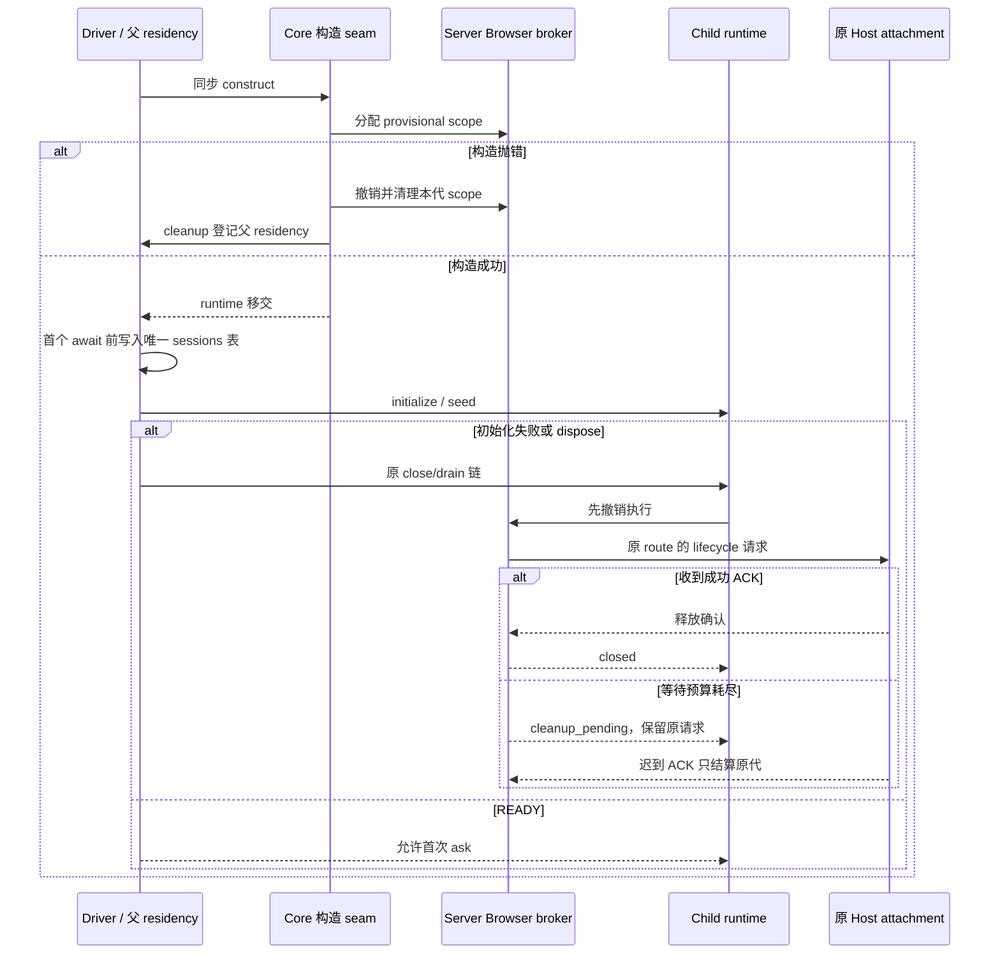

# 子代理与工作流 Browser 生命周期实施记录

2026-10-14，按用户“进行系统性解决问题”的授权，在基线 `9ec44da6` 上完成源码修复。仓库版本仍为 3.18.6，没有修改版本、安装包或原工作流。此记录区分代码验收与原安装包现场验收。

## 1. 交付与问题闭环

| 提交       | 问题                                       | 最终行为                                                                                                                                  |
| ---------- | ------------------------------------------ | ----------------------------------------------------------------------------------------------------------------------------------------- |
| `2e9bc585` | BR02 注册表分裂                            | Protocol server 持有一个 Browser broker；record、子 runtime 和共享 node_repl 使用同一权威端口。                                           |
| `f3275756` | BR01/BR06 创建资源无 owner                 | core 构造 seam 持有 provisional scope；driver 同步接管 runtime 后才异步初始化。模型绑定、保存、resume、task link、seed 失败均走原关闭链。 |
| `e9805061` | BR03/PX02 无限清理、错误释放状态与路由漂移 | 先撤销执行，再按原连接路由等待清理 ACK；超时返回 cleanup_pending，保留原 requestId/句柄，迟到 ACK 只结算原代。                            |
| `bc2fca2e` | BR07 已接受 socket 不能关闭                | close 同步封闭准入、取消 handler、销毁所属 socket，再等待真实 close；半行与 pending request 不再挂住 bridge。                             |
| `76958243` | BR05 半恢复 record；新增 BR09              | 根 resume 候选完成后才入册；失败不留半成品。关闭失败的 app 继续由资源 owner 持有，重试成功才释放。                                        |
| `e8800104` | BR04/BR08/PX01；新增 BR10                  | child 历史、产物、文件摘要、预览、显式回溯与反馈不创建执行 runtime；两类 child 的通用输入在 inbox/ledger 前拒绝。回溯回执失败补偿文件。   |
| `b266ee94` | 新增 VT01 验收误报                         | E2E 使用打开时的真实触发器 DOM 身份检查关闭/还焦；不依赖 Radix 关闭后已移除的 aria-controls。                                             |

`e70fc2cf` 进一步限定 BR10 补偿边界：只有严格回执写入的结构化失败才补偿，事实已提交后的 runtime 通知异常不能逆转文件。两条故障路径均有执行测试。`d5387fc3` 只格式化本轮生产装配回归 fixture。

BR01–BR07 的原缺陷已有源码与隔离复现；BR08 是用户授权方案中的产品决定。PX01/PX02 是配套依赖与防护，不能当作原截图已发生的独立根因。

新发现的问题已纳入实现与测试：

- **BR09 关闭句柄丢失：** ProtocolRuntimeResources 原先在 finally 删除 app，关闭失败后无 owner 重试。现在失败句柄保留；同 ID 再创建前先排水该失败资源。关闭中的活跃 app 不因新 allocation 被误关。
- **BR10 文件与回执不一致：** 回溯写入成功、严格持久事件写入失败时，原流程留下未登记的文件撤销。现在复用同一文件 journal 补偿；补偿再次失败保留两次原因，不能报告 applied。
- **PX03 观察投影回收：** 去掉 child 执行激活后，冷详情也需要回收资格。READY 后复用 detachedTerminalAt；有订阅者、执行 record、READY/hydration 或 pinned command 时不回收，不新增假 live 身份。
- **VT01 测试选择器失效：** 浏览器运行时证明原组件按 Escape 已进入 closed；E2E 等待带旧 aria-controls 的 closed trigger，因此超时。只修复测试身份定位，原组件键盘行为保持不变。

## 2. 最终所有者与事件顺序

- Browser scope entry 是 authority。revoking/cleanup_pending 不能接受新执行或同 ID 重挂；无连接的失败同步释放，不需要固定延时。
- runtime 的 durable drain 仍等待持久写入；Browser 等待预算不等于物理资源已释放，不覆盖已完成业务结果。
- 原请求捕获 workspace key/path/identity、remoteSessionId、clientMode、browserId/generation。后来的 root metadata 变化不能把旧清理发往新 attachment。
- child 的 transcript/entries/artifact 是历史事实；publisher 存在不代表执行权限。根 record 与恢复候选分别由 context.sessions 与原 resume flight 持有。
- 详情文件操作使用持久 worktree execution binding 的真实 cwd；origin 身份只用于进入该绑定。显式文件回溯与反馈继续走原 CommandInbox、canonical row、epoch/revision 和幂等检查。
- Desktop continuous 与 Mobile replayable 使用同一 READY、序列与输入 owner，分别保留实时交付和恢复语义。没有增加 Renderer 接受队列或 Browser wire 字段。

## 3. 验证证据

使用仓库固定 Node 24.21.0。测试是新行为断言，原 `.artifacts/subagent-browser-audit-20261014/audit.test.mjs` 的 13 项“缺陷复现”没有被当作修复通过。

| 验证                                                        | 结果 / 范围                                                                                                                                                 |
| ----------------------------------------------------------- | ----------------------------------------------------------------------------------------------------------------------------------------------------------- |
| Bootstrap `src` 全部 107 个实际 test.ts                     | 497 项通过，0 failed / skipped；含创建各阶段故障、真实 server/socket 装配、迟到 ACK、原路由、根恢复事务、只读历史、文件动作、双 delivery 与工作流控制回归。 |
| Core 定向运行时/子代理/snippet/fork-rewind 回归             | 56 项通过；普通 Agent Browser 继承、关闭重试、工作流 snippet 修正、已执行副作用与文件安全边界。                                                             |
| CDP adapter 生命周期                                        | 1 项通过；物理 close 未确认时保留工作句柄，不重复关闭 browser。使用测试 Playwright 对象，非真实 Chromium 生命周期验收。                                     |
| `bootstrap/scripts/subagent-browser-bridge.test.ts`         | 1 项通过；可信 subagent/workflow metadata 经真实私有 socket 到 scoped broker。                                                                              |
| Web 真实组件浏览器 E2E                                      | 右侧面板 9 项与工作流进度 1 项通过；1280/390 viewport、中英文、明暗主题、关闭还焦、加载/错误/重试与恢复。fixture 不启动模型或原业务 workflow。              |
| 根 `pnpm typecheck`、`pnpm lint`                            | 通过。                                                                                                                                                      |
| CLI `pnpm --dir apps/lcode-cli typecheck`、`lint`           | 通过；typecheck 27 tasks，lint 14 tasks。首次发现的新 fixture 类型/行数问题已修正后重跑。                                                                   |
| `pnpm architecture:check --changed`、`pnpm verify:pre-push` | 通过；violation / baseline / new 均为 0。CLI 与 UI 为现有 unmanaged 模块，没有伪称新增了 managed contract。                                                 |
| 格式                                                        | 本次文件单独检查；整仓 `pnpm fmt:check` 失败，报告 2,303 个文件有格式问题，其中含未修改的技能/tsconfig 文件；没有整体格式化任务外文件。                     |
| Agent 构建                                                  | `pnpm --dir apps/lcode-cli --filter @lcode/cli build:desktop-agent` 通过；生成 `apps/lcode-cli/packages/cli/dist/lcode.cjs`，约 16.9 MiB。                  |

本地可追踪输出在 `.artifacts/subagent-browser-repair/`：`bootstrap-tests.log`、`core-and-bridge-tests.log`、`cli-typecheck.log`、`cli-lint.log`、`desktop-agent-build.log`、`web-e2e.log`。后端合计 555 项（497 + 56 + 1 + 1），Web E2E 10 项通过。这些是本轮验证产物，不加入产品源文件。

本次 90 个文件的专项格式检查通过（89 个修复文件与 feature graph）；整仓格式失败独立保留。CLI Turbo 仍提示 lockfile 中部分 workspace 的闭包无法计算，检查命令返回成功；本任务没有改动无关 lockfile。实际改动模块为 lcode-cli 与 web 测试；共享 UI 组件实现未改动。规格与功能索引另行保留。

构建产物 SHA-256：`B76AACB57EA3ACFB3563E090590D1377578BCECAE9E18A49C2E9A2C595EBBC98`。最终交付前重新构建/核对同一文件；版本号没有自动上调。

## 4. 方案细化与未验证范围

1. bootstrap construction 不再提供另一条 rollback API；core seam 已拥有最早分配的 provisional ports，driver 在同步构造成功后的同一调用栈接管。异步 initialize 与 seed 仍由同一 sessions entry 排水。
2. 详情保持完整 transcript 语义。现有 bounded atomic snapshot 是搜索用确定性前缀，硬限 256 messages / 1,024 parts / 256 KiB；直接套到长详情会丢历史。本次没有把前缀冒称完整历史，也没有宣称新增了详情分页原子读端口。该扩展需要独立契约。
3. 未确认旧清理不强制重绑或发送到新 generation；首期沿用原 wire。未知 ACK 可用性导致 lease 保持 cleanup_pending，这是诚实状态，不用 sleep、随机 ID 或重复请求掩盖。
4. 已验证 Windows 上的源码、Node/runtime/socket 与 Chromium Web fixtures；没有运行真实 Electron Browser backend、macOS/Linux 原生生命周期、生产远程 Host 或原截图安装包。
5. 原截图首次异常及版本没有新增现场证据，不能断言某条缺陷是该次故障唯一根因。新版 bundle 未安装/发布，原失败工作流未自动恢复或重跑。AC46 的原类通道现场验收仍待新版实例；AC45 已完成 bundle 构建/hash，未声称完成安装包内全部官方内容 staging。
6. EvalWorkflowSnippet 已有的 source 冲突/缺失/错误修正回归保持通过；外部工具签名生成层的可选字段问题尚无可靠定位，不以本次 Browser 修复宣布它已解决。
7. 已补齐 feature-boundary seed graph 的 Browser authority、child 构造与只读观察节点，验证 YAML、88 个唯一 ID、128 条关系端点/rank、7 个新源码 seed。原 skill 引用的 `docs/skills/feature-boundary-graph.md` 当前不存在；没有恢复历史文档或修改任务外节点。

## 5. 回退边界

相对 `9ec44da6`，CLI 与 Web 测试共 82 个源码/测试文件，新增 3807 行、删除 1122 行，净增 2685 行；不含规格与功能索引。

按上表功能提交整体回退及重建产物。只读路由必须与附件/文件操作能力一起回退；broker 注入必须与共享 bridge authority 一起回退。回退或切换版本都不重放已完成 ask，不改历史 actor/run ID，不把未确认释放写成 closed。与本任务无关的本地修改保留，未推送提交。
