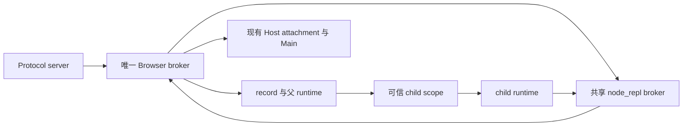
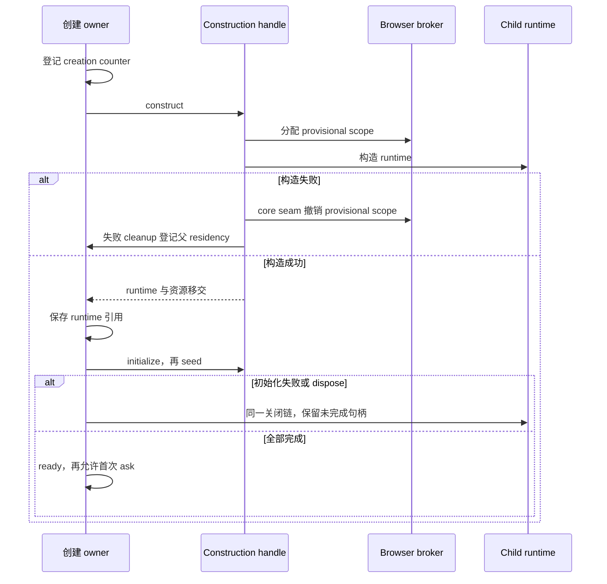
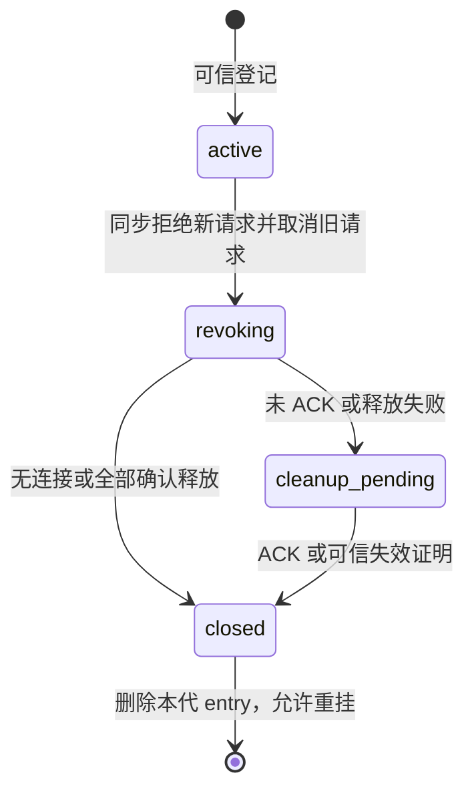
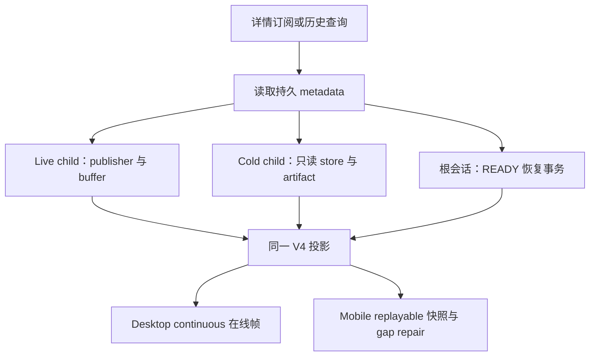

# 子代理与工作流 Browser 生命周期修复增强方案

本方案修复子代理创建失败、Browser 作用域残留、共享桥接注册表分裂、冷恢复身份变化及关闭不结算的问题。目标是让资源从分配到释放始终有明确所有者，让历史详情只读取事实，并保留真实重复登记、旧 turn、跨 Host/workspace 和迟到结果的拒绝保护。

依据为 [2026-10-14 检查记录](subagent-browser-lifecycle-audit-2026-10-14.md)，源码基线为 `9ec44da6`，仓库版本 3.18.6。2026-10-14 已按用户授权完成源码修复与增强；实现分工、执行验证与剩余现场范围见 [实施记录](subagent-browser-lifecycle-implementation-2026-10-14.md)。检查中的 43 项既有回归和 13 项诊断仍只是原缺陷基线，不能替代修复验收；原截图安装包版本及首次异常尚未核对。

## 1. 纳入范围与交付结果

| 项目 | 纳入内容                                                                        | 交付要求                                                                                    |
| ---- | ------------------------------------------------------------------------------- | ------------------------------------------------------------------------------------------- |
| BR01 | runtime 构造成功后，模型绑定/保存/恢复/task link 失败的 owner 缺口              | 初始化失败也能关闭原资源，同 ID 正常重建，保留首次 cause                                    |
| BR02 | server、record、共享 node_repl 使用不同 Browser broker                          | 一份权威 scope 注册表，经同一端口完成登记、调用和撤销                                       |
| BR03 | turnEnded/closeSession 无界 RPC；逻辑关闭与真正释放混同                         | turn 可以结算，执行权先撤销，清理状态准确，同 ID 重挂有安全条件                             |
| BR04 | child 详情冷恢复建立独立执行 record，改变权限与身份判定                         | child 详情只做投影重建，不增加 app/runtime 或恢复 Browser 权限                              |
| BR05 | 冷恢复失败残留 record，下一次错误跳过重水化                                     | 失败回滚本代候选，下一次实际重试；不删除历史或并发新代                                      |
| BR06 | 端口/Browser scope 在构造器之前分配，构造异常无回收                             | 创建事务覆盖最早分配点，普通 Agent、DWF、旧脚本/专家路径一致                                |
| BR07 | socket close 不取消已接受连接及在途请求                                         | 关闭封闭准入，取消请求并销毁所属连接，等待真实关闭事件                                      |
| BR08 | workflow child UI 只读与输入准入的差异                                          | 推荐将 workflow_child 与 subagent_child 的通用输入均设为只读，任务控制走现有 workflow owner |
| PX01 | 关闭 child runtime 冷激活后，历史、附件、文件摘要、模型统计仍依赖 active record | 增加独立只读读取能力，父 runtime 不活跃时也不丢历史或伪造空结果                             |
| PX02 | 迟到清理使用之后变化的 workspace/attachment 路由可能释放错代资源                | 清理使用实际连接建立时的窄路由快照；重挂保留 root/attachment/generation 校验                |

PX01/PX02 是本轮规划中补出的配套依赖与风险，不将它们写成原截图已发生的另外两个根因。PX01 有明确源码依据：`v4-bridge-hydration.ts` 在无法找到 child 或 parent active record 时提前返回空事件；附件读面也多处要求 record。必须与 BR04 同一阶段解决，否则单独禁止冷激活会引入历史读取回归。

优先级沿用检查记录：BR01–BR05 为 P1，BR06/BR07 为 P2，BR08 为待确定的产品规则。BR01–BR07 已在隔离诊断中分别复现相应缺陷窗口；BR06 直接注入的是旧 workflow 构造路径，普通 child 等同类路径的覆盖仍须补足。以上证明代码存在缺陷，不证明原截图的第一次失败一定由其中某一项单独触发。

本方案保持现有模型/provenance、权限、技能过滤、Computer Use 限制、actor/run ID、任务队列、journal 和协议历史格式。它不引入随机新 session ID、全局模型重试上限、数据库迁移或新的 Renderer 接受队列，也不自动重跑原失败工作流。

## 2. 产品规则与不变量

1. **创建有资源即有 owner。** 从 child scope 分配、runtime 构造到初始化完成，所有异常都能定位到持有资源的对象。首次 ask 只在初始化及必要 seed 完成后 admission。
2. **一个 Browser authority。** 同一 Protocol server 中，主 runtime、普通 child、DWF actor、旧 workflow child 和共享 MCP 都依赖 server 持有的同一个 broker。record 不创建私有替代注册表。
3. **真实重复保持拒绝。** 同 ID 的活跃或尚未安全释放的 lease 不能重复登记。记录冲突原因，区分 active_duplicate、cleanup_pending 和 root/identity 不可用；不按错误文本驱动恢复。
4. **撤销不等于物理释放。** close 第一拍禁止新请求并取消旧请求。远端未确认清理时标记 cleanup_pending，不能记录 closed 或让同 backend generation 的身份立即重用。
5. **无连接的初始化失败立即回收。** BR01/BR06 通常发生在首次 Browser 调用之前，没有 Host connection；此时 broker 同步撤销后即可完成本地释放，不发无意义 RPC，不等待固定 sleep。
6. **历史观察不执行。** 打开/重载/查询 child 历史不创建 child app、模型执行、MCP lease、Browser scope 或新 workflow run。根交互会话的冷执行恢复仍走其现有 READY 路径。
7. **恢复是事务。** 未完成初始化的根候选 record 不作为 READY 事实。失败只回滚本代，保留持久 session/messages、首次异常和已有成功任务。
8. **输入有唯一目标 owner。** 推荐 BR08 规则：普通 child 与 workflow child 的通用聊天/排队/续目标入口均只读；supplement/retry/revision 仍由现有 workflow run service 接受。详情读取和已授权的文件回溯不被“一律拒绝所有命令”误伤。
9. **身份与路径分离。** 隔离 key 继续使用 `workspaceIdentity?.trim() || workspacePath`。Browser 请求与清理保持 root/child、workspace、remoteSessionId、clientMode、browserId/browserGeneration 的完整关联。
10. **副作用与清理结果分开。** 已执行 snippet/工具/actor 不因清理超时被说成“未执行”；输入拒绝与构造失败发生在执行前时才明确写未执行。未确认的 Browser 动作不自动重放。

BR08 在检查记录中是候选；第 8 条是本方案推荐的产品决定，依据现有详情只读 UI 与 workflow 控制入口，不把它冒称为原先已经生效的规则。用户按本方案授权实施时以这一决定为实现范围；若改为允许直接续聊，需要另行定义执行 owner 和调度边界。

## 3. 所有者与接口设计

### 3.1 状态归属

| 状态/资源                         | 唯一所有者                                       | 读者与边界                                                                                      |
| --------------------------------- | ------------------------------------------------ | ----------------------------------------------------------------------------------------------- |
| actor/ask、接受队列、journal      | engine/scheduler 与 CLI CommandInbox 的既有职责  | 继续使用 sessionPromise、attempt、owner/lease 和既有事件；不增加另一条接受路径                  |
| actor 创建及 runtime dispose      | driver 的同一 sessions 状态表                    | 将 creating/ready/closing 纳入同一 owner；创建 helper 只借用宿主方法，不持有另一份 sessions Map |
| 普通/旧 workflow child 的创建资源 | 当前 runner/调用方的同一创建事务                 | 复用其终态清理与父 residency 接线，完成后移交 runtime，失败不丢 rollback 句柄                   |
| Browser lease 与待确认清理        | server Browser broker 的同一 scope entry         | scope phase、in-flight RPC、清理目标及结果均留在该 entry；不做全局补偿任务队列                  |
| socket 与请求 controller          | NodeReplBrowserBroker                            | 只取消自己接受的连接；共享 broker 不被某一个借用 app 关闭                                       |
| 可执行根 record 与 READY          | context.sessions + 既有 readyFlights/resume 单飞 | sessions 仅代表已发布的根执行事实；候选是当前 flight 的局部变量，不增加第二份记录缓存           |
| child 历史、文件与附件读取        | 既有 store/artifact/checkpoint 能力的只读端口    | 可借 active reader；parent 不活跃时按持久 metadata 建只读 reader，不建可执行 app                |
| tab/后台动作与 backend generation | 现有 Host/Main                                   | broker 不接管 tab 业务状态；继续用原 scopeKey 与 ownership 校验                                 |

### 3.2 统一 Browser 端口装配

修改 `server.ts`、`server-types.ts`、`server-operations.ts` 与 entrypoint 的注入关系：

- server 先建立稳定的 sessions/requestClient 宿主引用，再创建一个 Browser broker；context、公开 server 属性、record appOptions 和共享 socket 使用这一实例。
- broker 构造依赖收窄为实际需要的 sessions/requestClient 面，解决构造顺序；不通过可选字段、非空断言或全局 singleton 留下两套实例。
- `createRecord` 改为引用 context 注入的端口，移除逐 record 的 `createProtocolBrowserControlBroker(context)`。
- `create-app.ts` 保持 owned/borrowed NodeReplBrowserBroker 的释放差异。headless/custom 注入和插件禁用仍遵守当前配置，不为了修复而强制启用 Browser。
- 生产装配测试验证实际传给 app 与共享 bridge 的端口身份相同，再从普通 child、DWF、旧 workflow 的真实登记链调用 socket；仅比较 mock 参数不够。



### 3.3 创建事务覆盖构造器之前

已将 `ActorRuntimeFactory` 的“返回初始化完的 runtime”契约拆为 construction handle；实施后接口如下：

```ts
interface ActorRuntimeConstruction {
  // 端口/scope 分配也在此边界内；构造成功时移交给返回的 runtime。
  construct(): AgentRuntime;
  // 模型绑定、持久化/恢复及 task link；不包含首次 ask。
  initialize(runtime: AgentRuntime): Promise<void>;
}
```

factory 的 prepare 部分只冻结配置、构造这些闭包，不提前分配 Browser scope，不做会失去句柄的异步初始化。driver 先登记既有 creation counter，再同步 construct；同一调用栈中拿到 runtime 后立即写入唯一 sessions 表，在首个 await 前接管引用，再做 observe、initialize、seed，最后进入 ready。只有此时 createActorSession resolve，scheduler 才派发 ask。

构造函数内部通过 core 公共 `constructChildRuntimeWithPorts` seam 保存 provisional lease。构造失败由该 owner 发起 cleanup，登记父 residency 并保留 broker 的未确认 lease；不额外暴露 bootstrap rollback API。构造成功后 ownership 转移到 runtime。普通 Agent、旧 script/expert 路径使用同一资源分配/移交规则，把异常边界提前到 construct 之前。

模型 policy/provenance 继续在分配前冻结；模型绑定读取与写入放在 owner 接管后的 initialize，保留 journal 整行更新所需字段。先保存 session 再创建 task link 的 FK 顺序不变。driver 现有完整 turn、seed、迟到结果、关闭失败重试与 residency 保护继续生效。

`ActorRuntimeConstruction` 留在 bootstrap 的 driver 类型中，经 `@lcode/core` 公开入口引用 AgentRuntime；它不进入 contracts，避免基础契约反向依赖 runtime。provisional 资源分配/移交 seam 由 core 公开 API 提供，Browser port 与生命周期结果由 contracts 公开入口导出，bootstrap 不导入 core 的内部实现。施工时先用 dep:refs 找全调用者和测试桩，完整迁移后再清理旧导出；不长期保留两套可用创建链。



### 3.4 清理状态与关闭结果

broker 将 existing scope entry 的阶段明确为 active、revoking、cleanup_pending、closed。本地撤销必须发生在第一次 await 前；closed 仅在全部目标 ACK 成功，或目标已由可信 Host/Main 证明失效后成立。

拟议进程内结果：

```ts
type BrowserCleanupPending = {
  phase: "cleanup_pending";
  reason: "ack_timeout" | "transport_unavailable" | "backend_cleanup_failed";
};

type BrowserScopeCloseResult = { phase: "closed" } | BrowserCleanupPending;

type BrowserTurnCleanupResult = { phase: "completed" } | BrowserCleanupPending;
```

对 `BrowserControlPort.closeSession`/`turnEnded` 的结果和注释同步更新，并迁移所有调用者与测试桩。turnEnded 不关闭 session scope：它在同一 entry 内记录 ended turn 与该 turn 的清理目标，completed 仅表示本次 turn 清理已确认；scope 的 revoking/closed 转换由 session close 驱动。该状态先限定在进程内端口与日志中，不直接增加 V4 snapshot/tool row 字段。

- turnEnded 先登记 ended turn、取消该 turn 在途请求，再执行受控生命周期 RPC。ACK 超时不拖住 executeTurn 永久结算，也不撤销 ended turn 事实。
- 旧 turn 的 Host 清理未确认时，阻止向同 backend/generation 派发新的 Browser 操作；list/discovery 与其他不依赖 Browser 的能力仍按原 admission。返回明确的 turn_cleanup_pending，不能加入另一份隐藏工具队列。
- session close 撤销整个 scope 与后代；未确认目标保留在 broker entry。runtime 只表示本地执行权已撤销和自身 durable work 已结算，不能把 private browserSessionClosed 标记当作 Host 物理资源已经清空。
- broker 的 retiring entry 仅保存窄路由快照、连接目标与 cleanup handle，不持有已关闭 runtime、session store 或可继续写入业务事实的 callback。durable failover release、转录收尾与 Browser 远端 ACK 必须区分。
- 同 ID 的新 child 在 cleanup_pending 下明确拒绝/报告待清理，不在旧 generation 上提前复用。晚 ACK 后再允许登记；旧 wrapper 的重复 close 不能撤销新代。

建议将单次生命周期 ACK budget 定义为具名常量，初值 5000ms，给现有 6000ms 外层关闭预算留下余量。预算只限制等待，超时结果必须是 cleanup_pending；不得以 timeout、sleep 或更长等待冒充同步完成。重试与取消仍由同一 entry 持有，每个目标最多一项在途清理，请求完成/关闭时释放引用。

首期沿用现有 wire protocol，保守地等待 ACK 或可信 backend generation/owner 失效证据。Main 的 scopeKey 已含 browserId、browserGeneration、window、workspace、remoteSessionId、session 和 clientMode，但没有 child lease generation；因此“仍未确认的旧 generation 上强制重挂”不纳入首期。若以后需要该能力，必须另做端到端 fencing 协议、严格 schema 和能力协商，不能只在 CLI 增加一个计数。



## 4. 各问题的实施工作包

### A 统一权威 broker，对应 BR02

先实现 3.2 的注入关系。添加覆盖 entrypoint/server/record/app 的装配级测试，证明 scope 登记与 socket 消费同一事实；覆盖 root、普通 child、DWF、旧 workflow、两个 root 同路径不同 identity。保持插件禁用、Computer Use 拒绝和 owned/borrowed close 区别。

这个提交可以独立审查，但不能单凭它宣布创建问题全部解决，因为 BR01/BR06 的异常回收仍可能失败。

### B 创建事务与异常回收，对应 BR01 和 BR06

落实 construction、creating/ready/closing entry 和资源移交。修改 `workflow-actor-runtime.ts`、`workflow-driver-types.ts`、driver 的创建 seam、`child-client-ports.ts`、普通 subagent 和旧 workflow 装配点。

逐个覆盖构造、模型绑定、session 保存、重水化、task link、seed、dispose 的异常，保留最初 cause 与 stage。初始化尚未完成时不发布成功 spawn/ready，不调用 executeTurn；已有 session 行及 model provenance 不因为资源回滚被删除。普通/旧 workflow 的关会话失败也保持可追踪 owner，不能写一个吞错 finally。

新增 helper 每个源文件控制在 400 行内。触及既有大文件时按创建、交付、关闭的职责拆 seam，driver 仍拥有唯一状态表，不以提高行数阈值或搬出另一份状态解围。

### C 生命周期 RPC 和安全重挂，对应 BR03 和 PX02

让 turnEnded、closeSession、detached cancelRequest 具有 trace、独立 cleanup AbortController 和具名 deadline。cleanup controller 不使用已经 abort 的执行 scope signal；取消执行与清理资源是两件事。

保存每条实际 connection 的清理路由，包含原 workspace key/path/identity、remoteSessionId、clientMode、browserId/generation 和 root binding。root rebind 或 metadata 改变后，旧清理不根据新 record 重算路由。

检查 lifecycle RPC 的 `ok/error`，不能把 Promise.allSettled 结束等同于 Host 释放成功。若超时或失败，保留 cleanup_pending；若返回可信 generation 失效，验证它对原目标有效后再退休该目标。客户端断开只是传输不可用，不单独作为物理清理完成的证明。

在 actor turn/body 已结束后先完成本地取消与 store 写入收尾，再结算 business turn。Browser 清理不永久挂住模型轮次；durable failover/store 工作尚未完成时，原 owner 仍保留关闭句柄。明确正常运行、预执行创建失败和清理待确认三类用户反馈。

### D socket 关闭，对应 BR07

NodeReplBrowserBroker 持有其接受的 socket 与 AbortController 集合，关闭状态由同一 closePromise 负责。close 第一拍封闭新连接/请求，abort handler 和端口操作，销毁所属 socket，等待服务端 close/连接 close 事件。

覆盖 listen 尚未 ready 就 close、已接受但未发完请求行、已授权 pending list/execute、反复 close 和迟到 backend response。不依赖客户端自愿退出或固定 sleep。socket/token 与用户脚本内容不落日志。

协议级共享 broker 只由 entrypoint/server lifecycle 关闭；某个借用 record 的关闭只释放自己 scope，不能关共享 socket 或 MCP pool。

### E 根冷恢复事务，对应 BR05

`activateSessionForResume` 使用现有 READY/resume flight 表示未完成恢复。推荐将候选 record 保留在本次 flight 局部，完成 app.resume 与必要准备后才发布进 context.sessions；事件接线仍用候选闭包和既有 hydration buffer。

实施前用测试核对 resume 期间的反向请求和事件顺序。若某一恢复步骤确实要求 staged record，应将 staged/ready 视图放在同一 owner 契约中并显式拒绝执行 admission，不能再次让一个裸 Map.has 代表 READY。此分支须有运行时证据，不作为默认额外兜底。

失败撤销本代订阅并关闭本代候选；按对象/flight 身份检查删除，保留并发新代。close 失败保留 cleanup handle；日志同时保留初始化 cause 和 cleanup cause，后者不覆盖前者。下一次恢复必须真正重试，不返回半初始化 record。

继续等待 resident pool 的 deactivation gate；busy/running 已接受输入归 CLI CommandInbox，不从 Renderer 再提交一次。恢复期间的 owner/lease、跨 Host 和 stale run 校验保持。

### F child 历史观察与完整读取，对应 BR04 和 PX01

在 subscribe/query 的冷路径先读当前 store 的 taskType/parentID/workspace metadata，不解析 session ID 前缀推断类型：

- live detached child：复用现有 publisher、event buffer 与 child raw sequence；不创建 record。
- cold subagent_child/workflow_child：只读持久 transcript、session entries、journal、artifact/checkpoint 并重建投影；不进入 activateSessionForResume。
- 根交互会话：继续使用 E 的执行恢复和 READY。
- 不存在/已清理/尚未启动 child：返回准确的 unavailable/not-started，不创建空 child runtime，也不把读取失败显示为“空历史”。

扩展 `ColdSessionResumeOutcome`/gateway host 的进程内契约以区分 projection-only 和 executable READY。publisher 的存在与 model runtime 可执行性分开；需要执行的命令由 owner 准入，不能靠 cold publisher 或 context.sessions 的偶然记录授权。

PX01 必须同时处理以下读面：

| 读面                                       | 改动要求                                                                                                                                         |
| ------------------------------------------ | ------------------------------------------------------------------------------------------------------------------------------------------------ |
| transcript、memory supplement、DWF journal | 有 active reader 时借用其能力，明确以 childSessionId 读取；无 parent record 时仍读取持久源，复用三源 merge 与 sourceEventSeq，不提前返回空事件   |
| 附件与 tool artifact                       | 组合现有 SessionStorePort、ToolArtifactStorePort、FileSystemPort 的只读能力；message/index 校验、不可变副本优先、分块/大小/checksum 规则不变     |
| 文件摘要、回溯预览                         | 显式保留 child 的消息身份与 checkpoint 归属；借 parent reader 不等于用 parent messageHistory 代替 child。实际回溯仍走原授权写入入口              |
| model/config/usage 种子                    | 使用 child 事件、持久 model binding/provenance 与已有查询能力；不为了展示绑定执行模型，不用父当前模型覆盖 actor 选择；无法确认的容量保持 unknown |
| workspace/attachment                       | 用持久 metadata 与可信 pane authority 校验，远程 identity 与 remoteSessionId 贯穿，不能只按同路径借 reader                                       |

`v4-bridge-hydration.ts` 已注明借 parent 时 context-window 分母存在父模型展示偏差，本次 reader 重构应一起覆盖“父 A、child 显式 B”的场景。它作为读面准确性增强，不宣称已经复现原截图的额外执行故障。

只读 reader 组合现有 port，遵守公开入口和异步 I/O；不建立一个装着 AgentRuntime 的“只读 app”，不重新启动 model/MCP 来读取历史。父关系来自已持久化 parentID/task link，遇到循环/无效关系明确失败，不手写身份格式。



### G child 输入与任务控制，对应 BR08

按推荐规则增加一个 pure child 输入策略，在 V4 与 legacy 共用，覆盖 prompt、busy/running 排队、sendQueuedNow、resumeGoal、编辑重试、fork/selection 等现有普通 child 准入范围。检查早于 command ledger、输入历史、队列 admission 与任何执行 side effect。

拒绝时沿用当前可读 fault/错误展示，保留未提交草稿与附件，不让 optimistic overlay 变成接受事实。supplement/retry/revision 必须仍能通过原 workflow run owner 操作指定 actor，不绕过冻结模型配置或 stale attempt 防护。

readOnly 不等于拒绝所有操作：查看 transcript、附件、输出、文件摘要与已授权的 rewind/preview 保持原入口。若需要允许从 child 创建独立新会话，必须先定义明确产品命令和新 owner，不能顺带放开普通 child 输入。

### H 可观察性、内容与分发验证

scope/创建错误提供进程内稳定分类：stage、reason、是否已开始执行、是否 retryable、cleanup phase。error 文案只表达人可操作信息，不靠文案解析恢复，不把整个参数/code/路径/token/内部地址写日志。

- info：创建 ownership 移交、READY、一次性关闭完成。
- warn：初始化失败、cleanup_pending、恢复失败回滚，保留首次 cause。
- debug：每个 RPC/重试、对象代际、schema/接口诊断及高频 trace。
- error：真正丢失所有者、无法维持隔离等不可恢复不变量失败；不能把所有输入冲突统一记崩溃。

采用当前注入 Logger 与 traceContextToLogContext，保持 traceId、root/child/session/turn/toolCall 的关联。子会话错误由同一 run/session 事实派生，CLI、workflow 卡片、continuous 与 replayable 展示一致，不增加另一份 UI 恢复状态。

保留上一轮 snippet 契约反馈与 `EvalWorkflowSnippet` 的执行边界；本方案不把外部必填签名生成器问题改写为 Browser 生命周期问题或宣称一并修复。

## 5. 文件与架构落点

当前 architecture context 将 CLI 标为 legacy/unmanaged，requires 为 provider、provider-node、shared，未发现运行时模块合同。实施仍使用 architecture-governance，不新增跨域实现导入或反向依赖。主要变更在现有 lcode-cli；共享协议/Host/Main 只有经确认需要 wire fencing 时才进入条件阶段。

| 落点                                                                                                     | 目的                                                           | 状态                                                            |
| -------------------------------------------------------------------------------------------------------- | -------------------------------------------------------------- | --------------------------------------------------------------- |
| `bootstrap/src/lcode-protocol/{server,server-types,server-operations}.ts`                                | 单 broker DI、根恢复事务、输入准入                             | 已存在，拟修改                                                  |
| `bootstrap/src/lcode-protocol-entrypoint.ts`、`bootstrap/src/app/create-app.ts`                          | shared/owned broker 生命周期与装配测试                         | 已存在，拟修改                                                  |
| `bootstrap/src/lcode-protocol/browser-control-broker.ts`                                                 | scope phase、RPC outcome、清理路由与安全重挂                   | 已存在，拟修改并按职责拆 seam                                   |
| `contracts/src/interfaces/browser-control.port.ts` 与公开入口                                            | 进程内生命周期结果与严格类型                                   | 已存在，拟修改                                                  |
| `core/src/runtime/helpers/child-client-ports.ts`、runtime public API                                     | provisional scope 分配/移交的唯一 seam                         | 已存在，拟修改                                                  |
| `bootstrap/src/app/workflow-{actor-runtime,driver,driver-types,driver-cleanup}.ts`                       | construction 与 driver owner                                   | 已存在，拟修改                                                  |
| `core/src/runtime/methods/subagent.ts`、旧 workflow 装配点                                               | 覆盖构造异常；复用原终态关闭                                   | 已存在，拟修改                                                  |
| `core/src/runtime/{agent-runtime-close,methods/turn}.ts`                                                 | local revoke、turn 结算与 durable drain 区分                   | 已存在，拟修改                                                  |
| `bootstrap/src/app/node-repl-browser-broker.ts`                                                          | socket/请求生命周期                                            | 已存在，拟修改                                                  |
| `bootstrap/src/lcode-protocol-v4/{cold-session-resume,v4-gateway-subscriptions,v4-gateway-hydration}.ts` | projection-only child 路由与 READY                             | 已存在，拟修改                                                  |
| `bootstrap/src/lcode-protocol/v4-bridge-{hydration,read-host,backing-record,session-index}.ts`           | 不依赖 active app 的完整读面                                   | 已存在，拟修改                                                  |
| construction、lifecycle RPC、只读读取 helper                                                             | 让大文件回到高内聚 seam，不搬出状态 owner                      | 拟新增；命名与 public surface 在实现前确定                      |
| `specs/subagent-browser-capabilities.md` 与实际触及的恢复/输入 spec                                      | 更新产品规则、状态与验收                                       | 已存在，实施前更新                                              |
| feature-boundary graph                                                                                   | 增补 broker、共享 socket、actor construction 的已验证节点/关系 | graph-drift-candidate；随最终接口落地，不为拟议功能虚构现有种子 |

不新增根 UI 调 Repo、不让 services 依赖 runtime 实现；需要改 UI 时先读 DESIGN.md，通过已有 hooks/服务和 IPlatformService。删除/改名导出先查 dep:refs，图与合同示例随公开接口同步，不恢复已移除模块。

阶段 0 的 spec 更新落点如下。先写规则和会失败的验收场景，再开始对应实现；本方案不替代行为 spec。

| spec                                                                                             | 需要明确的规则                                                                                      |
| ------------------------------------------------------------------------------------------------ | --------------------------------------------------------------------------------------------------- |
| `specs/subagent-browser-capabilities.md`                                                         | 单 broker、construction 移交、构造/初始化失败、turn 与 scope 清理结果、安全重挂及 socket 关闭       |
| `specs/subagent-history-and-resume-ownership.md`（拟新增）                                       | 根 READY 恢复事务、child projection-only、只读端口所有者、父不活跃的读取与 identity 校验            |
| `specs/workflow-actor-controls-and-selective-revision.md`                                        | BR08 推荐输入规则；保留 supplement、retry、revision 与既有独立 actor continuation 的专用 owner 入口 |
| `specs/workflow-observation-display-compatibility.md`                                            | 失败/清理信息的既有投影、冷回放不执行、不添加未知 wire 字段                                         |
| `specs/session-transcript-bounded-snapshot.md`、`specs/conversation-session-token-statistics.md` | 复用原原子读取、预算和 child 用量口径；补充 parent inactive 与父子不同模型场景                      |
| `specs/mobile-remote-reconnect.md`                                                               | 按实际改动补充 continuous/replayable 恢复验收，已接受输入不重交、不另起 child runtime               |

## 6. 验收场景清单

下表 accepted 表示纳入实施验收，不表示测试已经存在或通过；recommended 表示方案中的 BR08 产品建议。时间场景等待确定的事件、ACK、Promise、socket connection/close，不依赖固定 sleep。

| ID   | 范围     | 前置与动作                                                  | 必须断言                                                                         | 分类        |
| ---- | -------- | ----------------------------------------------------------- | -------------------------------------------------------------------------------- | ----------- |
| AC01 | BR02     | 经真实 server/record/共享 socket 创建并调用普通 child       | app 与 socket 同 broker；root/child 都能路由；登记一次                           | accepted    |
| AC02 | BR02     | DWF 与旧 script/expert child 调用 Browser                   | 同一登记链，真实 socket 结果合法，非 fixture 私有替代                            | accepted    |
| AC03 | 身份     | 两根同 path、不同 workspaceIdentity/remoteSessionId         | 不互借 scope、artifact、结果或清理；保留两种 clientMode                          | accepted    |
| AC04 | 能力     | Browser 插件关闭、无宿主端口、受限 profile                  | 保持不可用；Computer Use 原拒绝不被扩大                                          | accepted    |
| AC05 | 身份     | journaled/minted ID 不一致                                  | 分配前拒绝；无 Browser/model/execution side effect                               | accepted    |
| AC06 | BR01     | factory prepare 校验失败                                    | 没有 lease/runtime；原 cause 正确；没有成功 ready/spawn                          | accepted    |
| AC07 | BR06     | 四类 child 构造器异常                                       | provisional owner 可回收；同 ID 可正常再创建；仅关闭本 child                     | accepted    |
| AC08 | BR01     | actual model binding 读取或写入失败                         | runtime 由创建 entry 持有；未开始 ask；回收不抹 journal 其他字段                 | accepted    |
| AC09 | BR01     | session 保存失败                                            | owner 保留，scope 回收一次；无 task link FK 越序                                 | accepted    |
| AC10 | BR01     | 重水化失败，含 SessionNotFound 分支                         | 非 SessionNotFound 不伪装 fresh；缺失按原规则处理且资源仍受控                    | accepted    |
| AC11 | BR01     | task link 保存失败                                          | session 行保留、无首次 ask、无孤立 scope；再次创建不冲突                         | accepted    |
| AC12 | BR01     | seed 复制失败                                               | 原 seed/转录 marker 防护有效；父 store 不提前关                                  | accepted    |
| AC13 | 时序     | initialize/seed 未完时 driver/父 dispose                    | creating entry 被同一 owner 关闭，晚返回不重激活旧代                             | accepted    |
| AC14 | 清理     | durable release 首次失败后成功                              | 唯一句柄保留并重试；成功项不重复 close；不关闭借用的 store/MCP                   | accepted    |
| AC15 | 调度     | 多 ask 同 actor及一个成功 sibling                           | 创建一次、配对闭合一次，不重放 sibling；错误不改随机 ID                          | accepted    |
| AC16 | BR03     | 无 connection 的预执行失败                                  | 同步撤销、直接释放；不发 RPC，不靠 timeout                                       | accepted    |
| AC17 | BR03     | turnEnded 收到 ACK                                          | 旧 turn 撤销、原在途取消，新 turn 正常；统计/进度先完成旧回合                    | accepted    |
| AC18 | BR03     | 客户端附着但不 ACK                                          | RPC 有 deadline/abort；turn 不永久挂住；同旧 backend 的新 Browser 操作明确待清理 | accepted    |
| AC19 | BR03     | session close 未 ACK后迟到 ACK                              | cleanup_pending 不伪造 closed；ACK 后允许新代；旧 close 不撤销新代               | accepted    |
| AC20 | BR03     | backend generation 由可信 owner 失效                        | 验证原目标退休，再允许新 generation；断连本身不当作成功                          | accepted    |
| AC21 | BR03     | 父关闭时后代已在关闭，多 backend 有一个未确认               | 取消完整后代、保留待确认目标；sibling/别的 root 不被清理                         | accepted    |
| AC22 | BR07     | socket 已 accepted，但只收到半行                            | close abort/销毁并等待 close；不等客户端补全请求                                 | accepted    |
| AC23 | BR07     | 已授权 list/execute 在途时 broker close                     | 信号取消、late response 丢弃；既有副作用不伪称 none                              | accepted    |
| AC24 | BR07     | listen 未 ready、重复 close、坏 token/超大/非法请求         | 幂等、无残留 socket，严格校验与 id correlation 保留                              | accepted    |
| AC25 | BR05     | 根 app.resume 失败                                          | 不留下 READY record，unsubscribe/close 本代；原历史不删除                        | accepted    |
| AC26 | BR05     | 上次失败后重试成功                                          | 真实执行第二次 resume，无 existing 半成品早退；发布正确 record                   | accepted    |
| AC27 | BR05     | subscribe/query/command 并发冷恢复                          | 同一 flight/READY 水位；未就绪不能 admission，不重复模型或配置绑定               | accepted    |
| AC28 | BR05     | 恢复中 close/rebind，新代先发布                             | 旧 failure/rollback 不删除新代，不漂移到新 attachment                            | accepted    |
| AC29 | BR04     | live detached child 第一次/重开订阅                         | 不建 record/runtime/scope，子 sourceEventSeq 与 durable 前缀完整                 | accepted    |
| AC30 | BR04     | cold child、parent active                                   | 只读 reader，零模型/MCP/运行创建；快照严格合法                                   | accepted    |
| AC31 | PX01     | cold child、parent inactive、存在历史                       | 持久消息/entries/artifact 仍可读，不返回假空历史，不激活 child/parent 执行       | accepted    |
| AC32 | BR04     | future/pruned/missing child                                 | 准确 unavailable/not-started，不造新会话、不污染任务列表                         | accepted    |
| AC33 | BR04     | 旧 child turn 关闭后打开 cold 详情，再发旧请求              | scope 权限仍拒绝；不因 publisher 或 metadata 恢复为 live root                    | accepted    |
| AC34 | 身份     | 同根 ID 换 record 或跨 attachment 重挂                      | 旧 lease/turn/result 不落新代；workspace identity不退化成 path                   | accepted    |
| AC35 | 队列     | mobile reconnect 恢复 running/busy 已接受输入               | CommandInbox 串行事实不丢、不重交；Renderer 仅草稿/overlay                       | accepted    |
| AC36 | BR08     | generic prompt/queue/goal 对两类 child                      | 准入前拒绝、零执行；保留草稿/附件；V4 与 legacy 一致                             | recommended |
| AC37 | BR08     | root workflow supplement/retry/revision及文件回溯           | 原 owner 接受目标 actor；不重放其他完成任务；只读规则不误伤合法入口              | recommended |
| AC38 | PX01     | 附件、tool artifact、文件摘要、rewind preview               | child message/ref 校验正确，不借错 parent history；源文件变化仍优先不可变副本    | accepted    |
| AC39 | PX01     | parent 模型 A、child 显式 B，冷统计                         | 使用 child 选择/provenance/容量；未知保持unknown，展示不绑定执行模型             | accepted    |
| AC40 | PX02     | workspace/attachment/clientMode 在连接后改变                | 旧清理发给原 route/目标，不关闭新绑定资源；旧请求被 fence                        | accepted    |
| AC41 | UI       | 桌面宽屏、手机窄屏打开失败 child 详情/重载                  | 失败与待清理可读，无永久 running，保持中英文/明暗主题与可访问展开                | accepted    |
| AC42 | 协议     | continuous live 与 replayable 断连/snapshot/cold transcript | 同一错误事实，只读不重执行；不增加 strict reader 不认识的字段                    | accepted    |
| AC43 | 回归     | 模型审批、provenance、技能禁用、SendMessage child 恢复      | 保持执行态/权限/工具面；无 Computer Use 或模型继承漂移                           | accepted    |
| AC44 | 生命周期 | durable 仍写 store、Browser ACK 已 pending                  | store 按 durable drain 等待；临时 Browser cleanup 不保留可写回 runtime 回调      | accepted    |
| AC45 | 分发     | 新 desktop-agent bundle 与官方内容在隔离环境暂存            | 新接口/owner代码确实进入产物，不以旧缓存/跳过当通过                              | accepted    |
| AC46 | 通道     | 新版本最小安全 workflow/child 在原类通道执行                | 首次创建成功；必要时闭合错误后同 ID 恢复；记录版本/trace，不重跑原业务           | accepted    |

不做 provider、所有主题、actor 数、Git 状态和每个阶段的全笛卡尔积。来源生命周期不依赖 UI 配色，布局与 transport 分别证明；保持高风险的创建阶段、cleanup 结果、身份、读/写目标和根/子差异。

## 7. 测试落点与证据升级

| 层                       | 复用当前测试/设施                                                                                               | 增补要求                                                                                    |
| ------------------------ | --------------------------------------------------------------------------------------------------------------- | ------------------------------------------------------------------------------------------- |
| broker                   | `browser-control-broker.test.ts`                                                                                | phase/结果、no ACK、多 backend、cleanup route、旧 turn 与 cold metadata                     |
| driver                   | `workflow-driver-controls.test.ts`、`workflow-driver-turns.test.ts`、`workflow-driver-session-identity.test.ts` | 迁移 construction 契约，初始化各失败窗口及与 dispose 的交叉                                 |
| production actor factory | `dynamic-workflow-run-launch-failover.test.ts`、`workflow-model-approval.integration.test.ts`                   | model/provenance、session/task link FK、首次 ask 闸门                                       |
| 父关闭                   | `agent-runtime-close.test.ts`、`session-facade-close.test.ts`、`dynamic-workflow-run-lifecycle.test.ts`         | local revoke/remote cleanup/durable drain 分离，Store 生命周期                              |
| 普通/旧 child            | `subagent-browser.test.ts`、`child-skill-inheritance.test.ts`                                                   | 构造失败、SendMessage重挂、关闭范围；旧 workflow 增补专属场景                               |
| shared bridge            | `bootstrap/scripts/subagent-browser-bridge.test.ts`                                                             | 改为实际生产装配入口，而非只给两个消费者同一 mock port                                      |
| 冷历史                   | `v4-bridge-hydration.ts`/cold materialization 相关既有测试                                                      | 新增 projection-only、parent inactive、附件与元数据读取场景                                 |
| socket                   | 现有 `node-repl-browser-broker.ts`，独立诊断 BR07                                                               | 拟新增正式 broker 生命周期测试，等待 connection/close 水位                                  |
| UI E2E                   | `packages/web/test/workflow-execution-progress-browser.mjs`、`side-pane-recovery.test.mjs`                      | 拟新增 child-history/recovery fixture，连接真实 gateway 与受控执行端口，验证重载/重连不执行 |
| 现场                     | `pnpm dev:desktop:test` 的隔离测试环境                                                                          | 最小 Browser tab 与 actor 创建/关闭；Windows/macOS/Linux分开记录                            |

`.artifacts/subagent-browser-audit-20261014/audit.test.mjs` 保留为缺陷证据。正式回归必须将断言改为期望的修复结果并落在实际 package 中：例如“closeCalls 为 0”改为“归属明确且回收一次”，“第二次 already active”改为“释放完成后正常创建”。诊断通过不能继续当作修复通过，也不能仅反转错误文案断言。

新测试文件在落地后才加入实际执行清单，不假定统一 test/E2E 命令。浏览器 E2E 要区分真实 renderer+gateway、受控 model/Browser port和真实 Electron/Main，报告各自覆盖范围。

## 8. 实施顺序与阶段门槛

每个功能级变更独立提交，包含对应 spec、测试与实现；不混入当前无关 desktop 更新或远端部署改动。

| 阶段 | 内容                                              | 依赖             | 完成门槛                                                        |
| ---- | ------------------------------------------------- | ---------------- | --------------------------------------------------------------- |
| 0    | 更新行为 spec、合同、失败用例；确认 BR08 推荐规则 | 本方案           | 先建立会失败的期望测试、所有者与接口例子，不宣称已修复          |
| 1    | A：唯一 broker 与生产装配                         | 0                | shared socket 能识别真实登记 child，原隔离保护通过              |
| 2    | B：construction 事务，BR01/06                     | 1                | 所有初始化窗口可回收；首次 ask 闸门与FK顺序通过                 |
| 3    | C/D：lifecycle、socket、PX02                      | 1/2              | 无无限RPC/socket等待，pending状态诚实；新代不被旧清理影响       |
| 4    | E：根冷恢复事务                                   | 0，协调3关闭结果 | 失败回滚与重试、READY和resident gate通过                        |
| 5    | F：child只读观察 + PX01完整读面                   | 1/3/4            | 不建 child runtime，父不活跃仍能读历史/附件，不恢复旧 turn 权限 |
| 6    | G：child输入规则                                  | 5，方案规则确认  | 通用输入拒绝与workflow控制正确分离，V4/legacy一致               |
| 7    | H：诊断、E2E、产物与现场                          | 前述阶段         | AC01–46按范围有真实证据，原类通道的创建/关闭/恢复核对完成       |

阶段 4 可以作为独立修复提交，但 child observation 与完整读面的阶段 5 必须一起交付。只删除 child 冷激活而不补读取能力，或只改 runtime 的超时标记而不处理 broker phase，均不满足阶段门槛。

## 9. 必须执行的检查与构建

实施前按当前 mise.toml 使用 Node 24.21.0 / pnpm 10.34.6，运行 freshness 与 architecture:check，再读取目标模块受控上下文。新增代码使用异步文件/网络 I/O，bug 注释用中文说明原因和修复依据。

仓库根的现有命令：

```text
node scripts/check-workspace-freshness.mjs
pnpm architecture:check --changed
pnpm architecture:context lcode-cli
pnpm typecheck
pnpm lint
pnpm --dir apps/lcode-cli typecheck
pnpm --dir apps/lcode-cli lint
pnpm verify:pre-push
git diff --check
```

定向测试使用 `node --import tsx --test <落地后核对的实际测试文件>`。针对改动文件执行现有 oxfmt；不要为这项修复整体重排技能示例、既有 UI 或无关文件。root检查不替代 CLI 检查；缓存、跳过、已有失败与平台限制如实报告。现有 Turbo workspace 闭包警告应独立记录，不通过修改无关 lockfile消除。

构建层复用当前 CLI 脚本：

```text
pnpm --dir apps/lcode-cli --filter @lcode/cli build:desktop-agent
```

核对新 bundle hash和实际 staging 内容，测试不允许产物缺失时跳过。首期不扩展 Browser wire；若 UI/shared/Host 真有变更，再构建对应 Desktop/mobile/remote资产。`pnpm build:mobile-web` 当前存在，但不能在没有手机资源改动时以“顺便全量打包”替代对链路语义的验证。

## 10. 发布、回退与完成标准

- 源码层：新用例证明所有权、失败回收、单 broker、pending/closed 区分、冷恢复事务和只读边界；原保护继续通过。
- 构建层：实际新 Agent 与所需 UI/Host资源包含变更，记录hash/版本；旧缓存发现能力不替代新产物验证。
- 通道层：在隔离测试实例和同类原问题通道做最小安全调用，记录首次失败与后续重挂；缺少现场证据时不能宣布原安装包的故障已解决。

不热修改当前运行时的 scope Map，不静默迁移活跃 actor，不覆盖用户插件或历史失败。安装/发布与源码修复分开，既有 owner/lease 完成关闭后才切换资源；未确认的旧清理不能在新 generation 上发送。

回退按完整阶段/配套产物进行，保持旧协议历史可读。不要只回退 observer 路由或单 broker 的一半，使 shared socket 再次与 runtime分离；不要在回退时重演已经成功的 ask、修改 journal ID 或伪造释放完成。

完成标准是：child正常创建与异常回收均可靠；共享桥接查询同一权威事实；turn与socket可结算；未知远端清理保持真实状态；详情读取完整且不取得执行权；root恢复失败可重试；Desktop与mobile均保持既有隔离、队列和恢复语义。方案不保证远端永不掉线或模型永不产生错误调用。

## 11. 方案阶段的历史验证记录（实施前）

- 复核检查记录、现有接口/owner、V4 hydration/附件/backing reader与 Main scopeKey；补出PX01完整只读读取和PX02原路由清理要求。没有修改运行代码或原诊断断言。
- freshness基线通过：L-GO 相对origin/main ahead 40 / behind 1，未设置有效远端跟踪；architecture:context lcode-cli返回现有 legacy/unmanaged边界，不把缺失的运行时合同当作已提供。
- 新接口、helper、E2E与AC01–46均为拟议/待实施。原检查56项结果只作为基线，不声称本方案新验收已通过。
- 本轮根 `pnpm typecheck` 与 `pnpm lint` 实跑通过（exit 0），使用 Node 24.21.0。新文档 oxfmt 检查通过；核对 30 个现有路径与 1 个本地链接，均存在；AC01–46 连续完整，无尾随空白。拟新增 spec 单独标注，不冒称现有文件。
- CLI 完整回归、新行为测试、原安装包与各平台验证仍属于实施验收，本轮没有据此宣布运行故障已解决。
