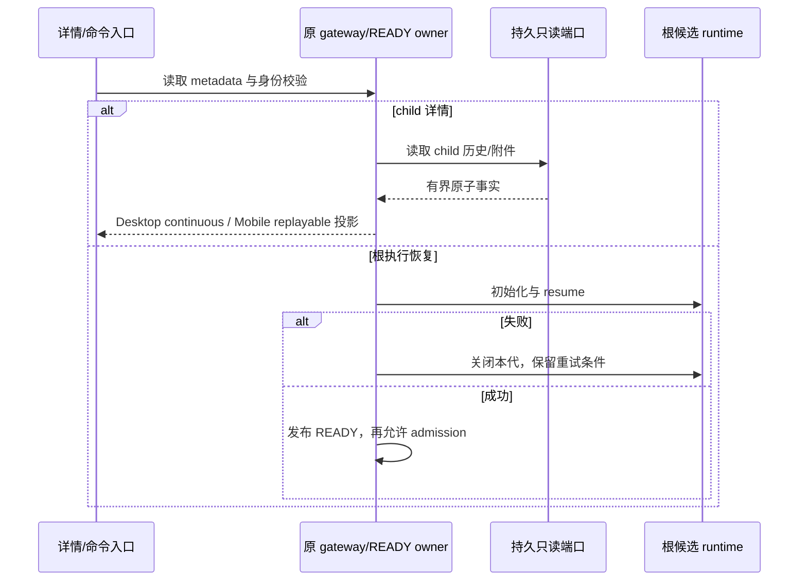

# 子会话历史读取与恢复所有权

## 产品规则

打开 live/cold subagent_child 或 workflow_child 详情只重建投影，不创建 app/runtime、Browser scope、模型请求或 workflow run。publisher 和历史 metadata 不代表执行权限。根交互会话经原 READY 单飞恢复，候选未就绪时不能接受执行命令。

两类 child 的通用 prompt、排队和续目标入口均只读，在 ledger/输入历史/admission 之前拒绝。workflow supplement、retry、revision、独立 actor continuation 仍通过原 workflow owner。读取附件、文件摘要、预览和已授权回溯保留原入口。

## 所有者与接口

- context.sessions 只发布成功 READY 的可执行根 record；恢复候选由原 flight 持有。失败撤销本代订阅并关闭候选，不覆盖首次异常，不删除并发新代与持久历史。
- context 的 root resume flight 只协调未完成的物化 Promise，成功/失败后清除；与 projection READY 水位分工，不缓存另一份可执行 record。legacy resume 与 V4 共用这个入口，不能并发创建两份同 ID app。
- ProtocolRuntimeResources 保留关闭失败的 app，失败关闭可重试；为同 ID 再构造前先完成该失败资源的清理。只有关闭成功才从资源 owner 删除，不在 finally 无条件删除。该条覆盖本轮实施中新复现的 BR09 关闭句柄丢失。
- child projection 经既有 transcript/entries/journal 三源 merge、sourceEventSeq 和 hydration buffer 形成；不增加第二条历史写入路径。
- 只读 reader 组合现有 SessionStorePort、ToolArtifactStorePort、FileSystemPort/checkpoint；可以借 parent 能力，但读取目标始终是 childSessionId。parent 不活跃时持久读取仍有效，读取失败不能伪装空历史。
- workspaceIdentity 与 remoteSessionId 贯穿校验，不按路径或 session ID 前缀推断权限。模型统计来自 child 的持久绑定/事件，未知保持未知，不为展示绑定模型。

## 验收

1. live/cold child 订阅、重载、重连不新增可执行 record/scope 或模型请求；旧 turn 始终被拒绝。
2. parent active/inactive 均能读取 child 的历史、附件、artifact、文件摘要；message/ref 与 checkpoint 不借错 parent。
3. 根 resume 失败不留下半初始化 record；第二次真实 resume；并发订阅/命令同一 flight，迟到失败不删除新代。
4. 两类 child 的通用执行入口在接受前拒绝；专用 workflow 控制和授权文件回溯继续有效，拒绝保留未提交草稿/附件。
5. continuous 与 replayable 同一事实，不重复提交已接受 busy/running 输入，不添加旧 strict reader 不认识的 wire 字段。

## 迁移与验证

无数据库迁移，不热修改正在运行的 workflow，不把诊断“缺陷复现通过”当作修复验收。正式结果与未验证范围在执行后记录。
